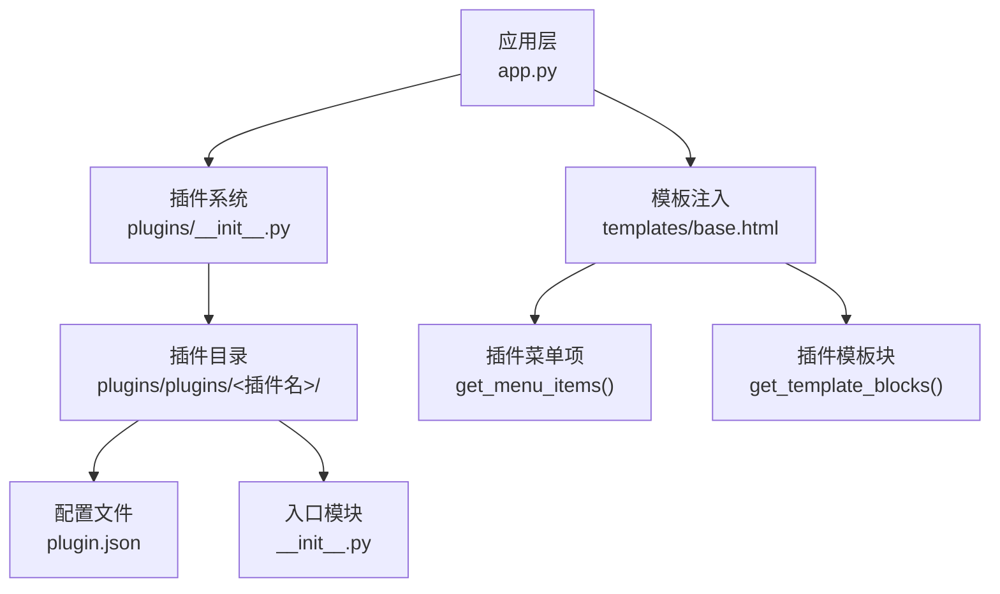
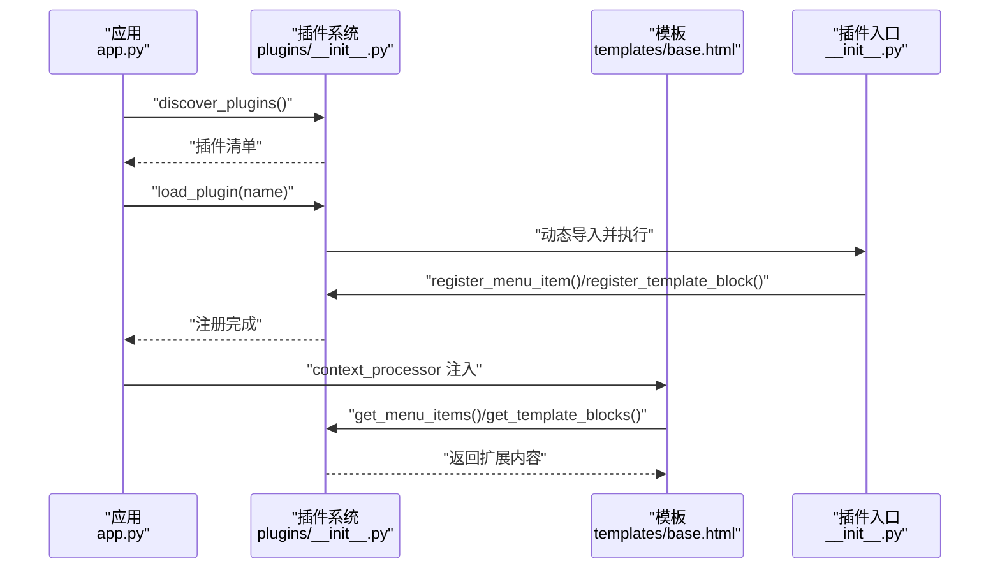
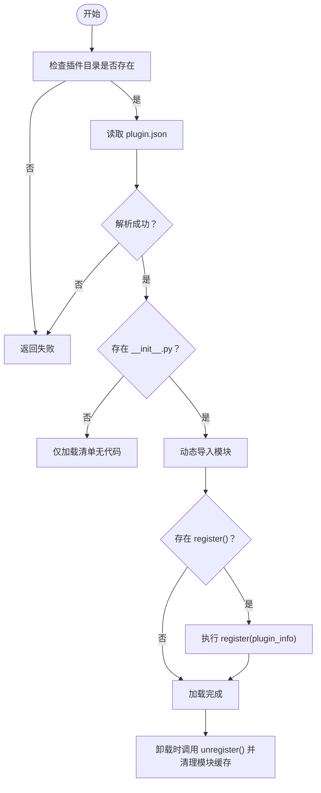

# 插件开发指南

<cite>
**本文档引用的文件**
- [plugins/__init__.py](file://plugins/__init__.py)
- [plugins/plugins/sample_hello/plugin.json](file://plugins/plugins/sample_hello/plugin.json)
- [plugins/plugins/sample_hello/__init__.py](file://plugins/plugins/sample_hello/__init__.py)
- [plugins/plugins/lang_ja/plugin.json](file://plugins/plugins/lang_ja/plugin.json)
- [plugins/plugins/lang_ko/plugin.json](file://plugins/plugins/lang_ko/plugin.json)
- [plugins/plugins/lang_ja/__init__.py](file://plugins/plugins/lang_ja/__init__.py)
- [plugins/plugins/lang_ko/__init__.py](file://plugins/plugins/lang_ko/__init__.py)
- [app.py](file://app.py)
- [templates/base.html](file://templates/base.html)
- [i18n/__init__.py](file://i18n/__init__.py)
</cite>

## 目录
1. [简介](#简介)
2. [项目结构](#项目结构)
3. [核心组件](#核心组件)
4. [架构总览](#架构总览)
5. [详细组件分析](#详细组件分析)
6. [依赖分析](#依赖分析)
7. [性能考虑](#性能考虑)
8. [故障排查指南](#故障排查指南)
9. [结论](#结论)
10. [附录](#附录)

## 简介
本指南面向希望在 School_Web 平台上开发插件的开发者，覆盖从插件目录创建、配置文件编写、模块实现，到菜单注册、模板注入、权限控制、国际化扩展、调试与最佳实践的完整流程。文档以仓库中的实际插件为范例，帮助你快速上手并构建高质量的可维护插件。

## 项目结构
插件系统位于 plugins/ 目录，采用“按插件独立目录”的组织方式，每个插件包含：
- plugin.json：插件元数据与配置
- __init__.py：插件逻辑入口，负责注册菜单项与模板块
- 可选资源：如语言包等

应用层通过 app.py 中的上下文处理器将插件菜单与模板块注入到模板中，实现运行时扩展。

图表来源
- [plugins/__init__.py:11-249](file://plugins/__init__.py#L11-L249)
- [app.py:181-194](file://app.py#L181-L194)
- [templates/base.html:220-230](file://templates/base.html#L220-L230)

章节来源
- [plugins/__init__.py:11-249](file://plugins/__init__.py#L11-L249)
- [app.py:181-194](file://app.py#L181-L194)
- [templates/base.html:220-230](file://templates/base.html#L220-L230)

## 核心组件
- 插件发现与加载器：扫描 plugins/plugins/ 目录，读取 plugin.json，动态导入 __init__.py，并调用 register()/unregister()。
- 插件钩子注册表：维护菜单项、模板块、静态路由、API 路由等扩展点。
- 应用注入：通过上下文处理器将插件菜单与模板块注入模板，实现运行时扩展。

章节来源
- [plugins/__init__.py:25-135](file://plugins/__init__.py#L25-L135)
- [app.py:181-194](file://app.py#L181-L194)

## 架构总览
下图展示了插件系统在应用启动与渲染阶段的关键交互：

图表来源
- [plugins/__init__.py:25-135](file://plugins/__init__.py#L25-L135)
- [app.py:181-194](file://app.py#L181-L194)
- [templates/base.html:220-230](file://templates/base.html#L220-L230)

## 详细组件分析

### 插件配置文件 plugin.json 规范
- 字段说明
  - name：插件显示名称（字符串）
  - version：版本号（字符串，语义化版本推荐）
  - description：简要描述（字符串）
  - author：作者（字符串）
  - license：许可证（字符串）
  - type：类型（如 language 表示语言包）
  - icon、display_name、uploader、created_at：市场相关字段（部分插件市场使用）
- 规范与示例
  - 必填字段：name、version、author、license
  - 建议字段：description、type
  - 示例参考：
    - [plugins/plugins/sample_hello/plugin.json:1-7](file://plugins/plugins/sample_hello/plugin.json#L1-L7)
    - [plugins/plugins/lang_ja/plugin.json:1-10](file://plugins/plugins/lang_ja/plugin.json#L1-L10)
    - [plugins/plugins/lang_ko/plugin.json:1-10](file://plugins/plugins/lang_ko/plugin.json#L1-L10)

章节来源
- [plugins/plugins/sample_hello/plugin.json:1-7](file://plugins/plugins/sample_hello/plugin.json#L1-L7)
- [plugins/plugins/lang_ja/plugin.json:1-10](file://plugins/plugins/lang_ja/plugin.json#L1-L10)
- [plugins/plugins/lang_ko/plugin.json:1-10](file://plugins/plugins/lang_ko/plugin.json#L1-L10)

### 插件入口模块 __init__.py 标准结构
- 必备导出
  - register(plugin_info)：插件加载时调用，用于注册菜单项与模板块
  - unregister()：插件卸载时调用，用于清理资源
- 常见职责
  - 调用 plugins.register_menu_item()/register_template_block() 注册扩展点
  - 访问插件元数据：通过 plugin_info.manifest 获取配置
- 示例参考
  - [plugins/plugins/sample_hello/__init__.py:1-32](file://plugins/plugins/sample_hello/__init__.py#L1-L32)
  - [plugins/plugins/lang_ja/__init__.py:1-98](file://plugins/plugins/lang_ja/__init__.py#L1-L98)
  - [plugins/plugins/lang_ko/__init__.py:1-89](file://plugins/plugins/lang_ko/__init__.py#L1-L89)

章节来源
- [plugins/plugins/sample_hello/__init__.py:1-32](file://plugins/plugins/sample_hello/__init__.py#L1-L32)
- [plugins/plugins/lang_ja/__init__.py:18-44](file://plugins/plugins/lang_ja/__init__.py#L18-L44)
- [plugins/plugins/lang_ko/__init__.py:17-41](file://plugins/plugins/lang_ko/__init__.py#L17-L41)

### 插件菜单项注册流程
- 注册接口
  - register_menu_item(plugin_name, item)
  - item 字段：label、url、icon、permission、order
- 权限控制
  - permission 支持 guest、user、vip、administrator
  - get_menu_items(user_permission) 会根据权限过滤并排序
- 示例参考
  - [plugins/plugins/sample_hello/__init__.py:11-18](file://plugins/plugins/sample_hello/__init__.py#L11-L18)
  - [plugins/__init__.py:143-164](file://plugins/__init__.py#L143-L164)

章节来源
- [plugins/plugins/sample_hello/__init__.py:11-18](file://plugins/plugins/sample_hello/__init__.py#L11-L18)
- [plugins/__init__.py:143-164](file://plugins/__init__.py#L143-L164)

### 插件模板注入流程
- 注册接口
  - register_template_block(plugin_name, block)
  - block 字段：name、template、position、order
  - position 支持 nav、footer、head 等
- 渲染注入
  - app.py 的 context_processor 将插件模板块注入模板
  - 模板中通过 plugin_footer_blocks/plugin_head_blocks 使用
- 示例参考
  - [plugins/plugins/sample_hello/__init__.py:20-26](file://plugins/plugins/sample_hello/__init__.py#L20-L26)
  - [plugins/__init__.py:167-184](file://plugins/__init__.py#L167-L184)
  - [templates/base.html:220-230](file://templates/base.html#L220-L230)

章节来源
- [plugins/plugins/sample_hello/__init__.py:20-26](file://plugins/plugins/sample_hello/__init__.py#L20-L26)
- [plugins/__init__.py:167-184](file://plugins/__init__.py#L167-L184)
- [templates/base.html:220-230](file://templates/base.html#L220-L230)

### 插件国际化扩展（语言包插件）
- 语言包插件职责
  - 自动确保翻译文件存在（必要时生成或复制）
  - 将新增语言加入 SUPPORTED_LANGS
  - 在模板 head 中注入必要的标记（可选）
- 示例参考
  - [plugins/plugins/lang_ja/__init__.py:18-98](file://plugins/plugins/lang_ja/__init__.py#L18-L98)
  - [plugins/plugins/lang_ko/__init__.py:17-89](file://plugins/plugins/lang_ko/__init__.py#L17-L89)
  - [i18n/__init__.py:1-113](file://i18n/__init__.py#L1-L113)

章节来源
- [plugins/plugins/lang_ja/__init__.py:18-98](file://plugins/plugins/lang_ja/__init__.py#L18-L98)
- [plugins/plugins/lang_ko/__init__.py:17-89](file://plugins/plugins/lang_ko/__init__.py#L17-L89)
- [i18n/__init__.py:1-113](file://i18n/__init__.py#L1-L113)

### 插件加载与卸载流程

图表来源
- [plugins/__init__.py:60-135](file://plugins/__init__.py#L60-L135)

章节来源
- [plugins/__init__.py:60-135](file://plugins/__init__.py#L60-L135)

## 依赖分析
- 插件系统依赖
  - Python 标准库：os、json、importlib、sys、traceback
  - 应用层：app.py 通过 context_processor 注入插件扩展
- 模块耦合
  - 插件入口模块通过 plugins.register_* 接口与插件系统解耦
  - 模板通过上下文变量消费插件扩展，避免直接耦合具体插件
- 外部依赖
  - Flask 上下文与模板系统
  - i18n 模块提供的语言能力

章节来源
- [plugins/__init__.py:5-11](file://plugins/__init__.py#L5-L11)
- [app.py:181-194](file://app.py#L181-L194)
- [i18n/__init__.py:1-113](file://i18n/__init__.py#L1-L113)

## 性能考虑
- 动态导入与模块缓存
  - 插件系统使用 importlib.util.spec_from_file_location 动态导入，避免全局污染
  - 卸载时清理 sys.modules，防止模块残留
- 权限过滤与排序
  - get_menu_items() 在服务端按权限过滤与排序，减少前端负担
- 模板块注入
  - 模板块按 order 排序，避免复杂计算开销
- 建议
  - 控制插件数量与模板块大小，避免过度注入
  - 将耗时任务放入异步或后台队列（如需）

章节来源
- [plugins/__init__.py:88-135](file://plugins/__init__.py#L88-L135)
- [plugins/__init__.py:154-164](file://plugins/__init__.py#L154-L164)
- [plugins/__init__.py:178-184](file://plugins/__init__.py#L178-L184)

## 故障排查指南
- 常见问题与定位
  - plugin.json 不存在或格式错误：加载失败，返回错误信息
  - __init__.py 缺失：仅加载清单，无法注册扩展
  - register()/unregister() 抛异常：系统捕获并记录，不影响其他插件
  - 权限不足导致菜单不可见：确认用户权限与 item.permission 设置
  - 模板块未生效：确认 position 与模板注入点一致
- 调试技巧
  - 查看应用日志：Flask current_app.logger 输出
  - 使用浏览器开发者工具检查网络请求与响应
  - 在插件入口中添加最小化日志输出，验证生命周期回调
- 相关实现参考
  - [plugins/__init__.py:75-109](file://plugins/__init__.py#L75-L109)
  - [plugins/plugins/lang_ja/__init__.py:30-43](file://plugins/plugins/lang_ja/__init__.py#L30-L43)
  - [plugins/plugins/lang_ko/__init__.py:28-41](file://plugins/plugins/lang_ko/__init__.py#L28-L41)

章节来源
- [plugins/__init__.py:75-109](file://plugins/__init__.py#L75-L109)
- [plugins/plugins/lang_ja/__init__.py:30-43](file://plugins/plugins/lang_ja/__init__.py#L30-L43)
- [plugins/plugins/lang_ko/__init__.py:28-41](file://plugins/plugins/lang_ko/__init__.py#L28-L41)

## 结论
通过本指南，你可以基于插件系统完成从配置到实现、从注册到注入的全流程开发。遵循规范的 plugin.json 字段、标准的 __init__.py 结构、合理的权限与模板注入策略，以及良好的调试与性能实践，将帮助你构建稳定、可维护且易于扩展的插件。

## 附录

### 最佳实践清单
- 命名规范
  - 插件目录名使用小写与下划线组合，避免空格
  - 插件内部常量 PLUGIN_NAME 与目录名保持一致
- 错误处理
  - 在 register()/unregister() 中捕获并记录异常，避免影响主流程
- 性能优化
  - 控制模板块数量与体积，避免阻塞页面渲染
  - 将重任务异步化
- 国际化
  - 语言包插件应自动补齐翻译文件并加入 SUPPORTED_LANGS

### 实战示例：sample_hello 插件
- 目录与文件
  - plugins/plugins/sample_hello/plugin.json：定义基础元数据
  - plugins/plugins/sample_hello/__init__.py：注册菜单项与底部模板块
- 关键步骤
  - 在 register() 中调用 register_menu_item() 与 register_template_block()
  - 在 unregister() 中预留清理逻辑
- 参考路径
  - [plugins/plugins/sample_hello/plugin.json:1-7](file://plugins/plugins/sample_hello/plugin.json#L1-L7)
  - [plugins/plugins/sample_hello/__init__.py:1-32](file://plugins/plugins/sample_hello/__init__.py#L1-L32)

章节来源
- [plugins/plugins/sample_hello/plugin.json:1-7](file://plugins/plugins/sample_hello/plugin.json#L1-L7)
- [plugins/plugins/sample_hello/__init__.py:1-32](file://plugins/plugins/sample_hello/__init__.py#L1-L32)