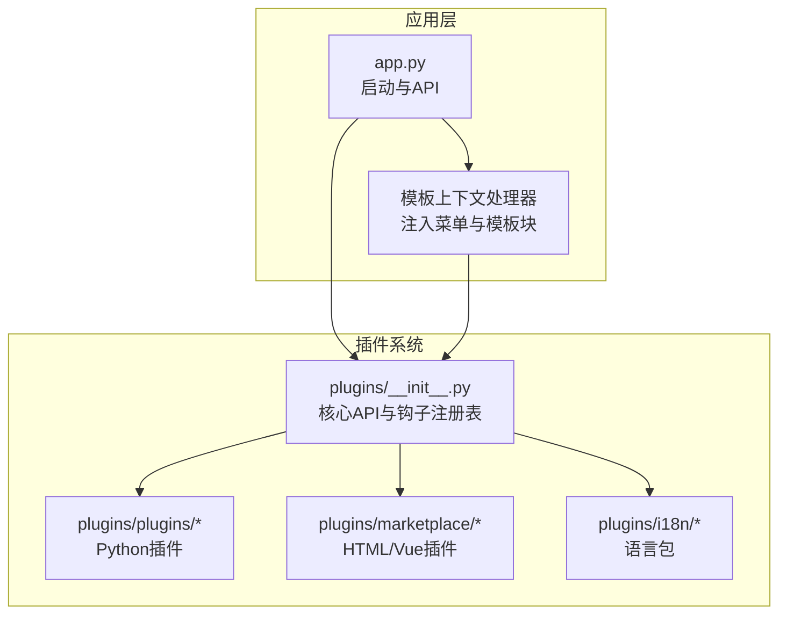
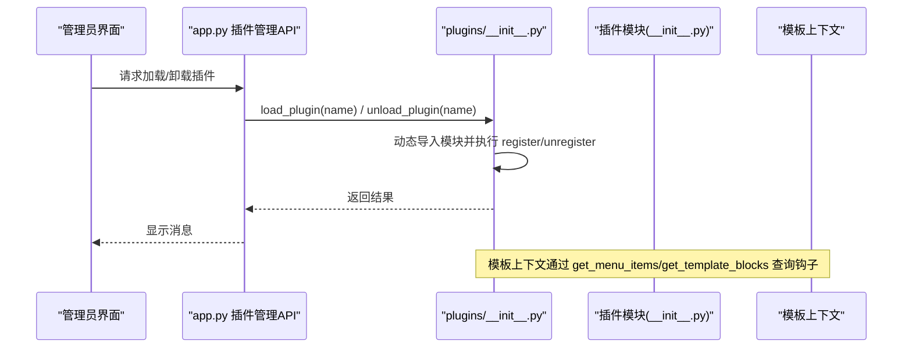
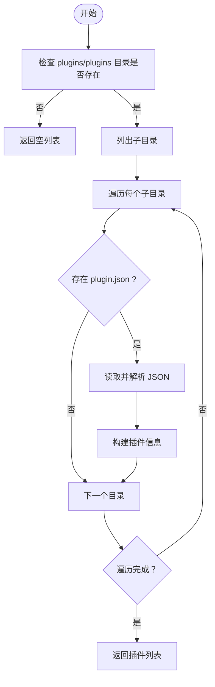
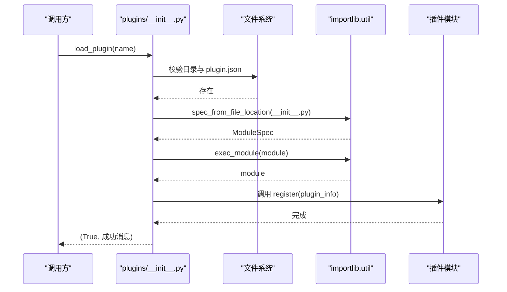
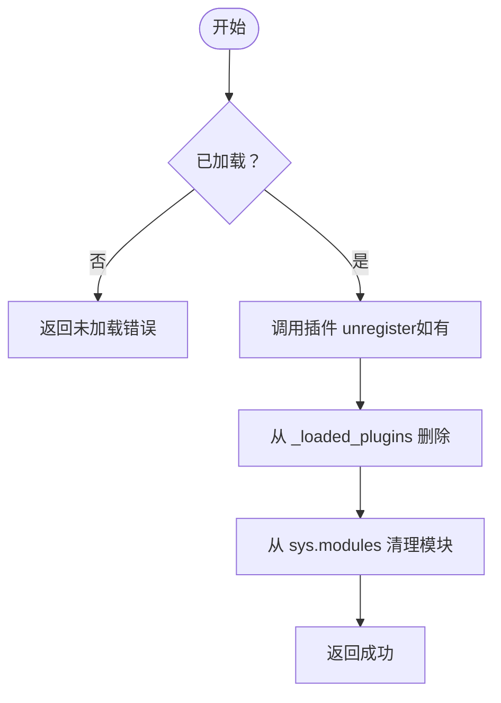
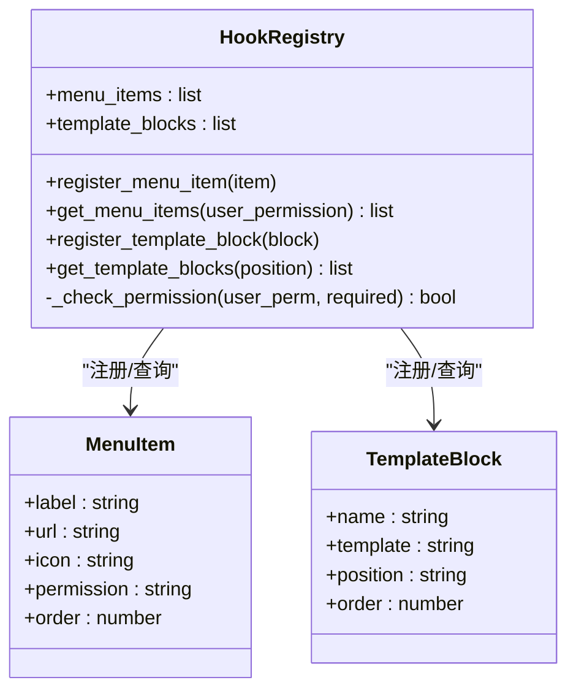
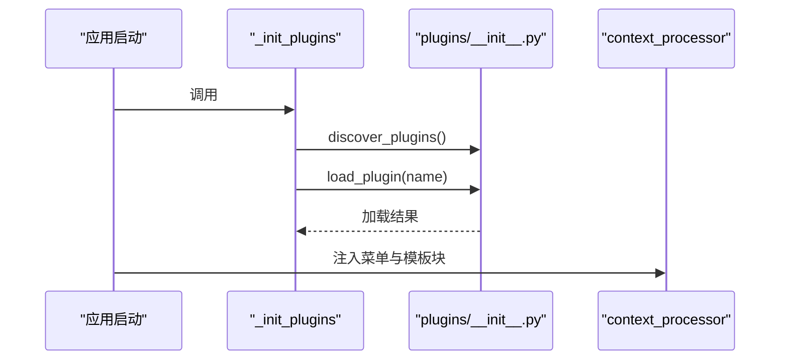
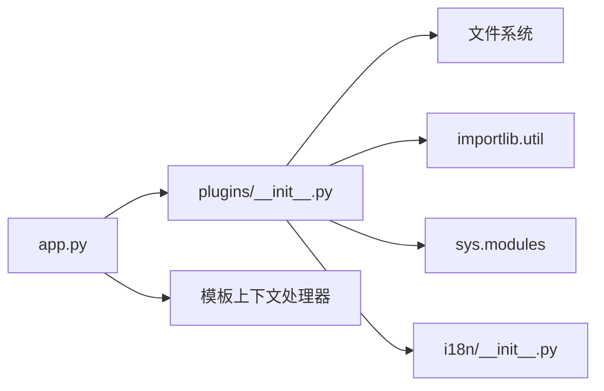

# 插件架构设计

<cite>
**本文档引用的文件**
- [plugins/__init__.py](file://plugins/__init__.py)
- [plugins/plugins/sample_hello/__init__.py](file://plugins/plugins/sample_hello/__init__.py)
- [plugins/plugins/sample_hello/plugin.json](file://plugins/plugins/sample_hello/plugin.json)
- [plugins/plugins/lang_ja/__init__.py](file://plugins/plugins/lang_ja/__init__.py)
- [plugins/plugins/lang_ja/plugin.json](file://plugins/plugins/lang_ja/plugin.json)
- [plugins/plugins/lang_ko/__init__.py](file://plugins/plugins/lang_ko/__init__.py)
- [plugins/plugins/lang_ko/plugin.json](file://plugins/plugins/lang_ko/plugin.json)
- [plugins/marketplace/markdown-editor/plugin.json](file://plugins/marketplace/markdown-editor/plugin.json)
- [plugins/marketplace/markdown-editor/index.html](file://plugins/marketplace/markdown-editor/index.html)
- [app.py](file://app.py)
- [i18n/__init__.py](file://i18n/__init__.py)
</cite>

## 目录
1. [简介](#简介)
2. [项目结构](#项目结构)
3. [核心组件](#核心组件)
4. [架构总览](#架构总览)
5. [详细组件分析](#详细组件分析)
6. [依赖分析](#依赖分析)
7. [性能考虑](#性能考虑)
8. [故障排查指南](#故障排查指南)
9. [结论](#结论)
10. [附录](#附录)

## 简介
本文件系统性阐述 School_Web 的插件架构设计与实现细节，覆盖插件发现机制、动态加载与卸载流程、生命周期管理、目录结构规范、配置文件格式、注册表与钩子系统、以及关键 API 的使用方式与最佳实践。通过结合实际源码与可视化图示，帮助开发者快速理解并扩展插件体系。

## 项目结构
插件系统位于 plugins 目录，采用“按功能分组”的组织方式：
- plugins/plugins：Python 插件（含 __init__.py 与 plugin.json）
- plugins/marketplace：市场插件（HTML/Vue 等前端插件，带 plugin.json 与入口文件）
- plugins/i18n：国际化资源（语言包）
- plugins/__init__.py：插件系统核心，负责发现、加载、卸载、钩子注册与查询

应用层 app.py 在启动时初始化插件，并通过 API 对外提供插件管理能力。

图表来源
- [plugins/__init__.py:1-249](file://plugins/__init__.py#L1-L249)
- [app.py:117-194](file://app.py#L117-L194)

章节来源
- [plugins/__init__.py:11-249](file://plugins/__init__.py#L11-L249)
- [app.py:117-194](file://app.py#L117-L194)

## 核心组件
- 插件发现与注册表
  - discover_plugins：扫描 plugins/plugins 目录，收集可用插件清单
  - 注册表 _plugin_hooks：维护 menu_items、template_blocks 等钩子
- 动态加载与卸载
  - load_plugin：动态导入 __init__.py，执行插件 register
  - unload_plugin：调用插件 unregister，清理 sys.modules
- 钩子 API
  - register_menu_item / get_menu_items：菜单项注册与查询
  - register_template_block / get_template_blocks：模板注入块注册与查询
- 示例与市场插件
  - sample_hello：演示型 Python 插件
  - markdown-editor：HTML 市场插件，带 plugin.json 与入口页面

章节来源
- [plugins/__init__.py:25-136](file://plugins/__init__.py#L25-L136)
- [plugins/__init__.py:143-193](file://plugins/__init__.py#L143-L193)
- [plugins/plugins/sample_hello/__init__.py:1-32](file://plugins/plugins/sample_hello/__init__.py#L1-L32)
- [plugins/marketplace/markdown-editor/plugin.json:1-10](file://plugins/marketplace/markdown-editor/plugin.json#L1-L10)

## 架构总览
插件系统围绕“发现—加载—注册—查询—卸载”闭环工作，应用层通过 API 与模板上下文处理器与之交互。

图表来源
- [app.py:5199-5252](file://app.py#L5199-L5252)
- [plugins/__init__.py:60-136](file://plugins/__init__.py#L60-L136)

## 详细组件分析

### 插件发现机制（discover_plugins）
- 扫描规则：遍历 plugins/plugins 下的子目录，要求同时存在 plugin.json 与 __init__.py（或仅有 plugin.json）
- 输出字段：name、dir、manifest、has_init、loaded
- 用途：用于 UI 展示与后续加载/卸载决策

图表来源
- [plugins/__init__.py:25-57](file://plugins/__init__.py#L25-L57)

章节来源
- [plugins/__init__.py:25-57](file://plugins/__init__.py#L25-L57)

### 动态加载流程（load_plugin）
- 幂等性：若已加载则直接返回成功
- 校验：目录存在、plugin.json 存在
- 动态导入：使用 importlib.util.spec_from_file_location 从 __init__.py 创建模块
- 生命周期：调用插件的 register(plugin_info)（如存在）
- 返回值：(success, message)

图表来源
- [plugins/__init__.py:60-110](file://plugins/__init__.py#L60-L110)

章节来源
- [plugins/__init__.py:60-110](file://plugins/__init__.py#L60-L110)

### 卸载与资源清理（unload_plugin）
- 调用插件 unregister（如存在）
- 从 _loaded_plugins 移除条目
- 从 sys.modules 清理模块缓存
- 返回值：(success, message)

图表来源
- [plugins/__init__.py:112-136](file://plugins/__init__.py#L112-L136)

章节来源
- [plugins/__init__.py:112-136](file://plugins/__init__.py#L112-L136)

### 钩子系统与注册表
- 注册表结构：_plugin_hooks 以钩子类型为键，存储条目列表
- 当前钩子类型：menu_items、template_blocks
- 注册与查询：
  - register_menu_item / get_menu_items：菜单项注册与按权限排序输出
  - register_template_block / get_template_blocks：模板块注册与按位置与顺序排序输出
- 权限控制：基于用户权限与条目所需权限进行过滤

图表来源
- [plugins/__init__.py:16-22](file://plugins/__init__.py#L16-L22)
- [plugins/__init__.py:143-193](file://plugins/__init__.py#L143-L193)

章节来源
- [plugins/__init__.py:16-22](file://plugins/__init__.py#L16-L22)
- [plugins/__init__.py:143-193](file://plugins/__init__.py#L143-L193)

### 插件目录结构规范与配置文件
- Python 插件（plugins/plugins/*）
  - 必需：plugin.json、__init__.py（可选，仅声明也可）
  - 示例：sample_hello、lang_ja、lang_ko
- 市场插件（plugins/marketplace/*）
  - 必需：plugin.json、入口文件（如 index.html 或 Vue 包装器）
  - 示例：markdown-editor

插件配置文件字段说明（示例）
- Python 插件（示例字段）：name、version、description、author、license、type（可选）
- 市场插件（示例字段）：plugin_name/display_name、description、version、author、file_type、icon

章节来源
- [plugins/plugins/sample_hello/plugin.json:1-7](file://plugins/plugins/sample_hello/plugin.json#L1-L7)
- [plugins/plugins/lang_ja/plugin.json:1-10](file://plugins/plugins/lang_ja/plugin.json#L1-L10)
- [plugins/plugins/lang_ko/plugin.json:1-10](file://plugins/plugins/lang_ko/plugin.json#L1-L10)
- [plugins/marketplace/markdown-editor/plugin.json:1-10](file://plugins/marketplace/markdown-editor/plugin.json#L1-L10)

### 插件模块结构（__init__.py）
- 必备：register(plugin_info)（可选：unregister()）
- 常见职责：向钩子系统注册菜单项与模板块
- 示例：sample_hello 展示了菜单项与页脚模板块的注册；lang_ja/lang_ko 展示了语言包的生成与注册

章节来源
- [plugins/plugins/sample_hello/__init__.py:1-32](file://plugins/plugins/sample_hello/__init__.py#L1-L32)
- [plugins/plugins/lang_ja/__init__.py:18-44](file://plugins/plugins/lang_ja/__init__.py#L18-L44)
- [plugins/plugins/lang_ko/__init__.py:17-41](file://plugins/plugins/lang_ko/__init__.py#L17-L41)

### 应用集成与生命周期
- 启动时自动加载：_init_plugins 会遍历发现的插件并尝试加载
- 模板上下文：通过 context_processor 注入菜单项与模板块
- 管理 API：提供插件列表、加载、卸载、批量重载等接口

图表来源
- [app.py:5877-5884](file://app.py#L5877-L5884)
- [app.py:181-194](file://app.py#L181-L194)
- [plugins/__init__.py:138-140](file://plugins/__init__.py#L138-L140)

章节来源
- [app.py:5877-5884](file://app.py#L5877-L5884)
- [app.py:181-194](file://app.py#L181-L194)

## 依赖分析
- 插件系统核心依赖
  - 文件系统：扫描目录、读取 plugin.json、定位 __init__.py
  - importlib.util：动态导入模块
  - sys.modules：模块缓存与清理
- 应用层依赖
  - app.py 导入 plugins 并在启动时初始化，通过 API 提供管理能力
  - 模板上下文处理器注入菜单与模板块
- 国际化依赖
  - i18n 模块提供语言列表与翻译函数，插件可扩展 SUPPORTED_LANGS

图表来源
- [plugins/__init__.py:5-11](file://plugins/__init__.py#L5-L11)
- [app.py:117-117](file://app.py#L117-L117)
- [i18n/__init__.py:1-13](file://i18n/__init__.py#L1-L13)

章节来源
- [plugins/__init__.py:5-11](file://plugins/__init__.py#L5-L11)
- [app.py:117-117](file://app.py#L117-L117)
- [i18n/__init__.py:1-13](file://i18n/__init__.py#L1-L13)

## 性能考虑
- 发现阶段：目录扫描与 JSON 解析为 O(N) 与常数开销，建议避免在高频路径重复扫描
- 动态导入：importlib.util.exec_module 为一次性开销，模块缓存于 sys.modules，重复加载成本低
- 钩子查询：列表遍历与排序为 O(K log K)，K 为钩子数量，建议在高并发场景下缓存查询结果
- 市场插件：HTML/Vue 插件通过静态路由提供，注意文件大小与安全校验

## 故障排查指南
- 加载失败
  - 检查 plugin.json 是否存在且可解析
  - 确认 __init__.py 是否存在或是否为纯清单插件
  - 查看异常堆栈与返回消息
- 卸载失败
  - 确认插件是否已加载
  - 检查插件 unregister 是否抛出异常
- 权限问题
  - 菜单项按权限过滤，确认用户权限级别与条目所需权限匹配
- 国际化问题
  - 语言包缺失时插件会自动生成基础文件，检查 i18n 目录权限与写入权限

章节来源
- [plugins/__init__.py:75-109](file://plugins/__init__.py#L75-L109)
- [plugins/__init__.py:116-135](file://plugins/__init__.py#L116-L135)
- [plugins/__init__.py:187-193](file://plugins/__init__.py#L187-L193)

## 结论
该插件架构以简洁的目录规范与 JSON 清单为核心，结合动态导入与钩子注册表，实现了可扩展、可管理的插件生态。通过应用层 API 与模板上下文的集成，插件可在运行时灵活加载与卸载，并对外提供一致的菜单与模板扩展能力。建议在生产环境中加强安全校验与错误处理，确保插件上传与加载的稳定性与安全性。

## 附录

### 关键 API 一览
- discover_plugins：扫描并返回可用插件列表
- load_plugin(name)：加载指定插件，返回 (success, message)
- unload_plugin(name)：卸载指定插件，返回 (success, message)
- get_loaded_plugins：返回已加载插件名称列表
- register_menu_item / get_menu_items：菜单项注册与查询
- register_template_block / get_template_blocks：模板块注册与查询

章节来源
- [plugins/__init__.py:25-136](file://plugins/__init__.py#L25-L136)
- [plugins/__init__.py:138-193](file://plugins/__init__.py#L138-L193)

### 市场插件上传与沙箱渲染
- 管理员可通过 API 上传 HTML/Vue 插件，系统生成 plugin.json 并写入磁盘
- Vue 插件会生成包装 HTML 以便沙箱渲染
- 上传时进行大小限制与模板语法安全检查

章节来源
- [app.py:5261-5389](file://app.py#L5261-L5389)