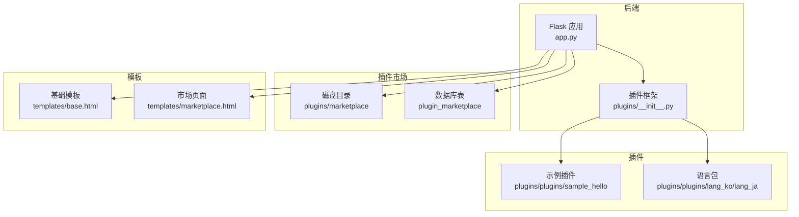
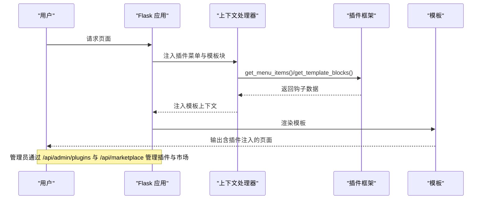
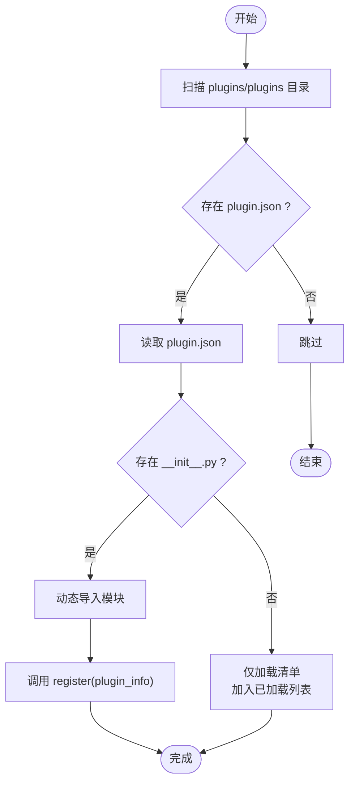
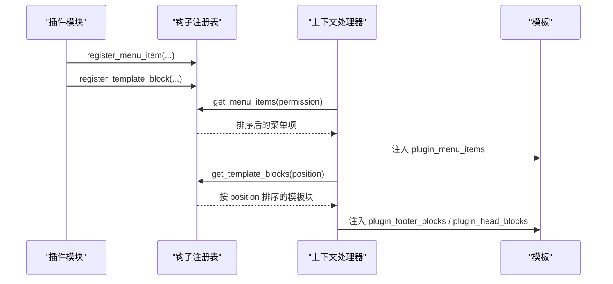
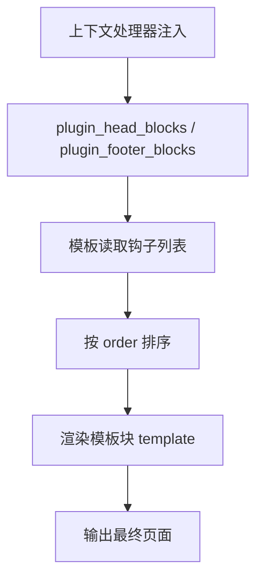
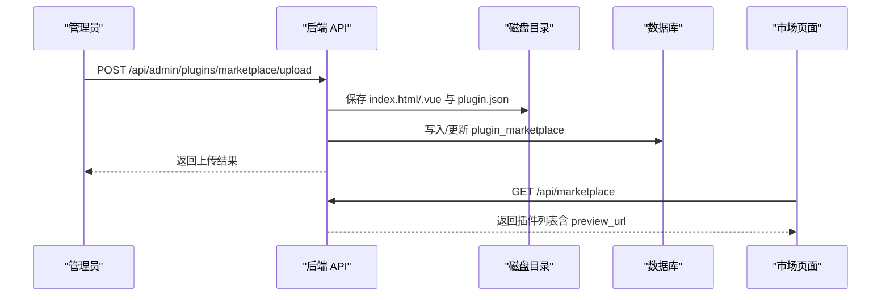
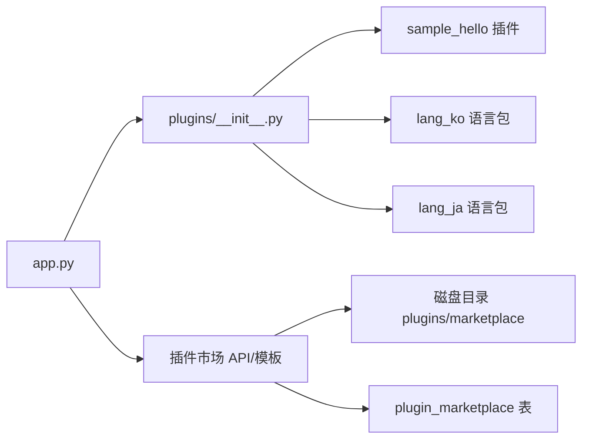

# 插件系统详解

<cite>
**本文档引用的文件**
- [app.py](file://app.py)
- [plugins/__init__.py](file://plugins/__init__.py)
- [plugins/plugins/sample_hello/__init__.py](file://plugins/plugins/sample_hello/__init__.py)
- [plugins/plugins/sample_hello/plugin.json](file://plugins/plugins/sample_hello/plugin.json)
- [plugins/plugins/lang_ko/plugin.json](file://plugins/plugins/lang_ko/plugin.json)
- [plugins/plugins/lang_ja/plugin.json](file://plugins/plugins/lang_ja/plugin.json)
- [plugins/marketplace/markdown-editor/plugin.json](file://plugins/marketplace/markdown-editor/plugin.json)
- [plugins/marketplace/markdown-editor/index.html](file://plugins/marketplace/markdown-editor/index.html)
- [templates/base.html](file://templates/base.html)
- [templates/marketplace.html](file://templates/marketplace.html)
- [templates/admin_dashboard.html](file://templates/admin_dashboard.html)
</cite>

## 目录
1. [简介](#简介)
2. [项目结构](#项目结构)
3. [核心组件](#核心组件)
4. [架构总览](#架构总览)
5. [组件详细分析](#组件详细分析)
6. [依赖关系分析](#依赖关系分析)
7. [性能考量](#性能考量)
8. [故障排查指南](#故障排查指南)
9. [结论](#结论)
10. [附录](#附录)

## 简介
本文件面向开发者与运维人员，系统性阐述该学校网站项目的插件系统设计与实现，涵盖插件发现机制、动态加载与卸载流程、生命周期管理、钩子系统（菜单注入、模板注入）、插件市场管理（上传、审核与版本管理）、开发规范与最佳实践，并给出安全与性能影响评估。

## 项目结构
插件系统主要由以下部分组成：
- 后端核心：Flask 应用在全局上下文中注入插件菜单与模板块，并提供插件管理与市场 API。
- 插件框架：位于 plugins 包中，负责插件发现、动态加载/卸载、钩子注册与查询。
- 插件样例与语言包：示例插件与多语言语言包，演示菜单与模板注入。
- 插件市场：HTML/Vue 插件的存储与沙箱渲染，提供前端浏览与管理员上传能力。
- 模板层：基础模板注入插件 footer 块，市场页面消费插件市场数据。

**图表来源**
- [app.py:178-197](file://app.py#L178-L197)
- [plugins/__init__.py:1-249](file://plugins/__init__.py#L1-L249)
- [templates/base.html:220-223](file://templates/base.html#L220-L223)
- [templates/marketplace.html:1-143](file://templates/marketplace.html#L1-L143)

**章节来源**
- [app.py:178-197](file://app.py#L178-L197)
- [plugins/__init__.py:1-249](file://plugins/__init__.py#L1-L249)
- [templates/base.html:220-223](file://templates/base.html#L220-L223)
- [templates/marketplace.html:1-143](file://templates/marketplace.html#L1-L143)

## 核心组件
- 插件发现与加载器：扫描 plugins/plugins 下的插件目录，读取 plugin.json 并按需动态导入 __init__.py，调用插件的 register/unregister 生命周期钩子。
- 钩子注册表：维护 menu_items、template_blocks 等钩子，供模板层与上下文处理器消费。
- 插件市场：管理员上传 HTML/Vue 插件，写入磁盘目录与数据库；提供公开浏览与沙箱渲染。
- 模板注入：在基础模板 footer 注入插件块，在市场页消费插件市场数据。

**章节来源**
- [plugins/__init__.py:25-136](file://plugins/__init__.py#L25-L136)
- [plugins/__init__.py:143-193](file://plugins/__init__.py#L143-L193)
- [app.py:5201-5256](file://app.py#L5201-L5256)
- [app.py:5263-5395](file://app.py#L5263-L5395)
- [app.py:5817-5877](file://app.py#L5817-L5877)
- [templates/base.html:220-223](file://templates/base.html#L220-L223)

## 架构总览
下图展示了插件系统在请求生命周期中的交互路径：上下文处理器收集菜单与模板块，模板渲染注入；管理员通过 API 管理插件与市场；市场页面通过公开 API 获取插件列表。

**图表来源**
- [app.py:178-197](file://app.py#L178-L197)
- [plugins/__init__.py:143-193](file://plugins/__init__.py#L143-L193)
- [templates/base.html:220-223](file://templates/base.html#L220-L223)

## 组件详细分析

### 插件发现与动态加载
- 发现机制：扫描 plugins/plugins 目录，要求每个插件包含 plugin.json 与可选的 __init__.py。
- 动态加载：使用 importlib.spec_from_file_location 动态导入模块，执行模块的 register(plugin_info)。
- 卸载流程：调用模块的 unregister（如存在），清理 _loaded_plugins 与 sys.modules。
- 生命周期：插件通过 register/unregister 与系统交互，注册菜单项与模板块。

**图表来源**
- [plugins/__init__.py:25-110](file://plugins/__init__.py#L25-L110)

**章节来源**
- [plugins/__init__.py:25-136](file://plugins/__init__.py#L25-L136)

### 钩子系统：菜单与模板注入
- 菜单钩子：插件通过 register_menu_item 注册菜单项，包含 label、url、icon、permission、order 等字段；上下文处理器按权限过滤并排序输出。
- 模板钩子：插件通过 register_template_block 注册模板块，包含 name、template、position（如 footer/head）、order；基础模板按 position 读取并注入。
- 权限控制：get_menu_items 内部根据 permission 与用户权限映射进行过滤。

**图表来源**
- [plugins/__init__.py:143-193](file://plugins/__init__.py#L143-L193)
- [app.py:178-197](file://app.py#L178-L197)
- [templates/base.html:220-223](file://templates/base.html#L220-L223)

**章节来源**
- [plugins/__init__.py:143-193](file://plugins/__init__.py#L143-L193)
- [app.py:178-197](file://app.py#L178-L197)
- [templates/base.html:220-223](file://templates/base.html#L220-L223)

### 插件开发规范
- 插件结构
  - 目录命名：plugins/plugins/<插件名>
  - 必备文件：plugin.json、可选 __init__.py
- 配置文件格式（plugin.json）
  - 示例字段：name、version、description、author、license、type（如 language）
  - 市场专用字段：display_name、file_type、icon、uploader（由市场上传流程写入）
- API 接口定义（插件模块）
  - register(plugin_info)：插件加载时调用，用于注册菜单与模板块
  - unregister()：插件卸载时调用（可选）

**章节来源**
- [plugins/plugins/sample_hello/plugin.json:1-7](file://plugins/plugins/sample_hello/plugin.json#L1-L7)
- [plugins/plugins/lang_ko/plugin.json:1-10](file://plugins/plugins/lang_ko/plugin.json#L1-L10)
- [plugins/plugins/lang_ja/plugin.json:1-10](file://plugins/plugins/lang_ja/plugin.json#L1-L10)
- [plugins/plugins/sample_hello/__init__.py:9-31](file://plugins/plugins/sample_hello/__init__.py#L9-L31)

### 模板注入机制
- 头部注入：上下文处理器注入 plugin_head_blocks，模板中可按需消费。
- 底部注入：基础模板循环渲染 plugin_footer_blocks，实现插件脚本或内容块注入。
- 内容替换：通过模板块的 template 字段注入任意 HTML 片段，结合 order 控制渲染顺序。

**图表来源**
- [app.py:178-197](file://app.py#L178-L197)
- [plugins/__init__.py:178-184](file://plugins/__init__.py#L178-L184)
- [templates/base.html:220-223](file://templates/base.html#L220-L223)

**章节来源**
- [app.py:178-197](file://app.py#L178-L197)
- [plugins/__init__.py:178-184](file://plugins/__init__.py#L178-L184)
- [templates/base.html:220-223](file://templates/base.html#L220-L223)

### 插件市场管理
- 存储与渲染
  - 磁盘目录：plugins/marketplace/<唯一目录名>，包含 index.html 或 index.vue 与 plugin.json
  - 数据库表：plugin_marketplace，记录插件元数据与上传者
  - 沙箱渲染：/plugin-market/<id> 与 /plugin-market-raw/<dirname> 提供隔离渲染
- 管理流程
  - 上传：管理员上传 .html/.vue，后端进行安全检查与入库，必要时生成 Vue 包装页
  - 浏览：公开 API 返回插件列表，前端市场页渲染卡片
  - 删除：管理员删除记录与磁盘文件
- 版本管理
  - 通过 plugin.json 的 version 字段标识版本；上传时可更新版本号

**图表来源**
- [app.py:5263-5395](file://app.py#L5263-L5395)
- [app.py:5817-5877](file://app.py#L5817-L5877)
- [plugins/marketplace/markdown-editor/plugin.json:1-10](file://plugins/marketplace/markdown-editor/plugin.json#L1-L10)
- [plugins/marketplace/markdown-editor/index.html:1-486](file://plugins/marketplace/markdown-editor/index.html#L1-L486)
- [templates/marketplace.html:103-141](file://templates/marketplace.html#L103-L141)

**章节来源**
- [app.py:5263-5395](file://app.py#L5263-L5395)
- [app.py:5817-5877](file://app.py#L5817-L5877)
- [templates/marketplace.html:1-143](file://templates/marketplace.html#L1-L143)
- [templates/admin_dashboard.html:403-1317](file://templates/admin_dashboard.html#L403-L1317)

### 开发示例与最佳实践
- 示例插件
  - 注册菜单项与底部模板块，演示插件如何参与导航与页面注入
- 最佳实践
  - 使用清晰的插件目录命名与稳定的 plugin.json 字段
  - 在 register 中集中注册所有钩子，避免副作用
  - 模板块 template 使用安全的 HTML，避免内联脚本与危险属性
  - 对外暴露的 API 严格校验输入，遵循最小权限原则

**章节来源**
- [plugins/plugins/sample_hello/__init__.py:9-31](file://plugins/plugins/sample_hello/__init__.py#L9-L31)
- [plugins/plugins/sample_hello/plugin.json:1-7](file://plugins/plugins/sample_hello/plugin.json#L1-L7)

## 依赖关系分析
- 插件框架依赖于 Flask 上下文处理器与模板系统，通过钩子注册表与 get_* 方法向模板层提供数据。
- 插件市场依赖于磁盘文件系统与数据库，提供上传、查询与沙箱渲染能力。
- 示例插件与语言包作为插件框架的典型用例，验证菜单与模板注入流程。

**图表来源**
- [app.py:178-197](file://app.py#L178-L197)
- [plugins/__init__.py:1-249](file://plugins/__init__.py#L1-L249)
- [plugins/plugins/sample_hello/__init__.py:1-32](file://plugins/plugins/sample_hello/__init__.py#L1-L32)
- [plugins/plugins/lang_ko/plugin.json:1-10](file://plugins/plugins/lang_ko/plugin.json#L1-L10)
- [plugins/plugins/lang_ja/plugin.json:1-10](file://plugins/plugins/lang_ja/plugin.json#L1-L10)

**章节来源**
- [app.py:178-197](file://app.py#L178-L197)
- [plugins/__init__.py:1-249](file://plugins/__init__.py#L1-L249)

## 性能考量
- 插件发现与加载
  - 发现阶段仅扫描目录与读取 JSON，成本低；动态导入模块在首次加载时发生，建议减少不必要的模块导入。
- 钩子查询
  - 菜单与模板块查询为线性扫描与排序，规模较小时开销可忽略；若插件数量增长，可考虑索引或缓存策略。
- 模板注入
  - 模板块拼接为 O(n) 字符串拼接，建议在高并发场景下对模板块进行缓存或预编译。
- 插件市场
  - 上传与渲染涉及磁盘 IO 与数据库写入，建议限制文件大小与并发，使用异步任务处理大型文件转换。

[本节为通用指导，不直接分析具体文件]

## 故障排查指南
- 插件未加载
  - 检查插件目录是否存在 plugin.json 且格式正确
  - 确认 __init__.py 是否存在且可被动态导入
  - 查看后端日志与异常堆栈，定位导入失败原因
- 菜单不可见
  - 检查插件注册的 permission 与当前用户权限映射是否匹配
  - 确认 order 排序是否导致被隐藏或覆盖
- 模板块未注入
  - 确认 position 是否与模板消费一致（如 footer/head）
  - 检查模板中是否正确遍历 plugin_footer_blocks/plugin_head_blocks
- 市场上传失败
  - 检查文件类型、大小限制与 UTF-8 编码
  - 关注后端安全检查（如模板语法关键字过滤）
  - 核对数据库写入是否成功，必要时检查磁盘目录权限

**章节来源**
- [plugins/__init__.py:25-136](file://plugins/__init__.py#L25-L136)
- [plugins/__init__.py:143-193](file://plugins/__init__.py#L143-L193)
- [app.py:5263-5395](file://app.py#L5263-L5395)

## 结论
该插件系统以简洁的发现与动态加载机制为基础，通过钩子注册表实现菜单与模板的灵活注入；配合插件市场实现上传、存储与沙箱渲染，满足扩展性与安全性的双重需求。建议在生产环境中加强权限控制、输入校验与资源限制，并对高并发场景下的钩子查询与模板渲染进行优化。

[本节为总结性内容，不直接分析具体文件]

## 附录
- 关键 API 一览
  - 管理员插件管理：GET /api/admin/plugins、POST /api/admin/plugins/<name>/load、POST /api/admin/plugins/<name>/unload、POST /api/admin/plugins/reload
  - 插件市场上传：POST /api/admin/plugins/marketplace/upload
  - 插件市场列表：GET /api/admin/plugins/marketplace、DELETE /api/admin/plugins/marketplace/<int:plugin_id>
  - 公开市场浏览：GET /marketplace、GET /api/marketplace
- 模板钩子使用
  - 在基础模板中使用 plugin_footer_blocks 注入底部块
  - 在市场页面中消费 /api/marketplace 返回的数据渲染插件卡片

**章节来源**
- [app.py:5201-5256](file://app.py#L5201-L5256)
- [app.py:5263-5395](file://app.py#L5263-L5395)
- [app.py:5817-5877](file://app.py#L5817-L5877)
- [templates/base.html:220-223](file://templates/base.html#L220-L223)
- [templates/marketplace.html:103-141](file://templates/marketplace.html#L103-L141)