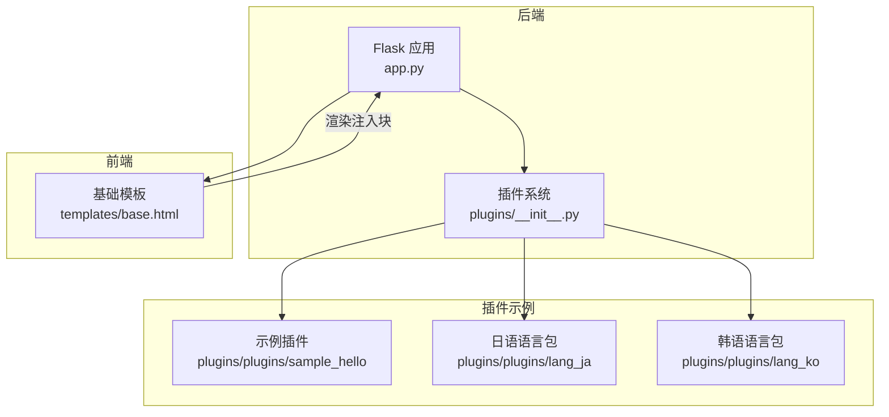
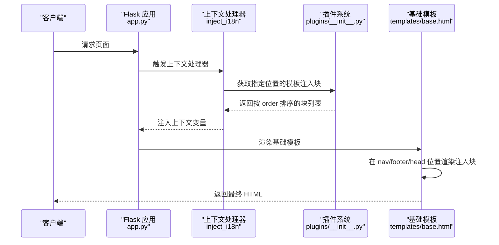
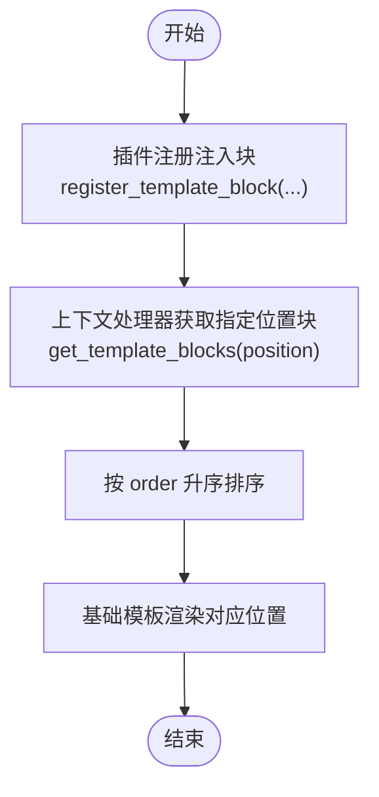
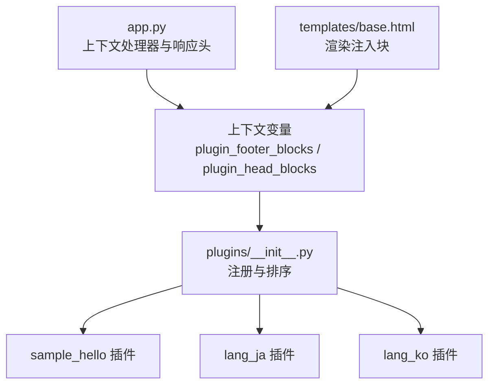

# 模板注入功能

<cite>
**本文引用的文件**
- [app.py](file://app.py)
- [templates/base.html](file://templates/base.html)
- [plugins/__init__.py](file://plugins/__init__.py)
- [plugins/plugins/sample_hello/__init__.py](file://plugins/plugins/sample_hello/__init__.py)
- [plugins/plugins/sample_hello/plugin.json](file://plugins/plugins/sample_hello/plugin.json)
- [plugins/plugins/lang_ja/__init__.py](file://plugins/plugins/lang_ja/__init__.py)
- [plugins/plugins/lang_ko/__init__.py](file://plugins/plugins/lang_ko/__init__.py)
- [安全措施清单.md](file://安全措施清单.md)
</cite>

## 目录
1. [简介](#简介)
2. [项目结构](#项目结构)
3. [核心组件](#核心组件)
4. [架构总览](#架构总览)
5. [详细组件分析](#详细组件分析)
6. [依赖分析](#依赖分析)
7. [性能考量](#性能考量)
8. [故障排查指南](#故障排查指南)
9. [结论](#结论)
10. [附录](#附录)

## 简介
本文件系统性阐述模板注入功能的设计与实现，涵盖以下要点：
- 注入机制与时机：在模板渲染阶段，通过上下文处理器收集各插件注册的注入块，并按位置插入到基础模板中。
- 注入位置差异：nav（导航栏）、footer（页脚）、head（页面头部）三类位置的用途与适用场景。
- 优先级排序：基于 order 参数进行稳定排序，数值越小优先级越高。
- 安全考虑：XSS 防护（CSP nonce、严格策略）、内容过滤与最小化原则。
- 实战示例：如何在插件中注册模板注入块，HTML 片段编写规范与样式处理建议。
- 调试与性能：调试方法、性能影响评估与优化建议。

## 项目结构
模板注入能力由后端插件系统与前端基础模板共同构成：
- 后端负责插件发现、注册、排序与上下文注入。
- 前端基础模板在相应位置渲染注入块。
- 安全层通过 CSP nonce 与响应头策略抵御 XSS。

图表来源
- [app.py:175-194](file://app.py#L175-L194)
- [plugins/__init__.py:167-184](file://plugins/__init__.py#L167-L184)
- [templates/base.html:220-223](file://templates/base.html#L220-L223)

章节来源
- [app.py:175-194](file://app.py#L175-L194)
- [plugins/__init__.py:167-184](file://plugins/__init__.py#L167-L184)
- [templates/base.html:220-223](file://templates/base.html#L220-L223)

## 核心组件
- 插件系统注册表：维护菜单项与模板注入块的钩子。
- 上下文处理器：向模板注入插件提供的注入块集合。
- 基础模板：在 nav/footer/head 等位置渲染注入块。
- 插件示例：演示如何注册注入块与菜单项。

章节来源
- [plugins/__init__.py:16-22](file://plugins/__init__.py#L16-L22)
- [plugins/__init__.py:167-184](file://plugins/__init__.py#L167-L184)
- [app.py:175-194](file://app.py#L175-L194)
- [templates/base.html:220-223](file://templates/base.html#L220-L223)

## 架构总览
模板注入的端到端流程如下：

图表来源
- [app.py:175-194](file://app.py#L175-L194)
- [plugins/__init__.py:167-184](file://plugins/__init__.py#L167-L184)
- [templates/base.html:220-223](file://templates/base.html#L220-L223)

## 详细组件分析

### 注入位置与适用场景
- nav（导航栏）
  - 适用：导航菜单、用户信息、主题切换等与顶部导航强相关的 UI。
  - 基础模板中对应导航区域，适合放置与导航栏联动的交互元素。
- footer（页脚）
  - 适用：版权信息、免责声明、统计脚本、轻量提示等。
  - 基础模板中位于主内容下方，适合放置非侵入性的补充信息。
- head（页面头部）
  - 适用：额外的 meta、link、script、style 等头部资源。
  - 基础模板中位于 head 区域，适合注入样式或脚本资源。

章节来源
- [templates/base.html:220-223](file://templates/base.html#L220-L223)

### 注入块注册与排序机制
- 注册接口
  - 插件通过注册函数调用注册模板注入块，传入名称、HTML 片段、位置与 order。
- 获取与排序
  - 上下文处理器按位置获取注入块，并按 order 升序排序。
- order 的作用
  - 数值越小优先级越高；相同 order 的稳定性由实现保证。
- 位置约束
  - 当前实现支持 nav、footer、head 三类位置；其他值会被忽略。

图表来源
- [plugins/__init__.py:167-184](file://plugins/__init__.py#L167-L184)
- [app.py:175-194](file://app.py#L175-L194)

章节来源
- [plugins/__init__.py:167-184](file://plugins/__init__.py#L167-L184)
- [app.py:175-194](file://app.py#L175-L194)

### HTML 片段注入时机与位置控制
- 注入时机：在模板渲染阶段，由上下文处理器将注入块注入到模板上下文，基础模板在相应位置遍历渲染。
- 位置控制：通过位置参数选择 nav/footer/head；基础模板在对应区块循环输出注入块。
- 安全渲染：注入块的 HTML 片段以安全方式渲染，避免二次转义问题。

章节来源
- [app.py:175-194](file://app.py#L175-L194)
- [templates/base.html:220-223](file://templates/base.html#L220-L223)

### 优先级排序规则
- 排序字段：order（数值越小优先级越高）。
- 排序范围：同一位置内按 order 升序排列。
- 默认值：未显式提供 order 的注入块将采用默认值参与排序。

章节来源
- [plugins/__init__.py:178-184](file://plugins/__init__.py#L178-L184)

### 安全考虑（XSS 防护与内容过滤）
- CSP nonce
  - 每个请求生成唯一 nonce 并注入到模板上下文，模板中 script/style 使用该 nonce。
  - 后端在响应头中设置 CSP，结合 nonce 有效阻止大多数反射型与存储型 XSS。
- 响应头策略
  - 设置 X-Content-Type-Options、X-Frame-Options、Referrer-Policy、Strict-Transport-Security 等。
- 内容最小化
  - 注入块尽量保持最小必要 HTML，避免内联事件与复杂脚本。
- 过滤与校验
  - 对注入块内容进行白名单校验与最小化处理，避免引入不受控脚本或资源。

章节来源
- [app.py:175-194](file://app.py#L175-L194)
- [app.py:641-676](file://app.py#L641-L676)
- [安全措施清单.md:72-161](file://安全措施清单.md#L72-L161)

### 实战示例：在插件中注册模板注入块
- 示例一：底部注入块（footer）
  - 注册位置：footer
  - 注册方式：在插件注册函数中调用注册接口，传入模板片段与 order。
  - 参考路径：[plugins/plugins/sample_hello/__init__.py:20-26](file://plugins/plugins/sample_hello/__init__.py#L20-L26)
  - 清单文件：[plugins/plugins/sample_hello/plugin.json:1-7](file://plugins/plugins/sample_hello/plugin.json#L1-L7)
- 示例二：头部注入块（head）
  - 注册位置：head
  - 注册方式：在插件注册函数中调用注册接口，传入空或最小化模板片段与 order。
  - 参考路径：[plugins/plugins/lang_ja/__init__.py:23-29](file://plugins/plugins/lang_ja/__init__.py#L23-L29)
  - 参考路径：[plugins/plugins/lang_ko/__init__.py:21-27](file://plugins/plugins/lang_ko/__init__.py#L21-L27)

HTML 片段编写规范与样式处理建议
- 规范
  - 使用最小化 HTML，避免内联事件（onclick 等）。
  - 如需脚本，请通过外部资源或在 head 中注入必要的资源链接。
  - 避免使用不受信任的数据直接拼接 HTML。
- 样式
  - 使用内联样式时注意与主题适配，避免破坏整体视觉一致性。
  - 优先使用外部样式资源，确保与 CSP 策略兼容。

章节来源
- [plugins/plugins/sample_hello/__init__.py:20-26](file://plugins/plugins/sample_hello/__init__.py#L20-L26)
- [plugins/plugins/lang_ja/__init__.py:23-29](file://plugins/plugins/lang_ja/__init__.py#L23-L29)
- [plugins/plugins/lang_ko/__init__.py:21-27](file://plugins/plugins/lang_ko/__init__.py#L21-L27)

### 调试方法
- 日志定位
  - 在插件注册函数中添加日志输出，确认注入块是否正确注册。
- 模板渲染验证
  - 在基础模板对应位置插入占位标记，确认注入块是否生效。
- 排序核验
  - 为多个注入块设置不同 order，观察渲染顺序是否符合预期。
- 安全核验
  - 使用浏览器开发者工具检查 CSP 头与 nonce 是否正确注入。
  - 参考安全清单中的注入测试结果，验证防护有效性。

章节来源
- [plugins/plugins/sample_hello/__init__.py:9-18](file://plugins/plugins/sample_hello/__init__.py#L9-L18)
- [plugins/plugins/lang_ja/__init__.py:30-34](file://plugins/plugins/lang_ja/__init__.py#L30-L34)
- [plugins/plugins/lang_ko/__init__.py:28-32](file://plugins/plugins/lang_ko/__init__.py#L28-L32)
- [安全措施清单.md:125-139](file://安全措施清单.md#L125-L139)

## 依赖分析
模板注入功能的依赖关系如下：

图表来源
- [app.py:175-194](file://app.py#L175-L194)
- [plugins/__init__.py:167-184](file://plugins/__init__.py#L167-L184)
- [templates/base.html:220-223](file://templates/base.html#L220-L223)

章节来源
- [app.py:175-194](file://app.py#L175-L194)
- [plugins/__init__.py:167-184](file://plugins/__init__.py#L167-L184)
- [templates/base.html:220-223](file://templates/base.html#L220-L223)

## 性能考量
- 注入块数量与大小
  - 注入块过多或体积过大可能增加模板渲染与传输开销。
- 排序成本
  - 注入块数量较多时，排序与遍历的开销需关注。
- 资源加载
  - 头部注入的脚本与样式应尽量复用 CDN 资源，减少重复加载。
- 建议
  - 控制注入块数量与体积，优先使用外部资源。
  - 合理设置 order，避免大量相邻数值导致频繁比较。

[本节为通用性能讨论，无需列出具体文件来源]

## 故障排查指南
- 注入块未显示
  - 检查插件是否正确注册，确认位置参数与基础模板对应位置一致。
  - 核对上下文变量是否注入成功。
- 排序异常
  - 检查各注入块的 order 值，确保数值合理且唯一性足够。
- CSP 导致脚本失效
  - 确认 nonce 是否正确注入，检查响应头 CSP 配置。
- 安全测试未通过
  - 参考安全清单中的注入测试结果，逐项验证防护策略。

章节来源
- [app.py:175-194](file://app.py#L175-L194)
- [app.py:641-676](file://app.py#L641-L676)
- [安全措施清单.md:125-139](file://安全措施清单.md#L125-L139)

## 结论
模板注入功能通过插件系统与基础模板的协作，在 nav/footer/head 三个位置提供灵活的 UI 扩展能力。借助 CSP nonce 与严格的响应头策略，系统在安全性方面具备良好基础。通过合理的 order 排序与最小化注入块设计，可以在保证功能的同时兼顾性能与可维护性。

[本节为总结性内容，无需列出具体文件来源]

## 附录
- 关键实现路径参考
  - 注入块注册与排序：[plugins/__init__.py:167-184](file://plugins/__init__.py#L167-L184)
  - 上下文处理器注入：[app.py:175-194](file://app.py#L175-L194)
  - 基础模板渲染注入块：[templates/base.html:220-223](file://templates/base.html#L220-L223)
  - 示例插件注册注入块：[plugins/plugins/sample_hello/__init__.py:20-26](file://plugins/plugins/sample_hello/__init__.py#L20-L26)
  - 语言包注入块（head）：[plugins/plugins/lang_ja/__init__.py:23-29](file://plugins/plugins/lang_ja/__init__.py#L23-L29)、[plugins/plugins/lang_ko/__init__.py:21-27](file://plugins/plugins/lang_ko/__init__.py#L21-L27)

[本节为参考索引，无需列出具体文件来源]