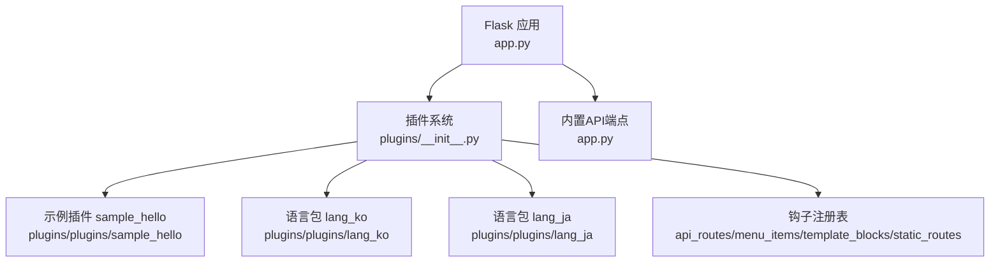
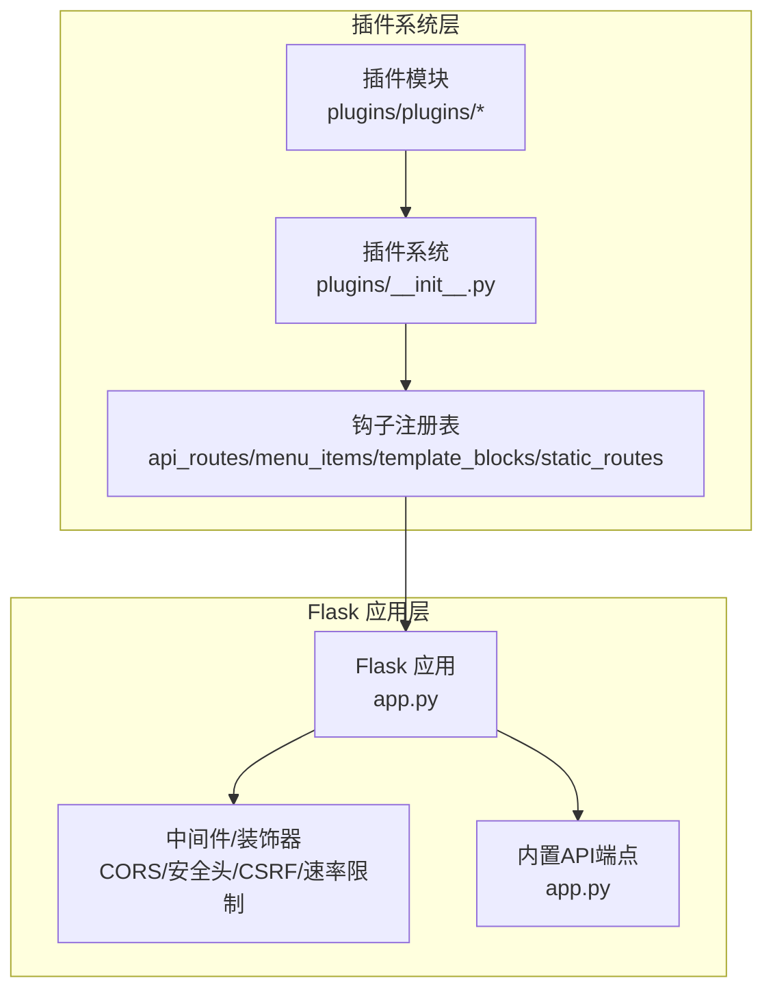
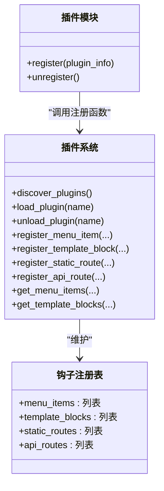
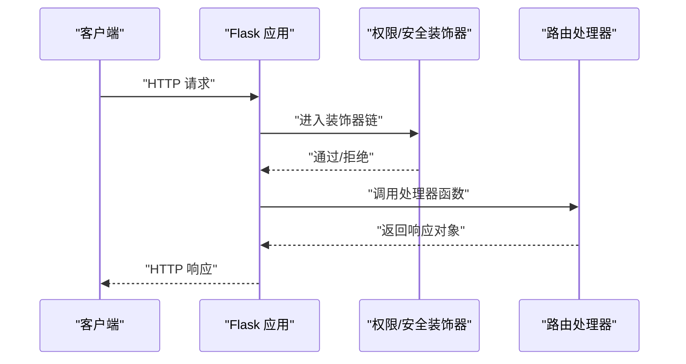
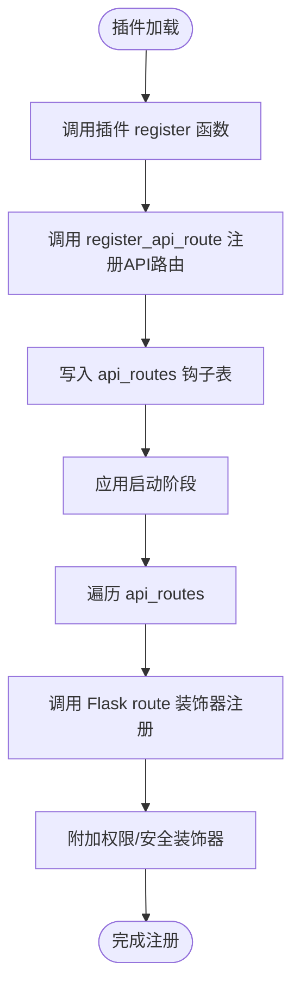
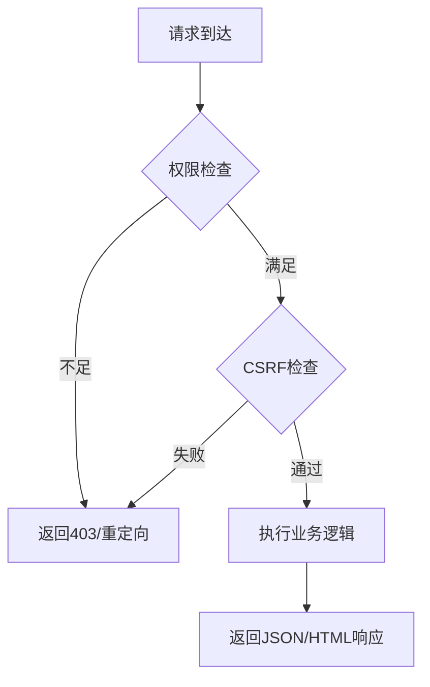
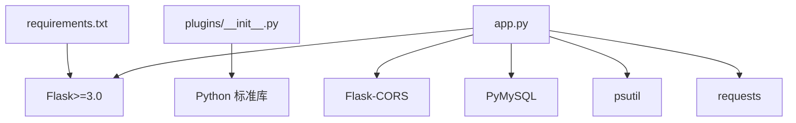

# API路由钩子

<cite>
**本文引用的文件**
- [app.py](file://app.py)
- [plugins/__init__.py](file://plugins/__init__.py)
- [plugins/plugins/sample_hello/__init__.py](file://plugins/plugins/sample_hello/__init__.py)
- [plugins/plugins/sample_hello/plugin.json](file://plugins/plugins/sample_hello/plugin.json)
- [plugins/plugins/lang_ko/__init__.py](file://plugins/plugins/lang_ko/__init__.py)
- [plugins/plugins/lang_ko/plugin.json](file://plugins/plugins/lang_ko/plugin.json)
- [plugins/plugins/lang_ja/__init__.py](file://plugins/plugins/lang_ja/__init__.py)
- [plugins/plugins/lang_ja/plugin.json](file://plugins/plugins/lang_ja/plugin.json)
- [requirements.txt](file://requirements.txt)
</cite>

## 目录
1. [简介](#简介)
2. [项目结构](#项目结构)
3. [核心组件](#核心组件)
4. [架构总览](#架构总览)
5. [组件详解](#组件详解)
6. [依赖关系分析](#依赖关系分析)
7. [性能考量](#性能考量)
8. [故障排查指南](#故障排查指南)
9. [结论](#结论)
10. [附录](#附录)

## 简介
本文件聚焦于“API路由钩子”的设计与实现，系统性阐述其在插件体系中的作用、注册机制、与Flask应用的集成方式以及请求处理流程。同时给出完整的API路由注册示例与最佳实践，涵盖错误处理、参数验证与安全防护等关键主题。

## 项目结构
- 应用入口与核心逻辑位于 app.py，负责Flask应用初始化、全局中间件（如CORS、安全头、速率限制、CSRF保护）、权限装饰器、以及若干内置API端点。
- 插件系统位于 plugins/，提供插件发现、加载/卸载、钩子注册表（含菜单项、模板块、静态路由、API路由）等能力，并在插件加载时调用插件的 register 函数。
- 示例插件与语言包插件位于 plugins/plugins/，演示如何通过钩子向系统注册菜单项、模板块或API路由等资源。

图表来源
- [app.py](file://app.py)
- [plugins/__init__.py](file://plugins/__init__.py)
- [plugins/plugins/sample_hello/__init__.py](file://plugins/plugins/sample_hello/__init__.py)
- [plugins/plugins/lang_ko/__init__.py](file://plugins/plugins/lang_ko/__init__.py)
- [plugins/plugins/lang_ja/__init__.py](file://plugins/plugins/lang_ja/__init__.py)

章节来源
- [app.py](file://app.py)
- [plugins/__init__.py](file://plugins/__init__.py)

## 核心组件
- 插件钩子注册表：维护四类钩子列表，其中与API路由直接相关的是 api_routes，用于收集插件声明的RESTful API路由元数据。
- 插件加载流程：动态导入插件模块，执行插件的 register 函数，插件通过调用注册函数向钩子表写入条目。
- Flask集成点：当前仓库中未见显式“将插件的API路由注册到Flask应用”的代码，但钩子表的存在为后续扩展提供了基础。现有内置API端点展示了标准的Flask路由与装饰器用法。

章节来源
- [plugins/__init__.py](file://plugins/__init__.py)

## 架构总览
下图展示了插件系统与Flask应用之间的交互关系，以及API路由钩子在整体架构中的定位。

图表来源
- [app.py](file://app.py)
- [plugins/__init__.py](file://plugins/__init__.py)

## 组件详解

### 插件钩子注册表与API路由钩子
- 注册表结构：包含 menu_items、template_blocks、static_routes、api_routes 四类钩子列表，分别对应菜单项、模板注入块、静态文件路由与API路由。
- 插件注册流程：插件加载时调用插件的 register 函数，插件通过调用注册函数（如 register_menu_item、register_template_block、register_static_route、register_api_route）向钩子表写入条目。
- 当前现状：仓库中未发现 register_api_route 的具体实现与将 api_routes 注册到Flask应用的代码。因此，若需通过钩子系统暴露RESTful API，需要在现有基础上扩展：在应用启动阶段遍历 api_routes 并调用 Flask 的 route 装饰器进行注册。

图表来源
- [plugins/__init__.py](file://plugins/__init__.py)

章节来源
- [plugins/__init__.py](file://plugins/__init__.py)

### Flask应用中的API路由与装饰器
- 路由装饰器：使用 Flask 的 route 装饰器定义HTTP方法、URL模式与处理器函数。
- 装饰器体系：提供多种装饰器用于权限控制与安全防护，如登录必需、管理员必需、VIP必需、CSRF校验、数据库验证码校验等。
- 内置API示例：仓库中存在若干内置API端点，展示了典型的请求处理流程（解析JSON、参数校验、业务处理、返回JSON响应）。

图表来源
- [app.py](file://app.py)

章节来源
- [app.py](file://app.py)

### 插件API路由注册示例（基于现有钩子）
以下示例展示如何在插件中定义并注册自定义API接口。该示例基于现有钩子表结构，实际部署时需在应用启动阶段将 api_routes 注册到Flask。

- 步骤一：在插件的 register 函数中调用 register_api_route，传入路由元数据（HTTP方法、URL模式、处理器函数、权限要求等）。
- 步骤二：在应用启动阶段，遍历 api_routes 列表，为每个条目调用 Flask 的 route 装饰器注册路由。
- 步骤三：根据权限要求，为处理器函数附加相应的装饰器（如 login_required、vip_required、admin_required、csrf_required 等）。

图表来源
- [plugins/__init__.py](file://plugins/__init__.py)
- [app.py](file://app.py)

章节来源
- [plugins/__init__.py](file://plugins/__init__.py)
- [app.py](file://app.py)

### 权限与安全装饰器
- 权限装饰器：login_required、admin_required、non_guest_required、vip_required，用于限制访问范围。
- 安全装饰器：csrf_required 用于CSRF防护；db_captcha_required 用于数据库操作的二次验证。
- 内置API中的安全实践：对敏感API返回统一JSON错误格式；对未授权访问返回403。

图表来源
- [app.py](file://app.py)

章节来源
- [app.py](file://app.py)

### 参数验证与错误处理
- 参数类型校验：内置API对输入参数进行类型检查与必要清理（如字符串去空白）。
- 统一错误响应：对非法参数或未授权访问返回JSON错误对象与状态码。
- 建议：在插件API中遵循相同模式，对必填字段、格式、范围进行严格校验，并在失败时返回明确的错误信息与状态码。

章节来源
- [app.py](file://app.py)

## 依赖关系分析
- Flask版本：requirements.txt 指定 Flask>=3.0，确保装饰器与蓝图等特性可用。
- 插件系统依赖：plugins/__init__.py 依赖 Python 标准库与导入机制，实现动态加载与钩子注册。
- 应用依赖：app.py 依赖 Flask、Flask-CORS、PyMySQL、psutil、requests 等第三方库。

图表来源
- [requirements.txt](file://requirements.txt)
- [plugins/__init__.py](file://plugins/__init__.py)
- [app.py](file://app.py)

章节来源
- [requirements.txt](file://requirements.txt)
- [plugins/__init__.py](file://plugins/__init__.py)
- [app.py](file://app.py)

## 性能考量
- 速率限制：app.py 提供基于内存的速率限制与持久化配置，可有效缓解滥用与暴力尝试。
- 白名单与封禁：支持IP白名单与手动封禁，结合封禁探测与延长策略，提升抗压能力。
- 建议：在插件API中复用现有速率限制策略，按路由粒度配置不同阈值；对高并发场景考虑引入Redis等外部存储。

章节来源
- [app.py](file://app.py)

## 故障排查指南
- 插件未生效：确认插件目录包含 plugin.json 与 __init__.py，且插件名称在钩子表中可见；检查插件 register 函数是否正确调用了注册函数。
- 路由未注册：若使用API路由钩子，需在应用启动阶段将 api_routes 注册到Flask；否则不会对外暴露新API。
- 权限问题：检查装饰器顺序与条件，确保登录状态、VIP/管理员权限满足要求；对API端点返回403时核对错误消息。
- CSRF/验证码：确认CSRF token存在且匹配，验证码二次验证通过后再访问受保护API。
- 速率限制：若被封禁，等待封禁结束或调整配置；检查封禁探测与延长策略是否触发。

章节来源
- [plugins/__init__.py](file://plugins/__init__.py)
- [app.py](file://app.py)

## 结论
本项目通过插件系统与钩子注册表为扩展性提供了良好基础。API路由钩子目前处于“待实现”状态：仓库中未见将 api_routes 注册到Flask应用的代码。建议在应用启动阶段遍历 api_routes 并调用 route 装饰器完成注册，同时复用现有的权限与安全装饰器，确保插件API具备一致的安全与体验。

## 附录

### 插件API路由注册示例（步骤说明）
- 在插件的 register 函数中调用 register_api_route，传入如下信息：
  - HTTP方法：GET/POST/PUT/DELETE 等
  - URL模式：如 “/api/myplugin/{id}”
  - 处理器函数：实现业务逻辑并返回响应
  - 权限要求：如 “all”、“user”、“vip”、“administrator”
  - 其他元数据：如描述、版本、作者等
- 在应用启动阶段：
  - 遍历 api_routes 列表
  - 对每个条目调用 Flask 的 route 装饰器注册
  - 根据权限要求附加相应装饰器
  - 返回统一的JSON响应格式

章节来源
- [plugins/__init__.py](file://plugins/__init__.py)
- [app.py](file://app.py)