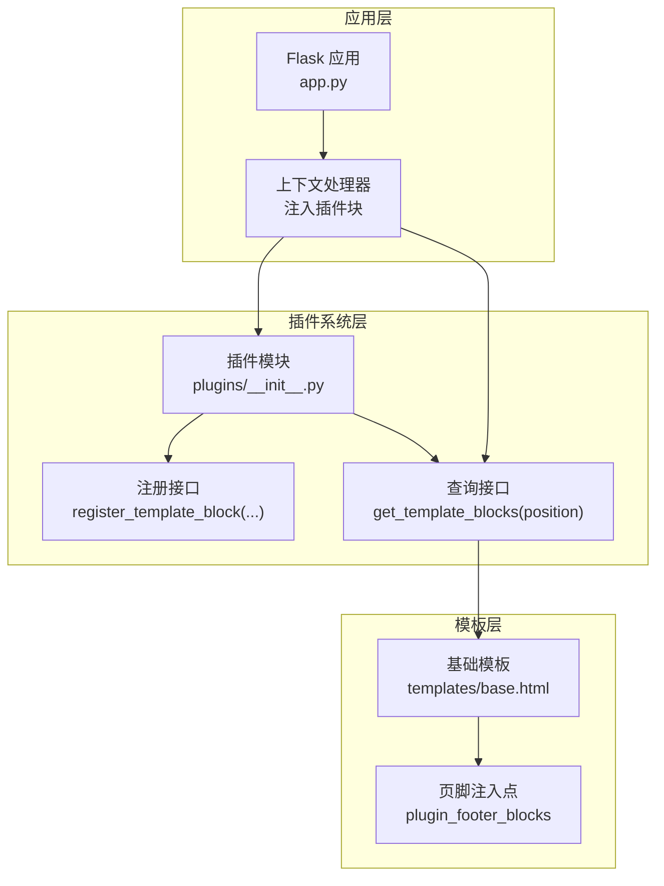
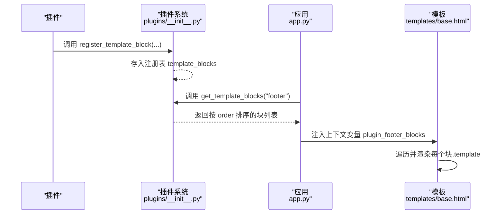
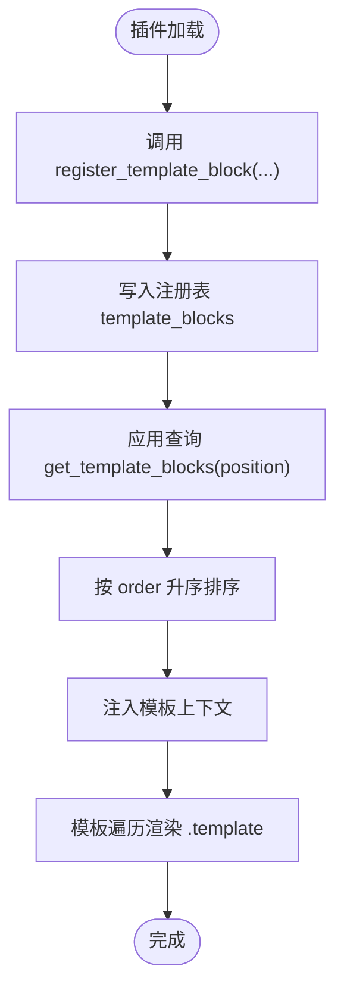
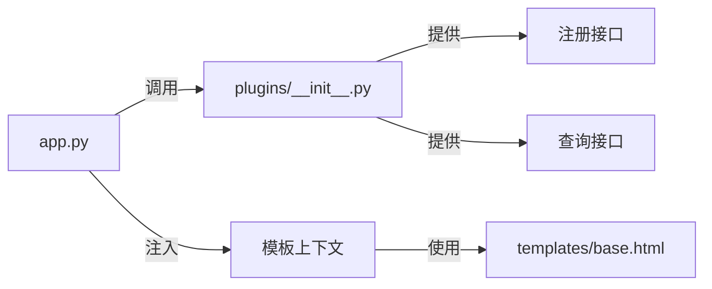

# 模板注入钩子

<cite>
**本文档引用的文件**
- [app.py](file://app.py)
- [plugins/__init__.py](file://plugins/__init__.py)
- [plugins/plugins/sample_hello/__init__.py](file://plugins/plugins/sample_hello/__init__.py)
- [plugins/plugins/sample_hello/plugin.json](file://plugins/plugins/sample_hello/plugin.json)
- [templates/base.html](file://templates/base.html)
</cite>

## 目录
1. [简介](#简介)
2. [项目结构](#项目结构)
3. [核心组件](#核心组件)
4. [架构总览](#架构总览)
5. [详细组件分析](#详细组件分析)
6. [依赖分析](#依赖分析)
7. [性能考量](#性能考量)
8. [故障排查指南](#故障排查指南)
9. [结论](#结论)
10. [附录](#附录)

## 简介
本文件围绕“模板注入钩子”展开，系统性阐述其工作原理、注册与渲染流程、位置控制策略、排序与执行顺序、安全与性能注意事项，并提供完整示例路径，帮助开发者在插件中正确、安全地注册不同位置的模板块。

## 项目结构
本项目的模板注入机制由三层协作构成：
- 应用层：通过上下文处理器向模板注入插件提供的模板块集合，并在模板中渲染。
- 插件系统层：维护全局钩子注册表，提供注册与查询接口。
- 模板层：在基础模板中按位置插入插件注入内容。

图表来源
- [app.py:181-194](file://app.py#L181-L194)
- [plugins/__init__.py:167-184](file://plugins/__init__.py#L167-L184)
- [templates/base.html:220-223](file://templates/base.html#L220-L223)

章节来源
- [app.py:181-194](file://app.py#L181-L194)
- [plugins/__init__.py:16-22](file://plugins/__init__.py#L16-L22)
- [templates/base.html:220-223](file://templates/base.html#L220-L223)

## 核心组件
- 插件注册表：集中存放所有插件注册的钩子，包括菜单项与模板注入块。
- 注册接口：插件在加载时调用，将自身注入块登记到注册表。
- 查询接口：应用在渲染前按位置查询并排序，得到最终注入序列。
- 上下文处理器：将查询结果注入模板上下文，供模板渲染。
- 模板注入点：在基础模板中按位置插入插件注入内容。

章节来源
- [plugins/__init__.py:16-22](file://plugins/__init__.py#L16-L22)
- [plugins/__init__.py:167-184](file://plugins/__init__.py#L167-L184)
- [app.py:181-194](file://app.py#L181-L194)
- [templates/base.html:220-223](file://templates/base.html#L220-L223)

## 架构总览
模板注入的端到端流程如下：

图表来源
- [plugins/__init__.py:167-184](file://plugins/__init__.py#L167-L184)
- [app.py:181-194](file://app.py#L181-L194)
- [templates/base.html:220-223](file://templates/base.html#L220-L223)

## 详细组件分析

### register_template_block() 实现机制
- 调用方：插件在加载时调用，传入块描述对象。
- 注册行为：将块对象追加到全局注册表的 template_blocks 列表中，并携带插件标识。
- 块对象字段：
  - name：块唯一标识（字符串）。
  - template：HTML 字符串（会被模板安全标记处理）。
  - position：注入位置（如 footer、head 等）。
  - order：排序权重（数值，默认值参与排序）。

章节来源
- [plugins/__init__.py:167-175](file://plugins/__init__.py#L167-L175)

### 模板注入位置控制
- 支持位置：
  - footer：页脚区域，常用于版权、统计、横幅等。
  - head：页面头部区域，适合注入 meta、link、script 等。
- 注入点：
  - 应用在上下文处理器中按位置查询并注入到模板上下文。
  - 基础模板在相应位置遍历渲染。

章节来源
- [app.py:192-193](file://app.py#L192-L193)
- [templates/base.html:220-223](file://templates/base.html#L220-L223)

### 排序机制与执行顺序控制
- 查询时排序：按 order 键升序排列，order 默认值参与排序。
- 执行顺序：模板渲染时按列表顺序依次输出，先小后大。
- 建议：
  - 使用整数权重，避免浮点误差。
  - 对关键注入块设置明确权重，保证相对稳定顺序。

章节来源
- [plugins/__init__.py:178-184](file://plugins/__init__.py#L178-L184)

### block 参数结构定义
- 必填字段：
  - name：块唯一名称。
  - template：HTML 片段。
  - position：注入位置（如 footer、head）。
- 可选字段：
  - order：排序权重（数值）。
- 注意：
  - template 将以安全方式渲染，但需遵循 CSP 与内容策略。

章节来源
- [plugins/__init__.py:167-175](file://plugins/__init__.py#L167-L175)

### 模板注入示例（路径指引）
- 示例插件注册页脚注入块：
  - 注册位置：插件加载时调用注册接口。
  - 注册内容：包含 name、template、position、order。
  - 参考路径：
    - [plugins/plugins/sample_hello/__init__.py:20-26](file://plugins/plugins/sample_hello/__init__.py#L20-L26)
    - [plugins/plugins/sample_hello/plugin.json:1-7](file://plugins/plugins/sample_hello/plugin.json#L1-L7)
- 应用侧注入与渲染：
  - 注入点：上下文处理器按位置查询并注入。
  - 渲染点：基础模板在页脚区域遍历渲染。
  - 参考路径：
    - [app.py:192-193](file://app.py#L192-L193)
    - [templates/base.html:220-223](file://templates/base.html#L220-L223)

章节来源
- [plugins/plugins/sample_hello/__init__.py:20-26](file://plugins/plugins/sample_hello/__init__.py#L20-L26)
- [plugins/plugins/sample_hello/plugin.json:1-7](file://plugins/plugins/sample_hello/plugin.json#L1-L7)
- [app.py:192-193](file://app.py#L192-L193)
- [templates/base.html:220-223](file://templates/base.html#L220-L223)

### 关键流程图（注册与渲染）

图表来源
- [plugins/__init__.py:167-184](file://plugins/__init__.py#L167-L184)
- [app.py:192-193](file://app.py#L192-L193)
- [templates/base.html:220-223](file://templates/base.html#L220-L223)

## 依赖分析
- 插件系统与应用的耦合：
  - 应用通过上下文处理器依赖插件系统查询接口。
  - 插件系统不依赖应用，仅维护注册表与查询逻辑。
- 模板与插件系统的耦合：
  - 模板依赖上下文中的插件块变量，实际数据来自插件系统查询结果。
- 潜在风险：
  - 若插件未正确注册或位置不匹配，可能导致注入缺失或顺序异常。
  - 模板中对 template 的安全处理依赖 CSP 与过滤策略。

图表来源
- [app.py:181-194](file://app.py#L181-L194)
- [plugins/__init__.py:167-184](file://plugins/__init__.py#L167-L184)
- [templates/base.html:220-223](file://templates/base.html#L220-L223)

章节来源
- [app.py:181-194](file://app.py#L181-L194)
- [plugins/__init__.py:167-184](file://plugins/__init__.py#L167-L184)
- [templates/base.html:220-223](file://templates/base.html#L220-L223)

## 性能考量
- 注册与查询复杂度：
  - 注册为 O(1) 追加写入。
  - 查询为 O(n) 过滤 + O(n log n) 排序，n 为注册块数量。
- 渲染开销：
  - 模板渲染为 O(m) 遍历，m 为该位置注入块数量。
- 优化建议：
  - 控制每个位置的注入块数量，避免过多重复渲染。
  - 合理设置 order，减少频繁调整导致的排序成本。
  - 对于 head 注入，尽量精简模板字符串，避免阻塞页面渲染。

## 故障排查指南
- 注入无效
  - 检查插件是否正确调用注册接口并传入正确的 position。
  - 确认应用上下文处理器是否按目标位置查询并注入。
  - 参考路径：
    - [plugins/plugins/sample_hello/__init__.py:20-26](file://plugins/plugins/sample_hello/__init__.py#L20-L26)
    - [app.py:192-193](file://app.py#L192-L193)
- 顺序异常
  - 检查各注入块的 order 设置是否符合预期。
  - 参考路径：
    - [plugins/__init__.py:178-184](file://plugins/__init__.py#L178-L184)
- 模板安全问题
  - 确保注入内容符合 CSP 策略，必要时使用 nonce 或外部资源。
  - 参考路径：
    - [app.py:175-178](file://app.py#L175-L178)
    - [app.py:642-676](file://app.py#L642-L676)

章节来源
- [plugins/plugins/sample_hello/__init__.py:20-26](file://plugins/plugins/sample_hello/__init__.py#L20-L26)
- [plugins/__init__.py:178-184](file://plugins/__init__.py#L178-L184)
- [app.py:175-178](file://app.py#L175-L178)
- [app.py:642-676](file://app.py#L642-L676)

## 结论
模板注入钩子通过“注册—查询—注入—渲染”的链路，实现了插件对页面的灵活扩展。合理设计 block 参数、选择合适位置与权重，结合安全与性能最佳实践，可构建稳定、可维护且高效的插件生态。

## 附录
- 术语
  - 注册表：集中存储插件钩子的全局结构。
  - 注入块：插件注册的 HTML 片段及其元数据。
  - 位置：模板中注入的具体区域（如 footer、head）。
  - 排序：基于 order 的稳定升序排列。