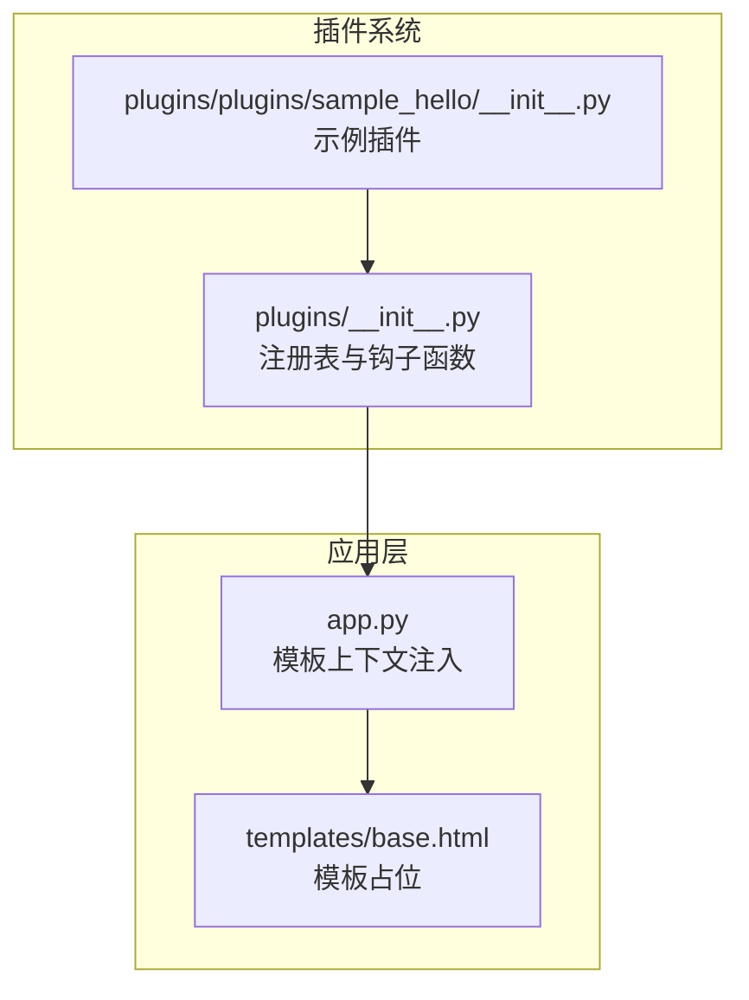
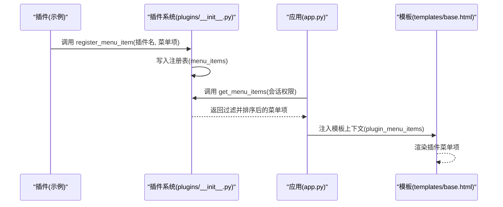
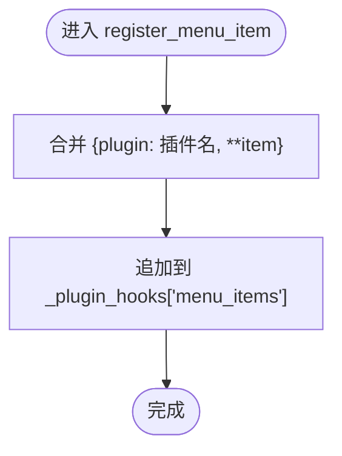
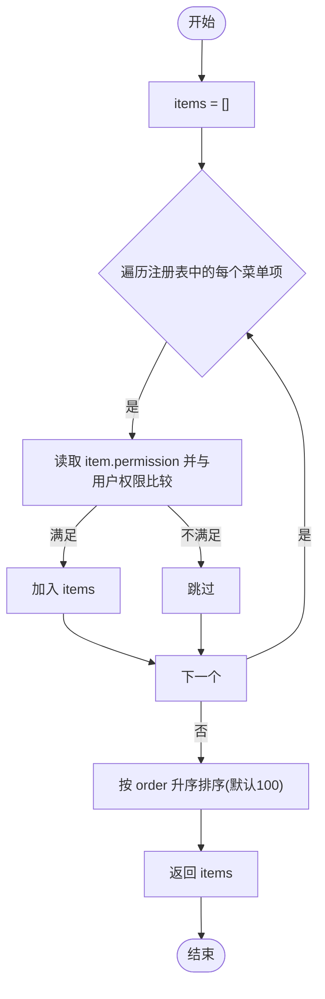
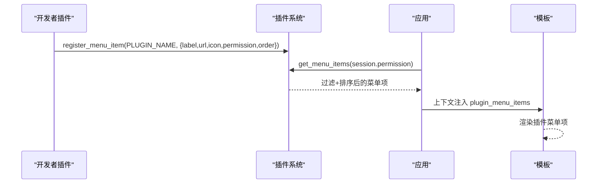

# 菜单项钩子

<cite>
**本文引用的文件**
- [plugins/__init__.py](file://plugins/__init__.py)
- [plugins/plugins/sample_hello/__init__.py](file://plugins/plugins/sample_hello/__init__.py)
- [app.py](file://app.py)
- [templates/base.html](file://templates/base.html)
</cite>

## 目录
1. [简介](#简介)
2. [项目结构](#项目结构)
3. [核心组件](#核心组件)
4. [架构总览](#架构总览)
5. [详细组件分析](#详细组件分析)
6. [依赖分析](#依赖分析)
7. [性能考虑](#性能考虑)
8. [故障排查指南](#故障排查指南)
9. [结论](#结论)
10. [附录](#附录)

## 简介
本文件系统性阐述“菜单项钩子”的注册与执行机制，涵盖以下要点：
- register_menu_item() 的实现原理与参数结构
- 菜单项数据格式与字段语义（label、url、icon、permission、order）
- get_menu_items() 的权限检查与排序逻辑
- 在插件中注册自定义菜单项的完整示例
- 最佳实践与常见问题解决方案

## 项目结构
菜单项钩子位于插件系统模块中，通过全局注册表集中管理，并在应用渲染阶段注入到模板上下文，最终由前端模板消费。

图表来源
- [plugins/__init__.py:17-22](file://plugins/__init__.py#L17-L22)
- [plugins/plugins/sample_hello/__init__.py:12-31](file://plugins/plugins/sample_hello/__init__.py#L12-L31)
- [app.py:190-191](file://app.py#L190-L191)
- [templates/base.html:220-223](file://templates/base.html#L220-L223)

章节来源
- [plugins/__init__.py:17-22](file://plugins/__init__.py#L17-L22)
- [plugins/plugins/sample_hello/__init__.py:12-31](file://plugins/plugins/sample_hello/__init__.py#L12-L31)
- [app.py:190-191](file://app.py#L190-L191)
- [templates/base.html:220-223](file://templates/base.html#L220-L223)

## 核心组件
- 菜单项注册表：维护一个“menu_items”列表，存储所有插件注册的菜单项
- 注册函数：register_menu_item(plugin_name, item)，将插件名与菜单项合并后写入注册表
- 查询函数：get_menu_items(user_permission)，按权限过滤并按 order 排序输出

章节来源
- [plugins/__init__.py:17-22](file://plugins/__init__.py#L17-L22)
- [plugins/__init__.py:143-164](file://plugins/__init__.py#L143-L164)

## 架构总览
菜单项钩子的调用链路如下：

图表来源
- [plugins/plugins/sample_hello/__init__.py:12-18](file://plugins/plugins/sample_hello/__init__.py#L12-L18)
- [plugins/__init__.py:143-164](file://plugins/__init__.py#L143-L164)
- [app.py:190-191](file://app.py#L190-L191)
- [templates/base.html:220-223](file://templates/base.html#L220-L223)

## 详细组件分析

### register_menu_item() 实现与参数结构
- 调用时机：插件在自身 register() 中调用
- 参数 item 字典包含：
  - label：显示名称
  - url：跳转地址
  - icon：图标符号
  - permission：权限要求
  - order：排序权重
- 内部处理：将插件名与 item 合并后追加到注册表“menu_items”

图表来源
- [plugins/__init__.py:143-151](file://plugins/__init__.py#L143-L151)

章节来源
- [plugins/__init__.py:143-151](file://plugins/__init__.py#L143-L151)
- [plugins/plugins/sample_hello/__init__.py:12-18](file://plugins/plugins/sample_hello/__init__.py#L12-L18)

### get_menu_items() 权限检查与排序逻辑
- 权限检查：对每个菜单项读取其 permission 字段，若为“all”则放行；否则比较用户权限与要求权限的等级
- 排序规则：按 order 字段升序排列，默认 order 为 100

图表来源
- [plugins/__init__.py:154-164](file://plugins/__init__.py#L154-L164)
- [plugins/__init__.py:187-192](file://plugins/__init__.py#L187-L192)

章节来源
- [plugins/__init__.py:154-164](file://plugins/__init__.py#L154-L164)
- [plugins/__init__.py:187-192](file://plugins/__init__.py#L187-L192)

### 菜单项数据格式与字段语义
- label：菜单项显示名称，用于前端渲染
- url：点击跳转的目标路径或链接
- icon：可选的图标符号，增强可读性
- permission：权限要求，支持“all”或具体等级
- order：排序权重，数值越小越靠前

字段使用建议
- 使用“all”表示无需权限即可显示
- 使用具体权限等级（如“user”、“administrator”）控制可见范围
- 合理设置 order 以保证菜单顺序符合业务预期

章节来源
- [plugins/__init__.py:143-151](file://plugins/__init__.py#L143-L151)
- [plugins/__init__.py:154-164](file://plugins/__init__.py#L154-L164)

### 在插件中注册自定义菜单项的完整示例
- 示例插件在 register() 中调用 register_menu_item()，传入 label、url、icon、permission、order
- 应用层在构造模板上下文时调用 get_menu_items()，并将结果注入到模板变量中
- 基础模板中通过循环渲染插件注入的菜单项

图表来源
- [plugins/plugins/sample_hello/__init__.py:12-18](file://plugins/plugins/sample_hello/__init__.py#L12-L18)
- [app.py:190-191](file://app.py#L190-L191)
- [templates/base.html:220-223](file://templates/base.html#L220-L223)

章节来源
- [plugins/plugins/sample_hello/__init__.py:12-18](file://plugins/plugins/sample_hello/__init__.py#L12-L18)
- [app.py:190-191](file://app.py#L190-L191)
- [templates/base.html:220-223](file://templates/base.html#L220-L223)

## 依赖分析
- 插件系统模块负责注册与查询菜单项
- 应用层负责从会话中获取权限并调用查询函数
- 模板层负责消费并渲染菜单项

图表来源
- [plugins/plugins/sample_hello/__init__.py:12-18](file://plugins/plugins/sample_hello/__init__.py#L12-L18)
- [plugins/__init__.py:143-164](file://plugins/__init__.py#L143-L164)
- [app.py:190-191](file://app.py#L190-L191)
- [templates/base.html:220-223](file://templates/base.html#L220-L223)

章节来源
- [plugins/__init__.py:143-164](file://plugins/__init__.py#L143-L164)
- [app.py:190-191](file://app.py#L190-L191)
- [templates/base.html:220-223](file://templates/base.html#L220-L223)

## 性能考虑
- 菜单项数量通常较小，过滤与排序的时间复杂度近似 O(n)
- 若未来菜单项规模扩大，可考虑：
  - 对注册表进行预过滤（按权限分桶）
  - 缓存不同权限级别的结果
  - 在模板侧做轻量级二次排序（如需）

## 故障排查指南
- 菜单项未显示
  - 检查 permission 是否与当前用户权限匹配
  - 检查 order 设置是否导致被其他项遮挡
- 菜单项顺序异常
  - 确认各插件的 order 设置是否合理
  - 注意默认 order 为 100，数值越小越靠前
- 插件未生效
  - 确认插件已加载且 register() 中调用了 register_menu_item()
  - 确认应用层模板上下文确实注入了 plugin_menu_items

章节来源
- [plugins/__init__.py:154-164](file://plugins/__init__.py#L154-L164)
- [plugins/__init__.py:187-192](file://plugins/__init__.py#L187-L192)
- [app.py:190-191](file://app.py#L190-L191)

## 结论
菜单项钩子通过统一的注册表与查询接口，实现了插件对导航菜单的灵活扩展。配合清晰的权限模型与排序机制，既保证了安全性，又便于定制化布局。遵循本文最佳实践，可稳定地在插件中注册自定义菜单项。

## 附录

### 字段定义速查
- label：显示名称
- url：跳转地址
- icon：图标符号
- permission：权限要求（all 或具体等级）
- order：排序权重（数值越小越靠前，默认 100）

### 最佳实践
- 使用“all”开放默认可见，再通过具体权限精细化控制
- 为不同功能域预留 order 区间，避免冲突
- 图标与文案保持一致的风格，提升可读性
- 在插件 register() 中集中注册，避免分散逻辑