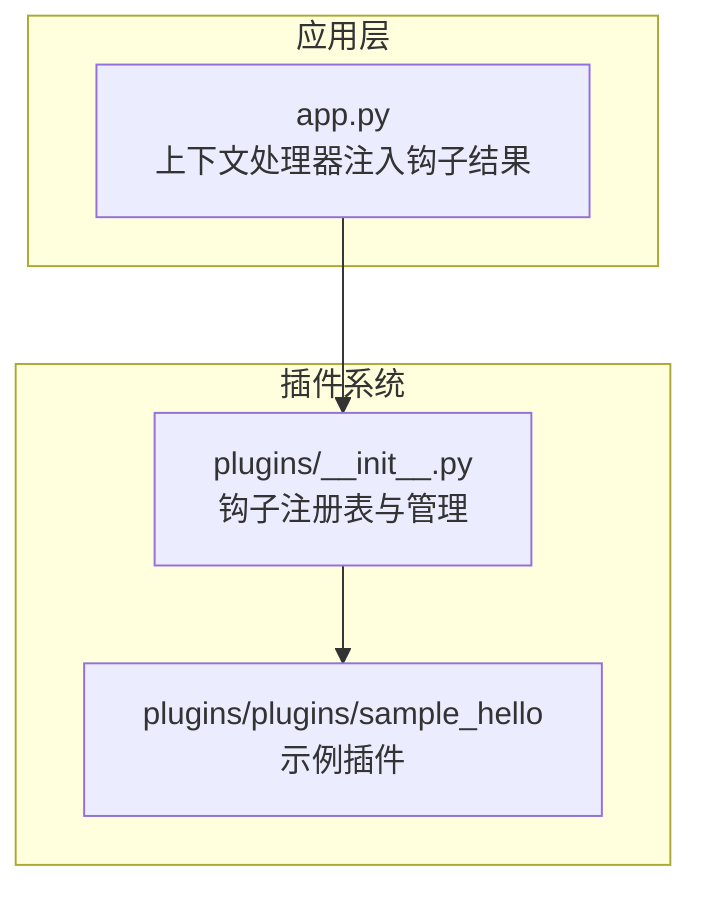
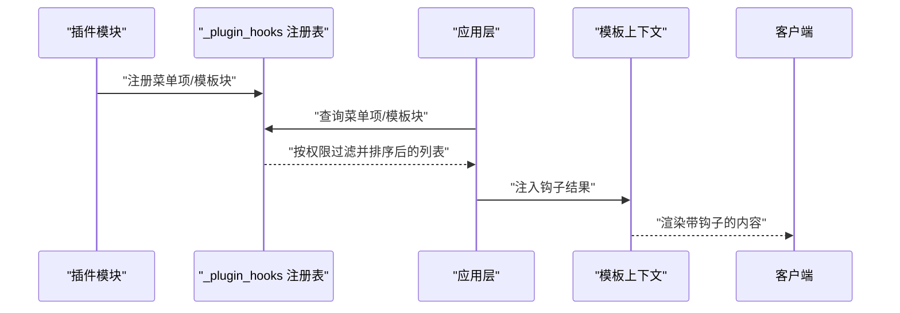
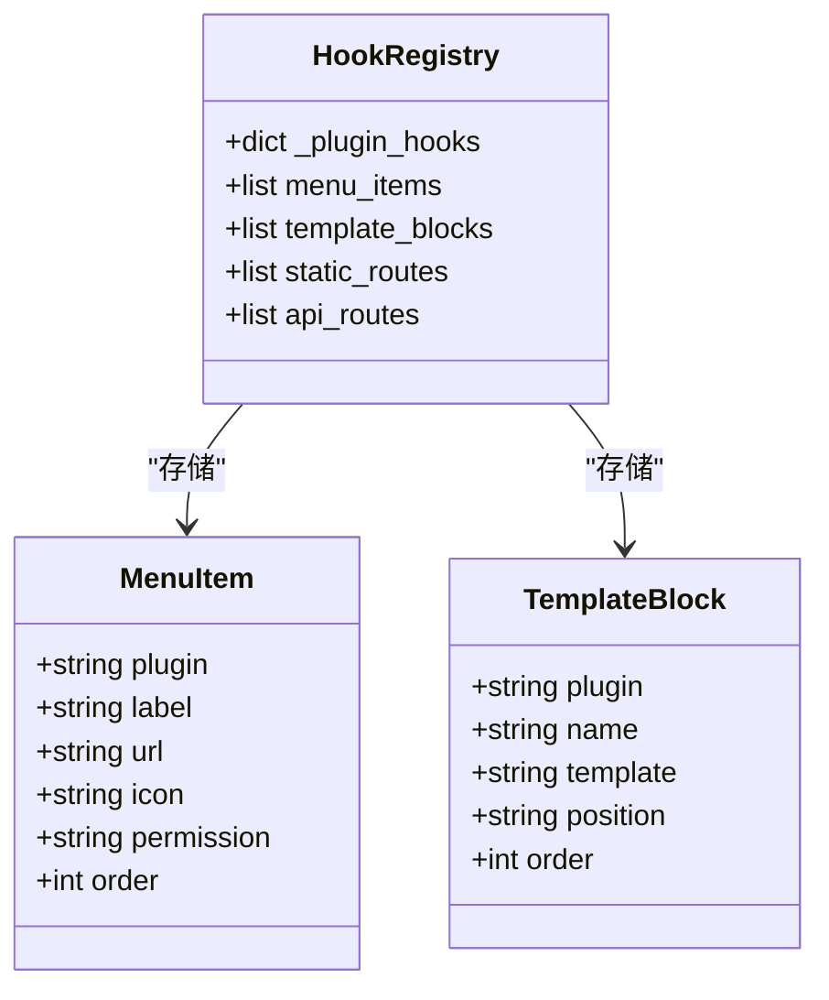
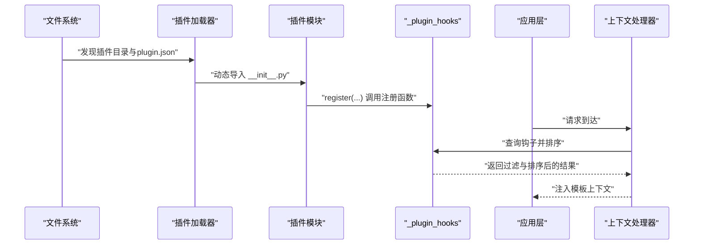
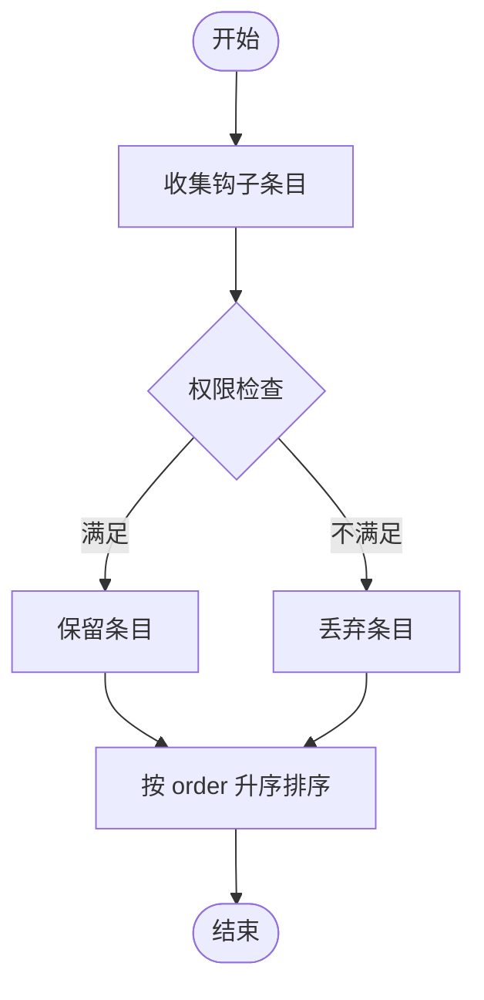
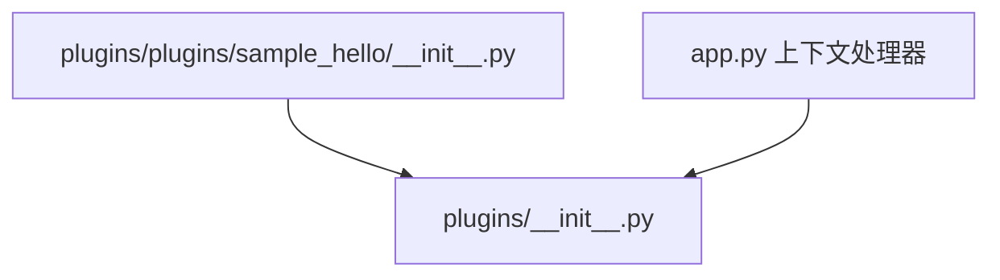

# 钩子注册与管理

<cite>
**本文档引用的文件**
- [plugins/__init__.py](file://plugins/__init__.py)
- [app.py](file://app.py)
- [plugins/plugins/sample_hello/__init__.py](file://plugins/plugins/sample_hello/__init__.py)
- [plugins/plugins/sample_hello/plugin.json](file://plugins/plugins/sample_hello/plugin.json)
</cite>

## 目录
1. [引言](#引言)
2. [项目结构](#项目结构)
3. [核心组件](#核心组件)
4. [架构概览](#架构概览)
5. [详细组件分析](#详细组件分析)
6. [依赖分析](#依赖分析)
7. [性能考虑](#性能考虑)
8. [故障排查指南](#故障排查指南)
9. [结论](#结论)

## 引言
本文件系统性阐述 School_Web 的钩子注册与管理机制，重点围绕插件系统的钩子注册表 _plugin_hooks 的数据结构设计、注册流程、生命周期管理、执行顺序与优先级控制、扩展方法以及性能与内存管理策略。读者无需深入编程背景即可理解钩子体系的工作原理与最佳实践。

## 项目结构
插件系统位于 plugins/ 目录，核心入口为 plugins/__init__.py。应用层通过 app.py 的上下文处理器将钩子结果注入模板上下文，供前端渲染使用。示例插件 sample_hello 展示了如何通过钩子注册菜单项与模板注入块。

**图表来源**
- [app.py:181-194](file://app.py#L181-L194)
- [plugins/__init__.py:1-249](file://plugins/__init__.py#L1-L249)
- [plugins/plugins/sample_hello/__init__.py:1-32](file://plugins/plugins/sample_hello/__init__.py#L1-L32)

**章节来源**
- [plugins/__init__.py:1-249](file://plugins/__init__.py#L1-L249)
- [app.py:181-194](file://app.py#L181-L194)

## 核心组件
- 钩子注册表 _plugin_hooks：集中存储各类钩子的注册列表，键为钩子类型，值为有序列表。
- 钩子注册函数：register_menu_item、register_template_block 等，供插件在加载时调用。
- 钩子查询函数：get_menu_items、get_template_blocks 等，按权限过滤与排序后返回给应用层。
- 插件生命周期：discover_plugins、load_plugin、unload_plugin 管理插件发现、加载与卸载。

**章节来源**
- [plugins/__init__.py:16-22](file://plugins/__init__.py#L16-L22)
- [plugins/__init__.py:143-184](file://plugins/__init__.py#L143-L184)
- [plugins/__init__.py:25-136](file://plugins/__init__.py#L25-L136)

## 架构概览
钩子系统采用“注册-查询-注入”的三层架构：
- 注册阶段：插件在加载时调用注册函数，将钩子条目写入 _plugin_hooks 对应列表。
- 查询阶段：应用层通过上下文处理器调用查询函数，按权限过滤并按 order 排序。
- 注入阶段：查询结果被注入模板上下文，供前端渲染使用。

**图表来源**
- [plugins/__init__.py:143-184](file://plugins/__init__.py#L143-L184)
- [app.py:181-194](file://app.py#L181-L194)

## 详细组件分析

### 钩子注册表与数据结构
- _plugin_hooks 是一个字典，键为钩子类型，值为列表。当前包含：
  - menu_items：菜单项列表
  - template_blocks：模板注入块列表
  - static_routes：静态文件路由列表
  - api_routes：API 路由列表
- 每个钩子条目包含插件标识与业务字段（如 label、url、icon、permission、order、position、template 等）。

**图表来源**
- [plugins/__init__.py:16-22](file://plugins/__init__.py#L16-L22)
- [plugins/__init__.py:143-184](file://plugins/__init__.py#L143-L184)

**章节来源**
- [plugins/__init__.py:16-22](file://plugins/__init__.py#L16-L22)

### 钩子注册流程与生命周期
- 发现插件：扫描 plugins/plugins/ 目录，读取 plugin.json 与 __init__.py。
- 加载插件：动态导入模块，调用插件的 register 函数，后者通过注册函数向 _plugin_hooks 写入条目。
- 卸载插件：调用插件的 unregister 函数（若存在），删除 sys.modules 中的模块引用，并从 _loaded_plugins 中移除。
- 应用层注入：上下文处理器在每次请求时调用查询函数，将钩子结果注入模板上下文。

**图表来源**
- [plugins/__init__.py:25-136](file://plugins/__init__.py#L25-L136)
- [plugins/__init__.py:143-184](file://plugins/__init__.py#L143-L184)
- [app.py:181-194](file://app.py#L181-L194)

**章节来源**
- [plugins/__init__.py:25-136](file://plugins/__init__.py#L25-L136)
- [app.py:181-194](file://app.py#L181-L194)

### 钩子执行顺序与优先级
- 排序依据：每个钩子条目包含 order 字段，默认值为 100。查询函数按 order 升序排序，数值越小优先级越高。
- 权限过滤：菜单项查询函数根据用户权限与条目所需权限进行匹配，仅返回可见项。

**图表来源**
- [plugins/__init__.py:154-164](file://plugins/__init__.py#L154-L164)
- [plugins/__init__.py:178-184](file://plugins/__init__.py#L178-L184)

**章节来源**
- [plugins/__init__.py:154-164](file://plugins/__init__.py#L154-L164)
- [plugins/__init__.py:178-184](file://plugins/__init__.py#L178-L184)

### 钩子类型与扩展方法
- 当前钩子类型：
  - menu_items：菜单项，包含 label、url、icon、permission、order 等。
  - template_blocks：模板注入块，包含 name、template、position、order 等。
  - static_routes：静态文件路由（预留）。
  - api_routes：API 路由（预留）。
- 扩展新钩子类型步骤：
  1) 在 _plugin_hooks 中新增键与空列表。
  2) 实现注册函数 register_my_hook(plugin_name, hook_data)。
  3) 实现查询函数 get_my_hooks(...)，按需过滤与排序。
  4) 在插件的 register 函数中调用 register_my_hook(...)。
  5) 在应用层上下文处理器中注入查询结果。

**章节来源**
- [plugins/__init__.py:16-22](file://plugins/__init__.py#L16-L22)
- [plugins/__init__.py:143-184](file://plugins/__init__.py#L143-L184)

### 示例插件与实现参考
- 示例插件 sample_hello 展示了如何注册菜单项与模板注入块，包括权限与排序字段的使用。
- 插件通过调用 plugins 包中的注册函数完成钩子注册。

**章节来源**
- [plugins/plugins/sample_hello/__init__.py:1-32](file://plugins/plugins/sample_hello/__init__.py#L1-L32)
- [plugins/plugins/sample_hello/plugin.json:1-7](file://plugins/plugins/sample_hello/plugin.json#L1-L7)

## 依赖分析
- 插件系统依赖于 Python 的动态导入机制（importlib.util）与 sys.modules 管理。
- 应用层通过上下文处理器依赖插件系统提供的查询函数。
- 插件与注册表之间为弱耦合：插件只依赖注册函数，不直接访问 _plugin_hooks。

**图表来源**
- [plugins/__init__.py:1-10](file://plugins/__init__.py#L1-L10)
- [plugins/plugins/sample_hello/__init__.py:1-5](file://plugins/plugins/sample_hello/__init__.py#L1-L5)
- [app.py:181-194](file://app.py#L181-L194)

**章节来源**
- [plugins/__init__.py:1-10](file://plugins/__init__.py#L1-L10)
- [app.py:181-194](file://app.py#L181-L194)

## 性能考虑
- 查询复杂度：菜单项与模板块的查询包含过滤与排序，时间复杂度近似 O(n log n)，其中 n 为对应钩子条目数量。
- 内存占用：_plugin_hooks 与 _loaded_plugins 为进程内常驻结构，建议避免在钩子中存储大型对象；必要时使用惰性加载或外部资源引用。
- 并发安全：当前实现未显式加锁，若多线程并发修改钩子表，需在注册与查询处增加同步机制。
- 缓存策略：对于稳定不变的钩子结果，可在应用层进行短期缓存以减少重复计算。

[本节为通用性能指导，不直接分析具体文件，故无“章节来源”]

## 故障排查指南
- 插件未生效
  - 检查插件目录是否存在 plugin.json 与 __init__.py。
  - 确认插件的 register 函数是否调用了正确的注册函数。
  - 查看应用日志，确认加载过程是否抛出异常。
- 权限导致菜单不可见
  - 检查菜单项的 permission 字段与用户权限等级映射。
- 排序不符合预期
  - 确认 order 字段是否正确设置，数值越小优先级越高。
- 卸载后残留
  - 确认插件的 unregister 函数是否实现；检查 sys.modules 是否清理。

**章节来源**
- [plugins/__init__.py:25-136](file://plugins/__init__.py#L25-L136)
- [plugins/__init__.py:154-164](file://plugins/__init__.py#L154-L164)

## 结论
School_Web 的钩子系统通过简洁的注册表与查询函数实现了插件化的扩展能力。其设计强调：
- 明确的钩子类型与数据结构
- 清晰的注册与查询流程
- 基于 order 的排序与基于权限的过滤
- 易于扩展的新钩子类型机制

在实际部署中，建议关注并发安全、内存占用与缓存策略，以获得更稳定的性能表现。