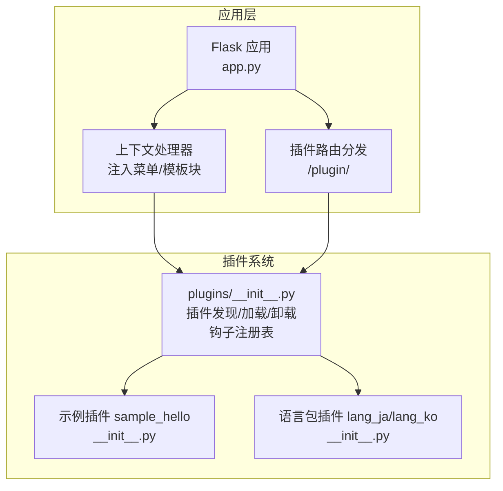
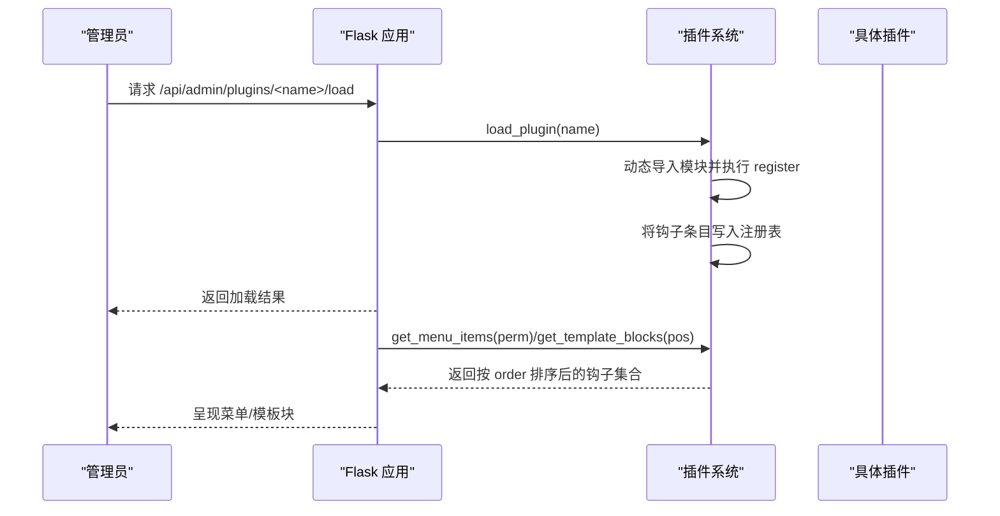
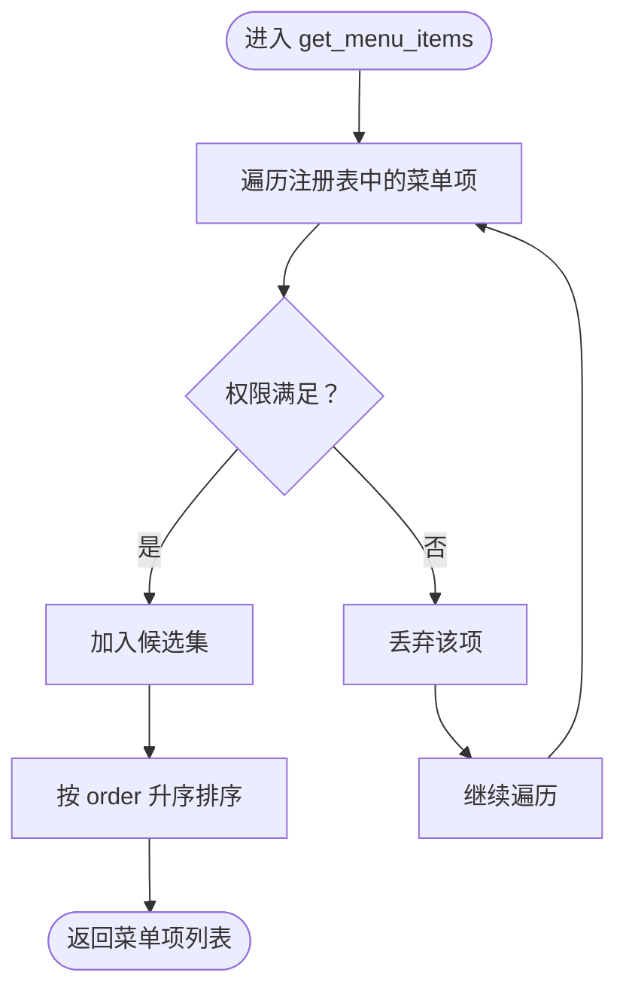
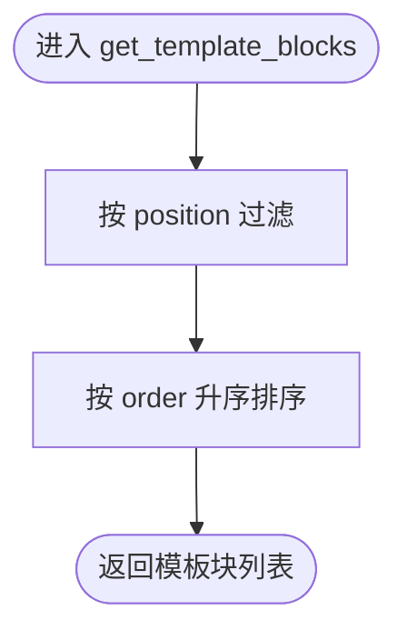
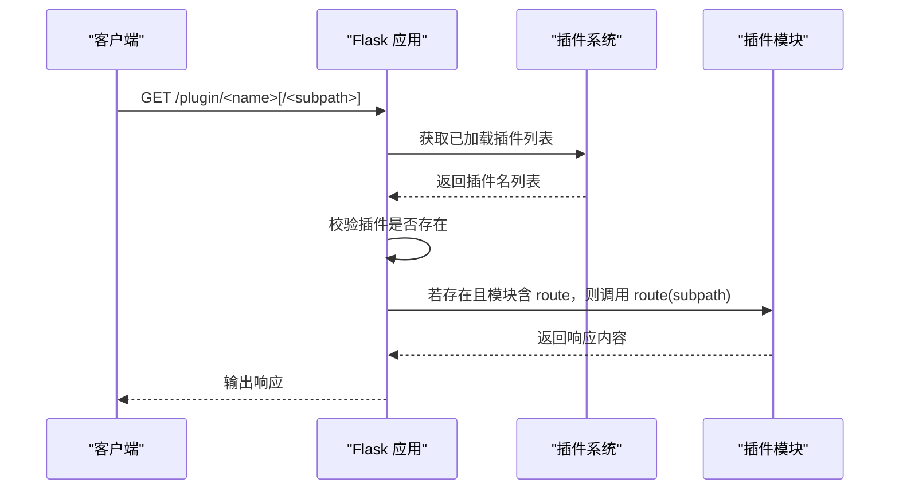
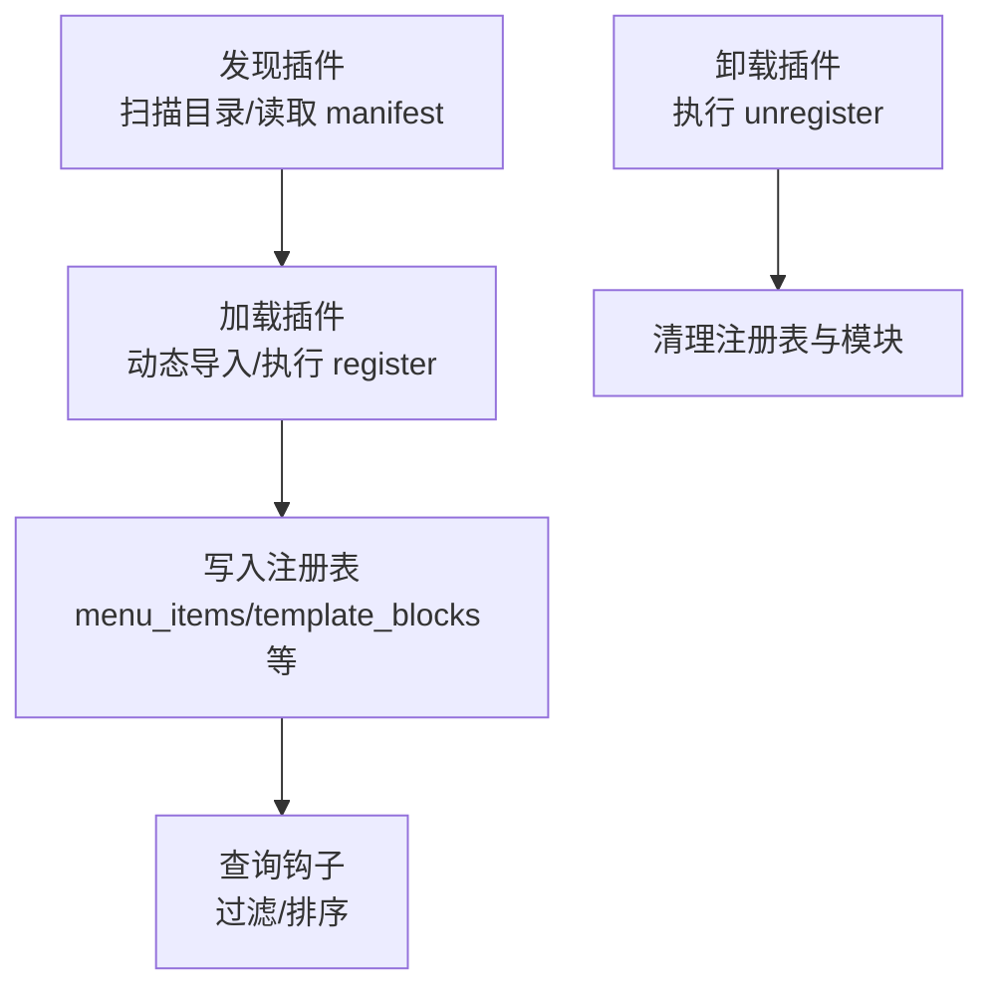
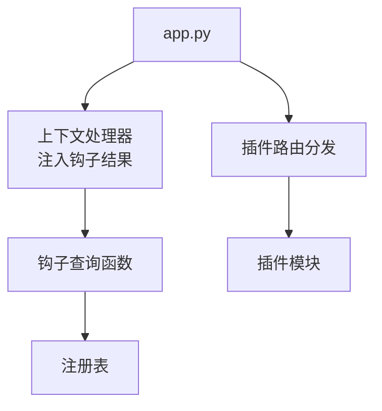

# 钩子系统机制

<cite>
**本文引用的文件**
- [app.py](file://app.py)
- [plugins/__init__.py](file://plugins/__init__.py)
- [plugins/plugins/sample_hello/__init__.py](file://plugins/plugins/sample_hello/__init__.py)
- [plugins/plugins/sample_hello/plugin.json](file://plugins/plugins/sample_hello/plugin.json)
- [plugins/plugins/lang_ja/__init__.py](file://plugins/plugins/lang_ja/__init__.py)
- [plugins/plugins/lang_ko/__init__.py](file://plugins/plugins/lang_ko/__init__.py)
- [plugins/plugins/lang_ja/plugin.json](file://plugins/plugins/lang_ja/plugin.json)
- [plugins/plugins/lang_ko/plugin.json](file://plugins/plugins/lang_ko/plugin.json)
</cite>

## 目录
1. [引言](#引言)
2. [项目结构](#项目结构)
3. [核心组件](#核心组件)
4. [架构总览](#架构总览)
5. [详细组件分析](#详细组件分析)
6. [依赖分析](#依赖分析)
7. [性能考虑](#性能考虑)
8. [故障排查指南](#故障排查指南)
9. [结论](#结论)
10. [附录](#附录)

## 引言
本文件系统性解析 School_Web 的插件钩子体系，重点阐述以下方面：
- 钩子工作原理与执行机制：事件触发、回调注册、执行顺序控制
- 四种主要钩子类型：menu_items（菜单项）、template_blocks（模板注入）、static_routes（静态路由）、api_routes（API路由）的实现与使用场景
- 钩子注册与管理的数据结构：注册表组织方式与查找机制
- 扩展方法：如何添加自定义钩子类型与实现复杂钩子链
- 性能与最佳实践：并发、持久化、线程安全与跨插件交互注意事项

## 项目结构
- 应用入口与钩子集成点位于应用层，通过上下文处理器向模板注入钩子结果，并在路由层处理插件路由转发
- 插件系统位于 plugins 包，负责插件发现、加载、卸载与钩子注册表管理
- 示例与语言包插件演示了菜单与模板注入的实际用法

图表来源
- [app.py:181-194](file://app.py#L181-L194)
- [app.py:5187-5197](file://app.py#L5187-L5197)
- [plugins/__init__.py:138-193](file://plugins/__init__.py#L138-L193)

章节来源
- [app.py:181-194](file://app.py#L181-L194)
- [plugins/__init__.py:138-193](file://plugins/__init__.py#L138-L193)

## 核心组件
- 插件注册表：按钩子类型维护有序列表，支持菜单项、模板注入块等
- 钩子注册函数：由插件在注册阶段调用，写入注册表
- 钩子查询函数：按用户权限与位置过滤，按 order 排序输出
- 插件生命周期：发现 → 加载（调用 register）→ 卸载（调用 unregister）

章节来源
- [plugins/__init__.py:16-22](file://plugins/__init__.py#L16-L22)
- [plugins/__init__.py:143-193](file://plugins/__init__.py#L143-L193)
- [plugins/__init__.py:60-136](file://plugins/__init__.py#L60-L136)

## 架构总览
钩子系统围绕“注册表”展开，插件在加载时调用注册函数写入注册表；应用在渲染模板或处理请求前，通过查询函数从注册表中提取并排序结果。

图表来源
- [app.py:5222-5228](file://app.py#L5222-L5228)
- [plugins/__init__.py:60-110](file://plugins/__init__.py#L60-L110)
- [plugins/__init__.py:154-184](file://plugins/__init__.py#L154-L184)

## 详细组件分析

### 菜单项钩子 menu_items
- 注册：插件在 register 中调用注册函数写入注册表
- 查询：按用户权限过滤，再按 order 升序排序
- 使用：上下文处理器注入到模板，供前端渲染导航菜单

图表来源
- [plugins/__init__.py:154-164](file://plugins/__init__.py#L154-L164)
- [plugins/__init__.py:187-192](file://plugins/__init__.py#L187-L192)

章节来源
- [plugins/__init__.py:143-164](file://plugins/__init__.py#L143-L164)
- [plugins/__init__.py:187-192](file://plugins/__init__.py#L187-L192)
- [app.py:191](file://app.py#L191)

### 模板注入钩子 template_blocks
- 注册：插件在 register 中调用注册函数，声明位置（如 footer/head）与模板片段
- 查询：按位置过滤，再按 order 升序排序
- 使用：上下文处理器注入到模板，渲染时拼接模板块

图表来源
- [plugins/__init__.py:178-184](file://plugins/__init__.py#L178-L184)

章节来源
- [plugins/__init__.py:167-184](file://plugins/__init__.py#L167-L184)
- [app.py:192-193](file://app.py#L192-L193)

### 静态路由钩子 static_routes
- 当前实现：插件系统未提供专门的 static_routes 钩子注册/查询函数
- 现状说明：应用层未见针对该钩子类型的注册与执行逻辑
- 建议：若需扩展，可在插件系统中新增注册表键与查询函数，并在应用启动时批量注册

章节来源
- [plugins/__init__.py:16-22](file://plugins/__init__.py#L16-L22)
- [plugins/__init__.py:143-193](file://plugins/__init__.py#L143-L193)

### API 路由钩子 api_routes
- 当前实现：插件系统未提供专门的 api_routes 钩子注册/查询函数
- 现状说明：应用层未见针对该钩子类型的注册与执行逻辑
- 建议：若需扩展，可在插件系统中新增注册表键与查询函数，并在应用启动时批量注册

章节来源
- [plugins/__init__.py:16-22](file://plugins/__init__.py#L16-L22)
- [plugins/__init__.py:143-193](file://plugins/__init__.py#L143-L193)

### 插件路由转发（插件自定义路由）
- 应用层提供统一的插件路由分发器，根据插件名称定位已加载插件模块，若模块提供 route，则交由插件自行处理子路径
- 适用场景：HTML/Vue 插件或需要自定义路由的插件

图表来源
- [app.py:5187-5197](file://app.py#L5187-L5197)

章节来源
- [app.py:5187-5197](file://app.py#L5187-L5197)

### 插件生命周期与注册表
- 发现：扫描插件目录，读取 plugin.json 与 __init__.py
- 加载：动态导入模块，调用 register 并写入注册表
- 卸载：调用 unregister，清理注册表与 sys.modules
- 注册表：按钩子类型维护列表，元素包含插件名与钩子元数据

图表来源
- [plugins/__init__.py:25-57](file://plugins/__init__.py#L25-L57)
- [plugins/__init__.py:60-110](file://plugins/__init__.py#L60-L110)
- [plugins/__init__.py:112-136](file://plugins/__init__.py#L112-L136)

章节来源
- [plugins/__init__.py:25-136](file://plugins/__init__.py#L25-L136)

### 示例与语言包插件
- 示例插件：演示菜单项与模板注入的注册方式
- 语言包插件：在注册时扩展支持语言列表，并注入空模板块用于后续扩展

章节来源
- [plugins/plugins/sample_hello/__init__.py:9-31](file://plugins/plugins/sample_hello/__init__.py#L9-L31)
- [plugins/plugins/lang_ja/__init__.py:18-34](file://plugins/plugins/lang_ja/__init__.py#L18-L34)
- [plugins/plugins/lang_ko/__init__.py:17-33](file://plugins/plugins/lang_ko/__init__.py#L17-L33)

## 依赖分析
- 插件系统依赖于 Flask 上下文处理器与路由机制
- 应用层通过上下文处理器注入钩子结果，模板渲染时使用
- 插件路由转发依赖于已加载插件模块的 route 方法

图表来源
- [app.py:181-194](file://app.py#L181-L194)
- [app.py:5187-5197](file://app.py#L5187-L5197)
- [plugins/__init__.py:154-184](file://plugins/__init__.py#L154-L184)

章节来源
- [app.py:181-194](file://app.py#L181-L194)
- [plugins/__init__.py:154-184](file://plugins/__init__.py#L154-L184)

## 性能考虑
- 注册表为内存列表，查询为线性扫描 + 排序，适合中小规模插件数量
- 权限检查与排序均为 O(n log n)，建议控制单页菜单项数量与模板块数量
- 插件加载/卸载涉及动态导入与模块清理，应避免频繁操作
- 模板注入的拼接发生在渲染阶段，注意模板片段大小与重复注入

[本节为通用指导，无需列出章节来源]

## 故障排查指南
- 插件未生效
  - 检查插件目录与 plugin.json 是否存在
  - 确认插件已加载（管理界面可查看）
  - 确认插件模块包含 register 且未抛异常
- 菜单项不显示
  - 检查权限字段与当前用户权限级别
  - 检查 order 字段是否导致排序后被截断
- 模板块未出现
  - 检查 position 是否正确
  - 检查模板片段是否为空或被其他块覆盖
- 插件路由 404
  - 确认插件已加载
  - 确认插件模块包含 route 方法

章节来源
- [plugins/__init__.py:60-110](file://plugins/__init__.py#L60-L110)
- [plugins/__init__.py:154-184](file://plugins/__init__.py#L154-L184)
- [app.py:5187-5197](file://app.py#L5187-L5197)

## 结论
- 钩子系统以“注册表 + 查询函数”的简洁模式实现插件扩展，当前聚焦菜单与模板注入
- 插件路由转发提供灵活的自定义路由能力
- 对于静态路由与 API 路由钩子，当前未提供专用注册/查询函数，可通过扩展注册表与查询逻辑实现
- 建议在扩展新钩子类型时保持注册表结构一致、查询函数幂等与线程安全

[本节为总结性内容，无需列出章节来源]

## 附录

### 钩子类型与职责对照
- menu_items：注册导航菜单项，支持权限过滤与排序
- template_blocks：注册模板注入块，按位置与排序拼接到模板
- static_routes：静态路由钩子（当前未实现）
- api_routes：API 路由钩子（当前未实现）

章节来源
- [plugins/__init__.py:16-22](file://plugins/__init__.py#L16-L22)
- [plugins/__init__.py:154-184](file://plugins/__init__.py#L154-L184)

### 扩展钩子类型的步骤建议
- 在注册表中新增键与对应查询函数
- 在插件注册阶段提供注册函数
- 在应用启动或请求前刷新钩子结果
- 在模板或路由层消费钩子结果

章节来源
- [plugins/__init__.py:16-22](file://plugins/__init__.py#L16-L22)
- [plugins/__init__.py:143-193](file://plugins/__init__.py#L143-L193)