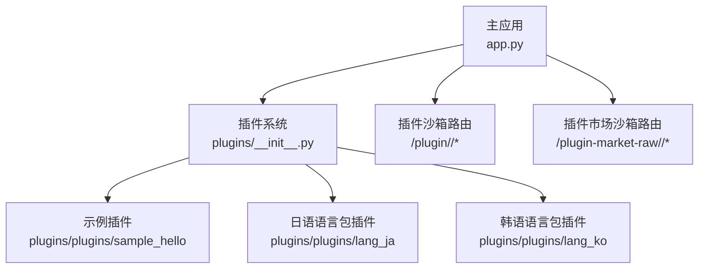
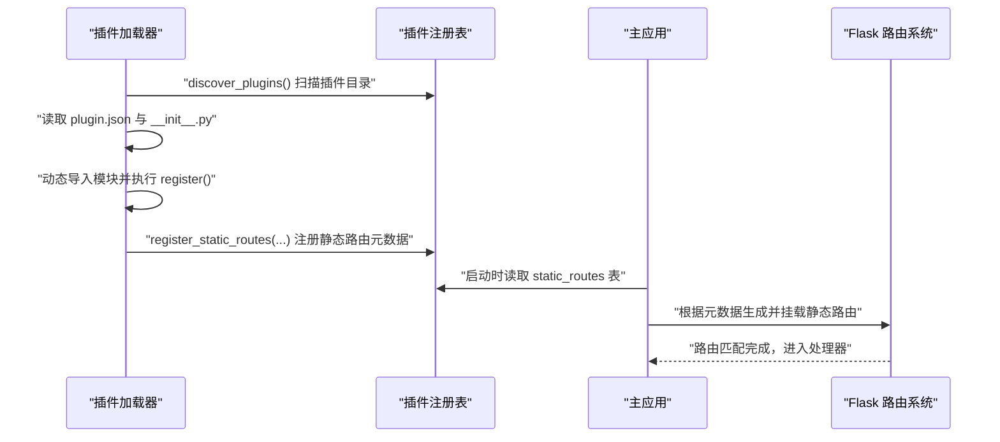
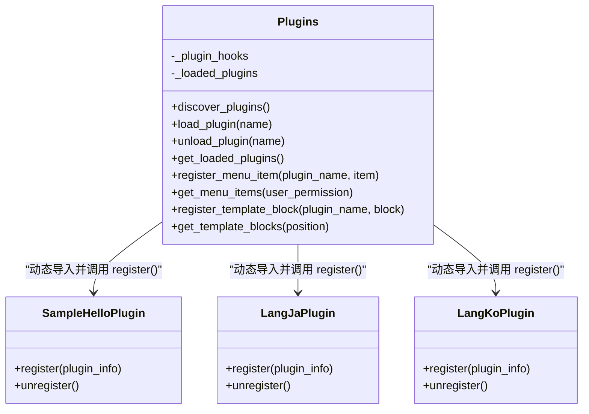
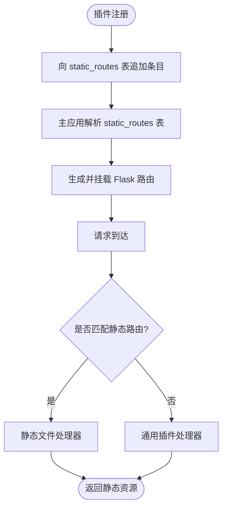
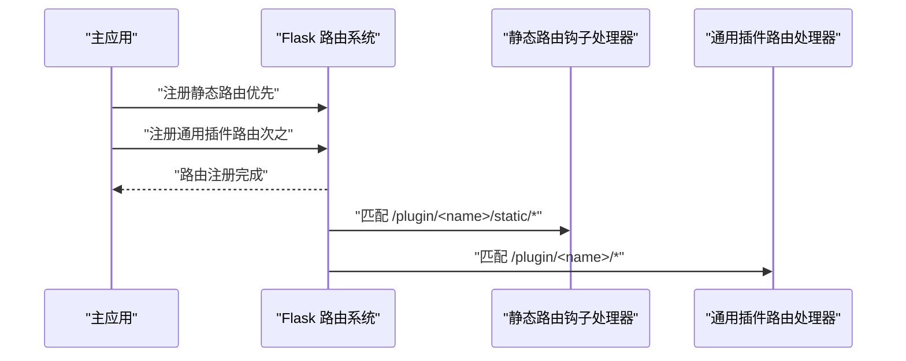
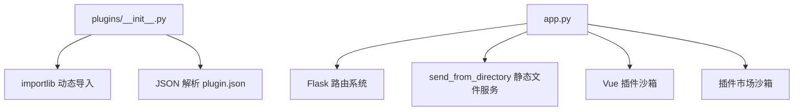

# 静态路由钩子

<cite>
**本文引用的文件**
- [app.py](file://app.py)
- [plugins/__init__.py](file://plugins/__init__.py)
- [plugins/plugins/sample_hello/__init__.py](file://plugins/plugins/sample_hello/__init__.py)
- [plugins/plugins/sample_hello/plugin.json](file://plugins/plugins/sample_hello/plugin.json)
- [plugins/plugins/lang_ja/__init__.py](file://plugins/plugins/lang_ja/__init__.py)
- [plugins/plugins/lang_ja/plugin.json](file://plugins/plugins/lang_ja/plugin.json)
- [plugins/plugins/lang_ko/__init__.py](file://plugins/plugins/lang_ko/__init__.py)
- [plugins/plugins/lang_ko/plugin.json](file://plugins/plugins/lang_ko/plugin.json)
</cite>

## 目录
1. [引言](#引言)
2. [项目结构](#项目结构)
3. [核心组件](#核心组件)
4. [架构总览](#架构总览)
5. [详细组件分析](#详细组件分析)
6. [依赖分析](#依赖分析)
7. [性能考虑](#性能考虑)
8. [故障排查指南](#故障排查指南)
9. [结论](#结论)
10. [附录](#附录)

## 引言
本技术文档聚焦“静态路由钩子”，系统性阐述其设计目的、实现机制与集成方式，重点说明如何通过钩子系统为插件提供独立的静态文件服务能力。文档涵盖以下要点：
- 设计目的：为插件提供可扩展、可隔离、可配置的静态资源访问接口，避免与主应用路由耦合。
- 实现机制：在插件系统中定义“static_routes”钩子注册表，插件通过注册函数向该表注入静态路由元数据，主应用在启动阶段或运行时按约定解析并挂载。
- 注册流程：插件加载时调用注册函数，向“static_routes”表追加条目；主应用侧负责解析这些条目并映射到实际的 Flask 路由。
- 路由规则配置：通过插件的 manifest 或注册函数传入的参数，声明静态资源根目录、URL 前缀、访问权限等。
- 与 Flask 路由系统的集成：静态路由钩子与现有 Flask 路由（如插件沙箱路由）共存，遵循 Flask 的路由匹配顺序与优先级策略。
- 应用场景与示例：展示如何为插件提供独立的静态资源访问接口，以及如何结合插件市场沙箱进行安全隔离。
- 配置选项与最佳实践：给出钩子配置建议、安全注意事项与性能优化方向。

## 项目结构
本项目采用“插件化 + Flask 路由”的架构。插件系统位于 plugins/ 目录，主应用位于 app.py。静态路由钩子属于插件系统的一部分，通过注册表集中管理。

图表来源
- [app.py](file://app.py)
- [plugins/__init__.py](file://plugins/__init__.py)
- [plugins/plugins/sample_hello/__init__.py](file://plugins/plugins/sample_hello/__init__.py)
- [plugins/plugins/lang_ja/__init__.py](file://plugins/plugins/lang_ja/__init__.py)
- [plugins/plugins/lang_ko/__init__.py](file://plugins/plugins/lang_ko/__init__.py)

章节来源
- [app.py](file://app.py)
- [plugins/__init__.py](file://plugins/__init__.py)

## 核心组件
- 插件系统注册表：维护“menu_items”、“template_blocks”、“static_routes”、“api_routes”等钩子表，用于集中管理插件扩展点。
- 插件加载器：扫描 plugins/plugins/ 下的插件目录，读取 plugin.json 与 __init__.py，动态导入模块并调用其 register 函数。
- 主应用路由：提供插件沙箱路由与插件市场沙箱路由，用于加载插件的前端资源与沙箱渲染。

章节来源
- [plugins/__init__.py](file://plugins/__init__.py)
- [app.py](file://app.py)

## 架构总览
静态路由钩子的总体工作流如下：
- 插件在注册函数中向“static_routes”表注册静态资源的访问规则（如前缀、根目录、权限等）。
- 主应用在启动或运行时解析“static_routes”表，生成对应的 Flask 路由，并绑定到实际的静态文件服务函数。
- 请求到达时，Flask 按路由匹配顺序选择最合适的处理器；静态路由钩子的处理器优先于通用插件路由，确保静态资源的快速访问。

图表来源
- [plugins/__init__.py](file://plugins/__init__.py)
- [app.py](file://app.py)

## 详细组件分析

### 插件系统与钩子注册表
- 注册表结构：包含“menu_items”、“template_blocks”、“static_routes”、“api_routes”四个键，分别对应菜单项、模板注入块、静态路由与 API 路由。
- 插件发现：扫描 plugins/plugins/ 目录，读取每个子目录下的 plugin.json 与 __init__.py，判断是否存在 __init__.py，决定是否动态导入。
- 注册函数：插件在 register() 中调用注册函数（如 register_menu_item、register_template_block、register_static_routes 等）向注册表写入数据。
- 权限控制：在获取菜单项时，会根据用户权限过滤不可见项。

图表来源
- [plugins/__init__.py](file://plugins/__init__.py)
- [plugins/plugins/sample_hello/__init__.py](file://plugins/plugins/sample_hello/__init__.py)
- [plugins/plugins/lang_ja/__init__.py](file://plugins/plugins/lang_ja/__init__.py)
- [plugins/plugins/lang_ko/__init__.py](file://plugins/plugins/lang_ko/__init__.py)

章节来源
- [plugins/__init__.py](file://plugins/__init__.py)
- [plugins/plugins/sample_hello/__init__.py](file://plugins/plugins/sample_hello/__init__.py)
- [plugins/plugins/sample_hello/plugin.json](file://plugins/plugins/sample_hello/plugin.json)
- [plugins/plugins/lang_ja/__init__.py](file://plugins/plugins/lang_ja/__init__.py)
- [plugins/plugins/lang_ja/plugin.json](file://plugins/plugins/lang_ja/plugin.json)
- [plugins/plugins/lang_ko/__init__.py](file://plugins/plugins/lang_ko/__init__.py)
- [plugins/plugins/lang_ko/plugin.json](file://plugins/plugins/lang_ko/plugin.json)

### 静态路由钩子的设计与实现
- 设计目的：为插件提供独立的静态资源访问接口，避免与主应用路由耦合，提升插件的可移植性与安全性。
- 实现机制：在插件系统中预留“static_routes”注册表，插件通过注册函数向该表注入静态路由元数据；主应用侧负责解析并挂载到 Flask 路由。
- 配置项建议：前缀（如 /plugin/<name>/static/）、根目录（如插件目录下的 static/）、访问权限（如 guest/user/vip/administrator）、缓存策略（如 ETag/Cache-Control）。
- 与现有路由的关系：静态路由钩子与通用插件路由（/plugin/<name>/*）并存，静态路由优先匹配，确保静态资源的高效访问。

图表来源
- [plugins/__init__.py](file://plugins/__init__.py)
- [app.py](file://app.py)

章节来源
- [plugins/__init__.py](file://plugins/__init__.py)
- [app.py](file://app.py)

### 与 Flask 路由系统的集成与优先级
- 集成方式：主应用在启动时读取“static_routes”表，为每个条目生成对应的 Flask 路由（如 /plugin/<name>/static/<path>），并绑定到静态文件服务函数。
- 优先级处理：Flask 路由匹配遵循“先到先得”的原则，静态路由钩子生成的路由应尽量靠前注册，以确保静态资源优先命中。
- 与插件沙箱路由的关系：插件沙箱路由（/plugin/<name>/*）与静态路由钩子互补，前者用于加载插件的前端资源，后者用于提供静态文件服务。

图表来源
- [app.py](file://app.py)

章节来源
- [app.py](file://app.py)

### 实际应用场景与使用示例
- 场景一：插件自带静态资源（如 CSS、JS、图片）。插件在注册函数中调用注册静态路由，声明前缀与根目录，主应用挂载后即可通过 /plugin/<name>/static/* 访问。
- 场景二：多语言插件提供本地化资源。插件在注册函数中注册静态路由，指向语言包目录，便于前端按需加载。
- 场景三：插件市场中的第三方插件。通过插件市场沙箱路由加载插件的 index.html 与静态资源，结合 CSP 与 sandbox 保证安全。

章节来源
- [plugins/plugins/sample_hello/__init__.py](file://plugins/plugins/sample_hello/__init__.py)
- [plugins/plugins/lang_ja/__init__.py](file://plugins/plugins/lang_ja/__init__.py)
- [plugins/plugins/lang_ko/__init__.py](file://plugins/plugins/lang_ko/__init__.py)
- [app.py](file://app.py)

## 依赖分析
- 插件系统依赖：依赖 Python 的 importlib 与 JSON 解析，动态导入插件模块并执行其注册函数。
- 主应用依赖：依赖 Flask 的路由系统与静态文件服务函数，负责挂载静态路由钩子与通用插件路由。
- 第三方依赖：前端 Vue 插件沙箱通过 CDN 加载 Vue，插件市场沙箱通过 CSP 与 sandbox 限制能力。

图表来源
- [plugins/__init__.py](file://plugins/__init__.py)
- [app.py](file://app.py)

章节来源
- [plugins/__init__.py](file://plugins/__init__.py)
- [app.py](file://app.py)

## 性能考虑
- 路由匹配效率：静态路由钩子应尽量使用精确前缀，减少通配符匹配带来的开销。
- 缓存策略：为静态资源设置合理的 Cache-Control 与 ETag，降低带宽与服务器压力。
- 文件系统访问：静态文件服务应限制在插件目录范围内，避免路径穿越与不必要的 IO。
- 并发与限速：结合全局速率限制与白名单机制，防止滥用静态路由导致的资源耗尽。

## 故障排查指南
- 插件未加载：确认插件目录下存在 plugin.json 与 __init__.py，且注册函数正确调用了注册静态路由的接口。
- 路由未生效：检查主应用是否在启动时解析了“static_routes”表并成功挂载了路由。
- 访问 404：确认请求路径与静态路由前缀一致，且文件存在于插件目录的静态资源根目录中。
- 安全问题：确保静态路由钩子仅暴露必要的静态资源，避免暴露敏感文件；结合 CSP 与沙箱策略提升安全性。

章节来源
- [plugins/__init__.py](file://plugins/__init__.py)
- [app.py](file://app.py)

## 结论
静态路由钩子通过“注册表 + 动态挂载”的方式，为插件提供了独立、可控、可扩展的静态资源访问能力。它与现有 Flask 路由系统无缝集成，既保持了灵活性，又兼顾了性能与安全。建议在插件开发中充分利用该机制，结合权限控制与缓存策略，构建高质量的插件生态。

## 附录
- 配置选项建议
  - 前缀：/plugin/<name>/static/
  - 根目录：插件目录下的 static/
  - 权限：guest/user/vip/administrator
  - 缓存：Cache-Control 与 ETag
- 最佳实践
  - 明确静态资源的命名规范与目录结构
  - 使用精确前缀，避免通配符滥用
  - 对外暴露的静态资源应进行最小化与压缩
  - 结合 CSP 与沙箱策略，确保插件沙箱的安全性