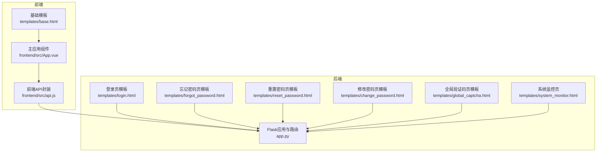
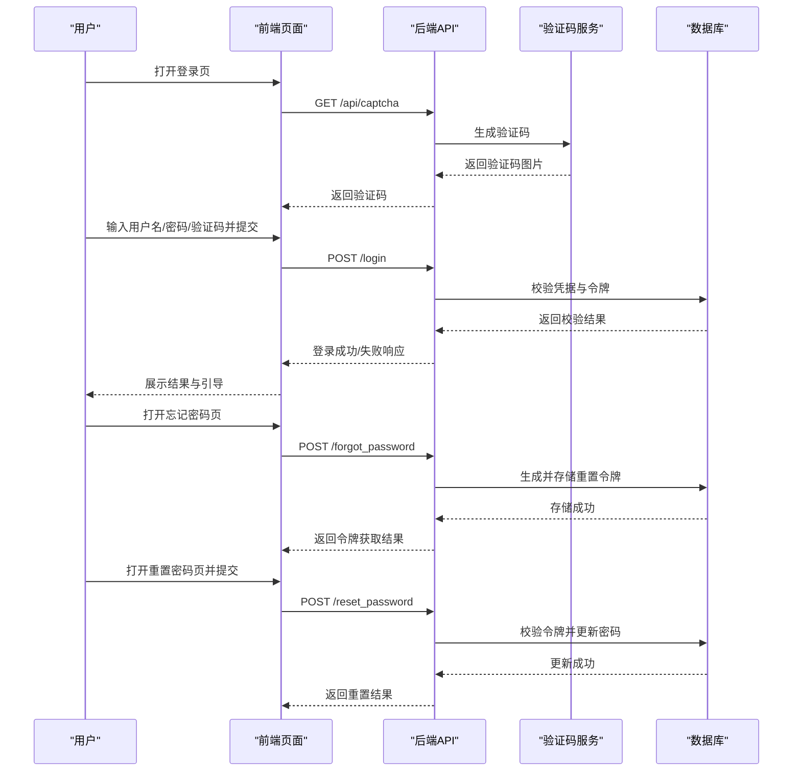
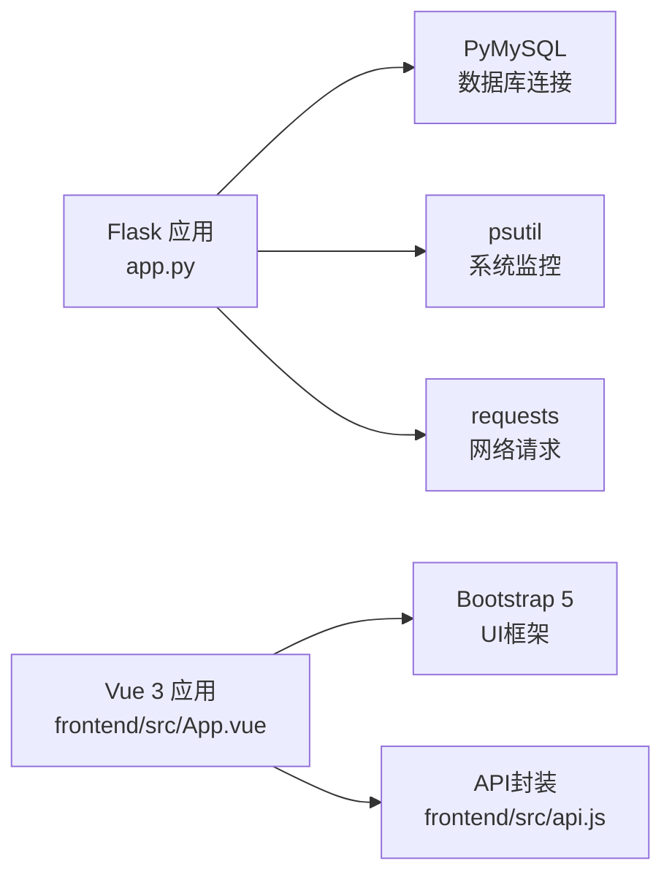

# 常见问题

<cite>
**本文引用的文件**
- [app.py](file://app.py)
- [login.html](file://templates/login.html)
- [forgot_password.html](file://templates/forgot_password.html)
- [reset_password.html](file://templates/reset_password.html)
- [change_password.html](file://templates/change_password.html)
- [global_captcha.html](file://templates/global_captcha.html)
- [base.html](file://templates/base.html)
- [api.js](file://frontend/src/api.js)
- [App.vue](file://frontend/src/App.vue)
- [system_monitor.html](file://templates/system_monitor.html)
- [dashboard.html](file://templates/dashboard.html)
- [requirements.txt](file://requirements.txt)
</cite>

## 目录
1. [简介](#简介)
2. [项目结构](#项目结构)
3. [核心组件](#核心组件)
4. [架构总览](#架构总览)
5. [详细组件分析](#详细组件分析)
6. [依赖分析](#依赖分析)
7. [性能考虑](#性能考虑)
8. [故障排查指南](#故障排查指南)
9. [结论](#结论)
10. [附录](#附录)

## 简介
本常见问题解答面向School_Web的使用者与维护者，聚焦用户在登录、验证码、密码重置、会话超时、权限与功能访问限制、浏览器与设备兼容性等方面常遇问题，提供错误代码说明、修复步骤、快速诊断与自助排障建议。文档同时结合前端与后端实现，帮助非技术读者也能快速定位并解决问题。

## 项目结构
- 后端采用Flask框架，提供认证、验证码、速率限制、全局安全验证、会话超时、权限控制与API等能力。
- 前端基于Vue 3构建，通过统一的/api/album接口与后端交互，部分页面包含浏览器与设备信息采集脚本，便于诊断兼容性问题。
- 模板系统使用Jinja2，提供国际化与安全响应头注入。

图表来源
- [app.py](file://app.py)
- [frontend/src/api.js](file://frontend/src/api.js)
- [frontend/src/App.vue](file://frontend/src/App.vue)
- [templates/base.html](file://templates/base.html)
- [templates/login.html](file://templates/login.html)
- [templates/forgot_password.html](file://templates/forgot_password.html)
- [templates/reset_password.html](file://templates/reset_password.html)
- [templates/change_password.html](file://templates/change_password.html)
- [templates/global_captcha.html](file://templates/global_captcha.html)
- [templates/system_monitor.html](file://templates/system_monitor.html)

章节来源
- [app.py](file://app.py)
- [frontend/src/api.js](file://frontend/src/api.js)
- [frontend/src/App.vue](file://frontend/src/App.vue)
- [templates/base.html](file://templates/base.html)

## 核心组件
- 登录与认证
  - 登录表单包含用户名、密码、验证码字段，验证码由后端生成并校验。
  - 支持“忘记密码”流程，通过用户名获取重置令牌，再在重置页设置新密码。
- 验证码体系
  - 图形验证码接口按IP进行速率限制；全局验证码门禁在特定场景要求二次验证。
- 会话与安全
  - 会话超时策略：IP在限定时间内无动作将被强制登出；安全响应头与CSP注入增强防护。
- 权限与功能访问
  - 不同权限（访客/用户/VIP/管理员）对功能入口与API有差异化访问限制。
- 前端交互
  - 统一的/api/album接口封装，配合会话携带与CSRF保护；系统监控页收集浏览器与设备信息辅助诊断。

章节来源
- [app.py](file://app.py)
- [templates/login.html](file://templates/login.html)
- [templates/forgot_password.html](file://templates/forgot_password.html)
- [templates/reset_password.html](file://templates/reset_password.html)
- [templates/change_password.html](file://templates/change_password.html)
- [templates/global_captcha.html](file://templates/global_captcha.html)
- [frontend/src/api.js](file://frontend/src/api.js)
- [frontend/src/App.vue](file://frontend/src/App.vue)
- [templates/system_monitor.html](file://templates/system_monitor.html)

## 架构总览
下图展示登录与密码重置的关键流程，以及验证码与会话超时的触发点。

图表来源
- [app.py](file://app.py)
- [templates/login.html](file://templates/login.html)
- [templates/forgot_password.html](file://templates/forgot_password.html)
- [templates/reset_password.html](file://templates/reset_password.html)

## 详细组件分析

### 登录失败
- 可能原因
  - 用户名或密码错误
  - 验证码错误或过期
  - 账户被锁定或速率限制触发
  - 会话超时导致需重新登录
- 修复步骤
  - 确认用户名与密码正确，注意大小写与特殊字符
  - 刷新验证码并重新输入
  - 若提示“请求过于频繁”，等待封禁解除或降低请求频率
  - 若提示“由于未操作自动退出登录”，重新登录即可
- 快速诊断
  - 查看页面是否有“请先登录”或“安全验证失败”的提示
  - 检查浏览器控制台是否存在跨域或CSP相关的报错

章节来源
- [app.py](file://app.py)
- [templates/login.html](file://templates/login.html)
- [templates/base.html](file://templates/base.html)

### 验证码错误
- 可能原因
  - 验证码输入不区分大小写但需完全匹配
  - 验证码过期或已被消费
  - 全局验证码门禁未通过
- 修复步骤
  - 点击验证码图片刷新，重新输入
  - 若出现全局验证码页，按提示完成二次验证
  - 检查网络是否稳定，避免并发请求导致验证码失效
- 快速诊断
  - 登录页与忘记/重置密码页均使用同一验证码接口
  - 全局验证码页会在未登录状态下对敏感操作触发

章节来源
- [app.py](file://app.py)
- [templates/login.html](file://templates/login.html)
- [templates/forgot_password.html](file://templates/forgot_password.html)
- [templates/reset_password.html](file://templates/reset_password.html)
- [templates/global_captcha.html](file://templates/global_captcha.html)

### 密码重置问题
- 常见问题
  - 忘记密码页面无法获取令牌
  - 重置密码页面提示令牌无效或过期
  - 新密码不符合强度要求
- 修复步骤
  - 在忘记密码页输入正确用户名与验证码，获取令牌
  - 在重置密码页粘贴令牌，输入新密码与确认密码
  - 新密码需满足最小长度且包含字母与数字
- 快速诊断
  - 确认令牌未过期（系统会记录有效期）
  - 检查两次输入的新密码一致

章节来源
- [templates/forgot_password.html](file://templates/forgot_password.html)
- [templates/reset_password.html](file://templates/reset_password.html)
- [app.py](file://app.py)

### 会话超时
- 触发条件
  - IP在设定时间内（约2.5分钟）无任何动作，下次请求将被强制登出
  - 登录/注册/登出页面与静态资源不参与超时检测
- 修复步骤
  - 重新登录系统
  - 在页面上进行常规操作（如切换标签、点击按钮）以维持活跃状态
- 快速诊断
  - 页面会闪退提示“由于未操作自动退出登录”
  - 检查是否长时间停留在静态资源或分享链接页

章节来源
- [app.py](file://app.py)
- [templates/base.html](file://templates/base.html)

### 权限与功能访问限制
- 权限等级
  - 访客：受限功能较多
  - 用户：可使用部分功能
  - VIP：解锁更多功能
  - 管理员：具备管理后台与高级权限
- 修复步骤
  - 申请VIP或管理员权限（若适用）
  - 检查当前权限等级与功能入口的对应关系
- 快速诊断
  - 仪表盘页面会显示当前权限徽章
  - 访客无法使用某些功能时，页面会提示需要VIP或管理员权限

章节来源
- [templates/dashboard.html](file://templates/dashboard.html)
- [app.py](file://app.py)

### 浏览器与设备兼容性
- 诊断要点
  - 系统监控页会采集浏览器、操作系统、屏幕分辨率、像素比、网络连接类型、Cookie启用状态等信息
  - 若页面样式异常或交互失效，优先检查上述指标
- 修复步骤
  - 使用主流浏览器（Chrome/Firefox/Edge/Safari）并保持最新版本
  - 确认Cookie启用、网络连接正常
  - 如在移动设备上出现布局问题，尝试切换横竖屏或调整缩放
- 快速诊断
  - 打开系统监控页，核对“浏览器/系统/屏幕/网络/Cookie”等信息
  - 若DNT或省流量模式影响功能，可在浏览器设置中关闭

章节来源
- [templates/system_monitor.html](file://templates/system_monitor.html)
- [app.py](file://app.py)

### 用户界面问题
- 常见表现
  - 页面空白、样式错乱、按钮无响应
- 修复步骤
  - 清除浏览器缓存并刷新页面
  - 禁用可能影响页面的浏览器扩展
  - 检查网络代理或防火墙是否阻断静态资源
- 快速诊断
  - 检查基础模板是否正确渲染（导航栏、通知铃铛等）
  - 查看浏览器开发者工具Network面板是否存在404/403/429等错误

章节来源
- [templates/base.html](file://templates/base.html)
- [frontend/src/App.vue](file://frontend/src/App.vue)
- [frontend/src/api.js](file://frontend/src/api.js)

## 依赖分析
- 后端依赖
  - Flask、PyMySQL、psutil、requests等，用于Web框架、数据库连接、系统监控与网络请求
- 前端依赖
  - Vue 3、Bootstrap 5、以及各业务组件（相册、留言板、播放器等）

图表来源
- [requirements.txt](file://requirements.txt)
- [app.py](file://app.py)
- [frontend/src/App.vue](file://frontend/src/App.vue)
- [frontend/src/api.js](file://frontend/src/api.js)

章节来源
- [requirements.txt](file://requirements.txt)
- [app.py](file://app.py)
- [frontend/src/App.vue](file://frontend/src/App.vue)
- [frontend/src/api.js](file://frontend/src/api.js)

## 性能考虑
- 速率限制与封禁
  - 对IP进行窗口化请求计数，超限时封禁并延长试探封禁时间
  - 白名单与手动封禁机制，便于管理员精准控制
- 验证码生成
  - 图形验证码按IP限流，防止暴力破解
- 会话超时
  - 降低长时间闲置带来的会话占用与潜在风险

章节来源
- [app.py](file://app.py)

## 故障排查指南

### 快速诊断清单
- 登录/验证码
  - 是否正确输入用户名与密码
  - 验证码是否刷新并匹配
  - 是否触发全局验证码门禁
- 会话与权限
  - 是否因超时被强制登出
  - 当前权限是否满足功能访问
- 浏览器与设备
  - Cookie是否启用
  - 网络连接类型与带宽是否正常
  - 浏览器版本是否过旧
- 前端交互
  - 控制台是否存在跨域/CSP错误
  - API调用是否返回预期状态码

### 常见错误代码与含义
- 400
  - 语言切换参数类型错误或不支持的语言
- 401
  - 未登录访问受保护资源
- 403
  - 需要安全验证（全局验证码）或权限不足（VIP/管理员）
- 429
  - 请求过于频繁，触发速率限制
- 500
  - 服务器内部错误（数据库连接失败等）

章节来源
- [app.py](file://app.py)

### 自助解决步骤
- 登录失败
  - 刷新验证码并重试；若频繁失败，稍后再试
- 验证码错误
  - 点击验证码图片刷新；确保输入正确
- 密码重置
  - 确认令牌有效且未过期；两次新密码输入一致
- 会话超时
  - 重新登录；在页面上进行操作以维持活跃
- 权限不足
  - 申请VIP或管理员权限；或切换到有权限的账户
- 浏览器兼容性
  - 使用最新版主流浏览器；开启Cookie；关闭可能干扰的扩展

## 结论
通过理解登录与密码重置流程、验证码与全局安全验证机制、会话超时策略、权限与功能访问限制，以及浏览器与设备兼容性诊断方法，用户可以高效自助解决大部分常见问题。若问题仍无法解决，建议参考系统监控页提供的客户端信息，以便更精准地定位问题。

## 附录

### 术语对照
- 会话超时：IP在限定时间内无动作，系统强制登出
- 全局验证码：对敏感操作或未登录状态下的二次安全验证
- 速率限制：按IP在时间窗口内的请求次数进行封禁

### 参考路径
- 登录页模板：[templates/login.html](file://templates/login.html)
- 忘记密码页模板：[templates/forgot_password.html](file://templates/forgot_password.html)
- 重置密码页模板：[templates/reset_password.html](file://templates/reset_password.html)
- 修改密码页模板：[templates/change_password.html](file://templates/change_password.html)
- 全局验证码页模板：[templates/global_captcha.html](file://templates/global_captcha.html)
- 基础模板：[templates/base.html](file://templates/base.html)
- 前端API封装：[frontend/src/api.js](file://frontend/src/api.js)
- 前端主应用：[frontend/src/App.vue](file://frontend/src/App.vue)
- 系统监控页：[templates/system_monitor.html](file://templates/system_monitor.html)
- 仪表盘页：[templates/dashboard.html](file://templates/dashboard.html)
- 后端应用：[app.py](file://app.py)
- 依赖清单：[requirements.txt](file://requirements.txt)