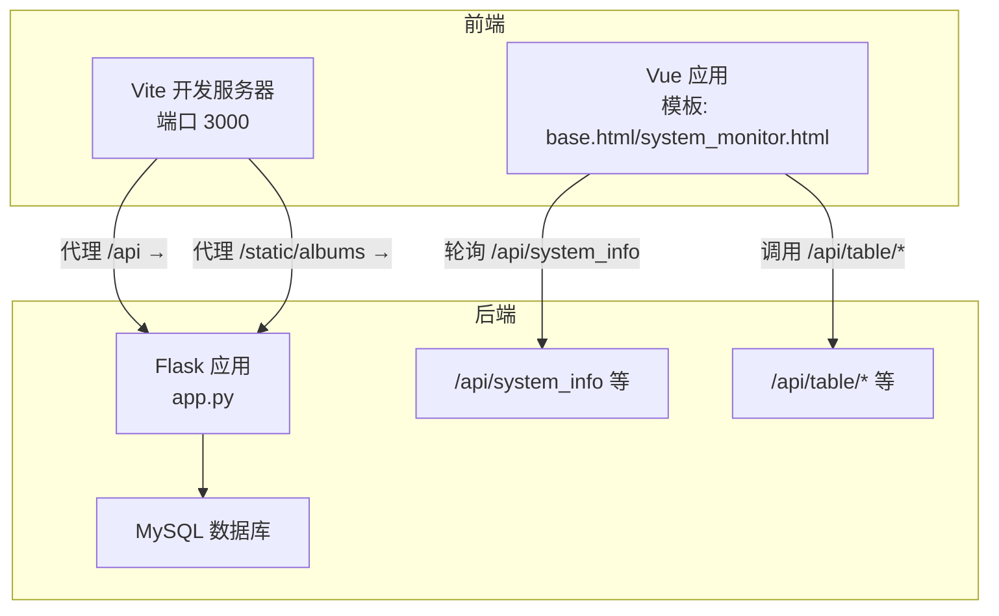
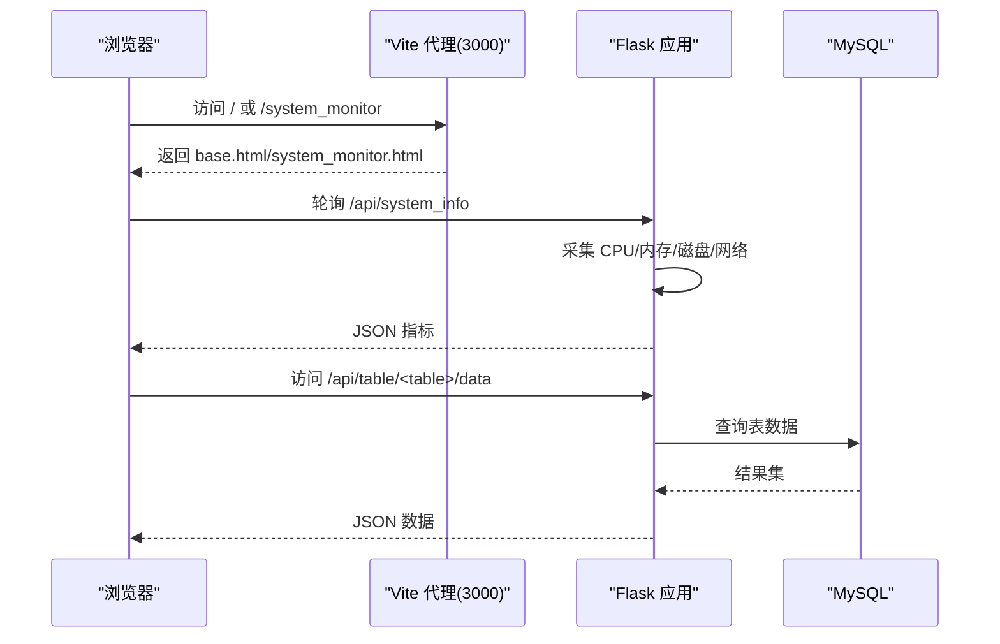
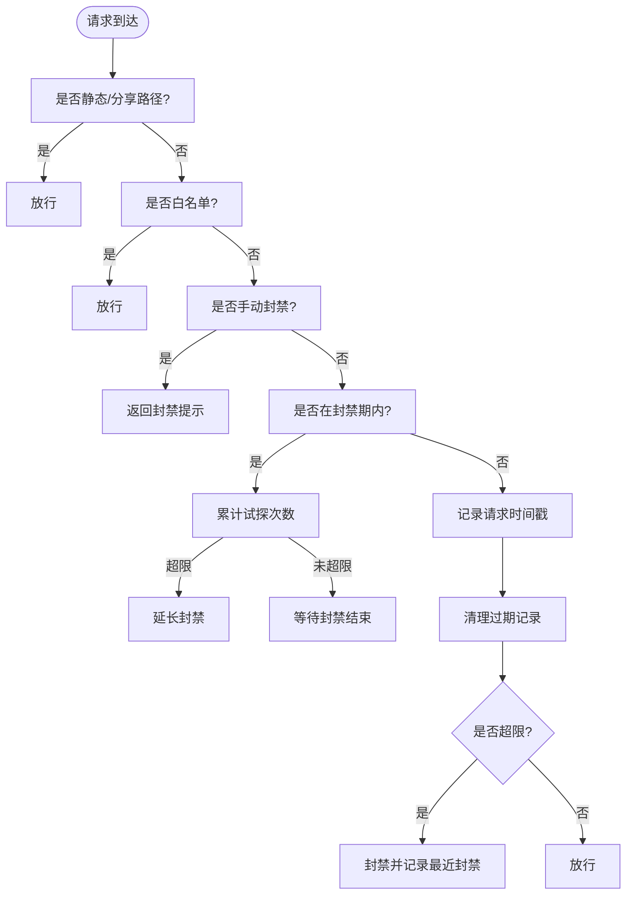
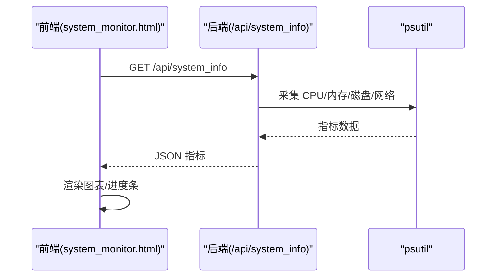
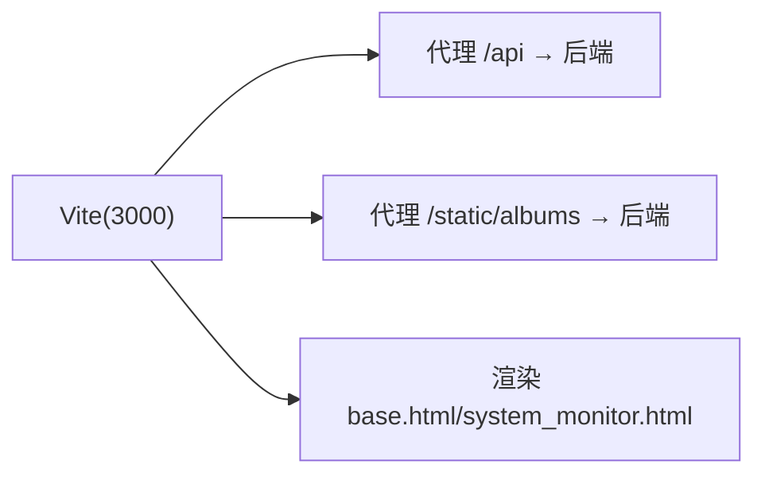
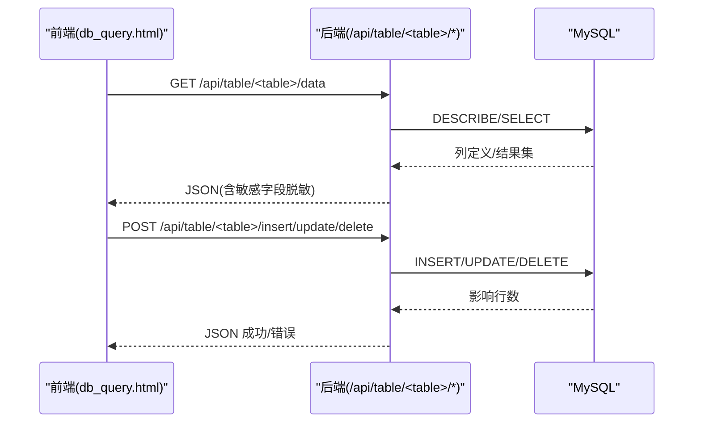
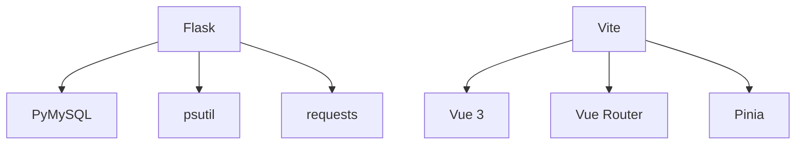

# 性能问题

**本文引用的文件**
- [app.py](file://app.py)
- [requirements.txt](file://requirements.txt)
- [frontend/package.json](file://frontend/package.json)
- [frontend/vite.config.js](file://frontend/vite.config.js)
- [templates/system_monitor.html](file://templates/system_monitor.html)
- [templates/admin_dashboard.html](file://templates/admin_dashboard.html)
- [templates/base.html](file://templates/base.html)
- [templates/db_captcha.html](file://templates/db_captcha.html)
- [rate_limiter.json](file://rate_limiter.json)

## 目录
1. [简介](#简介)
2. [项目结构](#项目结构)
3. [核心组件](#核心组件)
4. [架构总览](#架构总览)
5. [详细组件分析](#详细组件分析)
6. [依赖分析](#依赖分析)
7. [性能考量](#性能考量)
8. [故障排查指南](#故障排查指南)
9. [结论](#结论)
10. [附录](#附录)

## 简介
本指南面向 School_Web 的性能问题诊断与优化，聚焦三类瓶颈：数据库查询、前端资源加载与服务器响应时间。文档结合现有代码实现，给出可落地的优化建议、监控工具使用方法、缓存与CDN策略、静态资源压缩最佳实践，并提供性能测试与基准分析思路。

## 项目结构
- 后端基于 Flask，使用 PyMySQL 连接 MySQL，集成多语言、CORS、安全响应头、速率限制与系统监控等模块。
- 前端采用 Vite + Vue 3，开发服务器通过代理将 /api 与相册静态资源转发至后端。
- 模板层提供系统监控页面与基础布局，前端通过定时轮询调用后端 /api/system_info 等接口获取实时指标。

图表来源
- [frontend/vite.config.js:1-21](file://frontend/vite.config.js#L1-L21)
- [templates/system_monitor.html:36-270](file://templates/system_monitor.html#L36-L270)
- [app.py:1859-1888](file://app.py#L1859-L1888)
- [app.py:2370-2499](file://app.py#L2370-L2499)

章节来源
- [frontend/vite.config.js:1-21](file://frontend/vite.config.js#L1-L21)
- [templates/system_monitor.html:1-271](file://templates/system_monitor.html#L1-L271)
- [templates/base.html:1-337](file://templates/base.html#L1-L337)

## 核心组件
- 速率限制与安全防护
  - 内存级速率限制（RateLimiter）与持久化配置，支持白名单、手动封禁、试探封禁延长等策略。
  - 全站验证码门禁与数据库操作验证码门禁，降低暴力破解与误操作风险。
- 系统监控与指标采集
  - 通过 psutil 实时采集 CPU、内存、磁盘、网络等指标，提供 /api/system_info 接口。
- 前后端交互
  - 前端通过定时轮询获取系统指标；Vite 代理将 /api 与相册静态资源转发至后端。
- 数据库访问
  - 提供数据库查询与可视化编辑接口，包含白名单表名校验与参数化占位符使用。

章节来源
- [app.py:31-114](file://app.py#L31-L114)
- [app.py:350-412](file://app.py#L350-L412)
- [app.py:428-501](file://app.py#L428-L501)
- [app.py:596-622](file://app.py#L596-L622)
- [app.py:641-676](file://app.py#L641-L676)
- [app.py:1859-1888](file://app.py#L1859-L1888)
- [app.py:2318-2499](file://app.py#L2318-L2499)

## 架构总览
后端负责业务路由、安全策略、数据库访问与系统指标采集；前端负责展示与交互，通过代理与后端通信。整体采用“轻量代理 + 模板渲染 + API 返回 JSON”的模式，适合中小规模应用。

图表来源
- [templates/system_monitor.html:36-270](file://templates/system_monitor.html#L36-L270)
- [app.py:1859-1888](file://app.py#L1859-L1888)
- [app.py:2370-2499](file://app.py#L2370-L2499)

## 详细组件分析

### 1) 速率限制与安全防护
- 内存级滑动窗口速率限制，支持按 IP+路由维度统计，超过阈值封禁并记录试探行为。
- 白名单与手动封禁机制，结合持久化配置文件实现跨进程与重启后的状态保持。
- 全站验证码门禁与数据库操作验证码门禁，减少自动化攻击与误操作成本。

图表来源
- [app.py:513-593](file://app.py#L513-L593)
- [app.py:350-412](file://app.py#L350-L412)

章节来源
- [app.py:31-114](file://app.py#L31-L114)
- [app.py:350-412](file://app.py#L350-L412)
- [app.py:513-593](file://app.py#L513-L593)
- [rate_limiter.json:1-1](file://rate_limiter.json#L1-L1)

### 2) 系统监控与指标采集
- 后端通过 psutil 获取 CPU、内存、磁盘分区与网络 IO 指标，封装为 /api/system_info 返回。
- 前端模板 system_monitor.html 通过定时轮询展示实时指标，包含进度条与占比徽章。

图表来源
- [templates/system_monitor.html:36-270](file://templates/system_monitor.html#L36-L270)
- [app.py:1859-1888](file://app.py#L1859-L1888)

章节来源
- [templates/system_monitor.html:1-271](file://templates/system_monitor.html#L1-L271)
- [app.py:1859-1888](file://app.py#L1859-L1888)

### 3) 前端资源加载与代理
- Vite 开发服务器监听 3000，将 /api 与 /static/albums 代理到后端，便于前后端联调。
- 前端依赖 Vue 3、Vue Router、Pinia，模板 base.html 注入 CSP nonce，保证脚本与样式安全执行。

图表来源
- [frontend/vite.config.js:1-21](file://frontend/vite.config.js#L1-L21)
- [templates/base.html:155-337](file://templates/base.html#L155-L337)

章节来源
- [frontend/vite.config.js:1-21](file://frontend/vite.config.js#L1-L21)
- [templates/base.html:1-337](file://templates/base.html#L1-L337)

### 4) 数据库查询与可视化编辑
- 提供数据库查询与可视化编辑接口，包含表名校验、参数化占位符与敏感字段脱敏。
- 存在潜在优化点：复杂查询建议添加索引、分页与缓存；批量写入建议事务与批处理。

图表来源
- [app.py:2318-2499](file://app.py#L2318-L2499)

章节来源
- [app.py:2318-2499](file://app.py#L2318-L2499)

## 依赖分析
- 后端依赖
  - Flask、PyMySQL、psutil、requests 等，用于 Web 框架、数据库连接、系统监控与外部请求。
- 前端依赖
  - Vue 3、Vue Router、Pinia，构建工具 Vite 与 Vue 插件。

图表来源
- [requirements.txt:1-5](file://requirements.txt#L1-L5)
- [frontend/package.json:1-21](file://frontend/package.json#L1-L21)

章节来源
- [requirements.txt:1-5](file://requirements.txt#L1-L5)
- [frontend/package.json:1-21](file://frontend/package.json#L1-L21)

## 性能考量

### 1) 数据库查询优化
- 现状
  - 查询接口使用白名单表名校验与参数化占位符，避免注入风险。
  - 存在敏感字段脱敏处理，提升安全性。
- 建议
  - 为高频查询表添加合适索引（如用户、日志、活动等表的常用过滤列）。
  - 对大数据量表增加分页与 LIMIT 控制，避免一次性传输过多数据。
  - 对热点数据引入只读副本或缓存层（见“缓存策略”）。
  - 批量写入使用事务与批处理，减少往返与锁竞争。

章节来源
- [app.py:2318-2499](file://app.py#L2318-L2499)

### 2) 前端资源加载优化
- 现状
  - 前端通过 Vite 开发服务器代理 API 与静态资源，便于联调。
  - 模板注入 CSP nonce，保障脚本与样式安全执行。
- 建议
  - 生产构建启用代码分割与懒加载，减少首屏体积。
  - 启用静态资源压缩（JS/CSS/HTML）与 Gzip/Brotli。
  - 使用 CDN 缓存公共资源（如 Bootstrap、图标字体等），缩短首字节时间。
  - 图片与媒体资源采用现代格式（WebP/AVIF）与响应式尺寸，配合懒加载。

章节来源
- [frontend/vite.config.js:1-21](file://frontend/vite.config.js#L1-L21)
- [templates/base.html:155-337](file://templates/base.html#L155-L337)

### 3) 服务器响应时间优化
- 现状
  - 后端在响应头中设置安全策略与缓存控制，敏感页面禁用缓存。
  - 系统监控接口通过 psutil 实时采集指标，前端定时轮询。
- 建议
  - 对非敏感页面启用短期缓存（如静态资源、模板片段），合理设置 ETag/Last-Modified。
  - 将系统监控等周期性任务异步化，避免阻塞请求。
  - 优化数据库连接池与超时设置，减少慢查询对响应的影响。

章节来源
- [app.py:641-676](file://app.py#L641-L676)
- [app.py:1859-1888](file://app.py#L1859-L1888)

### 4) 缓存策略配置
- 应用层缓存
  - 对热点查询结果进行短期缓存（如排行榜、用户信息），结合失效策略与一致性维护。
- CDN 与静态资源
  - 将 CSS/JS/图片等静态资源托管于 CDN，设置合理的缓存头与版本化策略。
- 会话与中间件
  - 对只读数据与公共配置进行缓存，减少重复计算与数据库压力。

章节来源
- [app.py:1341-1393](file://app.py#L1341-L1393)

### 5) 并发请求处理
- 现状
  - Flask 默认单进程多线程模型，适用于中小规模并发。
- 建议
  - 生产环境考虑多进程部署（Gunicorn/uWSGI）与负载均衡。
  - 对高并发场景引入队列与异步任务（如日志、报表生成），避免阻塞主线程。

章节来源
- [app.py:5890-5915](file://app.py#L5890-L5915)

### 6) 性能监控工具与实践
- 指标采集
  - 使用 psutil 采集 CPU/内存/磁盘/网络，结合前端轮询展示。
- 慢查询分析
  - 启用 MySQL 慢查询日志，定位耗时 SQL；结合 EXPLAIN 分析执行计划。
- 内存使用监控
  - 结合 psutil 与系统工具（如 top/htop）观察峰值与泄漏趋势。
- 并发与响应时间
  - 使用压测工具（如 wrk/JMeter）模拟并发，记录 P95/P99 响应时间与错误率。

章节来源
- [app.py:1859-1888](file://app.py#L1859-L1888)
- [templates/system_monitor.html:36-270](file://templates/system_monitor.html#L36-L270)

### 7) 验证码与安全对性能的影响
- 现状
  - 验证码生成与校验涉及图像处理与会话存储，可能带来额外开销。
- 建议
  - 对验证码接口实施更严格的速率限制与缓存（如验证码内容与时间戳）。
  - 采用更高效的验证码算法或服务端渲染缓存，降低 CPU 占用。

章节来源
- [app.py:428-501](file://app.py#L428-L501)
- [templates/db_captcha.html:1-23](file://templates/db_captcha.html#L1-L23)

## 故障排查指南

### 1) 速率限制导致的访问异常
- 现象
  - 请求被 403，提示“请求过于频繁/IP已被封禁”。
- 排查步骤
  - 检查白名单与手动封禁配置，确认是否误伤。
  - 查看最近封禁记录与试探次数，评估封禁策略是否合理。
  - 调整封禁时长与试探阈值，平衡安全与可用性。

章节来源
- [app.py:513-593](file://app.py#L513-L593)
- [app.py:350-412](file://app.py#L350-L412)

### 2) 系统监控页面指标异常
- 现象
  - CPU/内存/磁盘占用显示异常或为空。
- 排查步骤
  - 确认 /api/system_info 接口返回正常 JSON。
  - 检查 psutil 依赖安装与权限，确保可读取系统信息。
  - 观察前端轮询频率与网络状况，避免因轮询过于频繁造成抖动。

章节来源
- [app.py:1859-1888](file://app.py#L1859-L1888)
- [templates/system_monitor.html:36-270](file://templates/system_monitor.html#L36-L270)

### 3) 数据库查询缓慢
- 现象
  - /api/table/* 接口响应时间过长。
- 排查步骤
  - 使用 EXPLAIN 分析 SQL 执行计划，确认索引使用情况。
  - 检查是否存在全表扫描与大结果集传输，必要时增加 LIMIT 或分页。
  - 对写入接口进行事务批处理，减少锁竞争。

章节来源
- [app.py:2318-2499](file://app.py#L2318-L2499)

### 4) 前端资源加载缓慢
- 现象
  - 首屏加载时间长，交互延迟明显。
- 排查步骤
  - 检查静态资源是否启用压缩与缓存，CDN 是否生效。
  - 分析打包体积与代码分割，移除未使用依赖。
  - 优化图片与媒体资源格式与尺寸，启用懒加载。

章节来源
- [frontend/vite.config.js:1-21](file://frontend/vite.config.js#L1-L21)
- [templates/base.html:155-337](file://templates/base.html#L155-L337)

## 结论
本指南基于现有代码实现，提出数据库查询、前端资源与服务器响应三个层面的优化方向，并配套监控与排障方法。建议优先落实索引与分页、静态资源压缩与CDN、缓存策略与并发部署，以获得稳定且可扩展的性能表现。

## 附录

### A. 性能测试与基准分析
- 压测工具
  - 使用 wrk/JMeter 对关键接口（/api/system_info、/api/table/*、/api/lang/switch 等）进行并发测试。
- 指标关注
  - QPS、P95/P99 响应时间、错误率、CPU/内存占用、数据库连接数。
- 基准对比
  - 在不同优化阶段（启用缓存、CDN、分页、索引）分别记录指标，形成对比报告。

章节来源
- [app.py:1859-1888](file://app.py#L1859-L1888)
- [app.py:2318-2499](file://app.py#L2318-L2499)
- [app.py:214-228](file://app.py#L214-L228)