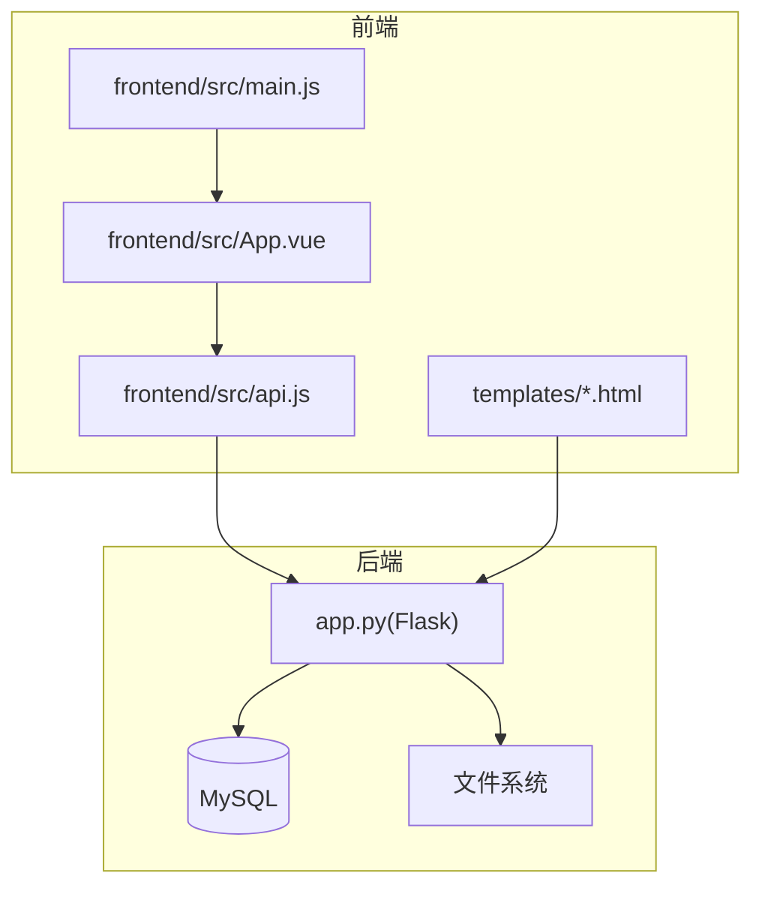
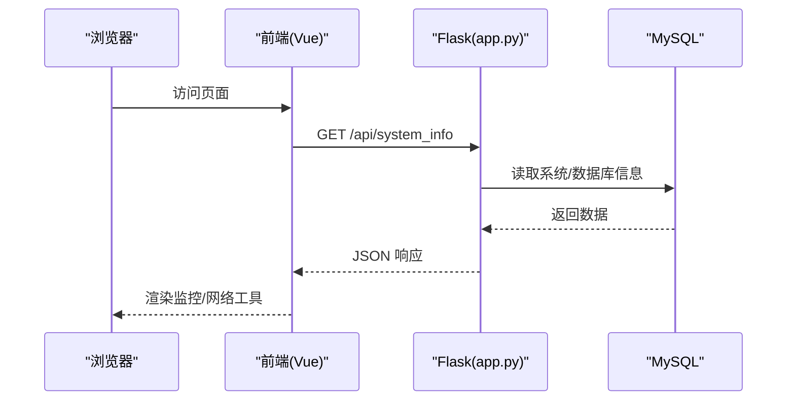
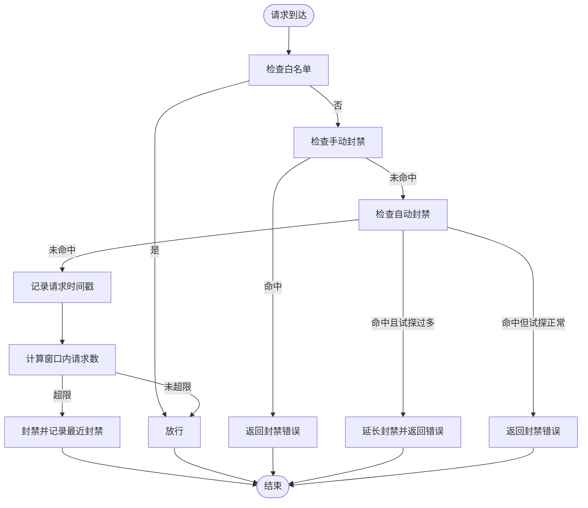
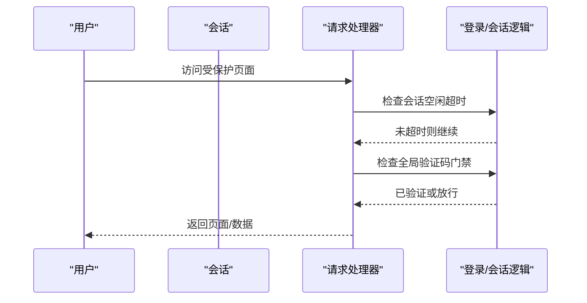
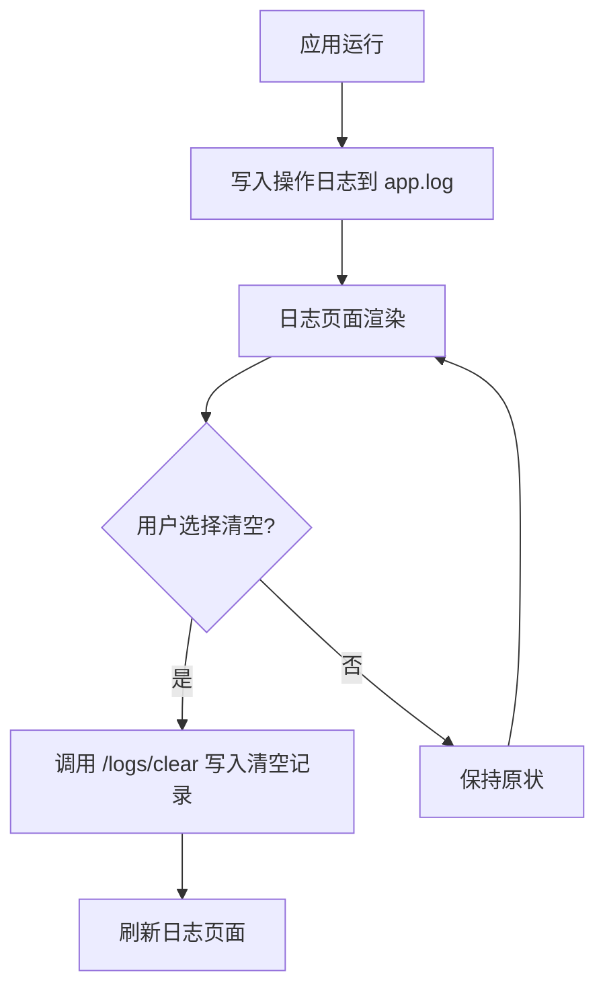
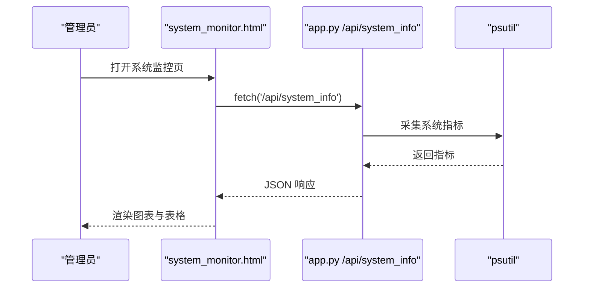
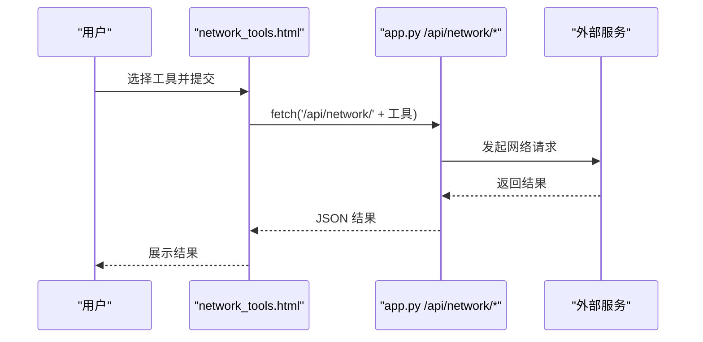
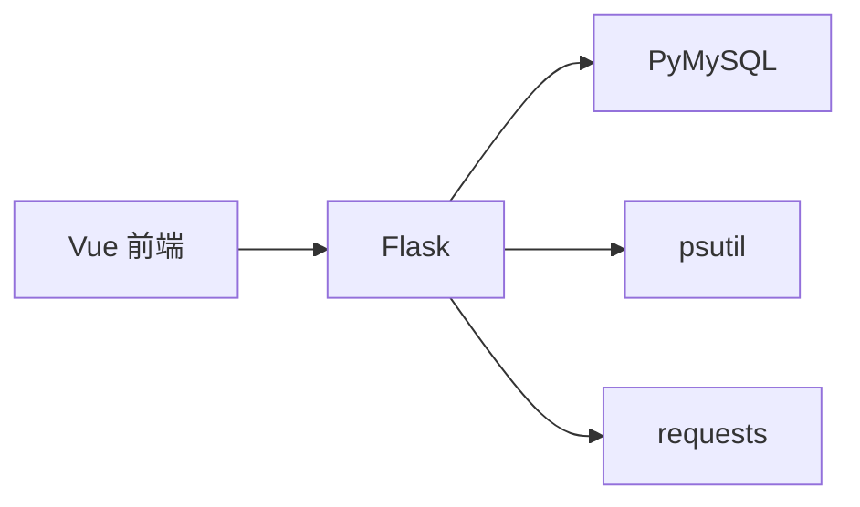

# 故障排除

<cite>
**本文引用的文件**   
- [app.py](file://app.py)
- [requirements.txt](file://requirements.txt)
- [templates/base.html](file://templates/base.html)
- [templates/logs.html](file://templates/logs.html)
- [templates/system_monitor.html](file://templates/system_monitor.html)
- [templates/admin_dashboard.html](file://templates/admin_dashboard.html)
- [templates/network_tools.html](file://templates/network_tools.html)
- [frontend/src/main.js](file://frontend/src/main.js)
- [frontend/src/api.js](file://frontend/src/api.js)
- [frontend/src/App.vue](file://frontend/src/App.vue)
</cite>

## 目录
1. [简介](#简介)
2. [项目结构](#项目结构)
3. [核心组件](#核心组件)
4. [架构总览](#架构总览)
5. [详细组件分析](#详细组件分析)
6. [依赖分析](#依赖分析)
7. [性能考虑](#性能考虑)
8. [故障排除指南](#故障排除指南)
9. [结论](#结论)
10. [附录](#附录)

## 简介
本指南面向 School_Web 的运维与开发人员，提供系统化的故障排除方法，涵盖登录问题、功能异常、性能问题、日志分析、网络排查、系统监控与预警、以及紧急故障处理流程与恢复策略。文档结合实际代码实现，帮助快速定位与解决问题。

## 项目结构
- 后端采用 Python + Flask，核心业务逻辑集中在 app.py，包含路由、数据库初始化、安全策略、速率限制、系统监控等。
- 前端基于 Vue 3，入口在 frontend/src/main.js，API 封装在 frontend/src/api.js，页面组件位于 frontend/src/components。
- 模板系统使用 Jinja2，前端页面通过 templates/*.html 渲染，包含系统监控、网络工具、日志等管理界面。
- 依赖通过 requirements.txt 管理，主要为 Flask、PyMySQL、psutil、requests 等。

图表来源
- [app.py](file://app.py)
- [frontend/src/main.js](file://frontend/src/main.js)
- [frontend/src/api.js](file://frontend/src/api.js)
- [frontend/src/App.vue](file://frontend/src/App.vue)
- [templates/base.html](file://templates/base.html)

章节来源
- [app.py](file://app.py)
- [requirements.txt](file://requirements.txt)
- [frontend/src/main.js](file://frontend/src/main.js)
- [frontend/src/api.js](file://frontend/src/api.js)
- [frontend/src/App.vue](file://frontend/src/App.vue)
- [templates/base.html](file://templates/base.html)

## 核心组件
- 速率限制与封禁：基于内存队列与持久化配置，支持白名单、手动封禁、试探封禁追加。
- 登录与会话：会话空闲超时、CSRF 令牌、会话安全头、CSP 注入。
- 日志与审计：统一写入应用日志文件，提供日志页面与清空能力。
- 系统监控：CPU/内存/磁盘/网络实时采集，前端可视化展示。
- 网络工具：IP 查询、端口扫描、Ping、Traceroute、Whois、DNS、HTTP 头、SSL 证书、子网计算器。
- 数据库：用户、相册、活动日志、管理员申请等表初始化与管理。

章节来源
- [app.py](file://app.py)
- [templates/system_monitor.html](file://templates/system_monitor.html)
- [templates/network_tools.html](file://templates/network_tools.html)
- [templates/logs.html](file://templates/logs.html)

## 架构总览
后端通过 Flask 提供 REST 接口与页面渲染，前端通过 fetch 调用 /api/* 接口，模板负责注入 CSP nonce 与国际化内容。系统监控与网络工具通过独立页面与 API 协作，日志页面提供集中查看与清理。

图表来源
- [app.py](file://app.py)
- [frontend/src/api.js](file://frontend/src/api.js)
- [templates/system_monitor.html](file://templates/system_monitor.html)
- [templates/network_tools.html](file://templates/network_tools.html)

## 详细组件分析

### 速率限制与封禁组件
- 内存队列：按 IP 维护请求时间戳，窗口内超限触发封禁。
- 持久化配置：速率参数与白名单保存在文件，支持热更新。
- 白名单与手动封禁：独立文件维护，支持批量导入/导出。
- 试探封禁：封禁期内持续试探将追加封禁时长。

图表来源
- [app.py](file://app.py)

章节来源
- [app.py](file://app.py)

### 登录与会话组件
- 会话空闲超时：IP 级别的最后活跃时间记录，超时强制登出并提示。
- CSRF 保护：每个页面注入 CSRF 令牌，表单提交需携带。
- 安全响应头：CSP、X-Frame-Options、X-Content-Type-Options、Referrer-Policy、HSTS 等。
- 全站验证码门禁：未登录用户访问特定路径需完成验证码验证。

图表来源
- [app.py](file://app.py)

章节来源
- [app.py](file://app.py)

### 日志与审计组件
- 日志文件：统一写入 app.log，支持清空与查看。
- 日志页面：提供刷新与清空按钮，便于运维查看。
- 审计事件：登录、数据库变更等关键操作写入日志。

图表来源
- [app.py](file://app.py)
- [templates/logs.html](file://templates/logs.html)

章节来源
- [app.py](file://app.py)
- [templates/logs.html](file://templates/logs.html)

### 系统监控组件
- 实时采集：CPU、内存、磁盘、网络 IO。
- 前端可视化：仪表盘、进度条、表格展示。
- 管理后台：IP 请求监控、白名单/手动封禁管理、服务器状态、插件管理、备份。

图表来源
- [app.py](file://app.py)
- [templates/system_monitor.html](file://templates/system_monitor.html)
- [templates/admin_dashboard.html](file://templates/admin_dashboard.html)

章节来源
- [app.py](file://app.py)
- [templates/system_monitor.html](file://templates/system_monitor.html)
- [templates/admin_dashboard.html](file://templates/admin_dashboard.html)

### 网络工具组件
- 前端页面：提供多种网络诊断工具，通过 /api/network/* 调用后端。
- 后端接口：封装外部网络请求与解析，返回结构化结果。

图表来源
- [templates/network_tools.html](file://templates/network_tools.html)
- [app.py](file://app.py)

章节来源
- [templates/network_tools.html](file://templates/network_tools.html)
- [app.py](file://app.py)

## 依赖分析
- Flask：Web 框架，提供路由、模板、会话、CORS 等。
- PyMySQL：MySQL 连接与查询。
- psutil：系统资源采集。
- requests：网络工具模块对外请求。

图表来源
- [requirements.txt](file://requirements.txt)
- [app.py](file://app.py)

章节来源
- [requirements.txt](file://requirements.txt)
- [app.py](file://app.py)

## 性能考虑
- 速率限制：合理设置窗口与上限，避免误伤正常用户；封禁期间试探追加策略防止暴力试探。
- 系统监控：定期刷新频率与前端渲染开销平衡，避免高并发下的 UI 卡顿。
- 数据库：表初始化与索引设计，避免慢查询；连接池与超时设置。
- 前端：API 调用统一封装，减少重复请求；组件懒加载与虚拟滚动优化大数据集展示。

## 故障排除指南

### 一、登录问题
- 现象
  - 登录后立即被强制登出
  - CSRF 校验失败
  - 需要验证码才能访问
- 诊断步骤
  - 检查会话空闲超时：确认 IP 是否长时间无活动导致超时。
  - 检查 CSRF 令牌：确认表单是否正确携带 _csrf_token。
  - 检查验证码门禁：未登录用户访问受保护路径是否已完成验证码。
- 解决方案
  - 调整 SESSION_IDLE_TIMEOUT 或在页面上进行交互以刷新最后活跃时间。
  - 确保表单提交包含正确的 CSRF 令牌。
  - 完成验证码验证或在白名单中添加可信来源。

章节来源
- [app.py](file://app.py)

### 二、功能异常
- 现象
  - 相册/留言板/统计等功能无法加载
  - 前端报 403/404/500
- 诊断步骤
  - 查看前端 API 调用路径与参数，确认 /api/* 是否可达。
  - 检查后端路由是否存在，权限装饰器是否生效。
  - 查看应用日志定位具体错误。
- 解决方案
  - 修复路由或权限配置；补充缺失的数据库表或索引。
  - 修正前端请求参数或跨域配置。

章节来源
- [frontend/src/api.js](file://frontend/src/api.js)
- [app.py](file://app.py)
- [templates/base.html](file://templates/base.html)

### 三、性能问题
- 现象
  - 页面卡顿、系统资源占用高
  - 网络工具执行缓慢
- 诊断步骤
  - 使用系统监控页面观察 CPU/内存/磁盘/网络使用情况。
  - 检查速率限制配置是否过于严格，导致频繁封禁。
  - 分析前端渲染压力，优化大数据集展示。
- 解决方案
  - 调整速率限制窗口与上限；优化前端组件渲染。
  - 对数据库查询建立索引，减少慢查询。

章节来源
- [templates/system_monitor.html](file://templates/system_monitor.html)
- [app.py](file://app.py)
- [frontend/src/App.vue](file://frontend/src/App.vue)

### 四、日志分析
- 应用日志
  - 位置：app.log
  - 内容：登录、数据库变更等审计事件
  - 方法：通过日志页面查看与清空
- 数据库日志
  - MySQL 慢查询日志：开启并定期分析
  - 错误日志：关注连接失败、权限不足、锁等待
- 系统日志
  - 操作系统日志：磁盘空间、内存不足、进程崩溃
- 分析要点
  - 时间线对齐：将前端错误与后端日志时间点对齐
  - 关键词检索：封禁、超时、429、403、500、数据库错误

章节来源
- [app.py](file://app.py)
- [templates/logs.html](file://templates/logs.html)

### 五、网络问题排查
- 连接超时
  - 检查后端到数据库连接配置与网络连通性
  - 检查防火墙与安全组规则
- 代理配置
  - 确认 Flask/CORS 配置与代理头透传
- 防火墙设置
  - 开放 /api/* 与静态资源端口
  - 验证白名单与封禁策略未阻断合法请求
- 网络工具辅助
  - 使用内置网络工具进行连通性测试与诊断

章节来源
- [app.py](file://app.py)
- [templates/network_tools.html](file://templates/network_tools.html)

### 六、系统监控与预警
- 监控项
  - CPU/内存/磁盘/网络 IO
  - 在线用户与封禁 IP 数
  - 速率限制命中率
- 预警建议
  - CPU/内存使用率连续高于阈值触发告警
  - 磁盘剩余空间低于阈值触发告警
  - 封禁 IP 数激增可能指示攻击

章节来源
- [templates/system_monitor.html](file://templates/system_monitor.html)
- [templates/admin_dashboard.html](file://templates/admin_dashboard.html)
- [app.py](file://app.py)

### 七、紧急故障处理流程
- 快速评估
  - 确定影响范围（全局/部分功能/特定用户）
  - 判断是否可回滚版本
- 临时缓解
  - 临时提高速率限制窗口/上限
  - 临时移除可疑封禁或白名单
  - 降级非关键功能
- 深入排查
  - 查看应用日志、数据库日志、系统日志
  - 复现问题并记录步骤
- 修复与恢复
  - 修复代码或配置
  - 验证修复效果
  - 恢复速率限制与封禁策略
- 复盘总结
  - 归档日志与变更记录
  - 输出改进措施与预防策略

章节来源
- [app.py](file://app.py)
- [templates/logs.html](file://templates/logs.html)
- [templates/admin_dashboard.html](file://templates/admin_dashboard.html)

## 结论
通过结合后端路由与中间件、前端 API 封装、系统监控与日志页面，School_Web 提供了完善的故障定位与恢复能力。遵循本指南的诊断流程与最佳实践，可显著缩短故障恢复时间并提升系统稳定性。

## 附录
- 常见错误码与含义
  - 403：禁止访问（权限不足/验证码未通过）
  - 404：页面不存在（路由或资源不存在）
  - 429：请求过于频繁（触发速率限制/验证码接口限流）
  - 500：服务器内部错误（数据库连接失败/系统异常）

章节来源
- [app.py](file://app.py)