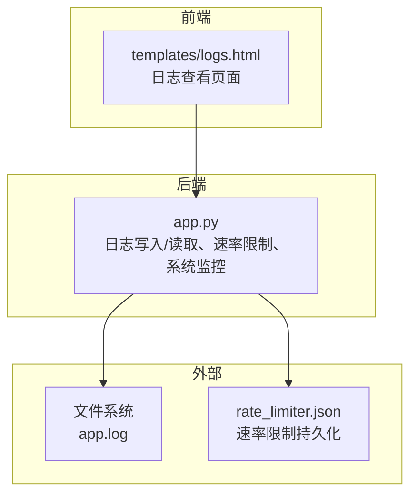
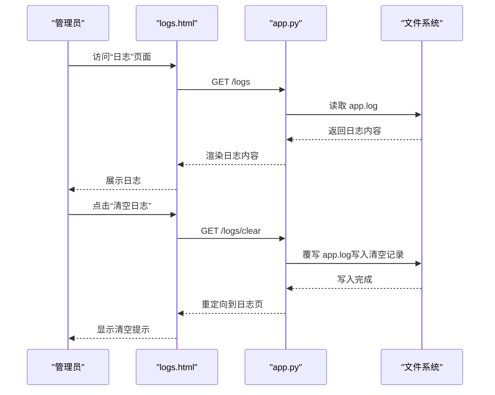
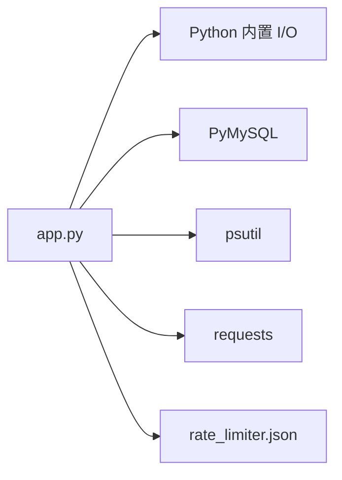

# 日志分析

**本文引用的文件**
- [app.py](file://app.py)
- [templates/logs.html](file://templates/logs.html)
- [rate_limiter.json](file://rate_limiter.json)
- [requirements.txt](file://requirements.txt)

## 目录
1. [简介](#简介)
2. [项目结构](#项目结构)
3. [核心组件](#核心组件)
4. [架构总览](#架构总览)
5. [详细组件分析](#详细组件分析)
6. [依赖分析](#依赖分析)
7. [性能考虑](#性能考虑)
8. [故障排查指南](#故障排查指南)
9. [结论](#结论)
10. [附录](#附录)

## 简介
本指南面向 School_Web 的运维与开发人员，提供一套完整的日志分析与故障诊断方法。内容涵盖：
- 应用日志的查看与解读（访问日志、错误日志、调试日志）
- 日志格式与关键字段说明
- 常见错误模式识别与分析技巧
- 日志轮转、存储管理与聚合建议
- 自动化监控与告警配置思路
- 生产环境最佳实践与工具推荐

## 项目结构
School_Web 的日志体系围绕后端主程序集中记录，前端通过管理界面进行查看与清空。核心文件如下：
- 后端日志写入与读取：app.py
- 日志查看页面：templates/logs.html
- 速率限制持久化（辅助定位异常流量）：rate_limiter.json
- 运行依赖：requirements.txt

图表来源
- [app.py](file://app.py)
- [templates/logs.html](file://templates/logs.html)
- [rate_limiter.json](file://rate_limiter.json)

章节来源
- [app.py](file://app.py)
- [templates/logs.html](file://templates/logs.html)
- [rate_limiter.json](file://rate_limiter.json)
- [requirements.txt](file://requirements.txt)

## 核心组件
- 日志写入与读取
  - 写入：write_log(action, detail) 将时间戳、动作与详情写入 app.log
  - 读取：read_logs() 读取 app.log 内容供页面展示
- 日志页面
  - logs.html 提供“刷新”“清空日志”按钮，展示纯文本日志内容
- 速率限制与封禁
  - 速率限制持久化至 rate_limiter.json，便于定位异常请求来源
  - 封禁触发时会写入日志，便于审计

章节来源
- [app.py](file://app.py)
- [templates/logs.html](file://templates/logs.html)
- [rate_limiter.json](file://rate_limiter.json)

## 架构总览
下图展示了日志从产生到呈现的关键流程。

图表来源
- [app.py](file://app.py)
- [templates/logs.html](file://templates/logs.html)

## 详细组件分析

### 日志格式与关键字段
- 时间戳：采用统一格式的本地时间字符串
- 动作：描述性操作名称（如“用户登录”“密码重置申请”等）
- 详情：附加信息，包含用户名、权限、IP、失败次数等

示例字段说明
- 时间戳：YYYY-MM-DD HH:MM:SS
- 动作：如“用户登录”“账户锁定”“密码重置成功”“VIP审核”“插件市场上传”等
- 详情：如“用户名: …, 权限: …”“IP: …”“剩余 … 次尝试”“操作者: …”

章节来源
- [app.py](file://app.py)

### 日志页面与交互
- 页面入口：管理员仪表盘中的“日志”入口
- 功能：
  - 刷新：重新读取 app.log 并展示
  - 清空：清空 app.log，并写入一条清空记录，包含操作者与时间

章节来源
- [templates/logs.html](file://templates/logs.html)
- [app.py](file://app.py)

### 速率限制与封禁日志
- 触发条件：
  - 请求频率超过配置阈值
  - 封禁期间持续试探将延长封禁
- 影响：
  - 403 禁止访问，提示剩余封禁时间
  - 触发封禁记录，写入日志，便于后续审计

章节来源
- [app.py](file://app.py)

### 系统监控与活动日志
- 系统监控：CPU/内存/磁盘/网络等指标
- 活动日志：用户活跃行为记录（用于排行榜与审计）

章节来源
- [app.py](file://app.py)

### 插件市场与备份相关日志
- 插件市场上传/删除/恢复等操作均写入日志，便于审计
- 备份创建/删除/清理等操作均写入日志，便于审计

章节来源
- [app.py](file://app.py)

## 依赖分析
- 运行时依赖
  - Flask、PyMySQL、psutil、requests 等
- 日志相关依赖
  - Python 内置文件 I/O 用于 app.log 的读写
  - 速率限制模块持久化至 rate_limiter.json

图表来源
- [app.py](file://app.py)
- [requirements.txt](file://requirements.txt)
- [rate_limiter.json](file://rate_limiter.json)

章节来源
- [requirements.txt](file://requirements.txt)
- [app.py](file://app.py)
- [rate_limiter.json](file://rate_limiter.json)

## 性能考虑
- 日志写入为同步 I/O，建议在高并发场景下：
  - 使用异步写入或缓冲队列
  - 将日志输出到标准输出，交由容器/系统日志代理收集
- 日志读取为一次性读取整个文件，建议：
  - 控制日志文件大小，配合轮转
  - 对于超大日志，采用分页/滚动读取策略

## 故障排查指南

### 如何查看与分析日志
- 登录管理后台，进入“日志”页面
- 使用“刷新”按钮实时查看最新日志
- 使用“清空日志”清理历史，同时记录清空操作

章节来源
- [templates/logs.html](file://templates/logs.html)
- [app.py](file://app.py)

### 常见错误模式与识别
- 登录失败与账户锁定
  - 现象：连续错误导致账户锁定，提示剩余锁定时间
  - 关注点：失败次数、锁定时长、是否为暴力破解
- 密码重置异常
  - 现象：令牌无效或过期、新旧密码相同
  - 关注点：令牌有效期、验证码校验
- VIP/管理员审核
  - 现象：审核通过或拒绝
  - 关注点：操作者、目标用户、状态变更
- 插件市场与备份
  - 现象：上传/删除/恢复成功或失败
  - 关注点：文件大小、权限、操作者

章节来源
- [app.py](file://app.py)

### 日志轮转、存储管理与聚合
- 轮转建议
  - 使用系统自带工具（如 logrotate）按大小或时间轮转
  - 保留一定历史以便审计
- 存储管理
  - 控制单文件大小与保留周期
  - 对敏感信息（如密码）避免写入日志
- 日志聚合
  - 将 app.log 输出到 stdout，结合 systemd/journald 或容器日志驱动
  - 使用 ELK/EFK 或 Loki/Grafana stack 进行采集与检索

[本节为通用指导，不直接分析具体文件]

### 自动化监控与告警
- 告警维度建议
  - 登录失败率突增
  - 密码重置请求异常
  - VIP/管理员审核高频
  - 插件市场/备份操作异常
- 实现思路
  - 通过日志解析规则触发告警
  - 结合速率限制封禁记录进行异常检测
  - 与监控面板联动展示趋势

[本节为通用指导，不直接分析具体文件]

### 生产环境最佳实践与工具推荐
- 最佳实践
  - 将日志输出到 stdout，由平台统一收集
  - 使用结构化日志（JSON），便于检索与聚合
  - 严格控制日志级别与敏感信息脱敏
  - 定期轮转与归档，设置保留策略
- 工具推荐
  - 收集：Fluent Bit、Filebeat、Vector
  - 存储：Elasticsearch、OpenSearch、Loki
  - 可视化：Grafana、Kibana
  - 告警：Alertmanager、Grafana 告警、Prometheus 规则

[本节为通用指导，不直接分析具体文件]

## 结论
School_Web 的日志体系以集中式写入为核心，辅以管理页面进行查看与清空。通过规范化的日志格式与关键字段，可快速定位登录、重置、权限变更、插件与备份等关键操作。建议在生产环境中采用结构化日志与平台化收集，结合轮转与聚合工具，实现高效可观测与自动化告警。

## 附录

### 日志格式速查
- 时间戳：YYYY-MM-DD HH:MM:SS
- 动作：如“用户登录”“账户锁定”“密码重置成功”“VIP审核”“插件市场上传”“清空日志”等
- 详情：包含用户名、权限、IP、失败次数、操作者等

章节来源
- [app.py](file://app.py)