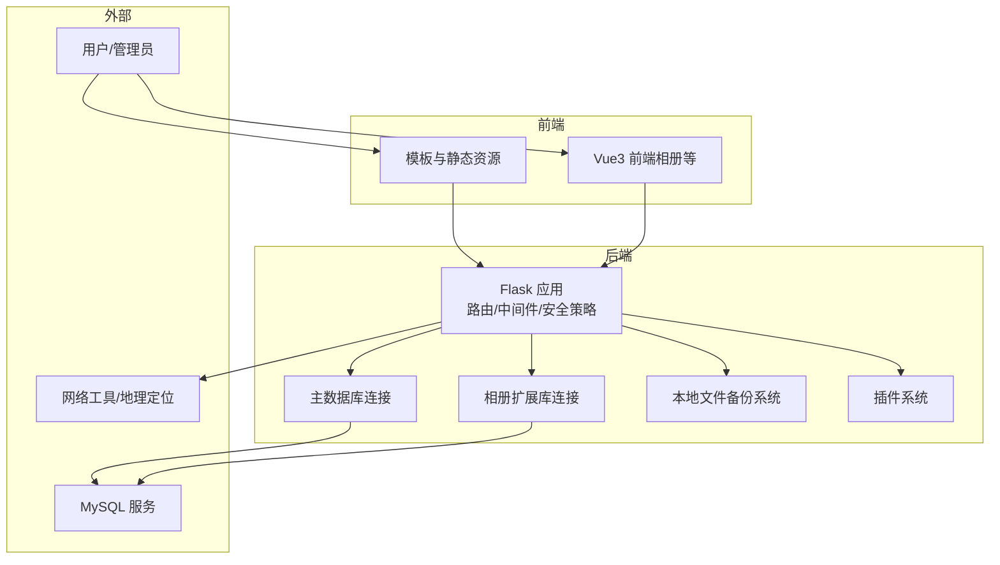
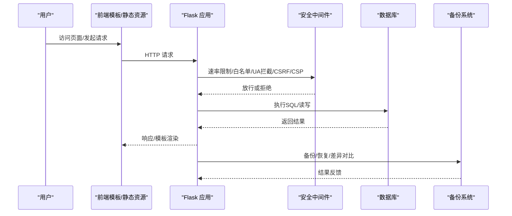
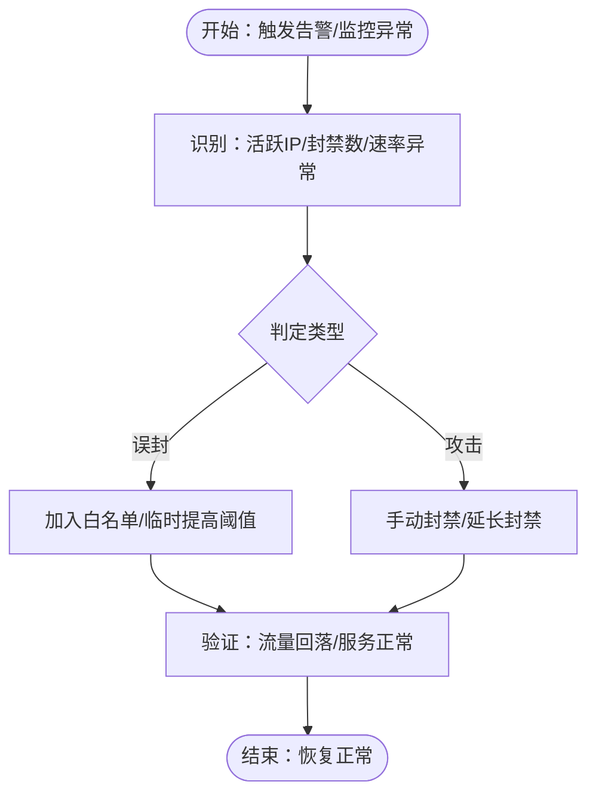
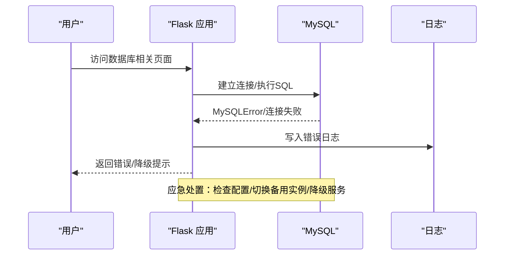
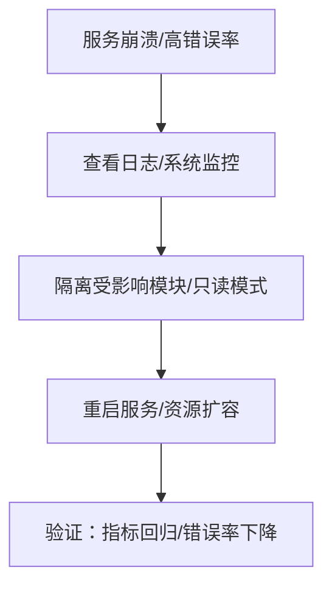
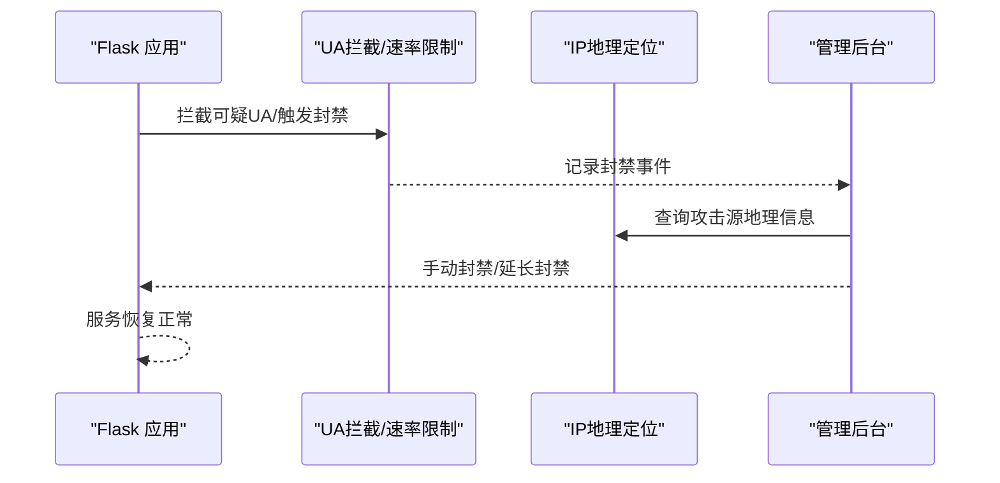
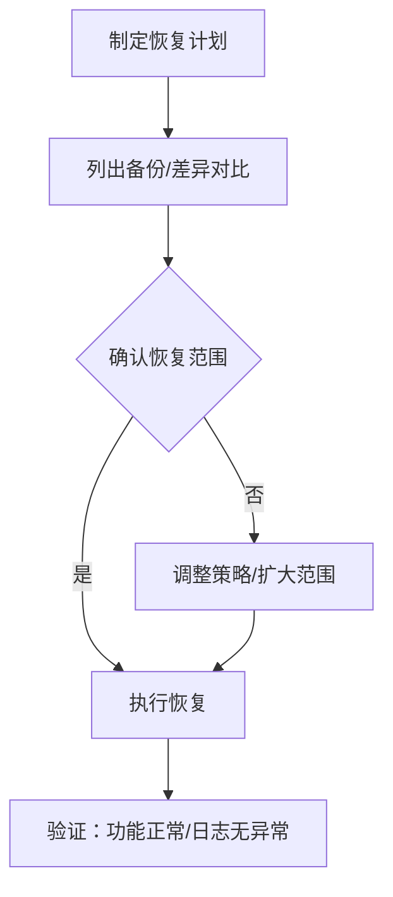
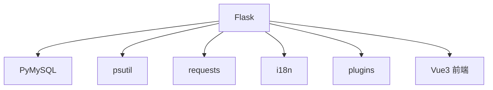

# 紧急故障处理

**本文引用的文件**
- [app.py](file://app.py)
- [requirements.txt](file://requirements.txt)
- [templates/base.html](file://templates/base.html)
- [templates/system_monitor.html](file://templates/system_monitor.html)
- [templates/logs.html](file://templates/logs.html)
- [templates/backup.html](file://templates/backup.html)
- [templates/admin_dashboard.html](file://templates/admin_dashboard.html)
- [templates/db_query.html](file://templates/db_query.html)
- [templates/db_update.html](file://templates/db_update.html)
- [templates/file_manager.html](file://templates/file_manager.html)
- [templates/global_captcha.html](file://templates/global_captcha.html)
- [templates/fm_password.html](file://templates/fm_password.html)
- [templates/db_captcha.html](file://templates/db_captcha.html)
- [templates/login.html](file://templates/login.html)
- [templates/register.html](file://templates/register.html)
- [templates/logout_confirm.html](file://templates/logout_confirm.html)
- [templates/reset_password.html](file://templates/reset_password.html)
- [templates/change_password.html](file://templates/change_password.html)
- [templates/notes.html](file://templates/notes.html)
- [templates/calculator.html](file://templates/calculator.html)
- [templates/calculator_sci.html](file://templates/calculator_sci.html)
- [templates/calculator_net.html](file://templates/calculator_net.html)
- [templates/dashboard.html](file://templates/dashboard.html)
- [templates/profile.html](file://templates/profile.html)
- [templates/author.html](file://templates/author.html)
- [templates/donate.html](file://templates/donate.html)
- [templates/chat_standalone.html](file://templates/chat_standalone.html)
- [templates/network_tools.html](file://templates/network_tools.html)
- [templates/marketplace.html](file://templates/marketplace.html)
- [templates/album_vue3.html](file://templates/album_vue3.html)
- [templates/album_vue3.html](file://templates/album_vue3.html)
- [templates/album_vue3.html](file://templates/album_vue3.html)
- [templates/album_vue3.html](file://templates/album_vue3.html)
- [templates/album_vue3.html](file://templates/album_vue3.html)
- [templates/album_vue3.html](file://templates/album_vue3.html)
- [templates/album_vue3.html](file://templates/album_vue3.html)
- [templates/album_vue3.html](file://templates/album_vue3.html)
- [templates/album_vue3.html](file://templates/album_vue3.html)
- [templates/album_vue3.html](file://templates/album_vue3.html)
- [templates/album_vue3.html](file://templates/album_vue3.html)
- [templates/album_vue3.html](file://templates/album_vue3.html)
- [templates/album_vue3.html](file://templates/album_vue3.html)
- [templates/album_vue3.html](file://templates/album_vue3.html)
- [templates/album_vue3.html](file://templates/album_vue3.html)
- [templates/album_vue3.html](file://templates/album_vue3.html)
- [templates/album_vue3.html](file://templates/album_vue3.html)
- [templates/album_vue3.html](file://templates/album_vue3.html)
- [templates/album_vue3.html](file://templates/album_vue3.html)
- [templates/album_vue3.html](file://templates/album_vue3.html)
- [templates/album_vue3.html](file://templates/album_vue3.html)
- [templates/album_vue3.html](file://templates/album_vue3.html)
- [templates/album_vue3.html](file://templates/album_vue3.html)
- [templates/album_vue3.html](file://templates/album_vue3.html)
- [templates/album_vue3.html](file://templates/album_vue3.html)
- [templates/album_vue3.html](file://templates/album_vue3.html)
- [templates/album_vue3.html](file://templates/album_vue3.html)
- [templates/album_vue3.html](file://templates/album_vue3.html)
- [templates/......](file://templates/album_vue3.html)

## 目录
1. [简介](#简介)
2. [项目结构](#项目结构)
3. [核心组件](#核心组件)
4. [架构总览](#架构总览)
5. [详细组件分析](#详细组件分析)
6. [依赖分析](#依赖分析)
7. [性能考虑](#性能考虑)
8. [故障排查指南](#故障排查指南)
9. [结论](#结论)
10. [附录](#附录)

## 简介
本指南面向School_Web项目的紧急故障处理与恢复，提供从故障识别、影响评估、应急处置到恢复验证的全流程策略。重点覆盖数据库连接异常、服务崩溃、安全攻击等场景，并配套备份恢复、热修复与降级服务方案，以及灾难恢复与业务连续性保障措施、紧急联系人与升级流程。

## 项目结构
- 后端采用Flask框架，集中式路由与中间件（CORS、安全头、CSRF、速率限制、白名单、会话超时、UA拦截、国际化等）。
- 前端模板基于Bootstrap与自定义脚本，部分功能（如相册、聊天、系统监控）通过API对接后端。
- 数据库连接通过PyMySQL实现，支持主库与相册扩展库分离。
- 备份系统提供本地文件打包、下载、删除、清理与差异对比能力。
- 管理后台提供IP统计、白名单、手动封禁、速率限制配置、日志查看与清理等功能。

图表来源
- [app.py](file://app.py)
- [requirements.txt](file://requirements.txt)

章节来源
- [app.py](file://app.py)
- [requirements.txt](file://requirements.txt)

## 核心组件
- 安全与防护
  - 速率限制与封禁：基于内存队列与定时持久化的轻量速率限制，支持白名单、手动封禁、封禁探测与延长。
  - IP白名单与手动封禁：提供批量导入、解除封禁、白名单维护。
  - 全局CSP与安全响应头：X-Content-Type-Options、X-Frame-Options、X-XSS-Protection、Referrer-Policy、Strict-Transport-Security、Permissions-Policy。
  - UA拦截：内置常见安全扫描工具User-Agent黑名单。
  - CSRF保护与全局验证码门禁：针对敏感API与非登录状态进行二次验证。
- 数据库层
  - 主库与相册扩展库分离初始化，支持表结构自动创建与兼容性迁移。
  - 数据库二次验证（验证码）与文件管理器密码二次验证，降低误操作风险。
- 系统监控与日志
  - 实时系统信息采集（CPU/内存/磁盘/网络）、在线用户统计、IP地理定位。
  - 日志写入与清理，支持管理员查看与清空。
- 备份与恢复
  - 自定义备份目录与包含/排除规则，支持创建、下载、删除、清理、差异对比与恢复。
- 插件系统
  - 插件发现、加载/卸载、市场上传与沙箱渲染，支持HTML/Vue插件。

章节来源
- [app.py](file://app.py)
- [templates/system_monitor.html](file://templates/system_monitor.html)
- [templates/logs.html](file://templates/logs.html)
- [templates/backup.html](file://templates/backup.html)

## 架构总览

图表来源
- [app.py](file://app.py)
- [templates/base.html](file://templates/base.html)

## 详细组件分析

### 速率限制与封禁（应急处置重点）
- 机制说明
  - 基于内存队列记录每IP在时间窗内的请求次数，超限触发封禁，封禁期内探测请求将延长封禁。
  - 支持白名单豁免与手动封禁，封禁状态持久化至文件，便于重启后恢复。
  - 管理后台提供IP统计、批量封禁/白名单、速率配置修改。
- 应急处置流程
  - 识别：通过系统监控页面查看活跃IP、封禁数量与请求速率。
  - 评估：区分误封（白名单遗漏）与攻击（异常探测/高并发）。
  - 处置：临时提高速率限制窗口/阈值，或加入白名单；对攻击源执行手动封禁并延长封禁时长。
  - 验证：观察封禁解除与流量回落，确认服务恢复正常。
- 恢复验证
  - 通过“系统监控-在线用户”与“管理后台-IP统计”核对封禁状态与请求速率。
  - 观察API响应状态码与错误信息，确保429/403不再出现。

图表来源
- [app.py](file://app.py)
- [templates/system_monitor.html](file://templates/system_monitor.html)
- [templates/admin_dashboard.html](file://templates/admin_dashboard.html)

章节来源
- [app.py](file://app.py)
- [templates/system_monitor.html](file://templates/system_monitor.html)
- [templates/admin_dashboard.html](file://templates/admin_dashboard.html)

### 数据库连接异常（应急处置重点）
- 识别与评估
  - 登录/注册/数据库相关API出现MySQLError或连接失败提示。
  - 通过“系统监控-数据库”与“日志”查看连接状态与错误堆栈。
- 应急处置
  - 快速检查DB_CONFIG/ALBUM_DB_CONFIG配置是否正确。
  - 若为服务端MySQL宕机，立即通知DBA并准备备用实例。
  - 临时降级：对非关键功能（如相册/聊天）设置只读或禁用相关API。
- 恢复验证
  - 通过“数据库-查询/更新”页面执行简单查询，确认连接恢复。
  - 观察日志中错误消失，API返回正常。

图表来源
- [app.py](file://app.py)
- [templates/logs.html](file://templates/logs.html)
- [templates/db_query.html](file://templates/db_query.html)
- [templates/db_update.html](file://templates/db_update.html)

章节来源
- [app.py](file://app.py)
- [templates/logs.html](file://templates/logs.html)
- [templates/db_query.html](file://templates/db_query.html)
- [templates/db_update.html](file://templates/db_update.html)

### 服务崩溃（应急处置重点）
- 识别与评估
  - 404/500错误增多，系统监控显示进程异常或CPU/内存飙升。
  - 查看日志与系统信息，定位崩溃时间点与调用栈。
- 应急处置
  - 快速重启服务，观察是否可自愈。
  - 若为内存泄漏/死锁，临时降低并发或启用只读模式。
  - 通过“系统监控-服务器”查看CPU/内存/磁盘占用，必要时进行资源扩容。
- 恢复验证
  - API响应时间回归正常，错误率下降。
  - “系统监控-服务器”指标稳定。

图表来源
- [app.py](file://app.py)
- [templates/system_monitor.html](file://templates/system_monitor.html)
- [templates/logs.html](file://templates/logs.html)

章节来源
- [app.py](file://app.py)
- [templates/system_monitor.html](file://templates/system_monitor.html)
- [templates/logs.html](file://templates/logs.html)

### 安全攻击（应急处置重点）
- 识别与评估
  - UA拦截命中、大量403/429、异常IP激增、地理分布异常。
  - 通过“IP地理定位”与“系统监控-在线用户”定位攻击源。
- 应急处置
  - 立即对攻击源执行手动封禁并延长封禁时长。
  - 临时提高速率限制窗口/阈值，避免误伤正常用户。
  - 启用更严格的CSP与HSTS（生产环境）。
- 恢复验证
  - 攻击源被阻断，流量回落，服务稳定。

图表来源
- [app.py](file://app.py)
- [templates/system_monitor.html](file://templates/system_monitor.html)
- [templates/admin_dashboard.html](file://templates/admin_dashboard.html)

章节来源
- [app.py](file://app.py)
- [templates/system_monitor.html](file://templates/system_monitor.html)
- [templates/admin_dashboard.html](file://templates/admin_dashboard.html)

### 备份恢复与热修复
- 备份策略
  - 定期创建备份（建议每日/每周增量），保留最近N份，自动排除缓存与构建产物。
  - 备份内容包含：相册/头像/图片、白名单/速率配置、模板、源码、前端构建目录、插件等。
- 恢复流程
  - 通过“备份管理”页面列出、下载、删除、清理备份。
  - 使用“差异对比”核对当前文件与备份差异，确认恢复范围。
  - 执行“恢复”操作，覆盖本地文件，记录恢复日志。
- 热修复
  - 对于可快速修复的小缺陷，优先通过“插件市场”上传HTML/Vue插件进行沙箱修复，避免停机。
  - 重要修复需走发布流程，配合灰度与回滚预案。

图表来源
- [app.py](file://app.py)
- [templates/backup.html](file://templates/backup.html)

章节来源
- [app.py](file://app.py)
- [templates/backup.html](file://templates/backup.html)

### 降级服务与业务连续性
- 降级策略
  - 数据库异常：暂停写操作，启用只读模式；对非关键API（如相册/聊天）暂时禁用。
  - 速率限制过高：临时提高阈值/窗口，或加入白名单。
  - 安全攻击：手动封禁+延长封禁，必要时临时关闭高风险功能。
- 业务连续性
  - 通过“系统监控-服务器/在线用户/本机信息”持续观测，确保核心功能可用。
  - 使用“日志”与“通知”机制及时预警，缩短故障恢复时间。

章节来源
- [app.py](file://app.py)
- [templates/system_monitor.html](file://templates/system_monitor.html)
- [templates/logs.html](file://templates/logs.html)

### 灾难恢复计划
- 目标：在数据库/服务器/网络重大故障下，尽快恢复核心功能。
- 步骤
  - 快速评估：确定故障范围与影响面。
  - 启动预案：启用备用数据库/服务器，切换域名/负载均衡。
  - 恢复验证：核对API响应、页面渲染、关键数据一致性。
  - 复盘归档：记录故障原因、处置过程与改进项。

章节来源
- [app.py](file://app.py)

### 紧急联系人与升级流程
- 紧急联系人
  - 运维负责人：负责数据库/服务器/网络层面处置。
  - 安全负责人：负责安全攻击处置与封禁策略调整。
  - 开发负责人：负责热修复与发布流程协调。
- 升级流程
  - 一线：快速封禁/降级/重启，观察指标。
  - 二线：深入分析日志与备份，定位根因。
  - 三线：修复缺陷并发布，灰度验证后全量上线。

章节来源
- [app.py](file://app.py)

## 依赖分析
- 外部依赖
  - Flask：Web框架与路由。
  - PyMySQL：数据库驱动。
  - psutil：系统信息采集。
  - requests：网络工具与IP地理定位。
- 内部模块
  - i18n：国际化。
  - plugins：插件系统与市场。
  - 前端：Vue3相册等。

图表来源
- [requirements.txt](file://requirements.txt)
- [app.py](file://app.py)

章节来源
- [requirements.txt](file://requirements.txt)
- [app.py](file://app.py)

## 性能考虑
- 速率限制窗口与阈值需结合业务峰值合理配置，避免误伤正常用户。
- 备份打包涉及I/O，建议在低峰期执行，避免影响线上性能。
- 系统监控定时刷新频率需平衡实时性与资源消耗。

## 故障排查指南
- 常见问题与定位
  - 登录/注册失败：检查验证码、速率限制、数据库连接与密码哈希升级逻辑。
  - 数据库查询/更新异常：检查表结构初始化、白名单与二次验证。
  - 文件管理器权限错误：检查路径穿越防护与用户权限。
  - 备份失败：检查磁盘空间、文件权限与打包过滤规则。
- 工具与页面
  - 系统监控：服务器/在线用户/本机信息。
  - 日志：查看错误堆栈与封禁记录。
  - 备份管理：列出/下载/删除/清理/差异对比/恢复。
  - 管理后台：IP统计、白名单、手动封禁、速率配置。

章节来源
- [app.py](file://app.py)
- [templates/system_monitor.html](file://templates/system_monitor.html)
- [templates/logs.html](file://templates/logs.html)
- [templates/backup.html](file://templates/backup.html)
- [templates/admin_dashboard.html](file://templates/admin_dashboard.html)
- [templates/db_query.html](file://templates/db_query.html)
- [templates/db_update.html](file://templates/db_update.html)
- [templates/file_manager.html](file://templates/file_manager.html)
- [templates/global_captcha.html](file://templates/global_captcha.html)
- [templates/fm_password.html](file://templates/fm_password.html)
- [templates/db_captcha.html](file://templates/db_captcha.html)
- [templates/login.html](file://templates/login.html)
- [templates/register.html](file://templates/register.html)
- [templates/logout_confirm.html](file://templates/logout_confirm.html)
- [templates/reset_password.html](file://templates/reset_password.html)
- [templates/change_password.html](file://templates/change_password.html)
- [templates/notes.html](file://templates/notes.html)
- [templates/calculator.html](file://templates/calculator.html)
- [templates/calculator_sci.html](file://templates/calculator_sci.html)
- [templates/calculator_net.html](file://templates/calculator_net.html)
- [templates/dashboard.html](file://templates/dashboard.html)
- [templates/profile.html](file://templates/profile.html)
- [templates/author.html](file://templates/author.html)
- [templates/donate.html](file://templates/donate.html)
- [templates/chat_standalone.html](file://templates/chat_standalone.html)
- [templates/network_tools.html](file://templates/network_tools.html)
- [templates/marketplace.html](file://templates/marketplace.html)
- [templates/album_vue3.html](file://templates/album_vue3.html)

## 结论
通过完善的速率限制与封禁、数据库连接与备份恢复、安全拦截与降级策略，School_Web能够在多数紧急情况下快速定位问题并恢复服务。建议定期演练故障恢复流程，完善监控与告警，确保业务连续性与用户体验。

## 附录
- 术语
  - 速率限制：单位时间内请求次数上限。
  - 封禁：对特定IP在一段时间内拒绝请求。
  - 白名单：豁免速率限制与封禁的IP列表。
  - 差异对比：比较当前文件与备份文件的差异。
- 参考页面
  - 系统监控：服务器/在线用户/本机信息。
  - 日志：操作日志与错误日志。
  - 备份管理：备份列表、下载、删除、清理、差异对比、恢复。
  - 管理后台：IP统计、白名单、手动封禁、速率配置。