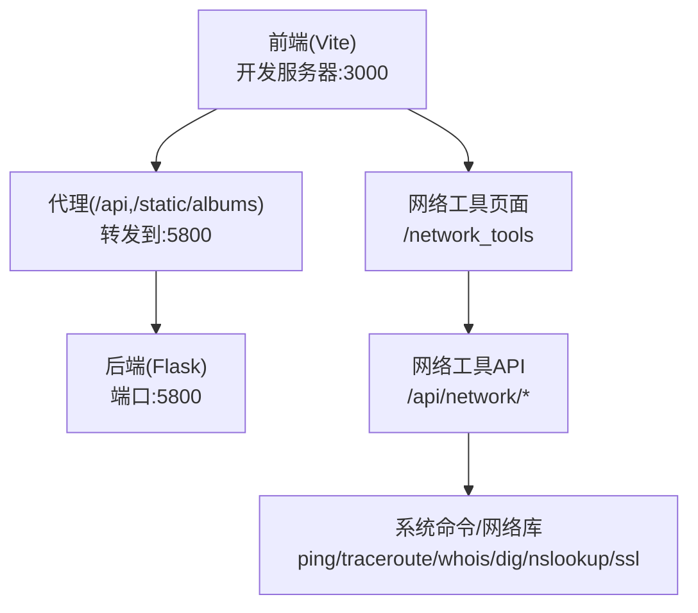
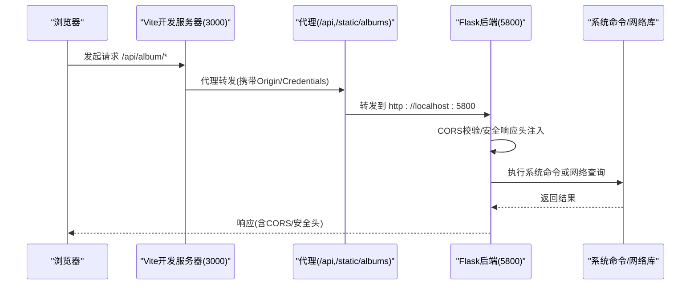
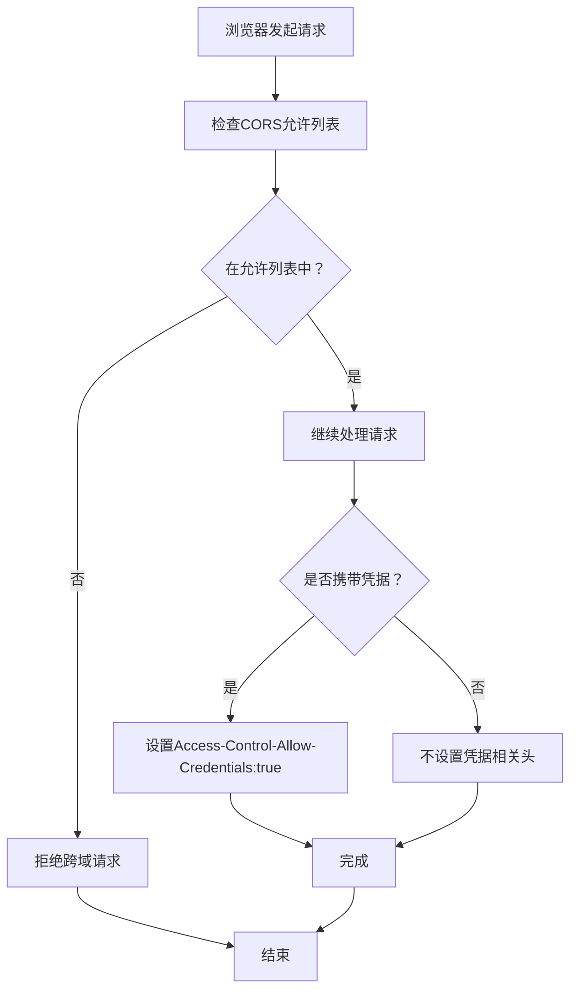
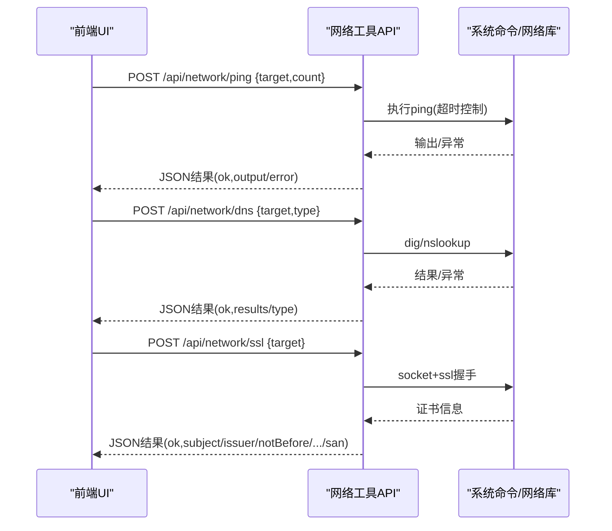
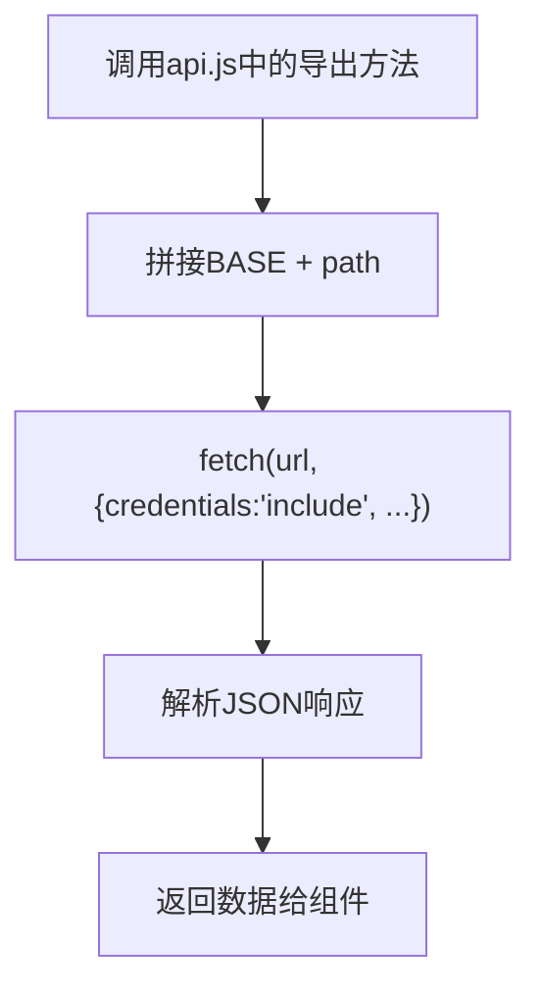
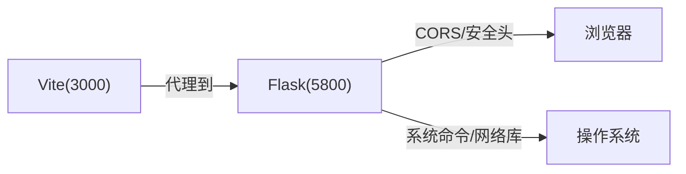

# 网络问题

**本文引用的文件**
- [app.py](file://app.py)
- [frontend/vite.config.js](file://frontend/vite.config.js)
- [frontend/src/api.js](file://frontend/src/api.js)
- [templates/network_tools.html](file://templates/network_tools.html)
- [requirements.txt](file://requirements.txt)

## 目录
1. [简介](#简介)
2. [项目结构](#项目结构)
3. [核心组件](#核心组件)
4. [架构总览](#架构总览)
5. [详细组件分析](#详细组件分析)
6. [依赖分析](#依赖分析)
7. [性能考虑](#性能考虑)
8. [故障排查指南](#故障排查指南)
9. [结论](#结论)
10. [附录](#附录)

## 简介
本指南面向School_Web项目，聚焦“网络连接问题”的诊断与解决，覆盖以下场景：
- 跨域请求失败（CORS）
- API调用超时
- 静态资源加载失败
- 代理设置与防火墙规则
- SSL证书与HTTPS重定向
- 移动网络与企业网络环境下的特殊配置

文档同时结合前端Vite开发服务器代理、后端Flask CORS配置、网络工具API以及安全响应头策略，给出可操作的排障步骤与最佳实践。

## 项目结构
围绕网络相关的关键位置如下：
- 前端开发服务器与代理：Vite配置将/api与/static/albums转发至后端服务
- 后端Flask CORS与安全响应头：统一处理跨域与安全策略
- 网络工具页面与API：提供ping、traceroute、whois、dns、http_headers、ssl、子网计算等能力
- 前端API封装：统一fetch调用与凭证传递

图表来源
- [frontend/vite.config.js:1-21](file://frontend/vite.config.js#L1-L21)
- [app.py:131](file://app.py#L131)
- [templates/network_tools.html:1-328](file://templates/network_tools.html#L1-L328)

章节来源
- [frontend/vite.config.js:1-21](file://frontend/vite.config.js#L1-L21)
- [app.py:131](file://app.py#L131)
- [templates/network_tools.html:1-328](file://templates/network_tools.html#L1-L328)

## 核心组件
- 前端代理与开发服务器
  - Vite开发服务器监听0.0.0.0:3000，将/api与/static/albums转发至后端
  - 代理开启changeOrigin，便于后端识别来源
- 后端CORS与安全响应头
  - 显式允许特定源（本地开发环境），并开启credentials
  - 设置严格安全响应头（含CSP、HSTS、X-Frame-Options等）
- 网络工具API
  - 提供ping、traceroute、whois、dns、http_headers、ssl、子网计算等
  - 采用VIP权限控制，避免滥用
- 前端API封装
  - 统一以BASE=/api/album发起请求，携带credentials

章节来源
- [frontend/vite.config.js:6-19](file://frontend/vite.config.js#L6-L19)
- [app.py:131](file://app.py#L131)
- [app.py:2075-2315](file://app.py#L2075-L2315)
- [frontend/src/api.js:1-45](file://frontend/src/api.js#L1-L45)

## 架构总览
下图展示从前端到后端再到系统命令的完整链路，以及CORS与安全响应头的作用点。

图表来源
- [frontend/vite.config.js:6-19](file://frontend/vite.config.js#L6-L19)
- [app.py:131](file://app.py#L131)
- [app.py:2075-2315](file://app.py#L2075-L2315)

## 详细组件分析

### 组件A：前端代理与跨域（CORS）
- Vite代理
  - 将/api与/static/albums转发至后端，changeOrigin=true，有助于后端识别来源
  - 适用于本地开发环境
- Flask CORS
  - 显式允许特定源（本地开发地址），并允许credentials
  - 若部署到生产环境，建议按需收紧origins白名单

图表来源
- [app.py:131](file://app.py#L131)
- [frontend/vite.config.js:9-18](file://frontend/vite.config.js#L9-L18)

章节来源
- [frontend/vite.config.js:6-19](file://frontend/vite.config.js#L6-L19)
- [app.py:131](file://app.py#L131)

### 组件B：网络工具API（ping/traceroute/whois/dns/ssl/子网）
- 权限控制
  - 仅VIP用户可访问网络工具页面与API，降低滥用风险
- 功能要点
  - ping/traceroute/whois：调用系统命令，带超时与错误处理
  - dns：支持A/AAAA/MX/NS/TXT/CNAME/SOA，优先dig，回退nslookup
  - http_headers：使用requests获取响应头与重定向信息
  - ssl：通过socket+ssl获取证书信息与有效期
  - subnet：基于ipaddress进行CIDR计算
- 前端集成
  - 前端通过POST /api/network/{tool}调用，携带credentials

图表来源
- [templates/network_tools.html:200-327](file://templates/network_tools.html#L200-L327)
- [app.py:2075-2315](file://app.py#L2075-L2315)

章节来源
- [templates/network_tools.html:1-328](file://templates/network_tools.html#L1-L328)
- [app.py:2075-2315](file://app.py#L2075-L2315)

### 组件C：前端API封装与静态资源
- API封装
  - 统一前缀BASE=/api/album，fetch时携带credentials
  - 支持GET/POST/DELETE等方法
- 静态资源
  - 代理/static/albums到后端，便于开发阶段访问后端静态资源目录

图表来源
- [frontend/src/api.js:1-45](file://frontend/src/api.js#L1-L45)
- [frontend/vite.config.js:14-18](file://frontend/vite.config.js#L14-L18)

章节来源
- [frontend/src/api.js:1-45](file://frontend/src/api.js#L1-L45)
- [frontend/vite.config.js:14-18](file://frontend/vite.config.js#L14-L18)

## 依赖分析
- 外部依赖
  - Flask、PyMySQL、psutil、requests等
- 系统命令依赖
  - ping/traceroute/whois/dig/nslookup/ssl等
- 前后端耦合点
  - 前端通过代理访问后端API
  - 后端通过CORS与安全响应头控制跨域与安全策略

图表来源
- [frontend/vite.config.js:6-19](file://frontend/vite.config.js#L6-L19)
- [app.py:131](file://app.py#L131)
- [requirements.txt:1-5](file://requirements.txt#L1-L5)

章节来源
- [requirements.txt:1-5](file://requirements.txt#L1-L5)
- [frontend/vite.config.js:6-19](file://frontend/vite.config.js#L6-L19)
- [app.py:131](file://app.py#L131)

## 性能考虑
- 代理层
  - 仅在开发环境使用Vite代理，生产环境建议由Nginx/反向代理统一处理
- API调用
  - 对外部网络请求设置合理超时（如10s），避免阻塞
- 网络工具
  - ping/traceroute等命令带超时与错误处理，避免长时间占用
- 静态资源
  - 生产环境建议CDN与缓存策略，减少后端压力

## 故障排查指南

### 1. 跨域请求失败（CORS）
- 现象
  - 浏览器控制台出现CORS错误
- 诊断
  - 检查后端CORS允许的origins是否包含前端地址
  - 确认请求是否携带credentials，后端是否允许credentials
- 处置
  - 在开发环境，确保前端Vite代理目标与后端CORS允许列表一致
  - 生产环境将origins精确限定为可信域名

章节来源
- [app.py:131](file://app.py#L131)
- [frontend/vite.config.js:6-19](file://frontend/vite.config.js#L6-L19)

### 2. API调用超时
- 现象
  - 前端长时间无响应，或出现超时错误
- 诊断
  - 使用网络工具API中的http_headers检查目标站点响应头与重定向
  - 使用ping/traceroute定位网络路径与丢包情况
- 处置
  - 调整后端请求超时参数
  - 检查防火墙与代理策略，确保端口可达

章节来源
- [app.py:2211-2236](file://app.py#L2211-L2236)
- [app.py:2075-2127](file://app.py#L2075-L2127)
- [templates/network_tools.html:200-327](file://templates/network_tools.html#L200-L327)

### 3. 静态资源加载失败
- 现象
  - 图片/样式等资源404或跨域
- 诊断
  - 确认Vite代理/static/albums是否正确转发
  - 检查后端静态资源目录与权限
- 处置
  - 在开发环境保持代理配置
  - 生产环境将静态资源托管至CDN或Nginx

章节来源
- [frontend/vite.config.js:14-18](file://frontend/vite.config.js#L14-L18)

### 4. 代理设置与防火墙规则
- 代理
  - 仅在开发环境使用Vite代理；生产环境由Nginx/反向代理统一转发
- 防火墙
  - 确保后端端口（示例:5800）与必要系统命令（ping/traceroute/whois/dig/nslookup）可用
  - 企业网络可能限制系统命令，需与网络管理员协调

章节来源
- [frontend/vite.config.js:6-19](file://frontend/vite.config.js#L6-L19)
- [app.py:2075-2315](file://app.py#L2075-L2315)

### 5. SSL证书与HTTPS重定向
- 证书检查
  - 使用网络工具API的ssl功能检查目标域名证书有效性与SAN
- HTTPS重定向
  - 后端已设置HSTS（生产环境），确保浏览器强制HTTPS
- 企业网络
  - 企业可能部署中间人证书或代理，导致证书告警；需与IT确认

章节来源
- [app.py:641-676](file://app.py#L641-L676)
- [app.py:2239-2285](file://app.py#L2239-L2285)

### 6. 移动网络与企业网络环境
- 移动网络
  - 带宽与延迟波动较大，建议前端增加重试与超时策略
- 企业网络
  - 可能限制外网访问或系统命令，需与IT沟通放行必要端口与命令
  - 若使用代理，需在开发环境配置Vite代理或调整后端CORS

章节来源
- [app.py:2075-2315](file://app.py#L2075-L2315)
- [frontend/vite.config.js:6-19](file://frontend/vite.config.js#L6-L19)

## 结论
- 本地开发推荐使用Vite代理与Flask CORS配合，快速定位跨域与静态资源问题
- 生产环境应收紧CORS白名单、启用HSTS、使用反向代理与CDN
- 网络工具API为排障提供了强有力的手段，建议在受控环境下使用
- 企业与移动网络环境需特别关注防火墙、代理与证书策略

## 附录

### A. 常用网络诊断命令（结合项目能力）
- ping
  - 通过网络工具API的ping功能进行连通性测试
- traceroute
  - 通过网络工具API的traceroute功能查看路由路径
- whois
  - 通过网络工具API的whois功能查询域名信息
- dns
  - 通过网络工具API的dns功能查询各类DNS记录
- http_headers
  - 通过网络工具API的http_headers功能检查响应头与重定向
- ssl
  - 通过网络工具API的ssl功能检查证书有效性
- 子网计算
  - 通过网络工具API的subnet功能进行CIDR计算

章节来源
- [templates/network_tools.html:200-327](file://templates/network_tools.html#L200-L327)
- [app.py:2075-2315](file://app.py#L2075-L2315)