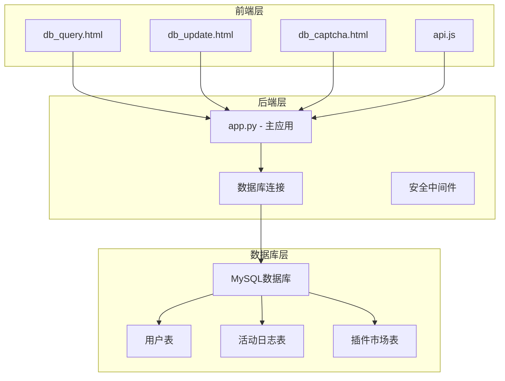
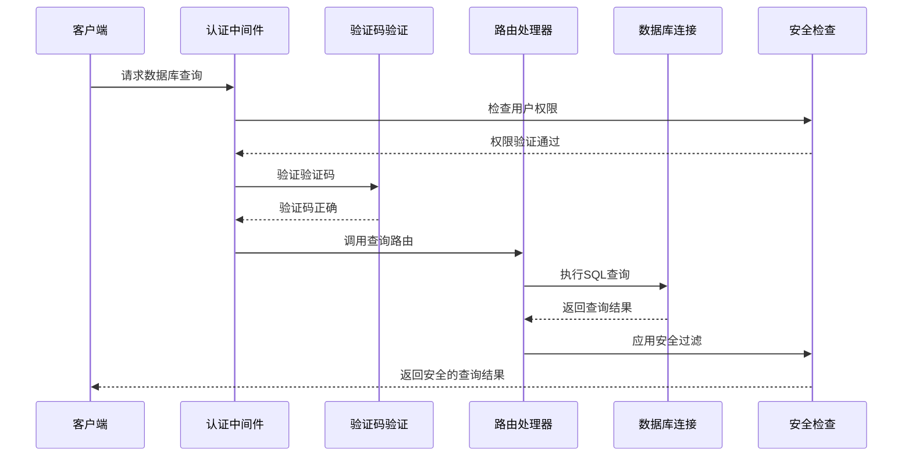
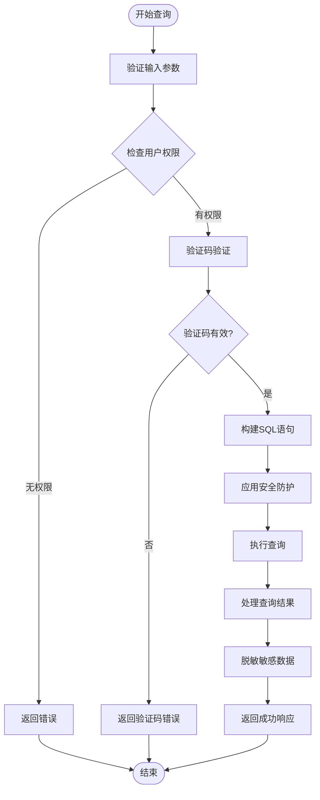
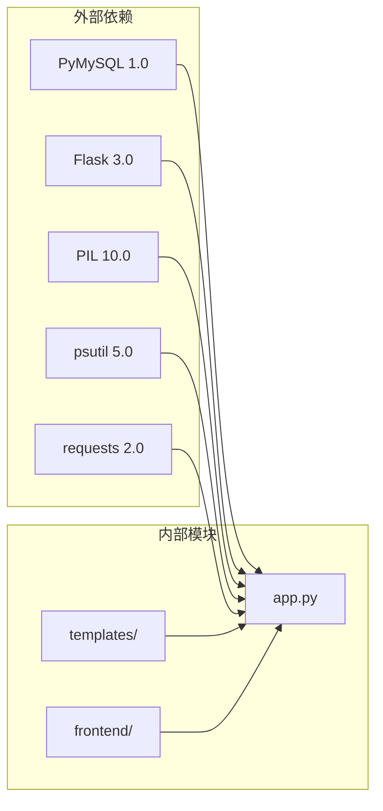

# SQL查询接口

<cite>
**本文档引用的文件**
- [app.py](file://app.py)
- [db_query.html](file://templates/db_query.html)
- [db_update.html](file://templates/db_update.html)
- [db_captcha.html](file://templates/db_captcha.html)
- [安全措施清单.md](file://安全措施清单.md)
- [api.js](file://frontend/src/api.js)
- [requirements.txt](file://requirements.txt)
</cite>

## 目录
1. [简介](#简介)
2. [项目结构](#项目结构)
3. [核心组件](#核心组件)
4. [架构概览](#架构概览)
5. [详细组件分析](#详细组件分析)
6. [依赖分析](#依赖分析)
7. [性能考虑](#性能考虑)
8. [故障排除指南](#故障排除指南)
9. [结论](#结论)

## 简介

SQL查询接口是School_Web项目中的一个核心功能模块，提供了数据库查询和管理能力。该接口采用多层安全防护设计，包括验证码验证、权限控制、SQL注入防护等多重安全措施。

该系统主要包含两个核心功能：
- **数据库查询界面**：提供基于Web的数据库查询功能
- **数据库管理API**：提供RESTful API接口用于数据库操作

## 项目结构



**图表来源**
- [app.py:2319-2518](file://app.py#L2319-L2518)
- [db_query.html:1-52](file://templates/db_query.html#L1-L52)
- [db_update.html:1-111](file://templates/db_update.html#L1-L111)

**章节来源**
- [app.py:1-200](file://app.py#L1-L200)
- [requirements.txt:1-5](file://requirements.txt#L1-L5)

## 核心组件

### 数据库查询路由
系统提供两种数据库查询方式：

1. **Web界面查询** (`/db_query`)
   - 基于表单的交互式查询
   - 支持表格数据展示
   - 实时密码字段脱敏

2. **API查询接口** (`/api/table/<table>/data`)
   - RESTful API设计
   - JSON格式响应
   - 支持完整的CRUD操作

### 安全防护机制
系统实现了多层次的安全防护：

1. **验证码验证**：所有数据库操作都需要通过验证码验证
2. **权限控制**：区分普通用户和管理员权限
3. **SQL注入防护**：使用反引号包裹表名和参数绑定
4. **输入验证**：严格的参数类型检查和长度限制

**章节来源**
- [app.py:2320-2368](file://app.py#L2320-L2368)
- [app.py:2372-2406](file://app.py#L2372-L2406)

## 架构概览



**图表来源**
- [app.py:2320-2368](file://app.py#L2320-L2368)
- [app.py:2372-2406](file://app.py#L2372-L2406)

## 详细组件分析

### 查询执行引擎

#### 查询解析流程


**图表来源**
- [app.py:2341-2368](file://app.py#L2341-L2368)
- [app.py:2376-2406](file://app.py#L2376-L2406)

#### SQL注入防护机制
系统采用了多重防护措施来防止SQL注入攻击：

1. **表名白名单验证**：只允许预定义的表名
2. **反引号包裹**：使用反引号(`)包裹表名和列名
3. **参数绑定**：使用pymysql的参数绑定机制
4. **输入验证**：严格的输入类型和长度检查

**章节来源**
- [app.py:2348-2349](file://app.py#L2348-L2349)
- [app.py:2424-2425](file://app.py#L2424-L2425)

### API规范

#### 数据库查询API
| 属性 | 详情 |
|------|------|
| **HTTP方法** | GET |
| **请求路径** | `/api/table/{table}/data` |
| **认证要求** | 需要登录和管理员权限 |
| **验证码** | 需要数据库操作验证码 |
| **响应格式** | JSON |

**请求参数**
- `table` (路径参数)：数据库表名

**响应数据结构**
```json
{
  "columns": ["列名数组"],
  "types": ["列类型数组"],
  "primary_key": "主键列名",
  "rows": [["行数据数组"]]
}
```

**错误码**
- `401`：未认证或权限不足
- `404`：表不存在
- `500`：数据库连接失败或查询错误

**章节来源**
- [app.py:2372-2406](file://app.py#L2372-L2406)

#### 数据库操作API

##### 插入数据
- **方法**：POST `/api/table/{table}/insert`
- **请求体**：JSON对象，键为列名，值为对应数据
- **响应**：包含受影响行数的JSON对象

##### 更新数据
- **方法**：POST `/api/table/{table}/update`
- **请求体**：
```json
{
  "pk_col": "主键列名",
  "pk": "主键值",
  "fields": {"列名": "新值"}
}
```

##### 删除数据
- **方法**：DELETE `/api/table/{table}/delete/{pk_value}`
- **查询参数**：`pk_col=主键列名`
- **响应**：包含受影响行数的JSON对象

**章节来源**
- [app.py:2409-2486](file://app.py#L2409-L2486)

### 结果集处理机制

#### 数据脱敏
系统对敏感数据进行自动脱敏处理：

1. **密码字段脱敏**：将密码字段显示为星号
2. **敏感信息过滤**：根据配置过滤可能泄露隐私的数据
3. **安全输出**：确保敏感信息不会通过API泄露

#### 数据格式化
查询结果经过以下处理步骤：
1. **类型转换**：将数据库类型转换为合适的Python类型
2. **空值处理**：将NULL值转换为空字符串
3. **编码处理**：确保数据适合JSON序列化

**章节来源**
- [app.py:2352-2356](file://app.py#L2352-L2356)
- [app.py:2399-2404](file://app.py#L2399-L2404)

## 依赖分析



**图表来源**
- [requirements.txt:1-5](file://requirements.txt#L1-L5)

### 核心依赖关系

1. **数据库连接**：使用PyMySQL库建立MySQL连接
2. **Web框架**：基于Flask框架提供Web服务
3. **模板渲染**：使用Jinja2模板引擎渲染HTML页面
4. **图像处理**：使用PIL库生成验证码图片

**章节来源**
- [requirements.txt:1-5](file://requirements.txt#L1-L5)
- [app.py:18-28](file://app.py#L18-L28)

## 性能考虑

### 查询优化策略

1. **连接池管理**：合理管理数据库连接，避免连接泄漏
2. **查询限制**：对查询结果集大小进行限制
3. **索引优化**：建议在常用查询列上建立适当索引
4. **缓存机制**：对频繁访问的元数据进行缓存

### 大数据集处理

对于大数据集的查询，系统建议：

1. **分页查询**：使用LIMIT和OFFSET实现分页
2. **索引优化**：为WHERE条件列建立索引
3. **选择性查询**：避免SELECT *，只查询必要列
4. **结果集压缩**：对传输的数据进行必要的压缩

## 故障排除指南

### 常见问题及解决方案

#### 数据库连接失败
**症状**：API返回"数据库连接失败"
**原因**：
- MySQL服务器不可达
- 数据库凭据错误
- 网络连接问题

**解决方案**：
1. 检查数据库服务器状态
2. 验证DB_CONFIG配置
3. 确认网络连通性

#### 权限不足错误
**症状**：返回401或403状态码
**原因**：
- 用户未登录
- 用户权限不足
- 验证码验证失败

**解决方案**：
1. 确保用户已正确登录
2. 验证用户是否具有管理员权限
3. 重新输入正确的验证码

#### SQL查询错误
**症状**：查询失败并返回错误信息
**原因**：
- SQL语法错误
- 表不存在
- 权限不足

**解决方案**：
1. 检查表名是否正确
2. 验证SQL语句语法
3. 确认用户权限

**章节来源**
- [安全措施清单.md:78-98](file://安全措施清单.md#L78-L98)

## 结论

SQL查询接口通过多层次的安全防护和完善的错误处理机制，为用户提供了一个安全可靠的数据库查询平台。系统的主要优势包括：

1. **全面的安全防护**：验证码、权限控制、SQL注入防护等多重保护
2. **灵活的查询方式**：既支持Web界面查询，也支持API调用
3. **严格的数据保护**：敏感数据自动脱敏，防止信息泄露
4. **完善的错误处理**：详细的错误信息和状态码

建议在生产环境中：
- 定期更新安全配置
- 监控查询性能指标
- 实施适当的备份策略
- 定期进行安全审计