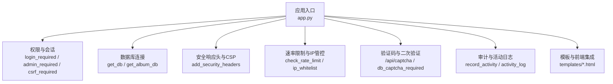
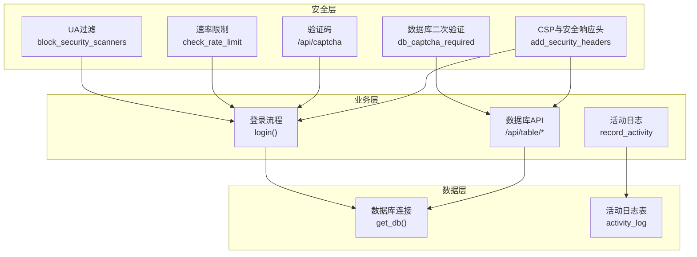
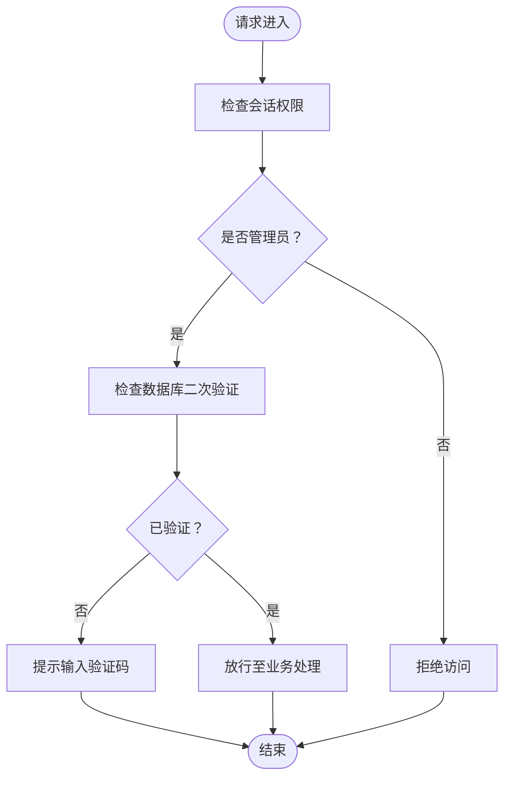
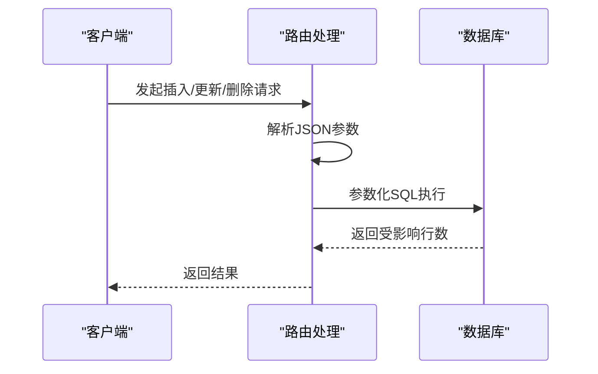
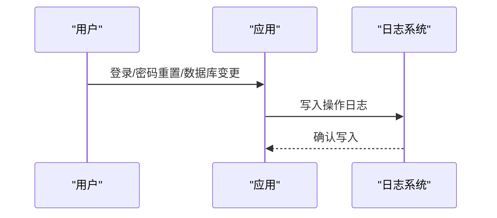
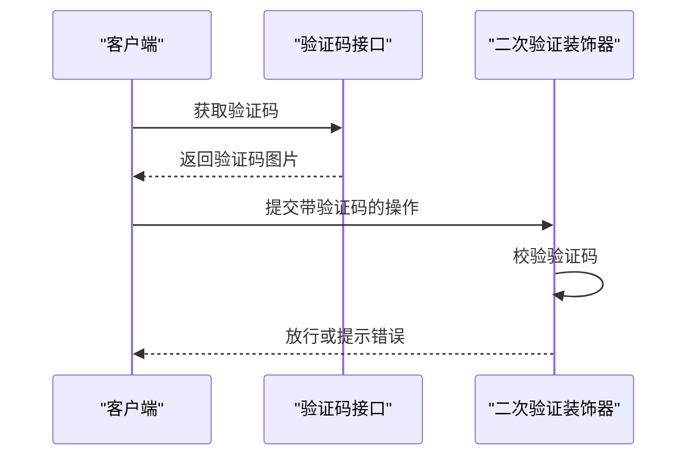
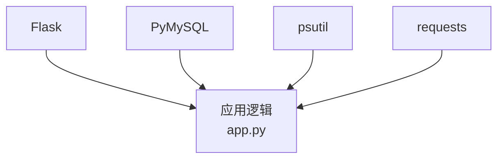

# 数据库安全机制

<cite>
**本文引用的文件**
- [app.py](file://app.py)
- [安全措施清单.md](file://安全措施清单.md)
- [requirements.txt](file://requirements.txt)
- [templates/db_captcha.html](file://templates/db_captcha.html)
</cite>

## 目录
1. [简介](#简介)
2. [项目结构](#项目结构)
3. [核心组件](#核心组件)
4. [架构总览](#架构总览)
5. [详细组件分析](#详细组件分析)
6. [依赖分析](#依赖分析)
7. [性能考虑](#性能考虑)
8. [故障排查指南](#故障排查指南)
9. [结论](#结论)
10. [附录](#附录)

## 简介
本文件围绕该代码库中的数据库安全机制进行系统化技术文档整理，重点涵盖以下方面：
- 访问控制机制：用户权限管理、角色分配、最小权限原则的实施路径
- SQL 注入防护：参数化查询、输入验证、查询白名单机制
- 敏感数据保护：数据脱敏、加密存储与传输安全现状与改进建议
- 数据库连接安全：连接池管理、SSL 配置、凭据保护现状与建议
- 安全审计：操作日志记录、异常检测与安全事件告警
- 安全配置指南与最佳实践建议

## 项目结构
该项目采用 Python + Flask 的后端架构，数据库访问通过 PyMySQL 实现，前端模板使用 Jinja2。数据库安全相关的关键位置集中在应用入口文件中，涉及：
- 路由装饰器与权限控制（登录、CSRF、管理员、VIP 等）
- 数据库连接与初始化
- 安全响应头与 CSP 配置
- 速率限制、IP 黑白名单与验证码门禁
- 数据库二次验证（验证码）与敏感数据脱敏

图表来源
- [app.py:120-140](file://app.py#L120-L140)
- [app.py:680-693](file://app.py#L680-L693)
- [app.py:642-677](file://app.py#L642-L677)
- [app.py:514-562](file://app.py#L514-L562)
- [app.py:429-501](file://app.py#L429-L501)
- [app.py:967-988](file://app.py#L967-L988)
- [app.py:1324-1339](file://app.py#L1324-L1339)

章节来源
- [app.py:120-140](file://app.py#L120-L140)
- [app.py:680-693](file://app.py#L680-L693)
- [app.py:642-677](file://app.py#L642-L677)
- [app.py:514-562](file://app.py#L514-L562)
- [app.py:429-501](file://app.py#L429-L501)
- [app.py:967-988](file://app.py#L967-L988)
- [app.py:1324-1339](file://app.py#L1324-L1339)

## 核心组件
- 权限与会话控制
  - 登录必需装饰器、管理员必需装饰器、CSRF 验证装饰器、VIP 必需装饰器等，确保受保护路由的访问控制链路完整。
- 数据库连接与初始化
  - 提供统一的数据库连接工厂与多数据库配置，包含表初始化逻辑与相册扩展表的创建。
- 安全响应头与 CSP
  - 设置多种安全响应头，包括 HSTS、X-Frame-Options、X-Content-Type-Options、CSP（含 nonce 轮换）等。
- 速率限制与 IP 管控
  - 基于内存的速率限制器与持久化配置，支持白名单、手动封禁、试探封禁延长等策略。
- 验证码与二次验证
  - 图形验证码生成与校验，以及数据库二次验证装饰器，用于高风险数据库操作。
- 审计与活动日志
  - 活跃度记录与活动日志表，便于追踪用户行为与异常。

章节来源
- [app.py:907-964](file://app.py#L907-L964)
- [app.py:680-693](file://app.py#L680-L693)
- [app.py:642-677](file://app.py#L642-L677)
- [app.py:319-346](file://app.py#L319-L346)
- [app.py:348-412](file://app.py#L348-L412)
- [app.py:429-501](file://app.py#L429-L501)
- [app.py:967-988](file://app.py#L967-L988)
- [app.py:1324-1339](file://app.py#L1324-L1339)

## 架构总览
下图展示了数据库安全相关模块之间的交互关系与职责划分：

图表来源
- [app.py:149-156](file://app.py#L149-L156)
- [app.py:514-562](file://app.py#L514-L562)
- [app.py:429-501](file://app.py#L429-L501)
- [app.py:967-988](file://app.py#L967-L988)
- [app.py:642-677](file://app.py#L642-L677)
- [app.py:1021-1100](file://app.py#L1021-L1100)
- [app.py:1324-1339](file://app.py#L1324-L1339)
- [app.py:2370-2405](file://app.py#L2370-L2405)

## 详细组件分析

### 访问控制与权限管理
- 角色与权限
  - 应用内置“访客”“普通用户”“VIP”“管理员”等角色，权限通过会话中的字段进行判定。
- 装饰器体系
  - 登录必需、管理员必需、VIP 必需、CSRF 验证等装饰器串联形成访问控制链。
- 最小权限原则
  - 对数据库管理类 API（如表数据查询、插入、更新、删除）均要求管理员身份与数据库二次验证，体现最小权限原则。

图表来源
- [app.py:934-941](file://app.py#L934-L941)
- [app.py:967-988](file://app.py#L967-L988)
- [app.py:2370-2405](file://app.py#L2370-L2405)

章节来源
- [app.py:907-964](file://app.py#L907-L964)
- [app.py:934-941](file://app.py#L934-L941)
- [app.py:967-988](file://app.py#L967-L988)
- [app.py:2370-2405](file://app.py#L2370-L2405)

### SQL 注入防护
- 参数化查询
  - 数据库写操作（插入、更新、删除）均采用参数化占位符拼接 SQL，避免直接拼接用户输入。
- 查询白名单机制
  - 读取表列表与描述时，通过“反引号包裹 + 白名单校验”的方式限定可访问对象，降低注入风险。
- 输入验证与清理
  - 登录用户名长度限制、密码强度提示、验证码校验等，减少恶意输入进入数据库层的机会。

图表来源
- [app.py:2412-2431](file://app.py#L2412-L2431)
- [app.py:2438-2461](file://app.py#L2438-L2461)
- [app.py:2468-2485](file://app.py#L2468-L2485)

章节来源
- [app.py:2412-2431](file://app.py#L2412-L2431)
- [app.py:2438-2461](file://app.py#L2438-L2461)
- [app.py:2468-2485](file://app.py#L2468-L2485)
- [app.py:2381-2385](file://app.py#L2381-L2385)

### 敏感数据保护
- 数据脱敏
  - 在数据库查询展示环节对敏感字段进行脱敏处理，避免明文泄露。
- 加密存储
  - 用户密码采用哈希存储，登录流程兼容旧版明文升级为哈希。
- 传输安全
  - 当前未见显式 SSL/TLS 配置；建议在生产环境启用 HTTPS 并配置 HSTS。

章节来源
- [app.py:2351-2355](file://app.py#L2351-L2355)
- [app.py:1071-1099](file://app.py#L1071-L1099)
- [app.py:642-677](file://app.py#L642-L677)

### 数据库连接安全
- 连接工厂
  - 统一的数据库连接工厂负责建立连接，异常时返回空值，避免崩溃传播。
- 凭据保护
  - 数据库凭据在配置字典中硬编码，建议迁移到环境变量或密钥管理服务。
- 连接池
  - 当前未实现连接池；建议引入连接池以提升并发与稳定性。

章节来源
- [app.py:680-684](file://app.py#L680-L684)
- [app.py:625-636](file://app.py#L625-L636)

### 安全审计与告警
- 活动日志
  - 记录用户活跃行为，支持排行榜与排名查询，便于审计与异常检测。
- 日志写入
  - 登录、密码重置、数据库变更等关键操作均调用日志写入函数，便于后续接入集中化日志系统。

图表来源
- [app.py:1077-1078](file://app.py#L1077-L1078)
- [app.py:1303-1311](file://app.py#L1303-L1311)
- [app.py:2428-2429](file://app.py#L2428-L2429)
- [app.py:2458-2459](file://app.py#L2458-L2459)
- [app.py:2482-2483](file://app.py#L2482-L2483)

章节来源
- [app.py:1324-1339](file://app.py#L1324-L1339)
- [app.py:1077-1078](file://app.py#L1077-L1078)
- [app.py:1303-1311](file://app.py#L1303-L1311)
- [app.py:2428-2429](file://app.py#L2428-L2429)
- [app.py:2458-2459](file://app.py#L2458-L2459)
- [app.py:2482-2483](file://app.py#L2482-L2483)

### 验证码与二次验证
- 图形验证码
  - 生成与校验流程，配合速率限制，降低自动化攻击成功率。
- 数据库二次验证
  - 高风险数据库操作前的二次验证码门禁，结合会话状态与模板渲染，保障操作真实性。

图表来源
- [app.py:429-501](file://app.py#L429-L501)
- [app.py:967-988](file://app.py#L967-L988)
- [templates/db_captcha.html:1-23](file://templates/db_captcha.html#L1-L23)

章节来源
- [app.py:429-501](file://app.py#L429-L501)
- [app.py:967-988](file://app.py#L967-L988)
- [templates/db_captcha.html:1-23](file://templates/db_captcha.html#L1-L23)

## 依赖分析
- 外部依赖
  - Flask、PyMySQL、psutil、requests 等，其中 PyMySQL 用于数据库连接。
- 内部耦合
  - 权限装饰器与数据库 API 高度耦合，确保高风险操作具备严格的身份与二次验证。
- 循环依赖
  - 未发现循环导入；各模块职责清晰。

图表来源
- [requirements.txt:1-5](file://requirements.txt#L1-L5)
- [app.py:15-25](file://app.py#L15-L25)

章节来源
- [requirements.txt:1-5](file://requirements.txt#L1-L5)
- [app.py:15-25](file://app.py#L15-L25)

## 性能考虑
- 速率限制
  - 基于内存的队列与定时保存策略，适合中小规模部署；高并发场景建议引入 Redis 等外部缓存以共享状态。
- 连接池
  - 当前未使用连接池，建议引入连接池以减少连接开销与提升吞吐。
- 查询优化
  - 活动日志表已建立索引，建议根据实际查询模式评估是否需要复合索引或物化视图。

## 故障排查指南
- 登录失败
  - 检查验证码校验、登录速率限制、账户锁定状态与数据库连接。
- 数据库操作失败
  - 核对表白名单校验、参数化 SQL、主键字段与二次验证状态。
- 会话超时
  - 检查 IP 最后活跃时间与会话超时阈值，确认是否因长时间无操作导致自动登出。
- 安全响应头问题
  - 确认生产环境是否启用 HTTPS，HSTS 是否生效，CSP 是否与前端脚本源冲突。

章节来源
- [app.py:1042-1054](file://app.py#L1042-L1054)
- [app.py:2381-2385](file://app.py#L2381-L2385)
- [app.py:2470-2471](file://app.py#L2470-L2471)
- [app.py:564-593](file://app.py#L564-L593)
- [app.py:642-677](file://app.py#L642-L677)

## 结论
该代码库在数据库安全方面已具备较为完善的基线能力：严格的权限控制、参数化查询、二次验证、活动日志与安全响应头等。建议在生产环境中进一步强化凭据保护、启用连接池与 SSL、完善集中化日志与告警体系，并持续进行漏洞扫描与安全评估。

## 附录
- 安全配置清单与修复建议可参考安全扫描报告，其中包含响应头加固、CSP 改进、Cookie 安全标记等建议。

章节来源
- [安全措施清单.md:1-161](file://安全措施清单.md#L1-L161)