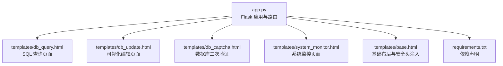
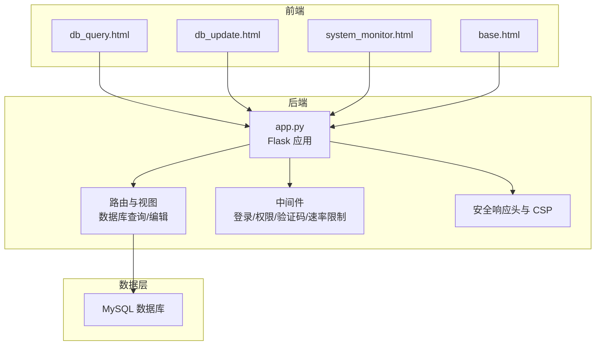
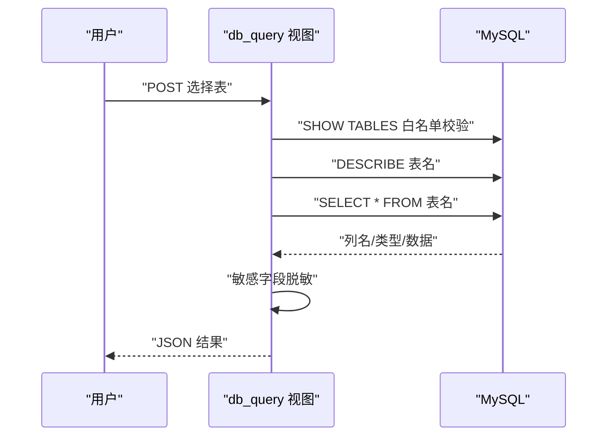
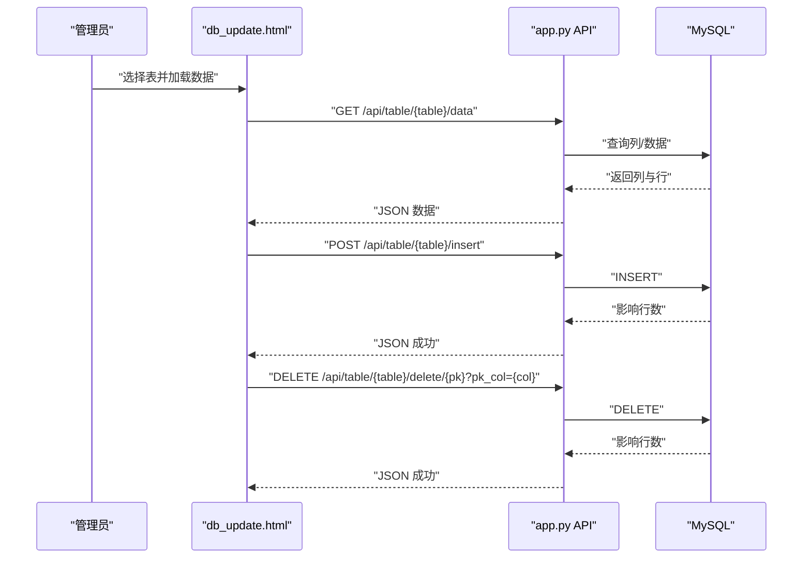
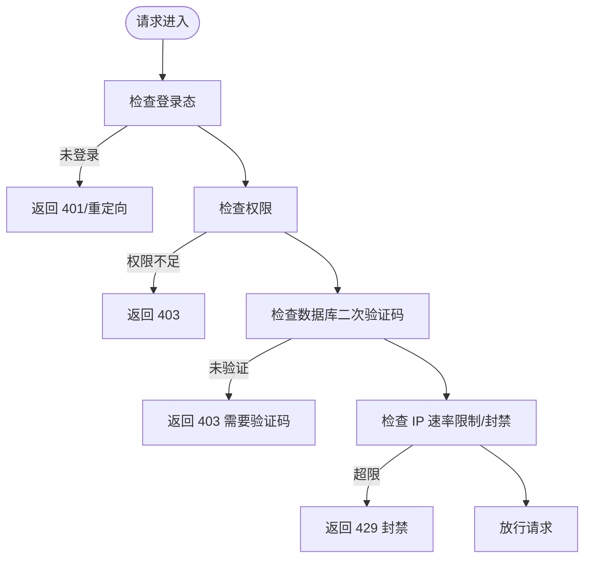
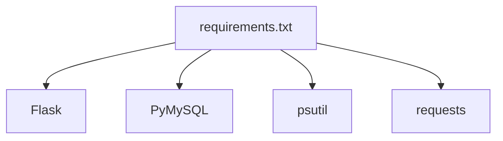

# 数据库管理系统

<cite>
**本文档引用的文件**
- [app.py](file://app.py)
- [db_query.html](file://templates/db_query.html)
- [db_update.html](file://templates/db_update.html)
- [db_captcha.html](file://templates/db_captcha.html)
- [system_monitor.html](file://templates/system_monitor.html)
- [requirements.txt](file://requirements.txt)
- [base.html](file://templates/base.html)
</cite>

## 目录
1. [简介](#简介)
2. [项目结构](#项目结构)
3. [核心组件](#核心组件)
4. [架构总览](#架构总览)
5. [详细组件分析](#详细组件分析)
6. [依赖分析](#依赖分析)
7. [性能考虑](#性能考虑)
8. [故障排除指南](#故障排除指南)
9. [结论](#结论)
10. [附录](#附录)

## 简介
本项目是一个基于 Flask 的多合一 Web 应用，其中数据库管理模块提供了 SQL 查询接口、可视化编辑界面、表结构浏览与安全机制。系统通过严格的访问控制、验证码二次验证、速率限制与安全响应头等手段保障数据库操作的安全性；前端采用 Bootstrap 与原生 JavaScript 实现交互式表格展示与增删改操作。

## 项目结构
- 后端入口与核心逻辑位于 app.py，包含数据库连接、路由定义、中间件与安全策略。
- 模板目录 templates 下包含数据库相关页面：db_query.html（查询）、db_update.html（可视化编辑）、db_captcha.html（数据库二次验证）以及系统监控页面 system_monitor.html。
- 前端资源位于 frontend/（本仓库未包含其完整内容），但数据库管理功能主要通过后端渲染模板与 API 接口实现。
- requirements.txt 指定运行所需依赖：Flask、PyMySQL、psutil、requests。

**图表来源**
- [app.py](file://app.py)
- [db_query.html](file://templates/db_query.html)
- [db_update.html](file://templates/db_update.html)
- [db_captcha.html](file://templates/db_captcha.html)
- [system_monitor.html](file://templates/system_monitor.html)
- [base.html](file://templates/base.html)
- [requirements.txt](file://requirements.txt)

**章节来源**
- [app.py](file://app.py)
- [requirements.txt](file://requirements.txt)

## 核心组件
- 数据库连接与初始化：统一的 get_db() 与 get_album_db()，并在启动时初始化必要表结构。
- 路由与页面：
  - /db_query：用户可选择表并执行查询，结果以表格形式展示。
  - /db_update：管理员可视化编辑数据库，支持加载数据、新增、编辑、删除。
  - /api/table/<table>/data：返回指定表的列名、类型、主键与数据。
  - /api/table/<table>/insert：向表插入一行数据。
  - /api/table/<table>/delete/<pk>：按主键删除一行数据。
- 安全机制：
  - 登录态与权限：login_required、admin_required、non_guest_required、vip_required。
  - 数据库二次验证：db_captcha_required，要求输入验证码后方可访问数据库相关功能。
  - 速率限制：全局 IP 速率限制与持久化配置，支持白名单与手动封禁。
  - 安全响应头：CSP、X-Frame-Options、X-Content-Type-Options、X-XSS-Protection、Strict-Transport-Security 等。
  - 输入清洗：sanitize_input，过滤潜在危险内容。
- 性能监控：system_monitor.html 展示 CPU、内存、磁盘、网络与在线用户统计。

**章节来源**
- [app.py](file://app.py)
- [db_query.html](file://templates/db_query.html)
- [db_update.html](file://templates/db_update.html)
- [system_monitor.html](file://templates/system_monitor.html)

## 架构总览
系统采用典型的三层架构：前端模板层（Jinja2）、后端业务层（Flask 路由与视图）、数据访问层（PyMySQL）。安全策略贯穿请求生命周期，从拦截扫描器 UA、生成 CSP nonce、到数据库二次验证与速率限制。

**图表来源**
- [app.py](file://app.py)
- [db_query.html](file://templates/db_query.html)
- [db_update.html](file://templates/db_update.html)
- [system_monitor.html](file://templates/system_monitor.html)
- [base.html](file://templates/base.html)

## 详细组件分析

### SQL 查询接口设计
- 功能概述
  - 用户选择目标表，后端执行查询并返回列名、数据与主键信息。
  - 结果集进行敏感字段脱敏处理，避免泄露。
- 执行流程
  - 前端提交表名 → 后端白名单校验表是否存在 → 执行 DESCRIBE 获取列与类型 → 执行 SELECT 获取数据 → 对数据进行脱敏 → 返回 JSON。
- 错误处理
  - 数据库连接失败、查询异常均返回 JSON 错误码与状态码。
- 安全要点
  - 表名使用反引号包裹并经白名单校验，降低注入风险。
  - 二次验证码 db_captcha_required 保护数据库操作。

**图表来源**
- [app.py](file://app.py)
- [db_query.html](file://templates/db_query.html)

**章节来源**
- [app.py](file://app.py)
- [db_query.html](file://templates/db_query.html)

### 可视化数据库编辑功能
- 功能概述
  - 管理员可加载任意表的数据，展示列名与行数据，支持添加、编辑、删除。
  - 前端通过 /api/table/<table>/data 获取列与数据，再通过 /api/table/<table>/insert 与 /api/table/<table>/delete/<pk> 执行变更。
- 数据流
  - 选择表 → 调用 /api/table/<table>/data → 渲染表头与数据 → 弹窗填写字段 → 提交插入或更新 → 刷新列表。
- 错误处理
  - API 返回 JSON 错误，前端弹窗提示并阻止无效操作。
- 安全要点
  - 仅管理员可访问 /db_update 与相关 API。
  - 二次验证码 db_captcha_required 保护数据库编辑操作。

**图表来源**
- [app.py](file://app.py)
- [db_update.html](file://templates/db_update.html)

**章节来源**
- [app.py](file://app.py)
- [db_update.html](file://templates/db_update.html)

### 表结构浏览与元数据查询
- 功能概述
  - 通过 DESCRIBE 获取列名、类型、是否为主键等元数据。
  - 通过 SHOW TABLES 获取可用表列表。
- 实现位置
  - 查询页面与可视化编辑页面均调用上述 SQL 并返回给前端渲染。
- 约束检查
  - 通过 DESCRIBE 结果判断主键列，删除操作需传入主键字段名以保证安全性。

**章节来源**
- [app.py](file://app.py)

### 数据库安全机制
- 访问控制
  - 登录态：login_required。
  - 权限：admin_required（仅管理员）、non_guest_required（禁止访客）、vip_required（VIP 或管理员）。
- SQL 注入防护
  - 表名使用反引号包裹并经白名单校验。
  - 插入与删除使用参数化占位符。
- 敏感数据保护
  - 查询结果对敏感字段进行脱敏处理（脱敏函数存在但当前实现直接返回字符串，便于后续扩展）。
- 二次验证
  - 数据库操作前需完成 db_captcha_required 验证，否则返回 403。
- 速率限制与封禁
  - 全局 IP 速率限制，支持白名单与手动封禁，封禁期间试探将延长封禁时长。
- 安全响应头
  - 设置 CSP、X-Frame-Options、X-Content-Type-Options、X-XSS-Protection、Strict-Transport-Security 等。

**图表来源**
- [app.py](file://app.py)

**章节来源**
- [app.py](file://app.py)

### 数据导入导出与备份恢复
- 备份管理
  - 前端通过 /api/backup/create、/api/backup/delete、/api/backup/delete-all、/api/backup/prune 等接口进行备份创建、删除、批量清理。
  - 备份列表展示文件名、创建时间、大小，并支持下载与差异对比。
- 导入导出
  - 代码库未发现 CSV 导入/导出专用路由与实现，建议在 /api/table/<table>/insert/update/delete 基础上扩展批量导入/导出接口。
- 备份恢复
  - 前端提供恢复与下载按钮，后端接口负责实际处理。

**章节来源**
- [system_monitor.html](file://templates/system_monitor.html)

### 性能监控与优化建议
- 实时监控
  - system_monitor.html 展示 CPU、内存、磁盘、网络与在线用户统计，定时刷新。
- 优化建议
  - 后端：对高频查询增加索引、分页与缓存；对批量写入使用事务减少往返。
  - 前端：对大数据表格启用虚拟滚动与懒加载；对 API 调用增加节流与去抖。
  - 安全：将 unsafe-inline 逐步迁移到 nonce 策略，减少 CSP 放宽。

**章节来源**
- [system_monitor.html](file://templates/system_monitor.html)

## 依赖分析
- Flask：Web 框架与路由。
- PyMySQL：MySQL 连接与查询。
- psutil：系统监控（CPU、内存、磁盘、网络）。
- requests：外部网络请求支持。

**图表来源**
- [requirements.txt](file://requirements.txt)

**章节来源**
- [requirements.txt](file://requirements.txt)

## 性能考虑
- 查询性能
  - 使用索引：对常用筛选与排序列建立索引。
  - 分页：大数据量查询应分页，避免一次性传输过多数据。
  - 缓存：对静态元数据与不常变动的查询结果进行缓存。
- 写入性能
  - 批量写入：使用事务一次性提交多条 INSERT/UPDATE。
  - 参数化：严格使用参数化占位符，避免拼接 SQL。
- 前端体验
  - 虚拟滚动：对大表格启用虚拟滚动。
  - 懒加载：按需加载数据与模态框内容。
- 安全与性能平衡
  - CSP 与安全头提升安全性，避免过度放宽导致性能下降。

## 故障排除指南
- 数据库连接失败
  - 检查 get_db() 返回值与 MySQL 服务状态。
  - 查看日志文件定位具体错误。
- 查询报错
  - 确认表名白名单校验与反引号包裹。
  - 检查 DESCRIBE 与 SELECT 是否返回描述信息。
- 二次验证码未生效
  - 确认 /api/captcha 正常生成，会话中 captcha_code 是否存在。
  - 检查 db_captcha_required 装饰器是否正确应用到路由。
- 429 速率限制
  - 检查 ip_requests 与 ip_blocked 状态，确认是否命中封禁。
  - 如需临时放行，将 IP 加入白名单或调整 rate_config.json。
- 403 权限不足
  - 确认用户权限为 administrator 或满足 VIP 要求。
  - 检查 CSRF 与登录态。

**章节来源**
- [app.py](file://app.py)

## 结论
该数据库管理模块通过严格的权限控制、二次验证码与安全响应头构建了可靠的安全边界；通过白名单与参数化查询有效降低了 SQL 注入风险；前端可视化编辑提升了数据库维护效率。建议后续增强 CSV 导入导出、备份恢复与性能监控能力，并持续优化前端交互与后端查询性能。

## 附录
- 常用路由速览
  - /db_query：数据库查询页面
  - /db_update：可视化编辑页面
  - /api/table/<table>/data：获取表数据
  - /api/table/<table>/insert：插入数据
  - /api/table/<table>/delete/<pk>：删除数据
  - /api/captcha：生成验证码
  - /system_monitor：系统监控页面