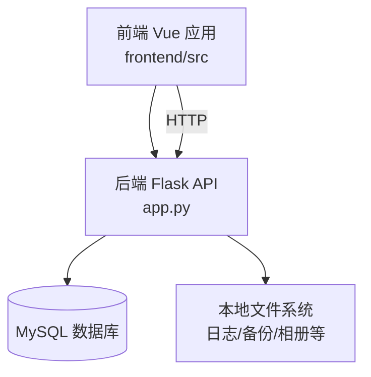
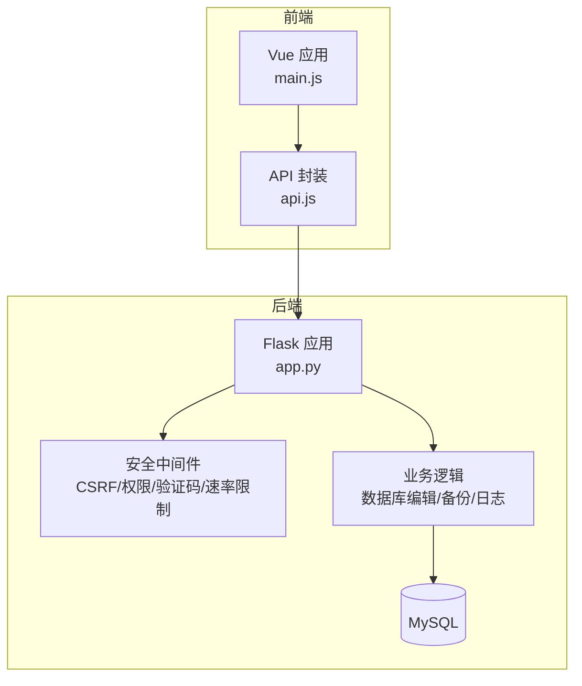
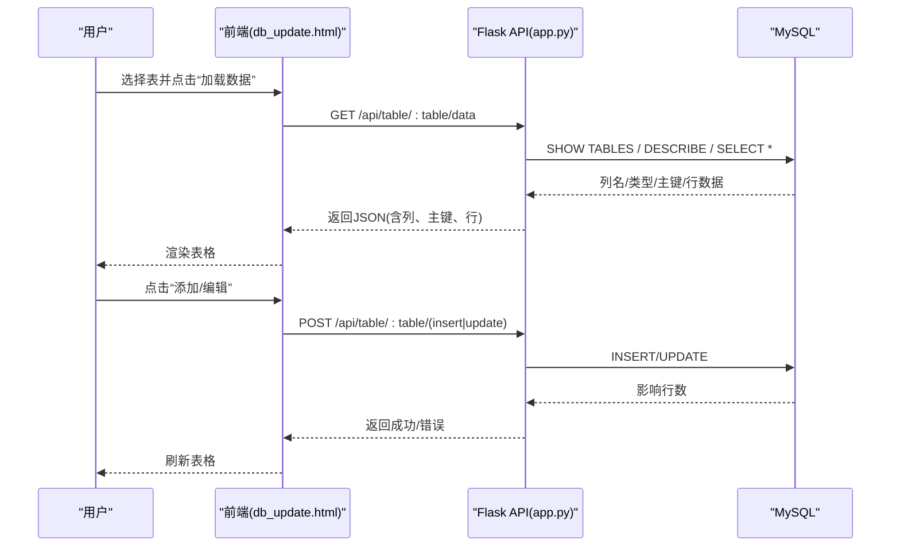
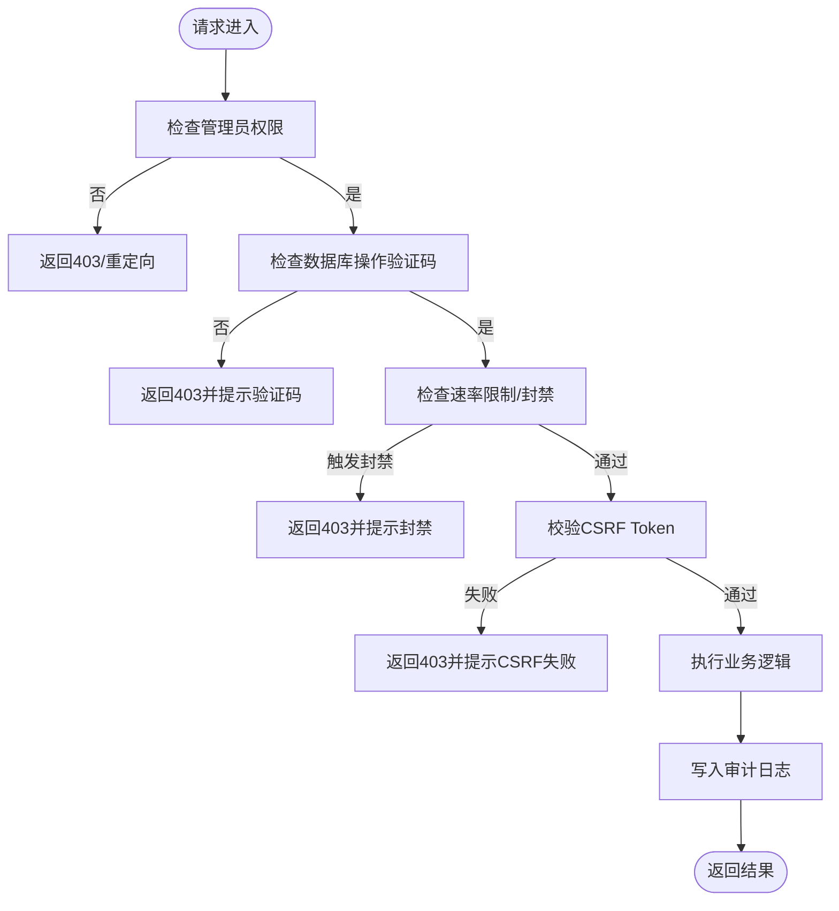
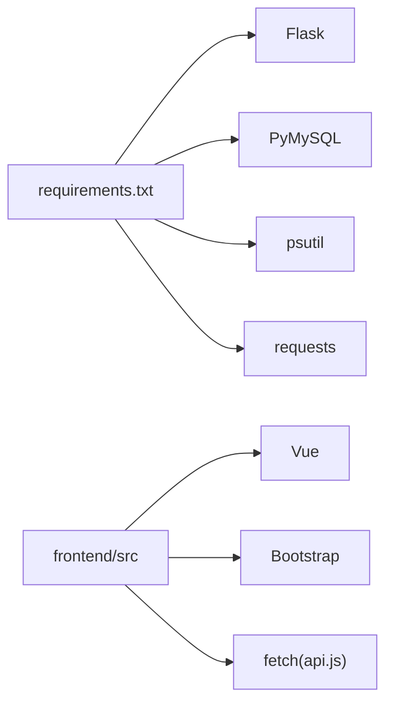

# 数据编辑系统

<cite>
**本文引用的文件**
- [app.py](file://app.py)
- [db_update.html](file://templates/db_update.html)
- [api.js](file://frontend/src/api.js)
- [main.js](file://frontend/src/main.js)
- [requirements.txt](file://requirements.txt)
- [logs.html](file://templates/logs.html)
- [backup.html](file://templates/backup.html)
</cite>

## 目录
1. [简介](#简介)
2. [项目结构](#项目结构)
3. [核心组件](#核心组件)
4. [架构总览](#架构总览)
5. [详细组件分析](#详细组件分析)
6. [依赖分析](#依赖分析)
7. [性能考虑](#性能考虑)
8. [故障排查指南](#故障排查指南)
9. [结论](#结论)
10. [附录](#附录)

## 简介
本文件面向“数据编辑系统”的全面技术文档，聚焦以下能力：
- 数据可视化编辑：表格渲染、单元格编辑、实时更新
- 数据验证规则：字段类型检查、约束验证、业务规则校验
- 批量操作：批量更新、批量删除、事务处理机制
- 数据导入导出：CSV格式处理、数据转换、错误恢复
- 安全控制：权限验证、审计日志、操作回滚
- API接口文档与使用示例

系统采用前后端分离架构：前端基于Vue应用，通过fetch调用后端Flask API；后端提供数据库可视化编辑、备份、日志等能力，并内置多层安全防护与审计。

## 项目结构
- 后端核心：Flask应用位于根目录，集中定义路由、中间件、安全策略与数据库操作
- 前端：Vue应用位于frontend/src，通过api.js封装统一的REST调用
- 模板：Jinja2模板位于templates，包含可视化数据库编辑界面、日志与备份界面等
- 依赖：requirements.txt声明Flask、PyMySQL、psutil、requests等运行时依赖

图表来源
- [app.py](file://app.py)
- [api.js](file://frontend/src/api.js)

章节来源
- [app.py](file://app.py)
- [api.js](file://frontend/src/api.js)
- [requirements.txt](file://requirements.txt)

## 核心组件
- 可视化数据库编辑器：提供表格加载、新增、编辑、删除的UI与API
- 安全中间件：CSRF保护、管理员权限、数据库操作验证码、速率限制、会话超时
- 审计日志：活动日志表与操作日志记录，支持查询与清理
- 备份与恢复：备份创建、压缩、删除、批量清理
- 前端API封装：统一的fetch封装，便于复用与扩展

章节来源
- [app.py](file://app.py)
- [db_update.html](file://templates/db_update.html)
- [logs.html](file://templates/logs.html)
- [backup.html](file://templates/backup.html)
- [api.js](file://frontend/src/api.js)

## 架构总览
系统采用“模板渲染 + REST API”的混合模式：
- 模板页面负责展示与交互（如可视化编辑器、日志、备份）
- API路由负责数据读写与业务逻辑（如数据库编辑、备份、日志）

图表来源
- [app.py](file://app.py)
- [api.js](file://frontend/src/api.js)
- [main.js](file://frontend/src/main.js)

## 详细组件分析

### 可视化数据库编辑器
- 功能概述
  - 表格加载：根据所选表名拉取列名、主键、行数据
  - 新增/编辑：弹窗收集字段值，提交至后端API
  - 删除：二次确认后调用删除API
  - 实时更新：提交后刷新表格数据

- 前端实现要点
  - 使用模板中的表格容器与模态框，通过脚本动态渲染
  - 新增/编辑表单按列动态生成，编辑时主键字段禁用
  - 提交时构造JSON并调用对应API，成功后隐藏模态并刷新

- 后端API要点
  - 获取表数据：校验表存在性，读取列定义与行数据，掩码敏感字段
  - 插入：拼接列与占位符，执行INSERT
  - 更新：校验主键与字段，构造SET子句，执行UPDATE
  - 删除：校验主键字段参数，执行DELETE

图表来源
- [db_update.html](file://templates/db_update.html)
- [app.py](file://app.py)

章节来源
- [db_update.html](file://templates/db_update.html)
- [app.py](file://app.py)

### 数据验证规则
- 字段类型检查
  - 后端通过SQL描述列类型，前端以文本框输入；建议在前端进行基础类型提示（如日期/数值），后端仍需进行严格校验
- 约束验证
  - 主键唯一性：插入/更新前确保主键存在且唯一
  - 非空约束：后端执行SQL时由数据库约束保证
- 业务规则校验
  - 管理员权限：编辑API均要求管理员身份
  - 数据库操作验证码：二次验证通过后方可执行编辑类操作
  - 会话超时：长时间无操作自动登出，避免越权

章节来源
- [app.py](file://app.py)

### 批量操作与事务处理
- 批量更新/删除
  - 当前实现为逐条调用单条API（插入/更新/删除），未见批量专用API
  - 若需批量操作，建议在后端提供批量接口，内部使用事务包裹，失败回滚
- 事务处理机制
  - 单条写操作在数据库层面具备原子性；批量场景建议引入显式事务
- 实时更新
  - 前端每次提交后主动刷新表格，确保UI与数据库一致

章节来源
- [app.py](file://app.py)
- [db_update.html](file://templates/db_update.html)

### 数据导入导出（CSV）
- 导入
  - 当前未发现CSV导入相关API或界面
  - 建议新增“CSV导入”API：解析CSV、校验列映射、批量写入
- 导出
  - 当前未发现通用CSV导出API
  - 建议在各业务模块提供“导出CSV”按钮，后端返回CSV流
- 错误恢复
  - 建议在导入流程中增加“预检”步骤与“回滚”机制（如事务包裹）

章节来源
- [app.py](file://app.py)
- [db_update.html](file://templates/db_update.html)

### 安全控制
- 权限验证
  - 管理员权限装饰器：仅管理员可访问编辑与日志等敏感功能
  - VIP/访客权限：部分功能对VIP开放
- CSRF保护
  - 表单提交需携带CSRF Token，后端严格校验
- 数据库操作验证码
  - 对数据库编辑API增加二次验证码校验
- 速率限制与封禁
  - 内存+文件持久化的速率限制，支持白名单与手动封禁
- 会话超时
  - IP维度的会话空闲超时，超时自动登出
- 审计日志
  - 记录用户登录、密码重置、数据库变更、相册操作等关键事件
  - 日志页面支持刷新与清空

图表来源
- [app.py](file://app.py)

章节来源
- [app.py](file://app.py)
- [logs.html](file://templates/logs.html)

### API接口文档与使用示例
以下为与数据编辑相关的核心API（基于现有实现整理）。为避免泄露具体代码，示例以路径与参数形式呈现。

- 获取表数据
  - 方法与路径：GET /api/table/{table}/data
  - 权限：管理员
  - 参数：无
  - 返回：列名数组、类型数组、主键、行数据（含敏感字段掩码）
  - 示例调用：前端模板中已使用fetch调用该路径

- 插入行
  - 方法与路径：POST /api/table/{table}/insert
  - 权限：管理员
  - 请求体：JSON对象，键为列名，值为对应值
  - 返回：成功标志与影响行数
  - 示例调用：前端模板中已使用fetch调用该路径

- 更新行
  - 方法与路径：POST /api/table/{table}/update
  - 权限：管理员
  - 请求体：JSON对象，包含主键列名(pk_col)、主键值(pk)、待更新字段集合(fields)
  - 返回：成功标志与影响行数
  - 示例调用：前端模板中已使用fetch调用该路径

- 删除行
  - 方法与路径：DELETE /api/table/{table}/delete/{pk}?pk_col={主键列名}
  - 权限：管理员
  - 返回：成功标志与影响行数
  - 示例调用：前端模板中已使用fetch调用该路径

- 日志管理
  - 查看日志：GET /logs
  - 清空日志：GET /logs_clear
  - 权限：管理员

- 备份管理
  - 创建备份：POST /api/backup/create
  - 删除备份：DELETE /api/backup/delete/{name}
  - 批量删除：DELETE /api/backup/delete-all
  - 保留N份：DELETE /api/backup/prune?keep=N
  - 权限：管理员

章节来源
- [app.py](file://app.py)
- [db_update.html](file://templates/db_update.html)
- [logs.html](file://templates/logs.html)
- [backup.html](file://templates/backup.html)

## 依赖分析
- 运行时依赖
  - Flask：Web框架
  - PyMySQL：MySQL驱动
  - psutil、requests：系统监控与网络请求
- 前端依赖
  - Vue：前端框架
  - Bootstrap：UI组件库
  - fetch：HTTP客户端（封装于api.js）

图表来源
- [requirements.txt](file://requirements.txt)
- [api.js](file://frontend/src/api.js)

章节来源
- [requirements.txt](file://requirements.txt)
- [api.js](file://frontend/src/api.js)

## 性能考虑
- 速率限制
  - 内存队列记录请求时间戳，超限封禁；支持白名单与手动封禁
  - 配置持久化，支持动态调整
- 数据库查询
  - 表格加载一次性读取全表，建议在大数据表上增加分页或索引
- 前端渲染
  - 大表格建议虚拟滚动与懒加载，减少DOM压力
- 文件I/O
  - 备份/相册等涉及文件系统操作，注意并发与磁盘空间

## 故障排查指南
- 权限不足
  - 现象：返回403或被重定向
  - 排查：确认会话权限、管理员状态、CSRF Token是否正确
- 验证码错误
  - 现象：数据库编辑API返回需要验证码
  - 排查：确认二次验证码页面已通过、会话中验证码未过期
- 速率限制触发
  - 现象：返回429或被封禁
  - 排查：检查IP白名单、封禁列表、配置文件
- 数据库连接失败
  - 现象：API返回数据库错误
  - 排查：检查DB配置、网络连通性、服务状态
- 日志为空
  - 现象：日志页面无内容
  - 排查：确认日志文件存在、权限正常、未被清空

章节来源
- [app.py](file://app.py)
- [logs.html](file://templates/logs.html)

## 结论
本数据编辑系统提供了完整的可视化数据库编辑能力，配合多层安全与审计机制，满足管理员日常维护需求。建议后续增强：
- 批量操作API与事务支持
- CSV导入导出能力
- 大表分页与前端虚拟滚动
- 更细粒度的字段级校验与提示

## 附录
- 前端入口
  - Vue应用入口：frontend/src/main.js
  - API封装：frontend/src/api.js
- 模板页面
  - 可视化数据库编辑：templates/db_update.html
  - 日志页面：templates/logs.html
  - 备份页面：templates/backup.html