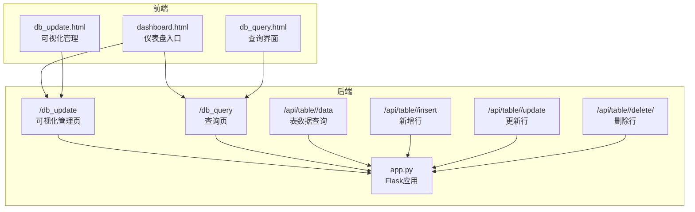
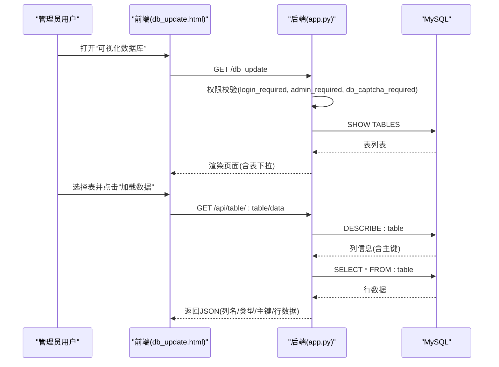
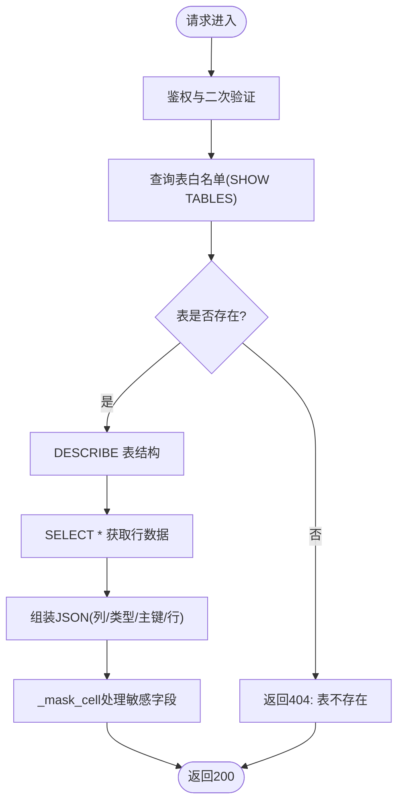
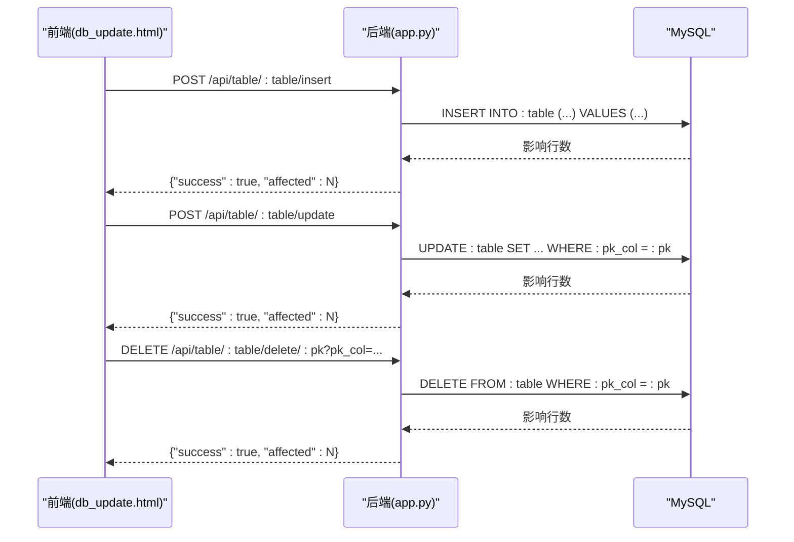
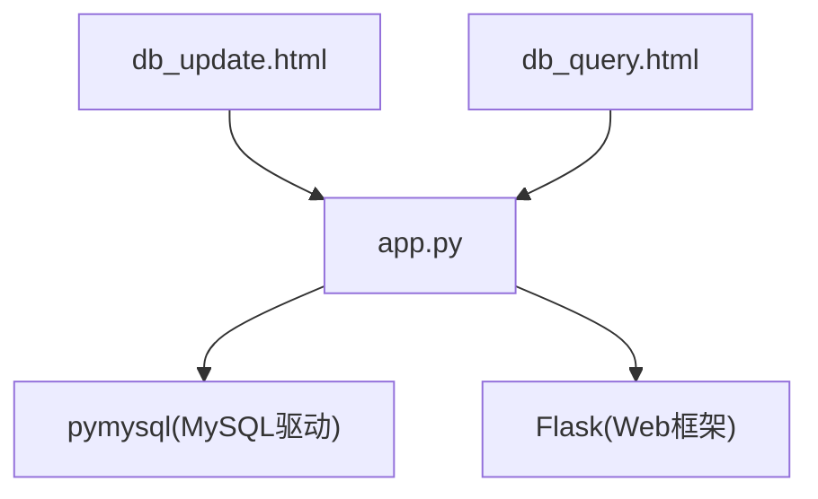

# 表结构管理

<cite>
**本文档引用的文件**
- [app.py](file://app.py)
- [db_update.html](file://templates/db_update.html)
- [db_query.html](file://templates/db_query.html)
- [dashboard.html](file://templates/dashboard.html)
</cite>

## 目录
1. [简介](#简介)
2. [项目结构](#项目结构)
3. [核心组件](#核心组件)
4. [架构概览](#架构概览)
5. [详细组件分析](#详细组件分析)
6. [依赖分析](#依赖分析)
7. [性能考虑](#性能考虑)
8. [故障排查指南](#故障排查指南)
9. [结论](#结论)
10. [附录](#附录)

## 简介
本技术文档聚焦于“表结构管理”能力，涵盖以下方面：
- 表结构浏览：元数据查询、表信息展示、索引信息查看
- 数据库模式管理：表创建、修改、删除操作
- 约束检查机制：外键关系、唯一性约束、完整性验证
- 表统计信息：行数统计、存储空间估算、性能指标监控
- 表结构变更的版本管理：DDL语句记录与变更历史追踪
- API接口与操作指南：REST风格接口定义与前端交互流程

本项目基于Flask + MySQL实现，提供可视化与API双入口，满足管理员对数据库表进行安全可控的结构与数据管理需求。

## 项目结构
围绕表结构管理的关键文件与职责如下：
- 后端应用与路由
  - app.py：核心业务逻辑、数据库连接、权限控制、表结构与数据管理API、模板渲染
- 前端模板
  - templates/db_update.html：可视化数据库管理界面（仅管理员）
  - templates/db_query.html：数据库查询界面（公开选择表）
  - templates/dashboard.html：导航入口（管理员可见“可视化数据库”入口）

图表来源
- [app.py](file://app.py)
- [db_update.html](file://templates/db_update.html)
- [db_query.html](file://templates/db_query.html)
- [dashboard.html](file://templates/dashboard.html)

章节来源
- [app.py](file://app.py)
- [db_update.html](file://templates/db_update.html)
- [db_query.html](file://templates/db_query.html)
- [dashboard.html](file://templates/dashboard.html)

## 核心组件
- 数据库连接与初始化
  - get_db()：建立MySQL连接
  - _init_reset_table()：确保系统基础表存在（含索引）
  - _init_album_tables()：相册扩展功能所需表的创建与兼容性处理
- 权限与安全
  - login_required、admin_required、db_captcha_required：统一鉴权与二次验证
  - write_log()：操作日志记录
- 表结构浏览与数据管理
  - /api/table/<table>/data：白名单校验 + DESCRIBE + SELECT
  - /api/table/<table>/insert/update/delete：增删改行（含主键参数校验）
  - /db_update：可视化管理页（仅管理员）
  - /db_query：查询页（公开选择表）

章节来源
- [app.py](file://app.py)

## 架构概览
表结构管理采用“前后端分离”的Flask架构：
- 前端通过模板渲染提供可视化界面（db_update.html、db_query.html）
- 后端通过装饰器实现统一的安全与权限控制
- API层负责表结构与数据的读写操作，返回JSON响应
- 日志模块记录关键操作，便于审计与追踪

图表来源
- [app.py](file://app.py)
- [db_update.html](file://templates/db_update.html)

## 详细组件分析

### 组件A：表结构浏览与元数据查询
- 功能要点
  - 白名单校验：仅允许已存在的表名访问
  - 元数据查询：DESCRIBE获取列名、类型、是否主键等
  - 行数据查询：SELECT * 获取全表数据
  - 主键识别：优先取PRI标记列，否则取第一列
  - 密码列脱敏：_mask_cell统一处理敏感字段
- 关键接口
  - GET /api/table/:table/data
- 前端交互
  - db_update.html通过AJAX调用上述API，渲染表头与表格数据

图表来源
- [app.py](file://app.py)
- [db_update.html](file://templates/db_update.html)

章节来源
- [app.py](file://app.py)
- [db_update.html](file://templates/db_update.html)

### 组件B：数据库模式管理（增删改）
- 新增行
  - POST /api/table/:table/insert
  - 参数：JSON对象，键为列名，值为对应数据
  - 安全校验：白名单表、数据库连接、异常捕获
- 更新行
  - POST /api/table/:table/update
  - 参数：pk（主键值）、pk_col（主键列名）、fields（待更新字段字典）
  - 安全校验：主键信息校验、字段非空校验
- 删除行
  - DELETE /api/table/:table/delete/:pk?pk_col=...
  - 参数：路径参数: pk，查询参数: pk_col
  - 安全校验：主键字段必填

图表来源
- [app.py](file://app.py)
- [db_update.html](file://templates/db_update.html)

章节来源
- [app.py](file://app.py)
- [db_update.html](file://templates/db_update.html)

### 组件C：约束检查机制
- 唯一性约束
  - 示例：password_reset_tokens.token唯一
  - 示例：plugin_marketplace.plugin_name唯一
- 外键关系
  - 项目中未显式定义外键约束，但通过业务逻辑与唯一约束保障数据一致性
- 完整性验证
  - 插入/更新前通过白名单与参数校验保证表名与主键有效
  - 异常捕获：MySQLError统一返回错误信息

章节来源
- [app.py](file://app.py)

### 组件D：表统计信息与性能监控
- 行数统计
  - 通过SELECT COUNT(*)获取各表行数（示例：相册统计API）
- 存储空间估算
  - 项目未提供直接的存储空间查询接口，可通过系统监控页面观察磁盘使用情况
- 性能指标监控
  - 系统监控页面提供CPU、内存、磁盘、网络等指标，间接反映数据库负载

章节来源
- [app.py](file://app.py)
- [system_monitor.html](file://templates/system_monitor.html)

### 组件E：表结构变更的版本管理
- DDL语句记录
  - 项目未内置DDL审计日志，建议结合数据库binlog或自定义DDL日志表实现
- 变更历史追踪
  - 通过write_log记录数据层操作（插入/更新/删除），可用于数据层面的变更追踪
- 建议
  - 引入独立的DDL审计表，记录DDL执行人、时间、SQL文本、影响范围
  - 对关键表的结构变更增加审批流程与回滚策略

章节来源
- [app.py](file://app.py)

### 组件F：API接口与操作指南
- API定义
  - GET /api/table/:table/data
    - 请求参数：无
    - 响应：columns、types、primary_key、rows
  - POST /api/table/:table/insert
    - 请求体：JSON对象（列名->值）
    - 响应：success、affected
  - POST /api/table/:table/update
    - 请求体：{pk_col, pk, fields}
    - 响应：success、affected
  - DELETE /api/table/:table/delete/:pk?pk_col=...
    - 查询参数：pk_col
    - 响应：success、affected
- 操作步骤
  - 登录并完成数据库操作验证码
  - 打开“可视化数据库”，选择目标表
  - 点击“加载数据”查看表结构与数据
  - 使用“添加行”、“编辑行”、“删除行”完成增删改

章节来源
- [app.py](file://app.py)
- [db_update.html](file://templates/db_update.html)

## 依赖分析
- 组件耦合
  - app.py集中实现权限控制、数据库操作与日志记录，与其他模块解耦良好
  - 前端模板通过AJAX调用后端API，职责清晰
- 外部依赖
  - MySQL驱动：pymysql
  - Flask框架：路由、模板、会话、CORS
- 潜在风险
  - SQL注入防护：通过反引号包裹表名与白名单校验降低风险
  - 二次验证：数据库操作需完成验证码二次验证

图表来源
- [app.py](file://app.py)
- [db_update.html](file://templates/db_update.html)
- [db_query.html](file://templates/db_query.html)

章节来源
- [app.py](file://app.py)

## 性能考虑
- 查询性能
  - 对于大表，建议在高频查询列上建立合适索引（如活动日志、日历事件等）
- 连接管理
  - 单次请求内复用连接，避免频繁创建/销毁
- 前端渲染
  - 大数据量时建议分页或虚拟滚动，减少DOM压力
- 日志与审计
  - write_log写入磁盘可能成为瓶颈，建议异步落盘或批量写入

## 故障排查指南
- 常见问题
  - 表不存在：/api/table/:table/data返回404
  - 缺少主键信息：/api/table/:table/update返回400
  - 数据库连接失败：所有API返回500
  - 权限不足：返回403或重定向至仪表盘
- 排查步骤
  - 检查数据库连接配置与连通性
  - 确认表名白名单与列名合法性
  - 查看write_log日志定位具体操作
  - 检查db_captcha_required是否通过

章节来源
- [app.py](file://app.py)

## 结论
本项目提供了完整的表结构浏览与数据管理能力，具备完善的权限控制与二次验证机制。通过白名单校验与参数校验，有效降低了SQL注入与误操作风险。建议后续引入DDL审计与结构变更审批流程，进一步完善版本管理与合规性。

## 附录
- 相关路由与模板
  - /db_update → db_update.html
  - /db_query → db_query.html
  - /api/table/:table/data → 表结构与数据
  - /api/table/:table/insert → 新增
  - /api/table/:table/update → 更新
  - /api/table/:table/delete/:pk → 删除