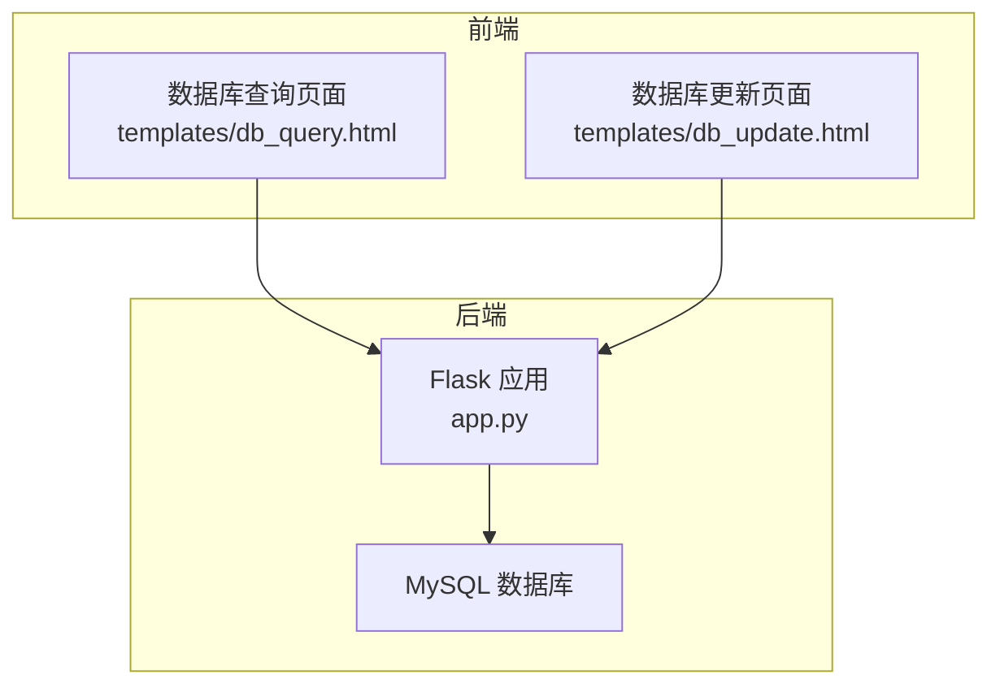
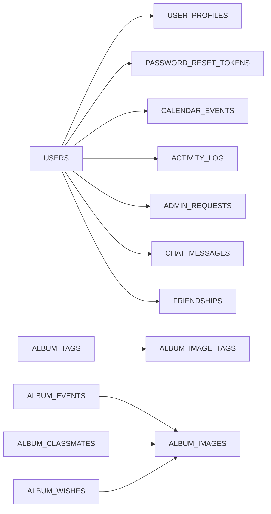

# 关系设计与约束

<cite>
**本文引用的文件**
- [app.py](file://app.py)
- [db_query.html](file://templates/db_query.html)
- [db_update.html](file://templates/db_update.html)
</cite>

## 目录
1. [简介](#简介)
2. [项目结构](#项目结构)
3. [核心组件](#核心组件)
4. [架构总览](#架构总览)
5. [详细组件分析](#详细组件分析)
6. [依赖分析](#依赖分析)
7. [性能考虑](#性能考虑)
8. [故障排查指南](#故障排查指南)
9. [结论](#结论)
10. [附录](#附录)

## 简介
本技术文档围绕 School_Web 的数据库关系设计展开，系统性阐述表间关系设计原则（一对一、一对多、多对多）、主键与外键约束策略、索引设计策略（主键索引、唯一索引、复合索引、查询优化索引）、数据库约束（NOT NULL、UNIQUE、CHECK 约束）的使用场景与最佳实践，并结合项目实际的表结构与 API 实现，给出关系图与 ER 图，帮助读者快速理解与优化数据库设计。

## 项目结构
本项目采用 Python + Flask + PyMySQL 的后端架构，数据库初始化与表结构定义集中在应用入口文件中，同时提供“数据库查询”和“数据库可视化更新”的管理界面模板，便于管理员进行数据维护与审计。



图表来源
- [app.py:2318-2367](file://app.py#L2318-L2367)
- [app.py:2488-2508](file://app.py#L2488-L2508)
- [db_query.html:1-52](file://templates/db_query.html#L1-L52)
- [db_update.html:1-248](file://templates/db_update.html#L1-L248)

章节来源
- [app.py:2318-2367](file://app.py#L2318-L2367)
- [app.py:2488-2508](file://app.py#L2488-L2508)
- [db_query.html:1-52](file://templates/db_query.html#L1-L52)
- [db_update.html:1-248](file://templates/db_update.html#L1-L248)

## 核心组件
- 数据库初始化与表结构定义：集中于应用启动阶段的初始化函数，负责创建用户、活动、日历、插件市场、相册扩展等核心表。
- 数据库查询与更新接口：提供“查询数据库”和“可视化数据库更新”两类管理能力，前者用于只读查看，后者用于管理员增删改查。
- 约束与索引：通过 SQL 声明式约束（主键、唯一、索引）保障数据完整性与查询性能。

章节来源
- [app.py:240-345](file://app.py#L240-L345)
- [app.py:695-831](file://app.py#L695-L831)
- [app.py:2370-2485](file://app.py#L2370-L2485)

## 架构总览
下图展示了数据库层与应用层的关系，以及关键表之间的依赖关系与数据流向。

```mermaid
erDiagram
USERS {
varchar User_Name PK
varchar User_Password
varchar Access_Permission
}
USER_PROFILES {
varchar username PK
varchar nickname
text bio
varchar phone
varchar email
date birthday
varchar lang
timestamp updated_at
}
PASSWORD_RESET_TOKENS {
int id PK
varchar username
varchar token UK
tinyint used
timestamp created_at
timestamp expires_at
}
ACTIVITY_LOG {
int id PK
varchar username
varchar action
int points
timestamp created_at
}
ADMIN_REQUESTS {
int id PK
varchar username UK
varchar status
int score
timestamp requested_at
varchar reviewed_by
timestamp reviewed_at
}
CALENDAR_EVENTS {
int id PK
varchar username
varchar title
text description
date event_date
time event_time
varchar category
varchar color
timestamp created_at
}
PLUGIN_MARKETPLACE {
int id PK
varchar plugin_name UK
varchar display_name
text description
varchar version
varchar author
enum file_type
varchar icon
varchar uploader
timestamp created_at
timestamp updated_at
}
ALBUM_EVENTS {
int id PK
varchar title
text description
date event_date
varchar created_by
timestamp created_at
}
ALBUM_CLASSMATES {
int id PK
varchar name
varchar nickname
varchar avatar_url
date birthday
varchar phone
varchar email
text motto
text interests
text future_plan
varchar class_name
varchar graduation_year
varchar created_by
timestamp created_at
}
ALBUM_WISHES {
int id PK
varchar author
tinyint is_anonymous
text content
varchar avatar_color
timestamp created_at
}
ALBUM_TAGS {
int id PK
varchar name UK
varchar color
}
ALBUM_IMAGE_TAGS {
int image_id
int tag_id
PRIMARY KEY (image_id, tag_id)
}
CHAT_MESSAGES {
int id PK
varchar channel
varchar sender
varchar recipient
text content
timestamp created_at
}
FRIENDSHIPS {
int id PK
varchar user1
varchar user2
varchar status
varchar requester
timestamp created_at
UNIQUE uk_pair (user1, user2)
}
USERS ||--|| USER_PROFILES : "一对一"
USERS ||--o{ PASSWORD_RESET_TOKENS : "一对多"
USERS ||--o{ CALENDAR_EVENTS : "一对多"
USERS ||--o{ ACTIVITY_LOG : "一对多"
USERS ||--o{ ADMIN_REQUESTS : "一对多"
USERS ||--o{ CHAT_MESSAGES : "一对多"
USERS ||--o{ FRIENDSHIPS : "一对多"
ALBUM_TAGS ||--o{ ALBUM_IMAGE_TAGS : "一对多"
ALBUM_EVENTS ||--o{ ALBUM_IMAGES : "一对多隐含"
ALBUM_CLASSMATES ||--o{ ALBUM_IMAGES : "一对多隐含"
ALBUM_WISHES ||--o{ ALBUM_IMAGES : "一对多隐含"
```

图表来源
- [app.py:240-345](file://app.py#L240-L345)
- [app.py:695-831](file://app.py#L695-L831)

## 详细组件分析

### 1) 用户与个人资料（一对一）
- 设计要点
  - 用户表与个人资料表通过用户名建立一对一关系，个人资料表的主键即用户的用户名。
  - 优点：避免重复存储用户标识，查询用户资料时无需额外 JOIN。
- 约束与索引
  - 个人资料表主键为 username，确保唯一性。
  - 查询常用字段如 lang、updated_at 未见显式索引，可根据业务访问模式评估是否添加索引。
- 数据流向
  - 登录成功后写入活动日志，随后读取个人资料用于展示。

章节来源
- [app.py:240-345](file://app.py#L240-L345)
- [app.py:1323-1340](file://app.py#L1323-L1340)
- [app.py:1753-1790](file://app.py#L1753-L1790)

### 2) 用户与重置令牌（一对多）
- 设计要点
  - 用户可拥有多个重置令牌，但当前有效令牌唯一（token 唯一）。
  - 令牌表包含过期时间与使用状态，配合业务逻辑实现一次性使用。
- 约束与索引
  - token 字段唯一，username 非唯一但常用于查询。
  - 建议在 username 上建立索引以加速“按用户查询有效令牌”场景。
- 数据流向
  - 忘记密码流程中生成令牌并落库，后续重置密码时校验令牌有效性。

章节来源
- [app.py:240-345](file://app.py#L240-L345)
- [app.py:1206-1258](file://app.py#L1206-L1258)
- [app.py:1261-1321](file://app.py#L1261-L1321)

### 3) 用户与日历事件（一对多）
- 设计要点
  - 用户可创建多条日历事件，事件表包含分类与颜色等属性。
- 约束与索引
  - username 非唯一，建议在 username 与 event_date 组合上建立索引，提升“按用户与日期范围查询”的性能。
- 数据流向
  - 日历事件的增删改查均基于当前登录用户身份进行权限控制。

章节来源
- [app.py:240-345](file://app.py#L240-L345)
- [app.py:4470-4637](file://app.py#L4470-L4637)

### 4) 用户与活动日志（一对多）
- 设计要点
  - 活动日志记录用户行为与积分，支持排行榜计算。
- 约束与索引
  - 已在 username 与 created_at 上建立索引，有利于按用户与时间维度的查询与聚合。
- 数据流向
  - 登录、上传图片、评论、聊天等行为触发记录写入。

章节来源
- [app.py:240-345](file://app.py#L240-L345)
- [app.py:1323-1340](file://app.py#L1323-L1340)
- [app.py:1341-1387](file://app.py#L1341-L1387)

### 5) 用户与管理员申请（一对多）
- 设计要点
  - 用户可提交管理员申请，申请表包含状态与评分等信息。
- 约束与索引
  - username 唯一，便于快速判断是否存在待审核申请。
- 数据流向
  - 管理员可查看待审核列表并进行审批。

章节来源
- [app.py:240-345](file://app.py#L240-L345)
- [app.py:1418-1456](file://app.py#L1418-L1456)
- [app.py:1457-1482](file://app.py#L1457-L1482)

### 6) 用户与插件市场（一对多）
- 设计要点
  - 插件市场表记录管理员上传的插件元数据，uploader 字段与用户关联。
- 约束与索引
  - plugin_name 唯一，便于去重与查找。
- 数据流向
  - 管理员上传插件后，其他用户可浏览与使用。

章节来源
- [app.py:240-345](file://app.py#L240-L345)
- [app.py:319-345](file://app.py#L319-L345)

### 7) 相册扩展（多对多与一对多组合）
- 设计要点
  - 照片标签与图片之间为多对多关系，通过中间表 album_image_tags 维护。
  - 每张图片可拥有多个标签，每个标签可被多张图片使用。
- 约束与索引
  - 中间表主键为(image_id, tag_id)，形成联合主键，天然保证唯一性。
  - 建议在 image_id 与 tag_id 单独建立索引，提升查询效率。
- 数据流向
  - 用户上传图片后可为其打标签；查询时可通过标签筛选图片。

章节来源
- [app.py:695-831](file://app.py#L695-L831)

### 8) 聊天系统（一对多与一对一）
- 设计要点
  - 聊天消息表支持公开频道与私信两种通道；私信通过 sender 与 recipient 字段区分。
  - 好友关系表维护用户之间的关系状态与请求者信息。
- 约束与索引
  - 好友关系表对(user1, user2)建立唯一索引，避免重复关系。
  - 聊天消息表在 channel、sender、recipient、created_at 上建立索引，优化消息查询与翻页。
- 数据流向
  - 发送消息时写入消息表；拉取历史消息时按条件过滤并排序。

章节来源
- [app.py:695-831](file://app.py#L695-L831)
- [app.py:3544-3755](file://app.py#L3544-L3755)

### 9) 数据库查询与更新（管理界面）
- 设计要点
  - “查询数据库”页面允许管理员选择表并查看数据，具备基础的密码二次验证。
  - “可视化数据库更新”页面提供增删改查的交互式界面，支持主键识别与字段更新。
- 约束与索引
  - 通过白名单校验与反引号包裹表名，降低注入风险；主键识别逻辑依赖 DESCRIBE 结果。
- 数据流向
  - 管理员在前端页面操作，后端通过 API 对数据库进行读写。

章节来源
- [db_query.html:1-52](file://templates/db_query.html#L1-L52)
- [db_update.html:1-248](file://templates/db_update.html#L1-L248)
- [app.py:2318-2367](file://app.py#L2318-L2367)
- [app.py:2370-2485](file://app.py#L2370-L2485)

## 依赖分析
- 组件耦合
  - 用户模块与多个子模块（日历、活动、聊天、相册）存在一对多依赖，耦合度适中。
  - 相册扩展模块通过中间表实现多对多关系，避免冗余字段与数据膨胀。
- 外部依赖
  - 使用 PyMySQL 进行数据库连接与操作，模板渲染依赖 Flask。
- 潜在循环依赖
  - 当前未发现明显循环依赖；各模块通过表结构与 API 调用间接耦合。



图表来源
- [app.py:240-345](file://app.py#L240-L345)
- [app.py:695-831](file://app.py#L695-L831)

章节来源
- [app.py:240-345](file://app.py#L240-L345)
- [app.py:695-831](file://app.py#L695-L831)

## 性能考虑
- 索引策略
  - 活动日志：已对 username 与 created_at 建立索引，适合按用户与时间聚合。
  - 日历事件：建议在 username 与 event_date 上建立复合索引，提升按用户与日期范围查询性能。
  - 聊天消息：已对 channel、sender、recipient、created_at 建立索引，满足公开频道与私信查询。
  - 好友关系：已对(user1, user2)建立唯一索引，避免重复关系。
- 查询优化
  - 使用白名单与反引号包裹表名，减少注入风险的同时保持查询灵活性。
  - 对于高频查询字段（如 username、token、plugin_name），建议补充索引以降低全表扫描概率。
- 写入优化
  - 批量写入与事务提交需谨慎，避免长时间锁表；必要时拆分大事务。

[本节为通用指导，不直接分析具体文件]

## 故障排查指南
- 常见问题
  - 表不存在或列缺失：初始化函数中包含列存在性检查与自动添加逻辑，若出现异常需检查数据库权限与连接配置。
  - 查询失败：检查表名白名单与反引号包裹是否正确，确认字段类型与查询条件匹配。
  - 权限不足：数据库查询与更新页面要求管理员权限，确认会话与权限状态。
- 排查步骤
  - 确认数据库连接配置与服务可用性。
  - 检查初始化函数是否成功执行，关注唯一约束冲突与索引创建结果。
  - 使用“数据库查询”页面验证表结构与数据一致性。

章节来源
- [app.py:2318-2367](file://app.py#L2318-L2367)
- [app.py:2370-2485](file://app.py#L2370-L2485)

## 结论
本项目在数据库关系设计上遵循“一对一、一对多、多对多”的基本范式，通过主键与唯一约束保障实体完整性，通过索引提升查询性能。整体设计清晰、模块边界明确，适合进一步扩展与优化。建议根据实际查询热点补充复合索引与查询优化，持续完善约束与权限控制，确保系统的稳定性与可维护性。

[本节为总结性内容，不直接分析具体文件]

## 附录

### A. 表结构与约束一览（摘要）
- 用户与个人资料：一对一，username 为主键。
- 用户与重置令牌：一对多，token 唯一。
- 用户与日历事件：一对多，按用户与日期查询频繁。
- 用户与活动日志：一对多，已建立相关索引。
- 用户与管理员申请：一对多，username 唯一。
- 用户与插件市场：一对多，plugin_name 唯一。
- 相册标签与图片：多对多，中间表联合主键。
- 聊天消息与好友关系：一对多与一对一，已建立相关索引与唯一约束。

章节来源
- [app.py:240-345](file://app.py#L240-L345)
- [app.py:695-831](file://app.py#L695-L831)