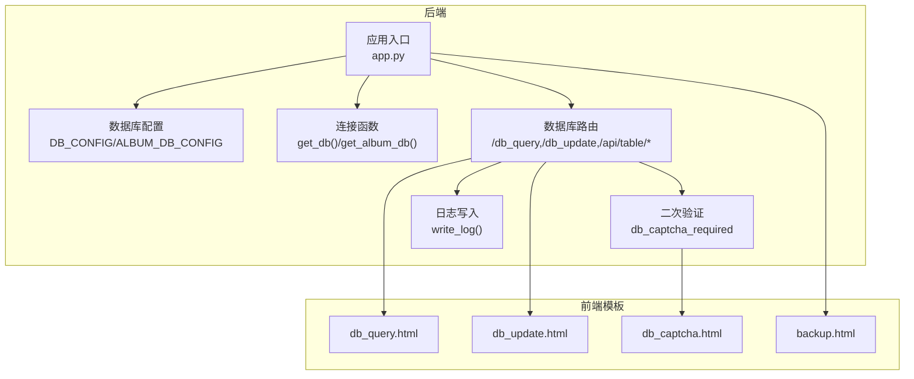
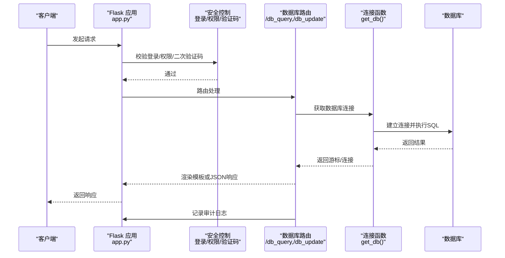
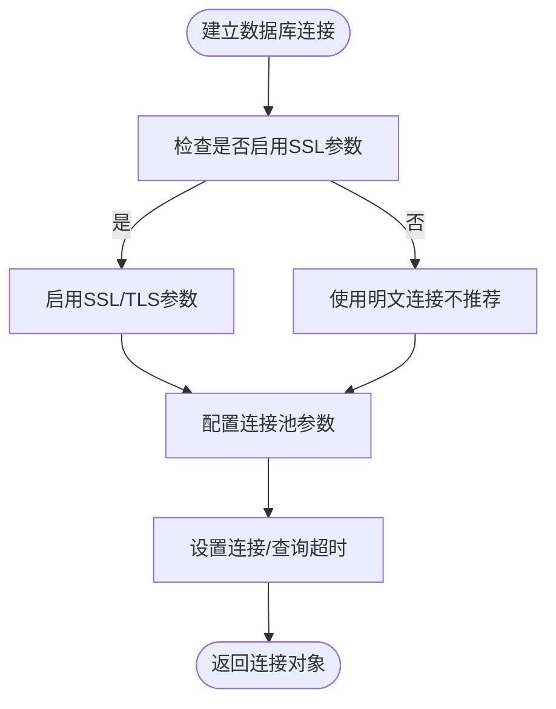
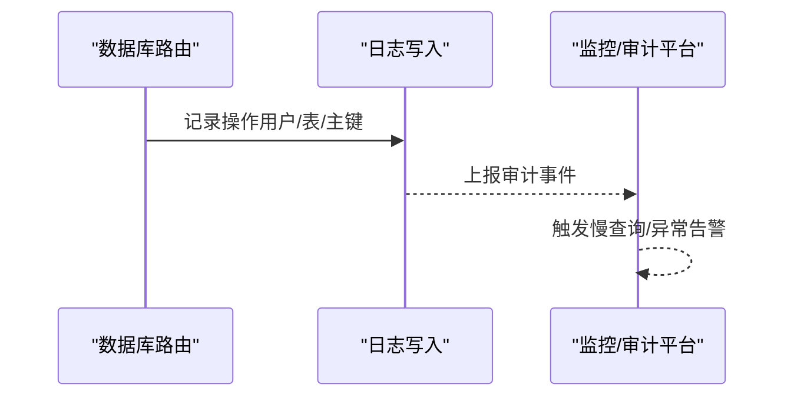
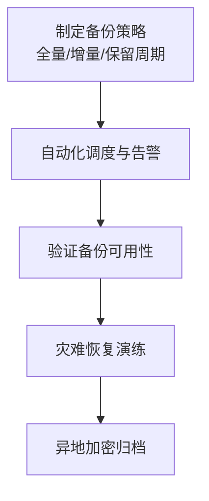
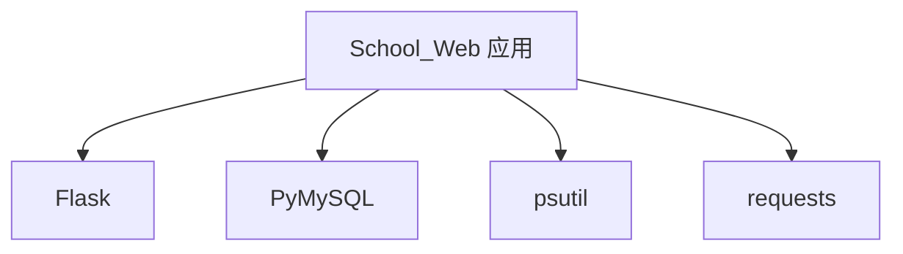

# 数据安全配置

<cite>
**本文引用的文件**
- [app.py](file://app.py)
- [requirements.txt](file://requirements.txt)
- [安全措施清单.md](file://安全措施清单.md)
- [templates/db_query.html](file://templates/db_query.html)
- [templates/db_update.html](file://templates/db_update.html)
- [templates/db_captcha.html](file://templates/db_captcha.html)
- [templates/backup.html](file://templates/backup.html)
</cite>

## 目录
1. [简介](#简介)
2. [项目结构](#项目结构)
3. [核心组件](#核心组件)
4. [架构总览](#架构总览)
5. [详细组件分析](#详细组件分析)
6. [依赖分析](#依赖分析)
7. [性能考虑](#性能考虑)
8. [故障排查指南](#故障排查指南)
9. [结论](#结论)
10. [附录](#附录)

## 简介
本技术文档围绕 School_Web 的数据库安全配置进行系统化梳理，重点覆盖以下方面：
- 数据库访问权限配置：用户权限分配、角色管理、最小权限原则的应用现状与改进建议
- 数据库连接安全配置：SSL 连接、连接池与连接超时设置现状与优化方向
- 数据加密策略：敏感数据加密、传输加密与存储加密的实现方案与建议
- 数据库审计与监控：查询日志、慢查询监控与访问控制现状与增强路径
- 备份与恢复：全量/增量备份与灾难恢复现状与最佳实践
- 合规与最佳实践：安全基线、漏洞扫描结果解读与修复建议

本文件旨在帮助开发与运维团队在现有实现基础上，进一步加固数据库层安全，满足生产环境的安全与合规要求。

## 项目结构
本项目采用 Python+Flask 的后端架构，数据库访问通过 PyMySQL 实现，前端模板位于 templates 目录。数据库安全相关的关键位置如下：
- 数据库连接与配置：集中于应用入口文件中的配置字典与连接函数
- 数据库功能入口：数据库查询与可视化更新页面及对应路由
- 安全控制：验证码二次验证、会话与响应头安全、速率限制等
- 备份页面：提供备份与恢复相关界面与交互逻辑

**图表来源**
- [app.py](file://app.py)
- [templates/db_query.html](file://templates/db_query.html)
- [templates/db_update.html](file://templates/db_update.html)
- [templates/db_captcha.html](file://templates/db_captcha.html)
- [templates/backup.html](file://templates/backup.html)

**章节来源**
- [app.py](file://app.py)
- [templates/db_query.html](file://templates/db_query.html)
- [templates/db_update.html](file://templates/db_update.html)
- [templates/db_captcha.html](file://templates/db_captcha.html)
- [templates/backup.html](file://templates/backup.html)

## 核心组件
- 数据库配置与连接
  - 应用内置数据库配置字典用于连接主库与相册库，连接函数负责建立连接并初始化扩展表
  - 当前未启用 SSL/TLS 与连接池参数，连接超时未显式配置
- 数据库功能路由
  - 提供数据库查询与可视化更新能力，均受登录、管理员权限与二次验证码保护
  - 查询结果对敏感列进行脱敏处理
- 安全控制与审计
  - 二次验证码门禁用于数据库高风险操作
  - 日志写入用于记录数据变更操作
- 备份与恢复
  - 提供备份页面与相关 API，支持备份列表、创建、下载、差异查看与批量清理

**章节来源**
- [app.py](file://app.py)
- [templates/db_query.html](file://templates/db_query.html)
- [templates/db_update.html](file://templates/db_update.html)
- [templates/db_captcha.html](file://templates/db_captcha.html)
- [templates/backup.html](file://templates/backup.html)

## 架构总览
下图展示数据库安全相关的端到端流程：客户端请求经安全控制（登录、权限、二次验证码）后，路由调用连接函数访问数据库，并在必要时写入审计日志。

**图表来源**
- [app.py](file://app.py)
- [templates/db_query.html](file://templates/db_query.html)
- [templates/db_update.html](file://templates/db_update.html)

## 详细组件分析

### 数据库访问权限与角色管理
- 现状
  - 应用通过单一数据库配置字典连接数据库，未区分不同角色的连接凭据
  - 数据库功能路由统一受管理员权限保护，但未在连接层按角色降权
- 改进建议
  - 为只读任务与写入任务分别配置独立账号，遵循最小权限原则
  - 在连接层根据业务角色选择对应凭据，避免使用高权限账号执行只读查询
  - 对关键表与字段增加基于角色的访问控制（如行级/列级策略）

**章节来源**
- [app.py](file://app.py)

### 数据库连接安全配置
- 现状
  - 连接函数直接使用配置字典建立连接，未启用 SSL/TLS 参数
  - 未配置连接池参数与连接超时
- 建议
  - 启用 SSL 连接参数，确保传输加密
  - 配置连接池大小、空闲超时与连接生命周期，提升并发与稳定性
  - 设置合理的连接超时与查询超时，避免资源泄漏与雪崩

**图表来源**
- [app.py](file://app.py)

**章节来源**
- [app.py](file://app.py)

### 数据加密策略
- 传输加密
  - 建议在连接层启用 SSL/TLS，确保数据库通信链路加密
- 存储加密
  - 对敏感字段（如密码、手机号、邮箱）在入库前进行加密存储
  - 使用强密钥管理与密钥轮换机制
- 传输与存储协同
  - 结合应用侧 HTTPS 与数据库侧 SSL，形成端到端加密链路

**章节来源**
- [安全措施清单.md](file://安全措施清单.md)
- [app.py](file://app.py)

### 数据库审计与监控
- 现状
  - 路由在数据变更后调用日志写入函数记录操作行为
  - 未见慢查询监控与访问控制（如审计日志分级、告警）的具体实现
- 建议
  - 引入慢查询日志与阈值告警
  - 对高风险操作（DDL/DML）进行审计日志分级与集中采集
  - 配置访问控制与最小权限账号，降低越权风险

**图表来源**
- [app.py](file://app.py)

**章节来源**
- [app.py](file://app.py)

### 备份与恢复策略
- 现状
  - 提供备份页面与相关交互，支持备份列表、创建、下载与差异查看
  - 未在仓库中发现实际备份脚本或自动化调度配置
- 建议
  - 制定全量/增量备份策略与保留周期
  - 自动化调度与告警，定期验证备份可用性与恢复演练
  - 将备份数据加密并异地存放，满足灾难恢复要求

**图表来源**
- [templates/backup.html](file://templates/backup.html)

**章节来源**
- [templates/backup.html](file://templates/backup.html)

### 最小权限原则的应用
- 现状
  - 应用使用单一数据库账号，未区分只读与写入场景
- 建议
  - 为只读查询与写入操作分别配置低权限账号
  - 对数据库路由按职责分配连接凭据，避免越权

**章节来源**
- [app.py](file://app.py)

## 依赖分析
- 核心依赖
  - Flask：Web 框架
  - PyMySQL：数据库驱动
  - psutil、requests：系统与网络辅助
- 安全相关依赖
  - CORS、安全响应头、CSRF Token、验证码等在应用层实现

**图表来源**
- [requirements.txt](file://requirements.txt)

**章节来源**
- [requirements.txt](file://requirements.txt)

## 性能考虑
- 连接池与超时
  - 建议配置连接池大小与超时，避免高并发下的连接耗尽
- 查询优化
  - 对高频查询增加索引与分页，避免全表扫描
- 缓存与鉴权
  - 结合会话与速率限制，减少无效请求对数据库的压力

[本节为通用指导，无需特定文件引用]

## 故障排查指南
- 数据库连接失败
  - 检查连接配置与凭据，确认网络连通与防火墙策略
  - 若启用 SSL，请核对证书与主机名验证
- 查询异常
  - 关注慢查询日志与错误码，定位热点表与索引缺失
- 审计与告警
  - 核对日志写入路径与权限，确保审计事件可追溯
- 备份问题
  - 核对备份目录权限与磁盘空间，验证备份完整性与可恢复性

**章节来源**
- [app.py](file://app.py)

## 结论
当前项目在应用层实现了较为完善的访问控制与安全响应头策略，数据库安全配置主要集中在连接与功能路由层面。为进一步提升安全性与合规性，建议：
- 在连接层启用 SSL/TLS 并配置连接池与超时
- 遵循最小权限原则，按角色分离数据库账号
- 引入慢查询监控与审计日志分级，完善备份与灾难恢复
- 持续进行漏洞扫描与安全评估，落实修复建议

[本节为总结性内容，无需特定文件引用]

## 附录

### 数据库功能与安全控制一览
- 数据库查询
  - 路由：/db_query
  - 控制：登录、管理员权限、二次验证码
  - 输出：对敏感列脱敏
- 可视化更新
  - 路由：/db_update 与 /api/table/*
  - 控制：同上
  - 输出：JSON 响应与审计日志
- 二次验证码
  - 模板：/templates/db_captcha.html
  - 控制：db_captcha_required 装饰器

**章节来源**
- [app.py](file://app.py)
- [templates/db_query.html](file://templates/db_query.html)
- [templates/db_update.html](file://templates/db_update.html)
- [templates/db_captcha.html](file://templates/db_captcha.html)

### 安全基线与修复建议
- 已实现
  - HSTS、CSP、X-Frame-Options、X-Content-Type-Options、Cookie 安全标记、UA 过滤、登录限流、验证码限流、全表单验证码等
- 待修复
  - Cookie 缺少 Secure 标记、CDN 脚本缺少 SRI、GET / 无限流等
- 建议优先修复
  - 添加 Cookie Secure 标记、为 CDN 脚本添加 SRI、为 GET / 添加频率限制

**章节来源**
- [安全措施清单.md](file://安全措施清单.md)