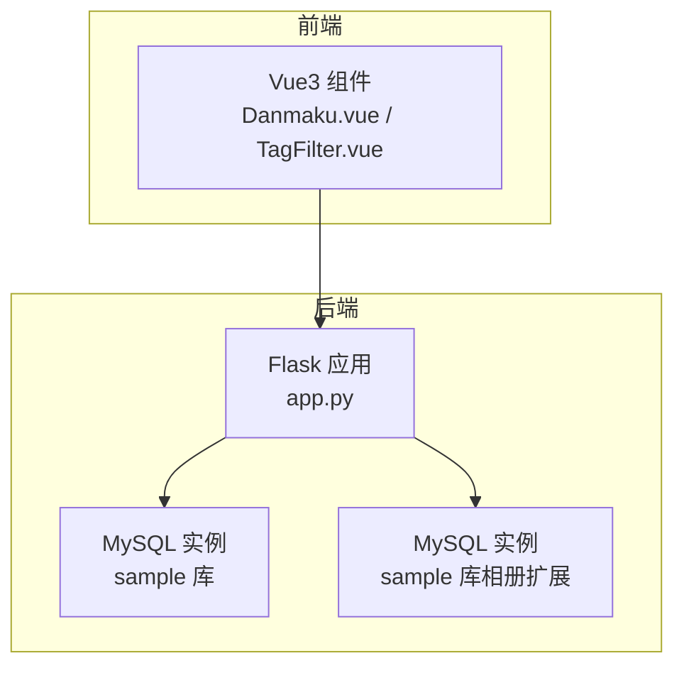
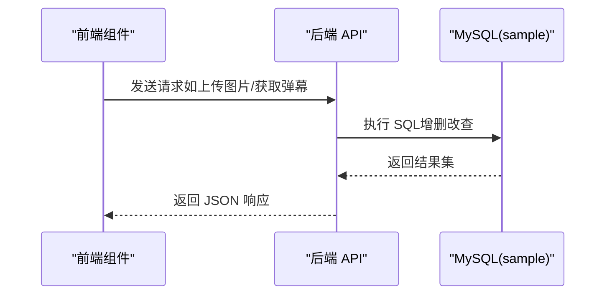
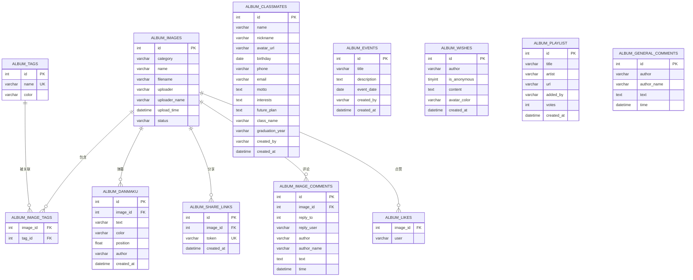

# 数据库设计

<cite>
**本文引用的文件**
- [app.py](file://app.py)
- [requirements.txt](file://requirements.txt)
- [db_query.html](file://templates/db_query.html)
- [db_update.html](file://templates/db_update.html)
- [Danmaku.vue](file://frontend/src/components/Danmaku.vue)
- [TagFilter.vue](file://frontend/src/components/TagFilter.vue)
</cite>

## 目录
1. [简介](#简介)
2. [项目结构](#项目结构)
3. [核心组件](#核心组件)
4. [架构总览](#架构总览)
5. [详细组件分析](#详细组件分析)
6. [依赖分析](#依赖分析)
7. [性能考虑](#性能考虑)
8. [故障排查指南](#故障排查指南)
9. [结论](#结论)
10. [附录](#附录)

## 简介
本文件面向 School_Web 数据库设计，围绕用户、相册、聊天、日志等模块的表结构、关系设计、索引与查询优化、数据模型演进、安全与备份、以及相册扩展功能（标签、弹幕、分享）进行系统化技术说明。文档同时提供数据库初始化脚本与种子数据建议、监控与维护最佳实践，帮助开发者与运维人员高效落地与维护该数据库。

## 项目结构
- 后端采用 Python Flask + PyMySQL，数据库连接配置集中于应用入口，相册扩展功能独立使用独立数据库连接。
- 前端使用 Vue3 组件与后端 API 交互，相册扩展功能通过 RESTful 接口驱动数据库。

图示来源
- [app.py](file://app.py)
- [Danmaku.vue](file://frontend/src/components/Danmaku.vue)
- [TagFilter.vue](file://frontend/src/components/TagFilter.vue)

章节来源
- [app.py](file://app.py)
- [requirements.txt](file://requirements.txt)

## 核心组件
- 用户与权限：用户表、用户资料表、管理员申请表、活动日志表。
- 相册扩展：相册图片、标签、图片-标签关联、弹幕、分享链接、同学录、大事记、毕业寄语、歌单等。
- 聊天系统：世界频道与私信、好友关系。
- 数据库管理：可视化查询与更新界面。
- 安全与审计：登录/注册、验证码、CSRF、速率限制、封禁、日志。

章节来源
- [app.py](file://app.py)
- [db_query.html](file://templates/db_query.html)
- [db_update.html](file://templates/db_update.html)

## 架构总览
后端通过统一的数据库配置连接 MySQL，相册扩展功能使用独立的数据库连接初始化相册相关表。前端通过 API 与后端交互，实现相册浏览、标签、弹幕、分享、聊天等功能。

图示来源
- [app.py](file://app.py)
- [Danmaku.vue](file://frontend/src/components/Danmaku.vue)
- [TagFilter.vue](file://frontend/src/components/TagFilter.vue)

## 详细组件分析

### 用户与权限表
- 用户表（users）：存储用户名、密码哈希、访问权限等。
- 用户资料表（user_profiles）：存储昵称、个人简介、联系方式、生日、语言偏好等。
- 活动日志表（activity_log）：记录用户行为与积分。
- 管理员申请表（admin_requests）：管理员审批流程。
- 日历事件表（calendar_events）：用户日程事件。

字段与约束要点
- 用户名为主键，保证唯一性。
- 密码字段使用哈希存储，兼容旧版明文升级逻辑。
- 用户资料表包含语言偏好字段，便于国际化。
- 活动日志表建立用户与时间索引，支撑排行榜与统计。
- 管理员申请表状态字段支持审批流程。
- 日历事件表支持分类与颜色标注。

索引策略
- 活动日志：用户索引、时间索引，支持按用户与时间范围查询。
- 管理员申请：用户名唯一索引，避免重复申请。
- 日历事件：用户索引、日期索引，支持按月查询与权限控制。

查询优化
- 排行榜与统计使用聚合查询，结合索引减少排序成本。
- 申请状态与权限判断在 SQL 层完成，降低业务层复杂度。

章节来源
- [app.py](file://app.py)

### 相册扩展表
相册扩展功能涉及多张表，统一在相册数据库连接上初始化与使用。

- 相册图片（album_images）：图片元数据、上传者、上传时间、状态（审核）。
- 相册标签（album_tags）：标签名唯一、颜色。
- 图片-标签关联（album_image_tags）：多对多关系。
- 弹幕（album_danmaku）：弹幕文本、颜色、位置、作者。
- 分享链接（album_share_links）：图片与分享令牌。
- 同学录（album_classmates）：同学信息、班级、毕业年份。
- 大事记（album_events）：事件标题、描述、日期。
- 毕业寄语（album_wishes）：匿名寄语、头像颜色。
- 歌单（album_playlist）：歌曲信息、投票数。
- 图片评论（album_image_comments、album_general_comments）：评论与回复。
- 图片点赞（album_likes）：点赞记录。
- 相册统计（album_stats）：基于上述表的聚合统计。

图示来源
- [app.py](file://app.py)

索引策略
- 相册图片：上传时间索引、状态索引，支持排序与审核过滤。
- 弹幕：图片索引、时间索引，支持按图片检索与滚动播放。
- 分享链接：令牌唯一索引，支持快速查找。
- 评论与点赞：按图片索引，支持分页与聚合统计。
- 标签：标签名唯一索引，避免重复。

查询优化
- 相册图片列表：支持按类别、搜索、标签过滤、排序，结合索引与条件裁剪。
- 统计接口：使用聚合查询一次性返回多个维度统计，减少往返。

章节来源
- [app.py](file://app.py)

### 聊天系统表
- 聊天消息（chat_messages）：世界频道与私信，支持索引加速查询。
- 好友关系（friendships）：唯一约束避免重复关系，支持状态管理。

索引策略
- 频道、发送者、接收者、时间索引，支撑翻页与私信查询。
- 好友关系唯一键约束，确保关系唯一性。

查询优化
- 私信查询使用双端组合条件，避免全表扫描。
- 消息翻页使用游标式查询（id < 指针）提升性能。

章节来源
- [app.py](file://app.py)

### 数据库初始化与演进
- 初始化流程：首次请求触发数据库初始化，创建必要表与索引。
- 相册扩展初始化：在相册数据库连接上创建扩展表，兼容旧版本字段（如图片状态列）。
- 演进策略：通过 ALTER 语句增加新列，捕获异常保证幂等；对唯一索引冲突进行容错处理。

章节来源
- [app.py](file://app.py)

### 安全与审计
- 访问控制：基于会话与权限的装饰器保护路由。
- 速率限制：基于内存的滑动窗口与封禁策略，支持白名单与手动封禁。
- 验证码：图形验证码与数据库操作验证码双重门禁。
- 日志：应用日志文件记录关键操作，便于审计与排障。

章节来源
- [app.py](file://app.py)

### 相册扩展功能数据结构详解
- 标签系统
  - 标签表：唯一标签名、颜色。
  - 关联表：多对多，支持按标签筛选图片。
- 弹幕功能
  - 弹幕表：按图片分发，支持颜色与位置。
  - 前端轮询：3 秒增量拉取，实时渲染。
- 分享机制
  - 分享链接表：唯一令牌，支持一键分享。

章节来源
- [app.py](file://app.py)
- [Danmaku.vue](file://frontend/src/components/Danmaku.vue)
- [TagFilter.vue](file://frontend/src/components/TagFilter.vue)

## 依赖分析
- Flask 与 PyMySQL：后端框架与数据库驱动。
- 前端组件：Vue3 组件通过 fetch 与后端 API 通信。

图示来源
- [requirements.txt](file://requirements.txt)
- [app.py](file://app.py)

章节来源
- [requirements.txt](file://requirements.txt)
- [app.py](file://app.py)

## 性能考虑
- 索引设计：围绕高频查询字段建立索引，如用户、时间、状态、令牌等。
- 查询优化：使用 LIMIT、游标式翻页、聚合一次性统计，减少往返。
- 缓存与轮询：弹幕采用前端轮询与动画结束清理，避免内存膨胀。
- 速率限制：内存+文件持久化，封禁与试探延长策略降低恶意请求影响。
- 数据库连接：相册扩展独立连接，避免阻塞主业务。

## 故障排查指南
- 数据库连接失败：检查数据库配置、网络连通性与账号权限。
- 表不存在或字段缺失：确认初始化流程已执行，关注兼容性 ALTER 语句。
- 速率限制误伤：检查白名单、封禁状态与试探计数，必要时调整配置。
- 前端无法加载：核对 API 路由与跨域配置，确认 CSP 与 nonce 设置。
- 日志定位：查看应用日志文件，结合操作时间与用户定位问题。

章节来源
- [app.py](file://app.py)

## 结论
本设计以清晰的表结构与合理的索引策略为基础，配合完善的相册扩展功能与安全机制，满足多场景需求。通过初始化与演进策略保障兼容性，结合性能优化与监控维护，可长期稳定运行。

## 附录

### 数据库初始化脚本与种子数据建议
- 初始化脚本
  - 用户与权限：创建用户表、用户资料表、管理员申请表、活动日志表、日历事件表。
  - 相册扩展：创建相册图片、标签、图片-标签关联、弹幕、分享链接、同学录、大事记、寄语、歌单、评论、点赞等表。
  - 兼容性处理：对旧版本缺失字段使用 ALTER 并捕获异常，保证幂等。
- 种子数据建议
  - 用户：至少包含管理员与普通用户两条记录。
  - 标签：预置常用标签（如“毕业照”、“活动”、“风景”）。
  - 图片：上传若干测试图片并分配标签，便于前端展示。
  - 弹幕：插入少量弹幕，验证滚动效果。
  - 分享链接：生成若干分享令牌，验证分享页面。
  - 聊天：插入少量世界频道消息与私信，验证聊天功能。
  - 日历：插入若干事件，验证日历视图。

章节来源
- [app.py](file://app.py)

### 监控与维护最佳实践
- 监控指标
  - 数据库连接数、慢查询、锁等待、表扫描率。
  - 应用侧：请求量、错误率、响应时间、速率限制触发次数。
- 维护建议
  - 定期备份：使用内置备份功能打包项目文件与关键数据。
  - 索引健康：定期检查索引使用情况，剔除冗余索引。
  - 表维护：定期 OPTIMIZE/REBUILD（根据存储引擎），清理过期数据（如过期分享链接、临时令牌）。
  - 安全加固：定期轮换密钥、审查白名单与封禁列表、审计日志。

章节来源
- [app.py](file://app.py)