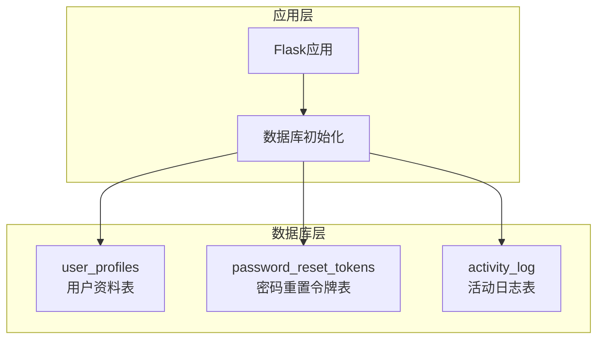
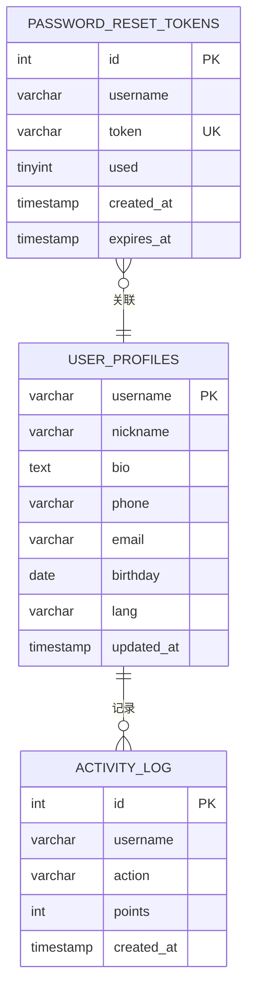
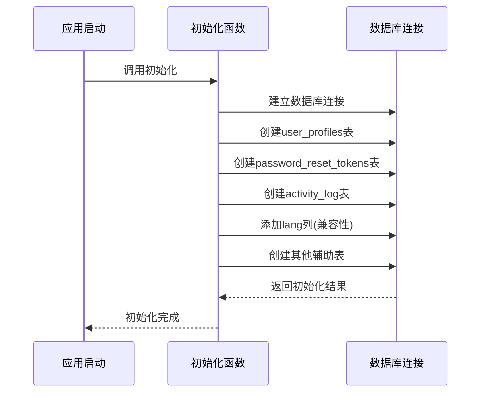
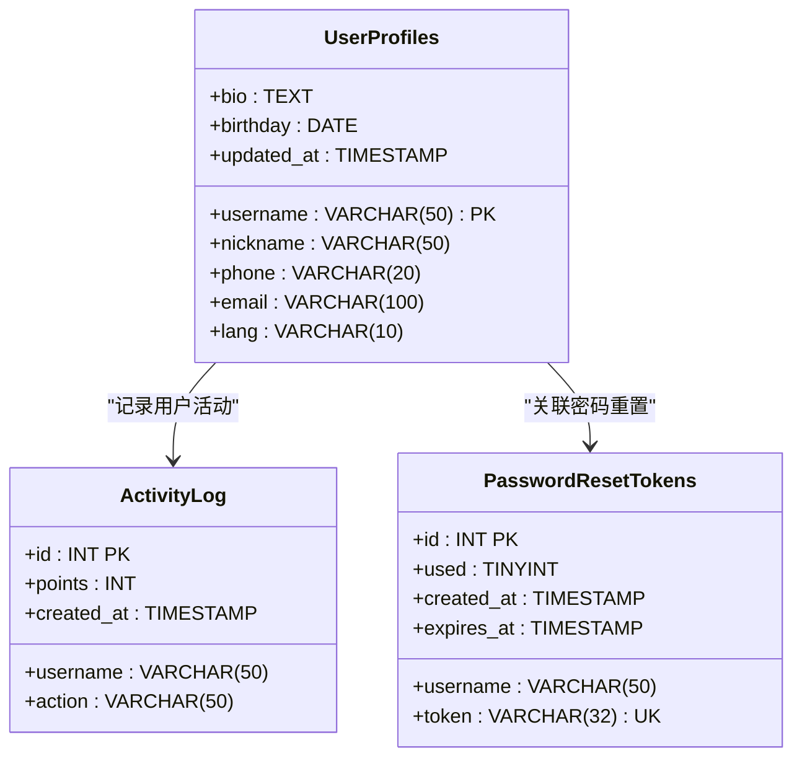
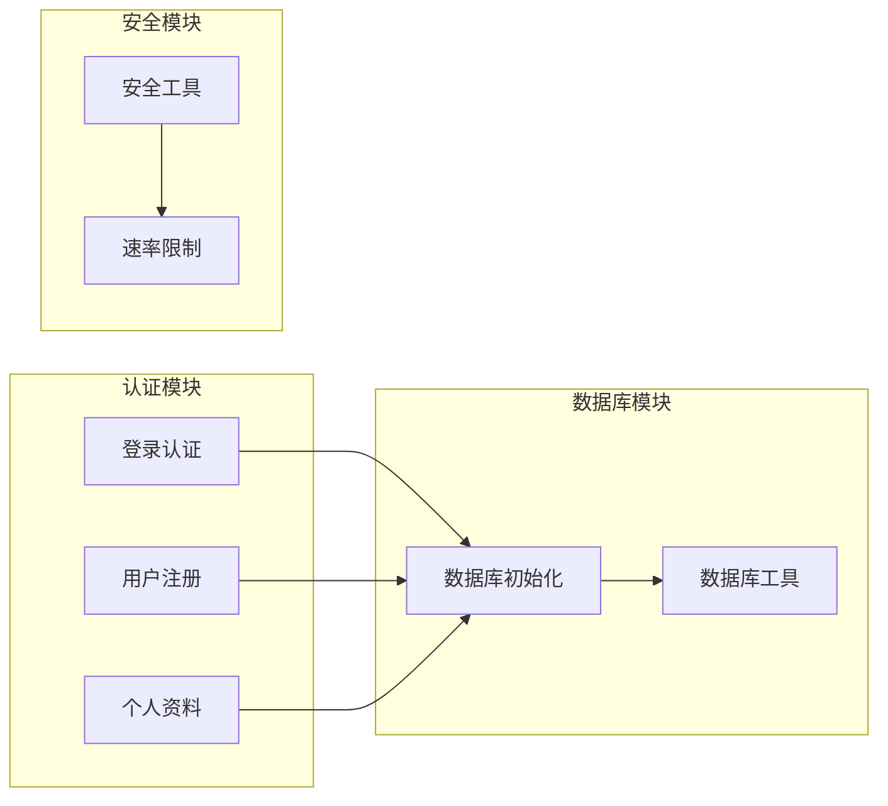

# 核心数据表结构

<cite>
**本文档引用的文件**
- [app.py](file://app.py)
</cite>

## 目录
1. [简介](#简介)
2. [项目结构](#项目结构)
3. [核心组件](#核心组件)
4. [架构概览](#架构概览)
5. [详细组件分析](#详细组件分析)
6. [依赖分析](#依赖分析)
7. [性能考虑](#性能考虑)
8. [故障排除指南](#故障排除指南)
9. [结论](#结论)

## 简介
本文档专注于School_Web项目的核心数据表结构，特别是用户认证相关的表设计。根据代码分析，项目主要包含以下核心认证相关表：

- `user_profiles` 用户资料表
- `password_reset_tokens` 密码重置令牌表  
- `activity_log` 活动日志表

这些表构成了系统的用户身份认证、资料管理和行为追踪的基础。

## 项目结构
基于代码分析，School_Web采用Flask框架构建，数据库初始化逻辑集中在应用启动时执行。核心的数据表创建和初始化逻辑位于应用的初始化函数中。

**图表来源**
- [app.py:231-317](file://app.py#L231-L317)

**章节来源**
- [app.py:231-317](file://app.py#L231-L317)

## 核心组件

### 用户资料表 (user_profiles)
用户资料表是系统的核心认证表之一，存储用户的个人基本信息和偏好设置。

**表结构定义**：
- 主键：`username` (VARCHAR 50)
- 字段：
  - `nickname` (VARCHAR 50) - 昵称
  - `bio` (TEXT) - 个人简介
  - `phone` (VARCHAR 20) - 电话号码
  - `email` (VARCHAR 100) - 邮箱地址
  - `birthday` (DATE) - 生日
  - `lang` (VARCHAR 10) - 语言偏好，默认'zh-CN'
  - `updated_at` (TIMESTAMP) - 更新时间戳

**约束条件**：
- 主键约束：username唯一标识用户
- 非空约束：username字段不能为空
- 默认值：lang字段默认为'zh-CN'

**索引策略**：
- 主键索引：自动创建，基于username字段
- 无额外显式索引

**章节来源**
- [app.py:258-267](file://app.py#L258-L267)

### 密码重置令牌表 (password_reset_tokens)
密码重置令牌表用于管理密码重置流程的安全令牌。

**表结构定义**：
- 主键：`id` (INT AUTO_INCREMENT)
- 字段：
  - `username` (VARCHAR 50) - 关联用户
  - `token` (VARCHAR 32) - 唯一令牌值
  - `used` (TINYINT) - 是否已使用，默认0
  - `created_at` (TIMESTAMP) - 创建时间，默认当前时间
  - `expires_at` (TIMESTAMP) - 过期时间

**约束条件**：
- 主键约束：id自增主键
- 唯一约束：token字段唯一
- 非空约束：username和expires_at字段不能为空

**索引策略**：
- 主键索引：自动创建，基于id字段
- 无额外显式索引

**章节来源**
- [app.py:248-255](file://app.py#L248-L255)

### 活动日志表 (activity_log)
活动日志表记录用户的系统行为和活动轨迹。

**表结构定义**：
- 主键：`id` (INT AUTO_INCREMENT)
- 字段：
  - `username` (VARCHAR 50) - 关联用户
  - `action` (VARCHAR 50) - 活动类型
  - `points` (INT) - 活动积分，默认0
  - `created_at` (TIMESTAMP) - 创建时间，默认当前时间

**约束条件**：
- 主键约束：id自增主键
- 非空约束：username和action字段不能为空
- 默认值：points字段默认为0

**索引策略**：
- 主键索引：自动创建，基于id字段
- 复合索引：`idx_activity_user` (username)
- 复合索引：`idx_activity_time` (created_at)

**章节来源**
- [app.py:270-278](file://app.py#L270-L278)

## 架构概览

**图表来源**
- [app.py:248-267](file://app.py#L248-L267)
- [app.py:270-278](file://app.py#L270-L278)

## 详细组件分析

### 数据库初始化流程

系统采用启动时自动初始化数据库表的机制，确保应用运行前具备完整的数据结构。

**图表来源**
- [app.py:232-317](file://app.py#L232-L317)

### 表间关系设计

系统采用简单的外键关联设计，通过username字段建立表间联系：

**图表来源**
- [app.py:248-278](file://app.py#L248-L278)

**章节来源**
- [app.py:232-317](file://app.py#L232-L317)

### 字段变更历史

根据代码分析，系统包含以下字段变更历史：

1. **lang字段增强**：在user_profiles表中添加lang列，支持多语言偏好设置
2. **兼容性处理**：通过ALTER TABLE语句向现有表添加新列，确保向前兼容

**章节来源**
- [app.py:280-285](file://app.py#L280-L285)

## 依赖分析

### 外部依赖
- **PyMySQL**：MySQL数据库连接和操作
- **Flask**：Web应用框架
- **Werkzeug**：安全工具和实用函数

### 内部依赖关系
系统采用模块化设计，数据库操作集中在统一的工具函数中：

**图表来源**
- [app.py:625-638](file://app.py#L625-L638)

**章节来源**
- [app.py:625-638](file://app.py#L625-L638)

## 性能考虑

### 索引优化建议
1. **活动日志表**：已建立username和created_at索引，适合用户活动查询和时间范围查询
2. **令牌表**：建议添加username索引以优化令牌查询性能
3. **用户表**：建议添加email索引以优化邮箱查询

### 查询优化策略
- 使用LIMIT限制查询结果集大小
- 合理利用现有索引避免全表扫描
- 对高频查询建立适当的复合索引

## 故障排除指南

### 常见问题诊断
1. **数据库连接失败**：检查DB_CONFIG配置和网络连接
2. **表创建失败**：确认MySQL权限和数据库存在性
3. **初始化异常**：查看具体错误信息并修复SQL语法

### 调试方法
- 启用详细的日志记录
- 使用数据库客户端验证表结构
- 检查应用错误日志

**章节来源**
- [app.py:680-692](file://app.py#L680-L692)

## 结论

School_Web项目的核心数据表结构设计简洁而实用，满足了基本的用户认证和管理需求。系统采用启动时自动初始化的策略，确保了部署的一致性和可靠性。现有的表结构涵盖了用户身份认证、资料管理和行为追踪等核心功能，为后续的功能扩展奠定了良好的基础。

建议的改进方向包括：
1. 增强表间的外键约束
2. 优化索引策略以提升查询性能
3. 添加更多的数据完整性约束
4. 考虑引入审计日志表以满足合规要求