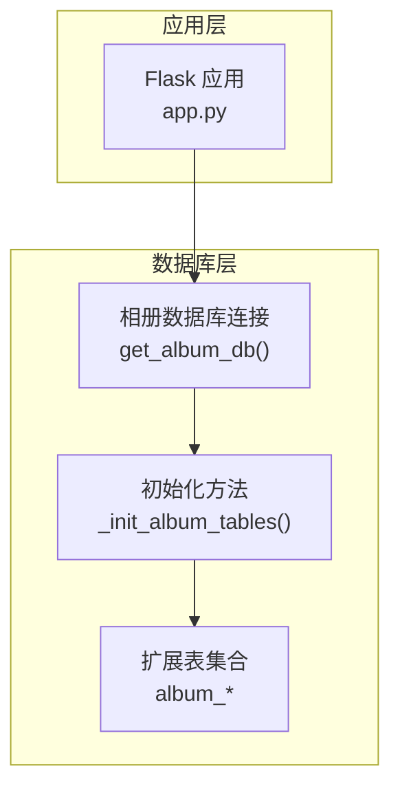
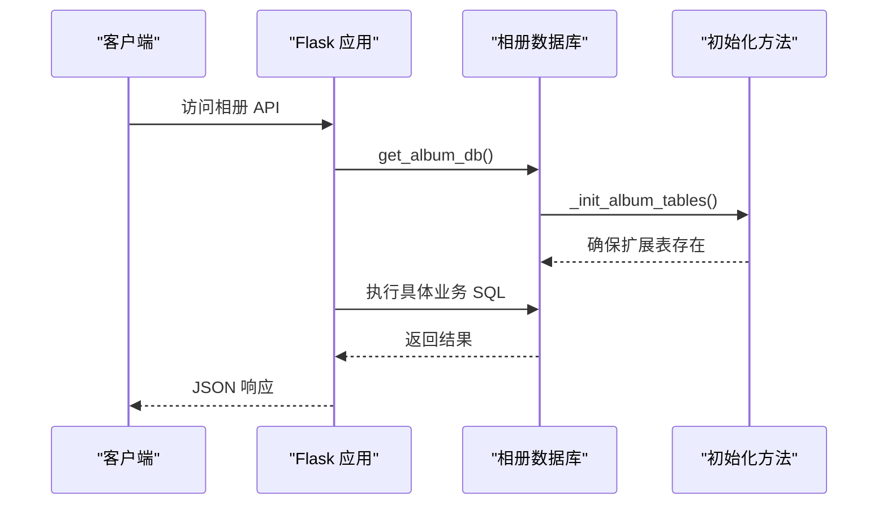

# 相册扩展表结构

<cite>
**本文档引用的文件**
- [app.py](file://app.py)
</cite>

## 目录
1. [简介](#简介)
2. [项目结构](#项目结构)
3. [核心组件](#核心组件)
4. [架构总览](#架构总览)
5. [详细组件分析](#详细组件分析)
6. [依赖关系分析](#依赖关系分析)
7. [性能考虑](#性能考虑)
8. [故障排查指南](#故障排查指南)
9. [结论](#结论)
10. [附录](#附录)

## 简介
本文件面向 School_Web 毕业相册扩展功能，系统性梳理并解释数据库表结构设计，涵盖以下扩展表：
- album_events 大事记时间表
- album_classmates 同学录表
- album_wishes 毕业寄语表
- album_tags 照片标签表
- album_image_tags 照片标签关联表
- album_playlist 毕业歌单表
- album_danmaku 弹幕表
- album_share_links 分享链接表

文档将逐表说明字段定义、数据类型、约束条件、索引策略，并给出初始化脚本与设计最佳实践建议。

## 项目结构
相册扩展功能的数据库表创建逻辑集中在应用启动时的数据库初始化流程中，位于数据库连接函数之后，统一调用初始化方法创建所需表。该初始化方法会创建上述扩展表以及相册主表 album_images（用于图片元数据、审核状态等）。



**图表来源**
- [app.py:686-831](file://app.py#L686-L831)

**章节来源**
- [app.py:686-831](file://app.py#L686-L831)

## 核心组件
- 相册数据库连接：通过独立配置连接相册专用数据库，避免与主业务库耦合。
- 初始化方法：在每次获取相册数据库连接时触发，确保表结构存在且具备兼容性（如新增列时自动 ALTER）。
- 扩展表集合：围绕“相册扩展功能”建立的八张表，分别支撑“时间轴”、“同学录”、“寄语墙”、“标签系统”、“歌单”、“弹幕”、“分享链接”等特性。

**章节来源**
- [app.py:686-831](file://app.py#L686-L831)

## 架构总览
相册扩展功能采用“集中初始化 + 功能路由”的架构。初始化阶段创建扩展表，后续各功能模块通过 API 路由访问这些表，实现数据的增删改查与业务逻辑处理。



**图表来源**
- [app.py:686-831](file://app.py#L686-L831)

## 详细组件分析

### album_events 大事记时间表
- 用途：记录班级/学校的重要事件，按日期排序展示。
- 字段与约束
  - id: 自增主键
  - title: 文本标题，必填
  - description: 文本描述，可选
  - event_date: 事件日期，必填
  - created_by: 创建者用户名，可选
  - created_at: 记录创建时间戳，默认当前时间
- 索引策略
  - 无显式索引，按事件日期倒序查询为主
- 设计要点
  - 支持管理员维护，普通用户不可直接写入
  - 适合配合时间轴组件进行展示

**章节来源**
- [app.py:699-708](file://app.py#L699-L708)
- [app.py:3131-3184](file://app.py#L3131-L3184)

### album_classmates 同学录表
- 用途：记录班级同学的基本信息、头像、座右铭、兴趣爱好、未来规划等。
- 字段与约束
  - id: 自增主键
  - name: 姓名，必填
  - nickname: 昵称，可选
  - avatar_url: 头像地址，可选
  - birthday: 生日，可选
  - phone: 电话，可选
  - email: 邮箱，可选
  - motto: 座右铭，可选
  - interests: 兴趣爱好，可选
  - future_plan: 未来规划，可选
  - class_name: 班级名称，可选（兼容性新增列）
  - graduation_year: 毕业年份，可选（兼容性新增列）
  - created_by: 创建者用户名，可选
  - created_at: 记录创建时间戳，默认当前时间
- 索引策略
  - 无显式索引，按班级筛选或姓名排序
- 设计要点
  - 支持按班级过滤与姓名排序
  - 兼容性：自动为旧表增加 class_name 与 graduation_year 列

**章节来源**
- [app.py:710-727](file://app.py#L710-L727)
- [app.py:3186-3283](file://app.py#L3186-L3283)

### album_wishes 毕业寄语表
- 用途：收集毕业生的毕业寄语，支持匿名发布与头像颜色标识。
- 字段与约束
  - id: 自增主键
  - author: 寄语作者用户名，可选
  - is_anonymous: 是否匿名，布尔值（0/1）
  - content: 寄语内容，必填
  - avatar_color: 头像颜色，用于匿名头像配色
  - created_at: 记录创建时间戳，默认当前时间
- 索引策略
  - 无显式索引，按创建时间倒序展示
- 设计要点
  - 匿名发布时 author 可为空或匿名标识
  - 为匿名用户随机分配头像颜色

**章节来源**
- [app.py:743-752](file://app.py#L743-L752)
- [app.py:3285-3346](file://app.py#L3285-L3346)

### album_tags 照片标签表
- 用途：定义照片可用的标签，支持标签名唯一与颜色配置。
- 字段与约束
  - id: 自增主键
  - name: 标签名，必填且唯一
  - color: 标签颜色，可选默认值
- 索引策略
  - name 唯一索引（保证标签名唯一）
- 设计要点
  - 标签名唯一，避免重复
  - 颜色用于前端展示

**章节来源**
- [app.py:754-760](file://app.py#L754-L760)
- [app.py:3348-3384](file://app.py#L3348-L3384)

### album_image_tags 照片标签关联表
- 用途：建立照片与标签的多对多关系。
- 字段与约束
  - image_id: 照片 ID，非空
  - tag_id: 标签 ID，非空
  - 主键：(image_id, tag_id)，联合主键
- 索引策略
  - 联合主键即复合索引，满足多对多查询与去重
- 设计要点
  - 通过联合主键保证同一照片同一标签仅出现一次
  - 支持按照片查询标签或按标签查询照片

**章节来源**
- [app.py:762-768](file://app.py#L762-L768)
- [app.py:3401-3434](file://app.py#L3401-L3434)

### album_playlist 毕业歌单表
- 用途：收集毕业生推荐的歌曲，支持投票与管理。
- 字段与约束
  - id: 自增主键
  - title: 歌曲标题，必填
  - artist: 歌手，可选
  - url: 歌曲链接，可选
  - added_by: 添加者用户名，可选
  - votes: 投票数，默认 0
  - created_at: 记录创建时间戳，默认当前时间
- 索引策略
  - 无显式索引，按投票数降序与创建时间降序查询
- 设计要点
  - 支持匿名添加，投票数用于排序
  - 管理员可删除条目

**章节来源**
- [app.py:770-780](file://app.py#L770-L780)
- [app.py:3437-3502](file://app.py#L3437-L3502)

### album_danmaku 弹幕表
- 用途：为特定照片添加实时滚动弹幕评论。
- 字段与约束
  - id: 自增主键
  - image_id: 照片 ID，必填
  - text: 弹幕文本，必填且长度限制
  - color: 弹幕颜色，可选默认值
  - position: 弹幕垂直位置百分比，数值型
  - author: 发布者用户名，可选
  - created_at: 记录创建时间戳，默认当前时间
- 索引策略
  - 无显式索引，按照片 ID 查询并按时间顺序展示
- 设计要点
  - 支持按照片维度聚合弹幕
  - 位置与颜色用于前端渲染

**章节来源**
- [app.py:782-792](file://app.py#L782-L792)
- [app.py:3504-3542](file://app.py#L3504-L3542)

### album_share_links 分享链接表
- 用途：为特定照片生成一次性或长期有效的分享链接。
- 字段与约束
  - id: 自增主键
  - image_id: 照片 ID，必填
  - token: 分享令牌，必填且唯一
  - created_at: 记录创建时间戳，默认当前时间
- 索引策略
  - token 唯一键，保证分享链接唯一性
- 设计要点
  - 通过 token 实现无登录访问
  - 支持查询最新分享链接或创建新链接

**章节来源**
- [app.py:794-801](file://app.py#L794-L801)
- [app.py:2886-2919](file://app.py#L2886-L2919)

## 依赖关系分析
扩展表之间存在如下依赖与关联：
- album_image_tags 依赖 album_tags 与 album_images（通过 image_id 与 tag_id 关联）
- album_danmaku 依赖 album_images（通过 image_id 关联）
- album_share_links 依赖 album_images（通过 image_id 关联）
- album_events、album_classmates、album_wishes、album_playlist 独立运行，不依赖其他扩展表

```mermaid
erDiagram
ALBUM_TAGS {
int id PK
varchar name UK
varchar color
}
ALBUM_IMAGE_TAGS {
int image_id
int tag_id
PK(image_id, tag_id)
}
ALBUM_IMAGES {
int id PK
varchar filename
varchar name
varchar uploader
datetime upload_time
varchar status
}
ALBUM_DANMAKU {
int id PK
int image_id
varchar text
varchar color
float position
varchar author
datetime created_at
}
ALBUM_SHARE_LINKS {
int id PK
int image_id
varchar token UK
datetime created_at
}
ALBUM_EVENTS {
int id PK
varchar title
text description
date event_date
varchar created_by
datetime created_at
}
ALBUM_CLASSMATES {
int id PK
varchar name
varchar nickname
varchar avatar_url
date birthday
varchar phone
varchar email
text motto
text interests
text future_plan
varchar class_name
varchar graduation_year
varchar created_by
datetime created_at
}
ALBUM_WISHES {
int id PK
varchar author
tinyint is_anonymous
text content
varchar avatar_color
datetime created_at
}
ALBUM_PLAYLIST {
int id PK
varchar title
varchar artist
varchar url
varchar added_by
int votes
datetime created_at
}
ALBUM_IMAGES ||--o{ ALBUM_IMAGE_TAGS : "包含"
ALBUM_TAGS ||--o{ ALBUM_IMAGE_TAGS : "被包含"
ALBUM_IMAGES ||--o{ ALBUM_DANMAKU : "拥有"
ALBUM_IMAGES ||--o{ ALBUM_SHARE_LINKS : "被分享"
```

**图表来源**
- [app.py:699-801](file://app.py#L699-L801)
- [app.py:2886-2919](file://app.py#L2886-L2919)

**章节来源**
- [app.py:699-801](file://app.py#L699-L801)
- [app.py:2886-2919](file://app.py#L2886-L2919)

## 性能考虑
- 查询热点
  - 按照片维度的标签查询、弹幕查询、分享链接查询较为频繁
  - 时间轴、寄语墙、歌单等列表查询按时间或投票排序
- 索引建议
  - album_image_tags：按 image_id 查询标签时，联合主键已满足需求；若频繁按 tag_id 查询照片，可考虑额外索引
  - album_danmaku：按 image_id 查询弹幕，建议在 image_id 上建立索引
  - album_share_links：按 token 查询分享链接，现有唯一键已足够
  - album_tags：name 唯一键已满足唯一性约束
- 数据规模
  - 弹幕与分享链接属于高并发写入场景，建议控制单次写入批量与前端轮询频率
  - 歌单投票为轻量写入，可忽略

[本节为通用性能建议，不直接分析具体代码文件]

## 故障排查指南
- 表不存在或结构不完整
  - 现象：API 报错提示表缺失
  - 处理：确认初始化方法是否执行；检查数据库连接配置
- 标签重复
  - 现象：插入标签时报唯一键冲突
  - 处理：检查标签名是否重复；使用查询接口确认是否存在
- 分享链接无效
  - 现象：访问分享链接提示无效或过期
  - 处理：确认 token 是否正确；检查分享链接表中是否存在对应记录
- 弹幕内容为空
  - 现象：提交弹幕后无内容
  - 处理：检查输入清洗逻辑与长度限制；确认 image_id 是否有效

**章节来源**
- [app.py:686-831](file://app.py#L686-L831)
- [app.py:3504-3542](file://app.py#L3504-L3542)
- [app.py:2886-2919](file://app.py#L2886-L2919)

## 结论
相册扩展功能的表结构设计遵循“单一职责、清晰关联、易于扩展”的原则。通过集中初始化与兼容性增强，确保在不中断线上服务的前提下平滑演进。建议在生产环境中根据实际查询模式补充必要索引，并结合业务流量特点优化写入与读取策略。

[本节为总结性内容，不直接分析具体代码文件]

## 附录

### 表结构初始化脚本（基于源码）
以下为从源码中提取的初始化 SQL（按表顺序整理，便于导入或审计）：

- album_events
  - 字段：id（自增主键）、title（文本）、description（文本）、event_date（日期）、created_by（文本）、created_at（时间戳）
  - 约束：主键 id，无显式索引
  - 参考路径：[app.py:699-708](file://app.py#L699-L708)

- album_classmates
  - 字段：id（自增主键）、name（文本）、nickname（文本）、avatar_url（文本）、birthday（日期）、phone（文本）、email（文本）、motto（文本）、interests（文本）、future_plan（文本）、class_name（文本）、graduation_year（文本）、created_by（文本）、created_at（时间戳）
  - 约束：主键 id，无显式索引；兼容性：自动新增 class_name 与 graduation_year 列
  - 参考路径：[app.py:710-727](file://app.py#L710-L727)

- album_wishes
  - 字段：id（自增主键）、author（文本）、is_anonymous（布尔）、content（文本）、avatar_color（文本）、created_at（时间戳）
  - 约束：主键 id，无显式索引
  - 参考路径：[app.py:743-752](file://app.py#L743-L752)

- album_tags
  - 字段：id（自增主键）、name（文本，唯一）、color（文本）
  - 约束：主键 id，唯一键 name
  - 参考路径：[app.py:754-760](file://app.py#L754-L760)

- album_image_tags
  - 字段：image_id（整数）、tag_id（整数）
  - 约束：联合主键 (image_id, tag_id)
  - 参考路径：[app.py:762-768](file://app.py#L762-L768)

- album_playlist
  - 字段：id（自增主键）、title（文本）、artist（文本）、url（文本）、added_by（文本）、votes（整数）、created_at（时间戳）
  - 约束：主键 id，无显式索引
  - 参考路径：[app.py:770-780](file://app.py#L770-L780)

- album_danmaku
  - 字段：id（自增主键）、image_id（整数）、text（文本）、color（文本）、position（浮点）、author（文本）、created_at（时间戳）
  - 约束：主键 id，无显式索引
  - 参考路径：[app.py:782-792](file://app.py#L782-L792)

- album_share_links
  - 字段：id（自增主键）、image_id（整数）、token（文本，唯一）、created_at（时间戳）
  - 约束：主键 id，唯一键 token
  - 参考路径：[app.py:794-801](file://app.py#L794-L801)

**章节来源**
- [app.py:699-801](file://app.py#L699-L801)

### 数据模型设计最佳实践
- 唯一键与唯一约束
  - 标签名唯一（album_tags.name）
  - 分享令牌唯一（album_share_links.token）
- 关系设计
  - 多对多：照片-标签通过 album_image_tags 关联
  - 一对多：照片-弹幕、照片-分享链接
- 兼容性
  - 通过信息架构查询与条件性 ALTER，确保旧表结构平滑升级
- 索引策略
  - 按查询模式补充索引（如按 image_id 的弹幕查询）
- 安全与清洗
  - 所有用户输入均经过清洗与长度限制，避免 XSS 与注入风险

**章节来源**
- [app.py:686-831](file://app.py#L686-L831)
- [app.py:3504-3542](file://app.py#L3504-L3542)
- [app.py:2886-2919](file://app.py#L2886-L2919)