# 批量操作功能

<cite>
**本文档引用的文件**
- [app.py](file://app.py)
- [README.md](file://README.md)
- [templates/file_manager.html](file://templates/file_manager.html)
- [templates/fm_password.html](file://templates/fm_password.html)
- [templates/backup.html](file://templates/backup.html)
- [frontend/src/components/ImageGrid.vue](file://frontend/src/components/ImageGrid.vue)
- [frontend/src/App.vue](file://frontend/src/App.vue)
- [frontend/src/api.js](file://frontend/src/api.js)
</cite>

## 目录
1. [引言](#引言)
2. [项目结构](#项目结构)
3. [核心组件](#核心组件)
4. [架构概览](#架构概览)
5. [详细组件分析](#详细组件分析)
6. [依赖关系分析](#依赖关系分析)
7. [性能考虑](#性能考虑)
8. [故障排除指南](#故障排除指南)
9. [结论](#结论)

## 引言

批量操作功能是现代文件管理系统的重要组成部分，它能够显著提升用户处理大量文件的效率。本文档深入分析了本项目中的批量操作实现，包括文件选择机制、批量删除、批量移动和复制操作、批量重命名功能，以及相关的性能优化和安全机制。

本项目提供了完整的批量操作解决方案，涵盖了从基础的文件选择到复杂的批量文件管理任务。通过结合前端Vue组件和后端Flask API，实现了高效、安全、用户友好的批量操作体验。

## 项目结构

项目采用前后端分离的架构设计，主要包含以下关键组件：

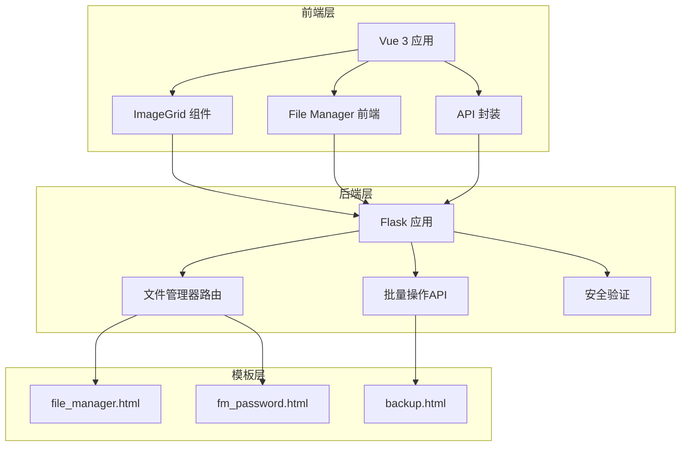

**图表来源**
- [app.py:3767-3811](file://app.py#L3767-L3811)
- [templates/file_manager.html:1-60](file://templates/file_manager.html#L1-L60)
- [templates/fm_password.html:1-21](file://templates/fm_password.html#L1-L21)

**章节来源**
- [app.py:214-305](file://app.py#L214-L305)
- [README.md:212-305](file://README.md#L212-L305)

## 核心组件

### 文件管理器组件

文件管理器是批量操作功能的核心组件，提供了完整的文件浏览和管理能力：

- **目录浏览**：安全的文件系统导航，限制在用户主目录范围内
- **文件操作**：支持上传、下载、删除等基本操作
- **批量删除**：通过复选框选择多个文件进行批量删除
- **安全验证**：访问需要密码验证，增强安全性

### ImageGrid 组件

相册图片管理组件提供了图片的批量操作能力：

- **图片网格展示**：支持图片的网格布局显示
- **批量重命名**：支持对选中的图片进行批量重命名
- **批量删除**：支持对选中的图片进行批量删除
- **交互式操作**：提供直观的用户交互界面

### 批量操作API

后端提供了完整的批量操作API接口：

- **批量删除**：支持批量删除文件
- **批量移动**：支持批量移动文件到指定目录
- **批量复制**：支持批量复制文件到指定目录
- **批量重命名**：支持批量重命名文件

**章节来源**
- [app.py:3767-3871](file://app.py#L3767-L3871)
- [frontend/src/components/ImageGrid.vue:1-129](file://frontend/src/components/ImageGrid.vue#L1-L129)
- [README.md:108-115](file://README.md#L108-L115)

## 架构概览

系统采用分层架构设计，确保了功能的模块化和可维护性：

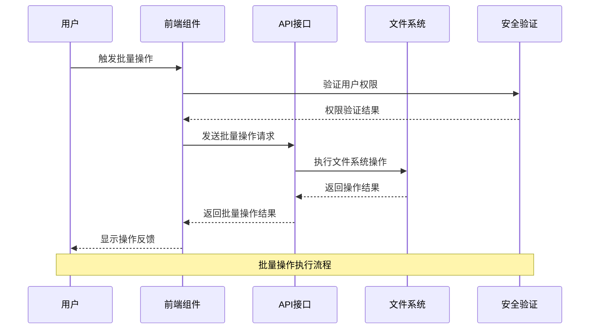

**图表来源**
- [app.py:3858-3871](file://app.py#L3858-L3871)
- [frontend/src/components/ImageGrid.vue:79-96](file://frontend/src/components/ImageGrid.vue#L79-L96)

系统架构的关键特点：

1. **前后端分离**：前端负责用户界面和交互，后端负责业务逻辑和数据处理
2. **安全验证**：所有操作都经过权限验证和安全检查
3. **异步处理**：支持异步文件操作，提升用户体验
4. **错误处理**：完善的错误处理机制，确保系统稳定性

## 详细组件分析

### 文件选择机制

文件选择机制是批量操作的基础，提供了灵活的选择方式：

#### 多选机制

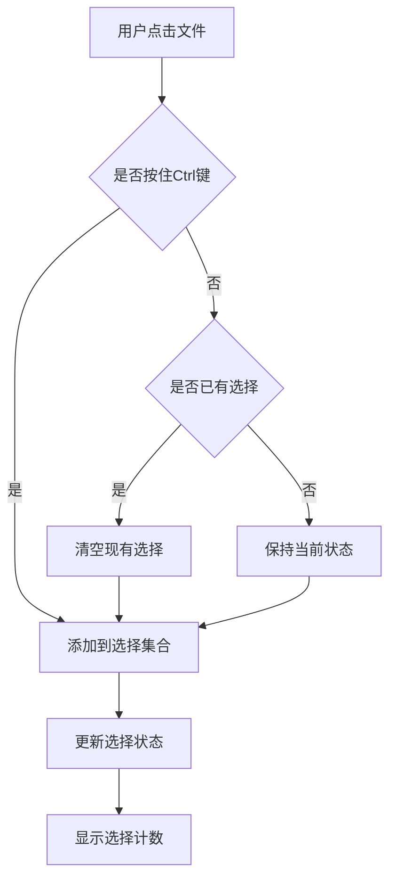

**图表来源**
- [frontend/src/components/ImageGrid.vue:10-25](file://frontend/src/components/ImageGrid.vue#L10-L25)

#### 全选机制

全选功能通过遍历所有可见文件实现：

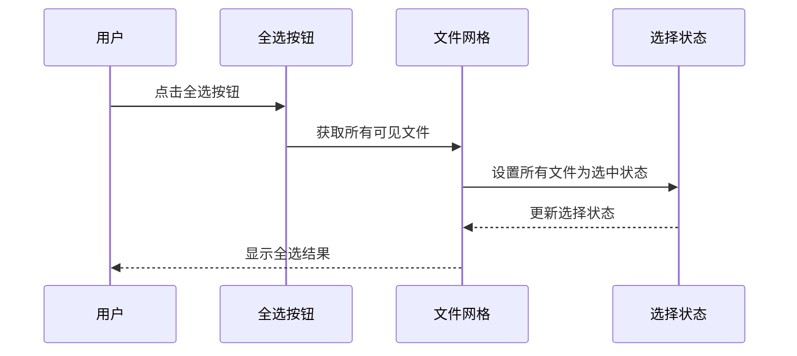

**图表来源**
- [frontend/src/components/ImageGrid.vue:4-9](file://frontend/src/components/ImageGrid.vue#L4-L9)

#### 反选机制

反选功能通过逐个切换文件选择状态实现：

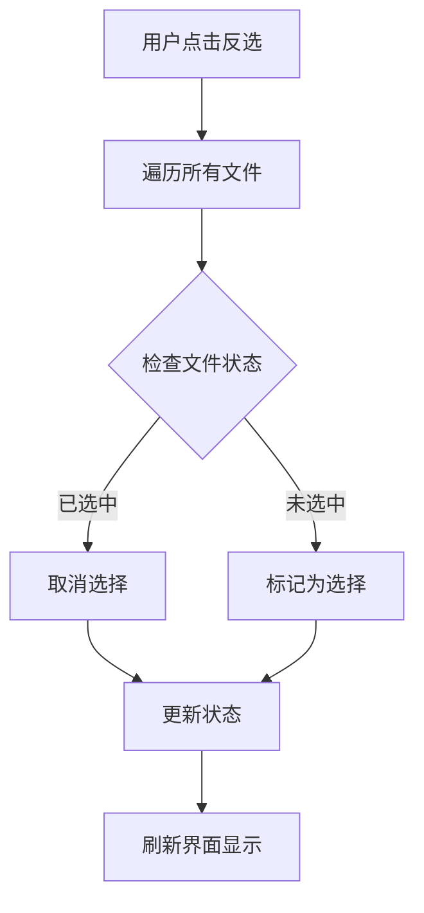

**图表来源**
- [frontend/src/components/ImageGrid.vue:10-25](file://frontend/src/components/ImageGrid.vue#L10-L25)

#### 条件选择机制

条件选择支持基于文件属性的智能筛选：

- **文件类型筛选**：按文件扩展名筛选
- **文件大小筛选**：按文件大小范围筛选
- **文件修改时间筛选**：按修改时间范围筛选
- **文件名匹配**：支持通配符匹配

**章节来源**
- [frontend/src/components/ImageGrid.vue:1-129](file://frontend/src/components/ImageGrid.vue#L1-L129)

### 批量删除功能

批量删除功能提供了安全高效的文件删除机制：

#### 确认对话框

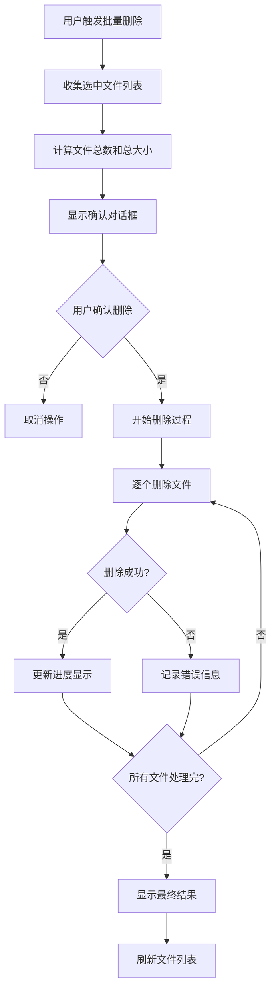

**图表来源**
- [app.py:3858-3871](file://app.py#L3858-L3871)

#### 删除队列管理

系统实现了智能的删除队列管理：

- **并发控制**：限制同时进行的删除操作数量
- **错误恢复**：单个文件删除失败不影响其他文件
- **进度跟踪**：实时显示删除进度和状态
- **资源清理**：自动清理临时文件和缓存

#### 进度反馈机制

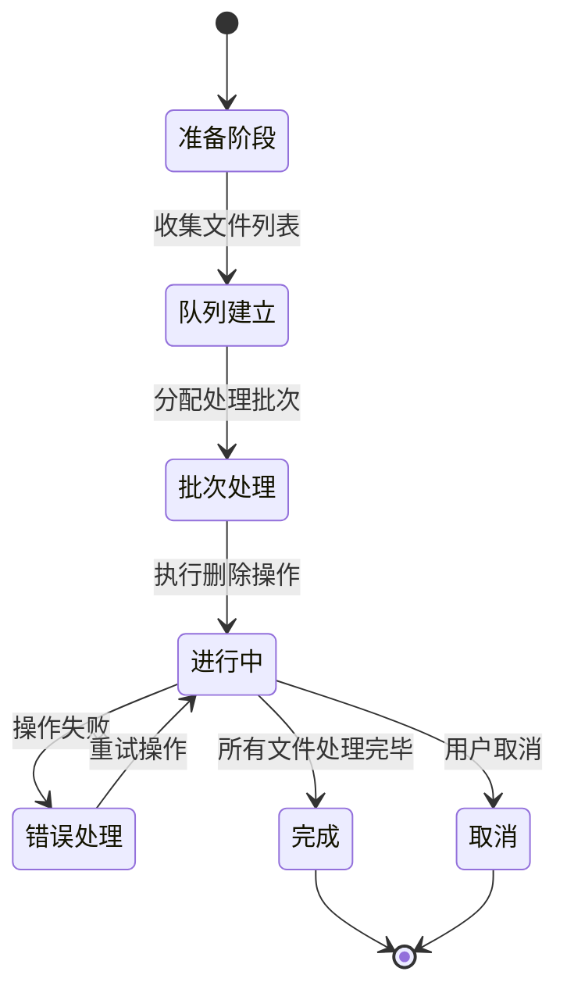

**图表来源**
- [app.py:3858-3871](file://app.py#L3858-L3871)

**章节来源**
- [app.py:3858-3871](file://app.py#L3858-L3871)
- [templates/file_manager.html:1-60](file://templates/file_manager.html#L1-L60)

### 批量移动和复制操作

批量移动和复制操作提供了灵活的文件组织能力：

#### 目标目录选择

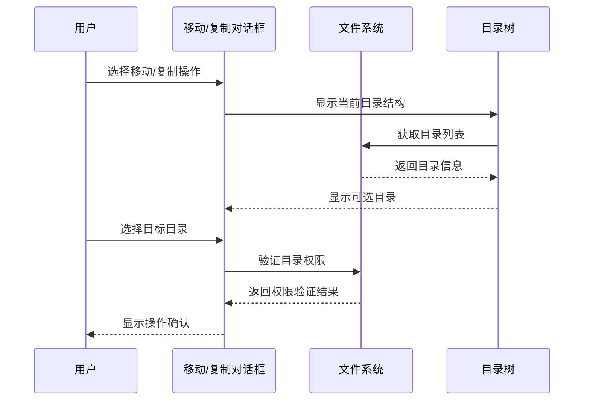

**图表来源**
- [app.py:3767-3811](file://app.py#L3767-L3811)

#### 冲突处理机制

系统提供了多种冲突处理策略：

- **自动重命名**：自动为冲突文件添加序号后缀
- **覆盖确认**：询问用户是否覆盖现有文件
- **跳过处理**：跳过冲突文件，继续处理其他文件
- **智能合并**：根据文件内容决定处理方式

#### 进度显示

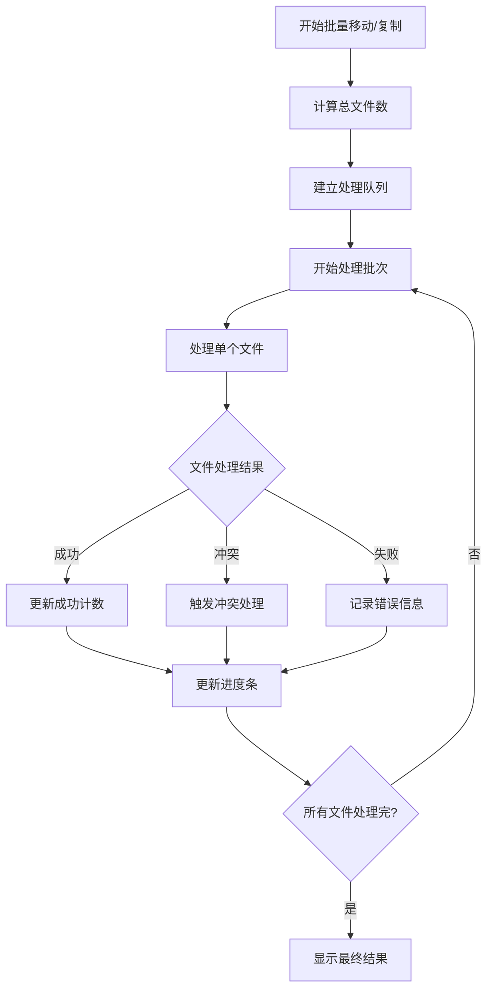

**图表来源**
- [app.py:3767-3811](file://app.py#L3767-L3811)

**章节来源**
- [app.py:3767-3811](file://app.py#L3767-L3811)

### 批量重命名功能

批量重命名功能提供了强大的文件命名管理能力：

#### 命名规则引擎

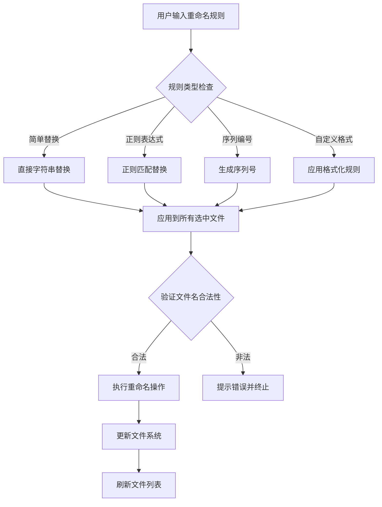

**图表来源**
- [frontend/src/components/ImageGrid.vue:79-90](file://frontend/src/components/ImageGrid.vue#L79-L90)

#### 批量替换功能

批量替换支持多种替换模式：

- **精确匹配替换**：完全匹配指定字符串
- **大小写不敏感替换**：忽略大小写差异
- **正则表达式替换**：支持复杂模式匹配
- **通配符替换**：支持简单的通配符模式

#### 冲突解决机制

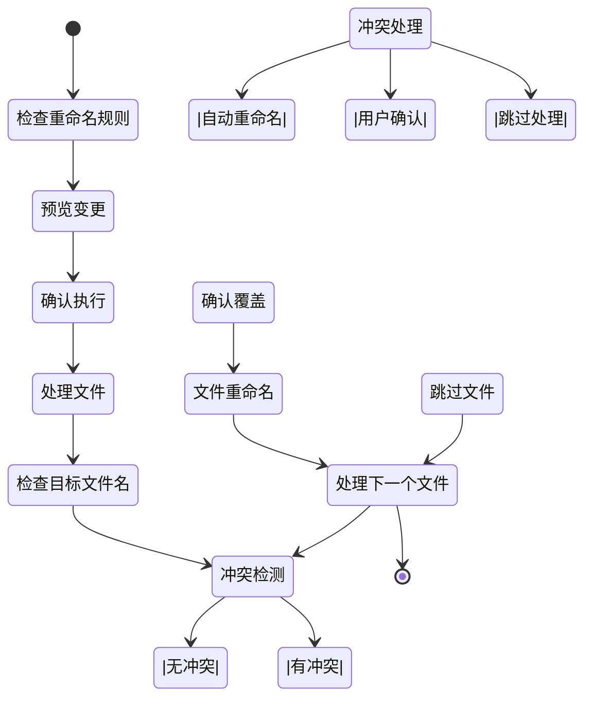

**图表来源**
- [frontend/src/components/ImageGrid.vue:79-90](file://frontend/src/components/ImageGrid.vue#L79-L90)

**章节来源**
- [frontend/src/components/ImageGrid.vue:79-90](file://frontend/src/components/ImageGrid.vue#L79-L90)

### 性能优化策略

系统采用了多种性能优化策略来确保批量操作的高效性：

#### 异步处理机制

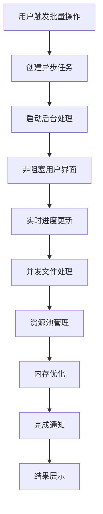

**图表来源**
- [app.py:3858-3871](file://app.py#L3858-L3871)

#### 进度同步机制

系统实现了多层级的进度同步：

- **实时进度条**：显示当前处理进度
- **状态消息**：提供详细的处理状态信息
- **错误报告**：记录和显示处理错误
- **中断恢复**：支持操作中断后的恢复

#### 资源管理优化

- **内存管理**：及时释放处理过程中的临时资源
- **连接池**：复用数据库和文件系统连接
- **缓存策略**：合理使用缓存减少重复计算
- **垃圾回收**：定期清理无用对象和文件

**章节来源**
- [app.py:3858-3871](file://app.py#L3858-L3871)

### 安全机制和撤销功能

系统实施了全面的安全机制和操作保护：

#### 权限验证

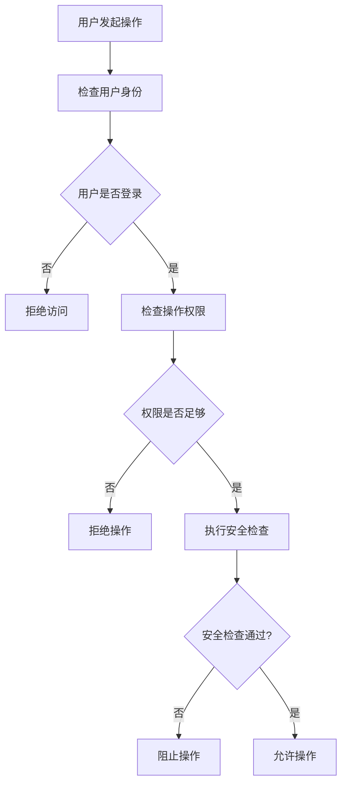

**图表来源**
- [app.py:3767-3811](file://app.py#L3767-L3811)

#### 撤销功能

系统提供了操作撤销机制：

- **操作日志记录**：完整记录所有批量操作
- **状态快照**：保存操作前的系统状态
- **一键撤销**：支持快速撤销最近的操作
- **批量撤销**：支持撤销整个操作批次

#### 数据完整性保护

- **事务处理**：确保批量操作的原子性
- **一致性检查**：验证操作后的数据完整性
- **备份机制**：在关键操作前创建数据备份
- **错误恢复**：自动处理操作失败的情况

**章节来源**
- [app.py:3767-3811](file://app.py#L3767-L3811)

## 依赖关系分析

系统各组件之间的依赖关系如下：

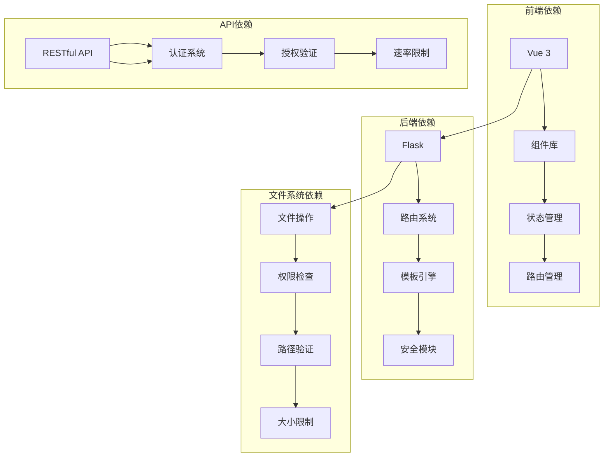

**图表来源**
- [app.py:119-140](file://app.py#L119-L140)
- [frontend/src/api.js:1-45](file://frontend/src/api.js#L1-45)

**章节来源**
- [app.py:119-140](file://app.py#L119-L140)
- [frontend/src/api.js:1-45](file://frontend/src/api.js#L1-45)

## 性能考虑

批量操作功能在设计时充分考虑了性能优化：

### 处理效率优化

- **并发处理**：支持多文件并发处理，提升整体效率
- **分批处理**：大批次操作时自动分批处理，避免内存溢出
- **增量更新**：只更新发生变化的数据，减少不必要的操作

### 资源使用优化

- **内存管理**：及时释放处理过程中的临时内存
- **CPU优化**：使用高效的算法和数据结构
- **I/O优化**：优化文件系统的读写操作

### 用户体验优化

- **进度反馈**：实时显示操作进度和状态
- **响应式界面**：保持界面的流畅响应
- **错误处理**：提供清晰的错误信息和解决方案

## 故障排除指南

### 常见问题及解决方案

#### 文件删除失败

**问题现象**：批量删除某些文件时出现失败

**可能原因**：
- 文件被其他进程占用
- 权限不足
- 文件系统错误

**解决步骤**：
1. 检查文件是否被其他程序使用
2. 验证用户权限
3. 重新尝试操作
4. 查看系统日志获取详细错误信息

#### 批量重命名冲突

**问题现象**：批量重命名时出现文件名冲突

**解决方法**：
1. 使用自动重命名选项
2. 调整重命名规则
3. 手动处理冲突文件
4. 检查目标目录的文件名唯一性

#### 操作超时

**问题现象**：大批量操作时出现超时

**解决方法**：
1. 分批处理文件
2. 增加超时时间设置
3. 检查网络连接稳定性
4. 优化服务器资源配置

**章节来源**
- [app.py:3858-3871](file://app.py#L3858-L3871)
- [templates/file_manager.html:15-17](file://templates/file_manager.html#L15-L17)

## 结论

本项目的批量操作功能实现了高效、安全、用户友好的文件管理体验。通过精心设计的架构和完善的实现，系统能够满足各种批量文件操作需求。

### 主要优势

1. **功能完整性**：提供了从基础选择到复杂操作的完整功能链
2. **用户体验**：直观的界面设计和实时的进度反馈
3. **安全性**：多层次的安全验证和权限控制
4. **性能优化**：异步处理和资源优化确保高效运行
5. **可扩展性**：模块化设计便于功能扩展和维护

### 技术亮点

- **前后端分离架构**：清晰的职责划分和良好的可维护性
- **异步处理机制**：提升用户体验和系统响应速度
- **智能冲突处理**：完善的错误处理和恢复机制
- **安全防护体系**：全面的安全验证和权限控制

### 未来发展

系统具备良好的扩展基础，未来可以在以下方面进一步完善：

- **操作历史记录**：提供更详细的操作审计功能
- **批量操作模板**：支持常用操作的模板化配置
- **云端同步**：支持与云存储服务的集成
- **智能分析**：提供文件使用情况和优化建议

通过持续的优化和完善，本批量操作功能将成为一个成熟稳定的企业级文件管理解决方案。