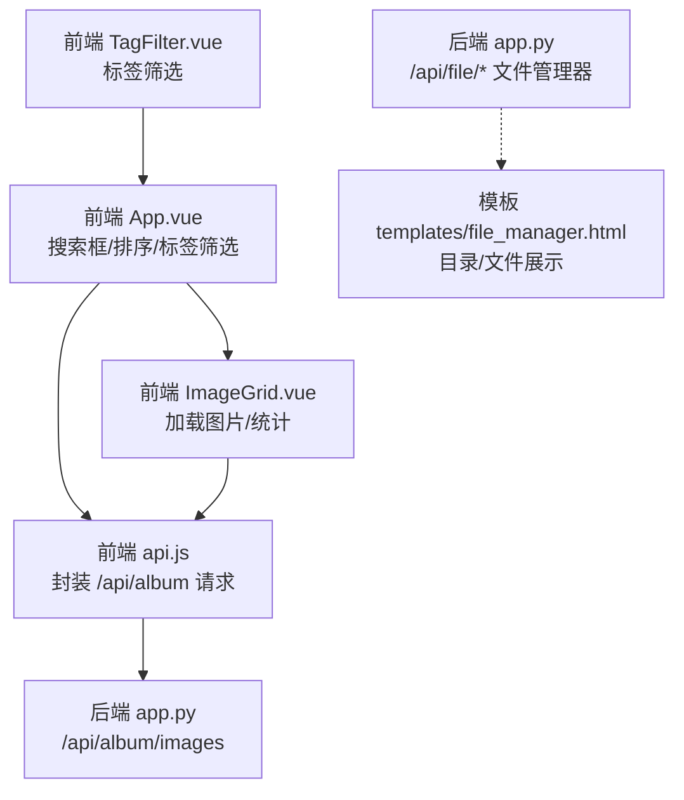
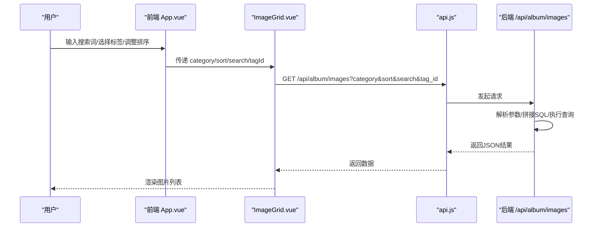
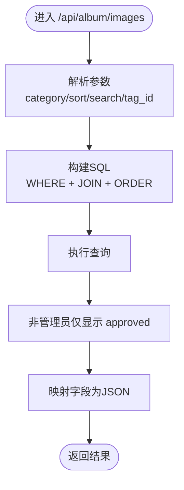
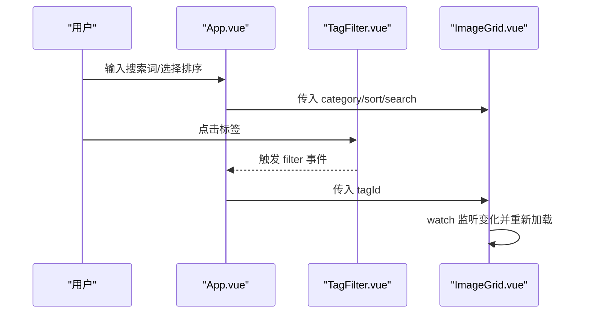
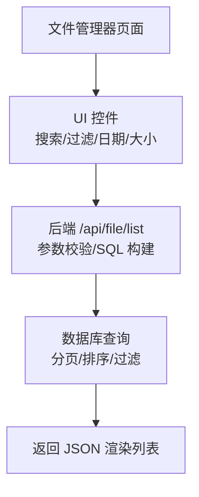
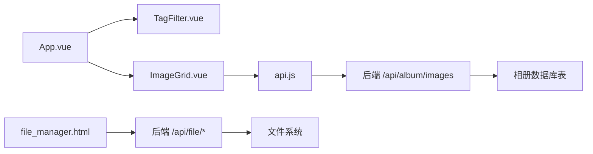

# 搜索与过滤

<cite>
**本文引用的文件**
- [app.py](file://app.py)
- [frontend/src/App.vue](file://frontend/src/App.vue)
- [frontend/src/components/ImageGrid.vue](file://frontend/src/components/ImageGrid.vue)
- [frontend/src/components/TagFilter.vue](file://frontend/src/components/TagFilter.vue)
- [frontend/src/api.js](file://frontend/src/api.js)
- [templates/file_manager.html](file://templates/file_manager.html)
</cite>

## 目录
1. [简介](#简介)
2. [项目结构](#项目结构)
3. [核心组件](#核心组件)
4. [架构总览](#架构总览)
5. [详细组件分析](#详细组件分析)
6. [依赖分析](#依赖分析)
7. [性能考虑](#性能考虑)
8. [故障排查指南](#故障排查指南)
9. [结论](#结论)
10. [附录](#附录)

## 简介
本文件围绕“搜索与过滤”能力进行系统化技术文档整理，重点覆盖以下方面：
- 文件名称搜索：模糊匹配、大小写敏感性、搜索触发与节流
- 文件类型过滤：扩展名过滤、MIME 类型匹配、自定义过滤规则
- 时间范围查询：创建时间/修改时间筛选与日期选择器实现思路
- 文件大小过滤：范围选择、单位换算与显示格式
- 高级搜索：组合条件、布尔运算与搜索历史
- 性能优化与索引策略：查询优化、缓存与前端节流

说明：当前仓库中与“搜索与过滤”直接相关的核心实现集中在相册图片模块的前端与后端接口，以及文件管理器的静态展示页面。对于“文件管理器”的文件列表展示，当前模板仅提供基础的目录浏览与文件名展示，尚未实现扩展名过滤、MIME 类型匹配、时间范围与大小过滤等高级能力。因此本文在“文件管理器”部分将以“现状与建议”的形式给出扩展方向。

## 项目结构
- 前端采用 Vue 3 单页应用，主要入口为 App.vue，负责标签筛选、搜索框与排序控制，并通过 ImageGrid.vue 展示图片列表。
- 后端基于 Flask，提供相册图片的搜索与过滤接口（按名称模糊匹配、按标签过滤、按时间排序），并提供文件管理器的上传、下载、删除等基础能力。
- 模板层 templates/file_manager.html 提供文件管理器页面的目录与文件列表展示，但未集成搜索与过滤逻辑。

**图表来源**
- [frontend/src/App.vue:1-99](file://frontend/src/App.vue#L1-L99)
- [frontend/src/api.js:1-45](file://frontend/src/api.js#L1-L45)
- [frontend/src/components/ImageGrid.vue:1-129](file://frontend/src/components/ImageGrid.vue#L1-L129)
- [frontend/src/components/TagFilter.vue:1-51](file://frontend/src/components/TagFilter.vue#L1-L51)
- [app.py:2537-2576](file://app.py#L2537-L2576)
- [templates/file_manager.html:1-60](file://templates/file_manager.html#L1-L60)

**章节来源**
- [frontend/src/App.vue:1-99](file://frontend/src/App.vue#L1-L99)
- [frontend/src/components/ImageGrid.vue:1-129](file://frontend/src/components/ImageGrid.vue#L1-L129)
- [frontend/src/components/TagFilter.vue:1-51](file://frontend/src/components/TagFilter.vue#L1-L51)
- [frontend/src/api.js:1-45](file://frontend/src/api.js#L1-L45)
- [app.py:2537-2576](file://app.py#L2537-L2576)
- [templates/file_manager.html:1-60](file://templates/file_manager.html#L1-L60)

## 核心组件
- 前端搜索与过滤入口：App.vue 提供搜索框与排序控件，结合 TagFilter.vue 实现标签筛选。
- 图片列表加载：ImageGrid.vue 依据 category、sort、search、tagId 参数调用后端接口获取数据。
- 后端搜索与过滤：/api/album/images 支持按名称模糊匹配与按标签过滤，并按上传时间排序。
- 文件管理器：templates/file_manager.html 展示目录与文件列表，后端提供上传、下载、删除等 API。

**章节来源**
- [frontend/src/App.vue:1-99](file://frontend/src/App.vue#L1-L99)
- [frontend/src/components/ImageGrid.vue:55-77](file://frontend/src/components/ImageGrid.vue#L55-L77)
- [app.py:2537-2576](file://app.py#L2537-L2576)
- [templates/file_manager.html:1-60](file://templates/file_manager.html#L1-L60)

## 架构总览
下图展示了“搜索与过滤”的端到端流程：前端发起请求，后端执行 SQL 查询，返回结果给前端渲染。

**图表来源**
- [frontend/src/App.vue:62-77](file://frontend/src/App.vue#L62-L77)
- [frontend/src/components/ImageGrid.vue:55-77](file://frontend/src/components/ImageGrid.vue#L55-L77)
- [frontend/src/api.js:8-12](file://frontend/src/api.js#L8-L12)
- [app.py:2537-2576](file://app.py#L2537-L2576)

## 详细组件分析

### 相册图片搜索与过滤（当前实现）
- 搜索字段：名称（name）支持模糊匹配（LIKE %...%）
- 过滤字段：标签（tag_id）通过 JOIN album_image_tags 实现
- 排序字段：上传时间（upload_time），支持 newest/oldest
- 权限控制：非管理员仅能看到已审核（approved）的图片

**图表来源**
- [app.py:2537-2576](file://app.py#L2537-L2576)

**章节来源**
- [app.py:2537-2576](file://app.py#L2537-L2576)

### 前端搜索与过滤交互（当前实现）
- 搜索框：App.vue 中的输入框与触发节流（300ms）
- 排序：下拉选择 newest/oldest
- 标签：TagFilter.vue 切换 activeTag 并触发搜索
- 列表：ImageGrid.vue 根据 props 动态加载数据

**图表来源**
- [frontend/src/App.vue:62-77](file://frontend/src/App.vue#L62-L77)
- [frontend/src/components/TagFilter.vue:1-51](file://frontend/src/components/TagFilter.vue#L1-L51)
- [frontend/src/components/ImageGrid.vue:98-106](file://frontend/src/components/ImageGrid.vue#L98-L106)

**章节来源**
- [frontend/src/App.vue:62-77](file://frontend/src/App.vue#L62-L77)
- [frontend/src/components/TagFilter.vue:1-51](file://frontend/src/components/TagFilter.vue#L1-L51)
- [frontend/src/components/ImageGrid.vue:98-106](file://frontend/src/components/ImageGrid.vue#L98-L106)

### 文件管理器（现状与扩展建议）
- 现状：templates/file_manager.html 展示目录与文件列表，未实现搜索与过滤。
- 后端 API：提供上传、下载、删除等基础能力，未暴露搜索与过滤接口。
- 扩展建议：
  - 增加搜索输入框与过滤控件（扩展名、MIME、时间范围、大小范围）
  - 后端新增 /api/file/list 接口，支持分页、排序与多条件过滤
  - 前端增加日期选择器与范围滑块组件，提交查询参数

**图表来源**
- [templates/file_manager.html:1-60](file://templates/file_manager.html#L1-L60)
- [app.py:3814-3871](file://app.py#L3814-L3871)

**章节来源**
- [templates/file_manager.html:1-60](file://templates/file_manager.html#L1-L60)
- [app.py:3814-3871](file://app.py#L3814-L3871)

## 依赖分析
- 前端依赖关系：App.vue 依赖 TagFilter.vue 与 ImageGrid.vue；ImageGrid.vue 通过 api.js 封装调用后端接口。
- 后端依赖关系：/api/album/images 依赖相册数据库表 album_images、album_image_tags；文件管理器 API 依赖文件系统路径与权限控制。

**图表来源**
- [frontend/src/App.vue:1-99](file://frontend/src/App.vue#L1-L99)
- [frontend/src/components/TagFilter.vue:1-51](file://frontend/src/components/TagFilter.vue#L1-L51)
- [frontend/src/components/ImageGrid.vue:1-129](file://frontend/src/components/ImageGrid.vue#L1-L129)
- [frontend/src/api.js:1-45](file://frontend/src/api.js#L1-L45)
- [app.py:2537-2576](file://app.py#L2537-L2576)
- [templates/file_manager.html:1-60](file://templates/file_manager.html#L1-L60)

**章节来源**
- [frontend/src/App.vue:1-99](file://frontend/src/App.vue#L1-L99)
- [frontend/src/components/ImageGrid.vue:1-129](file://frontend/src/components/ImageGrid.vue#L1-L129)
- [frontend/src/components/TagFilter.vue:1-51](file://frontend/src/components/TagFilter.vue#L1-L51)
- [frontend/src/api.js:1-45](file://frontend/src/api.js#L1-L45)
- [app.py:2537-2576](file://app.py#L2537-L2576)
- [templates/file_manager.html:1-60](file://templates/file_manager.html#L1-L60)

## 性能考虑
- 前端节流：App.vue 对搜索输入进行 300ms 节流，减少频繁请求。
- 后端查询：/api/album/images 使用 LIKE %...% 与 JOIN，建议在 name 与 tag_id 上建立索引以提升模糊匹配与连接效率。
- 排序与分页：当前按 upload_time 排序，建议在 upload_time 建立索引；如需大数据量展示，应引入分页参数（page/size）。
- 缓存策略：对热门搜索词与标签组合结果可引入短期缓存（如 Redis），降低重复查询压力。
- 前端渲染：ImageGrid.vue 对每张图片异步加载评论与点赞数量，注意并发控制与错误兜底。

**章节来源**
- [frontend/src/App.vue:72-74](file://frontend/src/App.vue#L72-L74)
- [frontend/src/components/ImageGrid.vue:65-74](file://frontend/src/components/ImageGrid.vue#L65-L74)
- [app.py:2537-2576](file://app.py#L2537-L2576)

## 故障排查指南
- 搜索无结果
  - 检查前端是否正确传递 search 参数与编码
  - 检查后端 /api/album/images 是否正确拼接 WHERE 子句
- 标签筛选无效
  - 确认 tag_id 是否传入且为整数
  - 确认 album_image_tags 关联是否存在
- 权限问题
  - 非管理员仅能看到 approved 的图片，若无内容请检查审核状态
- 文件管理器异常
  - 上传/下载/删除报错时，检查路径穿越防护与权限校验
  - 文件过大或格式不合法会被拒绝，检查大小限制与魔数校验

**章节来源**
- [app.py:2537-2576](file://app.py#L2537-L2576)
- [app.py:2577-2630](file://app.py#L2577-L2630)
- [app.py:3814-3871](file://app.py#L3814-L3871)

## 结论
- 当前“搜索与过滤”已在相册图片模块实现基础能力：名称模糊匹配、标签过滤与时间排序。
- 文件管理器页面与 API 尚未集成搜索与过滤，建议按“扩展建议”逐步完善。
- 性能优化建议集中在数据库索引、查询节流与缓存策略上，以支撑更大规模的数据检索场景。

## 附录

### 术语表
- 模糊匹配：使用 LIKE %...% 的字符串匹配方式
- MIME 类型：描述文件类型的标识符（如 image/jpeg）
- 扩展名：文件名末尾的后缀（如 .jpg）
- 审核状态：图片上传后的状态（如 pending/approved）

### 未来扩展清单（建议）
- 文件管理器搜索与过滤
  - 增加扩展名/正则过滤、MIME 类型匹配、时间范围、大小范围
  - 后端新增 /api/file/list 接口，支持分页与多条件组合
- 高级搜索
  - 布尔运算（AND/OR）、搜索历史存储与回放
- 性能优化
  - 数据库索引、查询缓存、前端虚拟滚动与懒加载