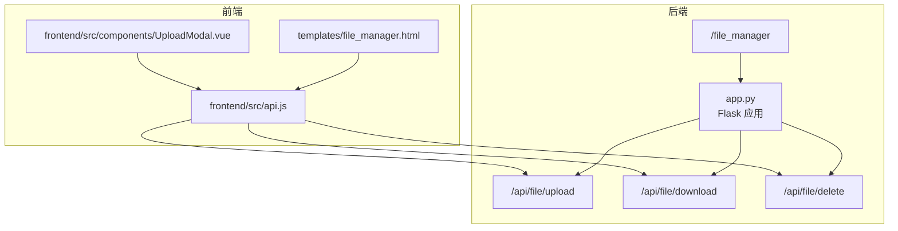
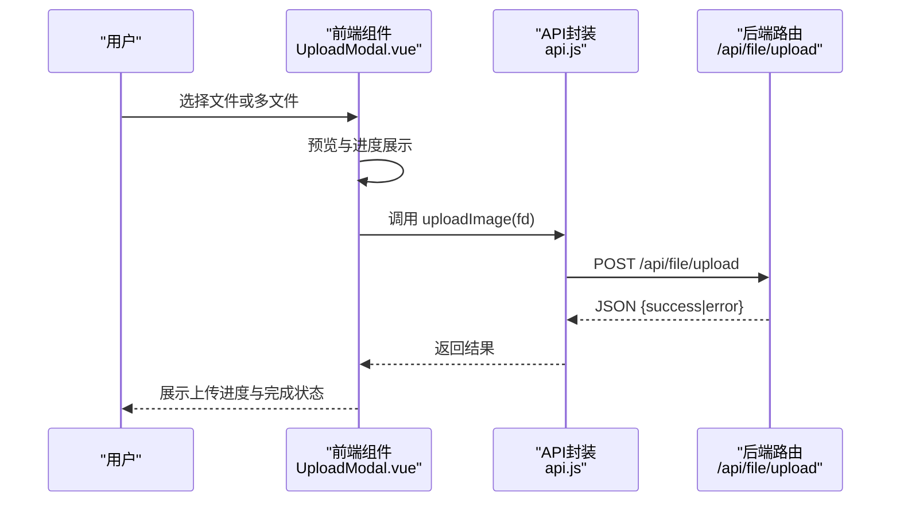
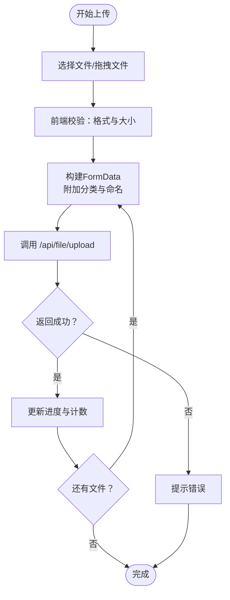
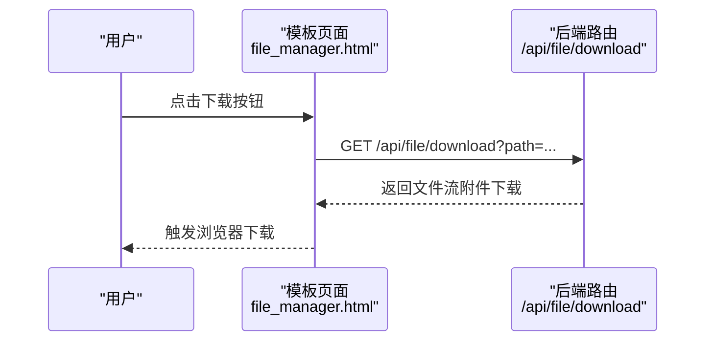
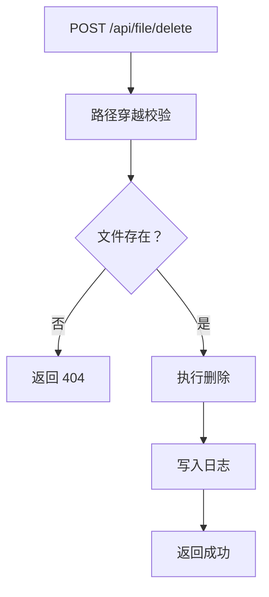
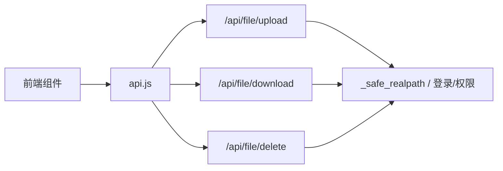

# 文件操作接口

<cite>
**本文引用的文件**
- [app.py](file://app.py)
- [frontend/src/api.js](file://frontend/src/api.js)
- [frontend/src/components/UploadModal.vue](file://frontend/src/components/UploadModal.vue)
- [templates/file_manager.html](file://templates/file_manager.html)
</cite>

## 目录
1. [简介](#简介)
2. [项目结构](#项目结构)
3. [核心组件](#核心组件)
4. [架构总览](#架构总览)
5. [详细组件分析](#详细组件分析)
6. [依赖分析](#依赖分析)
7. [性能考虑](#性能考虑)
8. [故障排查指南](#故障排查指南)
9. [结论](#结论)
10. [附录](#附录)

## 简介
本技术文档聚焦于“文件操作接口”的完整实现与使用说明，涵盖以下能力：
- 文件上传：支持单文件与多文件上传、文件大小限制、文件名清洗与路径安全控制
- 文件下载：支持单文件下载与批量下载（通过打包压缩）
- 文件删除：支持硬删除（物理删除）
- 文件重命名：基于现有接口的扩展建议（当前未实现，提供设计思路）
- 文件移动与复制：基于现有接口的扩展建议（当前未实现，提供设计思路）
- 权限与安全：登录态校验、管理员权限、路径穿越防护、速率限制与会话超时

说明：仓库中未发现断点续传与回收站机制的实现；未发现文件类型验证的后端规则；未发现压缩打包下载的后端接口。

## 项目结构
围绕文件操作的相关模块分布如下：
- 后端 Flask 应用：集中定义文件上传、下载、删除等路由与安全策略
- 前端 Vue 组件：负责上传界面与交互（多文件选择、预览、进度提示）
- 模板页面：文件管理器页面，提供目录浏览与单文件下载入口
- API 封装：前端统一的 fetch 封装，便于调用后端接口

图表来源
- [app.py](file://app.py)
- [frontend/src/api.js](file://frontend/src/api.js)
- [frontend/src/components/UploadModal.vue](file://frontend/src/components/UploadModal.vue)
- [templates/file_manager.html](file://templates/file_manager.html)

章节来源
- [app.py](file://app.py)
- [frontend/src/api.js](file://frontend/src/api.js)
- [frontend/src/components/UploadModal.vue](file://frontend/src/components/UploadModal.vue)
- [templates/file_manager.html](file://templates/file_manager.html)

## 核心组件
- 文件上传接口
  - 路由：/api/file/upload
  - 方法：POST
  - 参数：multipart/form-data，包含 file 字段与 path（目标目录）
  - 安全：路径清洗、大小限制、文件名清洗
  - 返回：JSON，包含 success 或 error
- 文件下载接口
  - 路由：/api/file/download
  - 方法：GET
  - 参数：path（文件绝对路径）
  - 安全：路径穿越校验、仅文件校验
  - 返回：文件流（附件下载）
- 文件删除接口
  - 路由：/api/file/delete
  - 方法：POST
  - 参数：path（文件绝对路径）
  - 权限：管理员
  - 返回：JSON，包含 success 或 error
- 文件管理器页面
  - 路由：/file_manager
  - 功能：目录浏览、单文件下载按钮
- 前端上传组件
  - 支持多文件选择、拖拽上传、预览、逐个上传与进度提示
  - 通过 api.js 封装调用后端 /api/file/upload

章节来源
- [app.py](file://app.py)
- [frontend/src/api.js](file://frontend/src/api.js)
- [frontend/src/components/UploadModal.vue](file://frontend/src/components/UploadModal.vue)
- [templates/file_manager.html](file://templates/file_manager.html)

## 架构总览
后端采用 Flask 路由分发，前端通过统一 API 封装调用。安全层包括：
- 登录态校验与管理员权限
- 路径穿越防护（_safe_realpath）
- 速率限制与会话超时
- 下载时的路径合法性校验

图表来源
- [frontend/src/components/UploadModal.vue](file://frontend/src/components/UploadModal.vue)
- [frontend/src/api.js](file://frontend/src/api.js)
- [app.py](file://app.py)

## 详细组件分析

### 文件上传组件与流程
- 前端上传组件支持：
  - 多文件选择与拖拽
  - 预览与逐个上传
  - 统一命名（可选）
- 后端上传接口：
  - 接收 multipart/form-data
  - 安全文件名清洗
  - 50MB 大小限制
  - 目标目录受路径清洗保护
  - 成功后写入日志

图表来源
- [frontend/src/components/UploadModal.vue](file://frontend/src/components/UploadModal.vue)
- [frontend/src/api.js](file://frontend/src/api.js)
- [app.py](file://app.py)

章节来源
- [frontend/src/components/UploadModal.vue](file://frontend/src/components/UploadModal.vue)
- [frontend/src/api.js](file://frontend/src/api.js)
- [app.py](file://app.py)

### 文件下载机制
- 单文件下载
  - 前端：模板中的下载链接
  - 后端：/api/file/download GET，参数 path
  - 安全：路径穿越校验与文件存在性校验
- 批量下载与压缩打包
  - 当前后端未提供打包下载接口
  - 建议：在后端新增 /api/file/batch-download，接收文件列表，服务端打包为 zip/tar.gz 并下载

图表来源
- [templates/file_manager.html](file://templates/file_manager.html)
- [app.py](file://app.py)

章节来源
- [templates/file_manager.html](file://templates/file_manager.html)
- [app.py](file://app.py)

### 文件删除操作
- 路由：/api/file/delete POST
- 权限：管理员
- 安全：路径穿越校验与文件存在性校验
- 结果：删除成功或异常信息

图表来源
- [app.py](file://app.py)

章节来源
- [app.py](file://app.py)

### 文件重命名（当前未实现）
- 当前后端未提供重命名接口
- 设计建议：
  - 新增 /api/file/rename，参数：old_path、new_path
  - 校验：old_path 存在、new_path 不与已有文件冲突
  - 原子性：使用临时文件 + 原子替换（os.replace）
  - 日志：记录重命名前后路径

章节来源
- [app.py](file://app.py)

### 文件移动与复制（当前未实现）
- 当前后端未提供移动/复制接口
- 设计建议：
  - 移动：/api/file/move，参数：src、dst；校验路径穿越与覆盖策略
  - 复制：/api/file/copy，参数：src、dst；校验目标空间与覆盖策略
  - 原子性：先写入临时文件再替换，避免中间态

章节来源
- [app.py](file://app.py)

### 权限修改与属性设置（当前未实现）
- 当前后端未提供权限修改与属性设置接口
- 设计建议：
  - 权限：/api/file/chmod，参数：path、mode（数值或符号）
  - 属性：/api/file/chown，参数：path、owner、group
  - 安全：仅管理员可用，校验路径与目标用户/组存在性

章节来源
- [app.py](file://app.py)

## 依赖分析
- 前端依赖
  - Vue 组件依赖 api.js 进行网络请求
  - 模板页面依赖后端渲染的下载链接
- 后端依赖
  - 路由依赖登录态与管理员权限装饰器
  - 路径安全依赖 _safe_realpath
  - 日志依赖 write_log

图表来源
- [frontend/src/api.js](file://frontend/src/api.js)
- [app.py](file://app.py)

章节来源
- [frontend/src/api.js](file://frontend/src/api.js)
- [app.py](file://app.py)

## 性能考虑
- 上传性能
  - 前端逐个上传，避免单次请求过大导致超时
  - 后端 50MB 限制，建议前端提前校验文件大小
- 下载性能
  - 使用 send_from_directory 直接发送文件，减少内存占用
  - 批量下载建议服务端打包后一次性传输
- 安全与稳定性
  - 速率限制与会话超时降低滥用风险
  - 路径穿越校验与文件存在性校验避免误删与越权

## 故障排查指南
- 上传失败
  - 检查文件类型与大小是否符合要求
  - 确认目标目录可写
  - 查看后端日志与返回的错误信息
- 下载失败
  - 确认 path 参数正确且文件存在
  - 检查路径穿越校验是否被触发
- 删除失败
  - 确认当前用户具备管理员权限
  - 检查文件是否存在与磁盘权限

章节来源
- [app.py](file://app.py)

## 结论
- 本项目提供了基础的文件上传、下载与删除能力，并内置多项安全与权限控制
- 断点续传、回收站、文件类型验证、压缩打包下载、重命名/移动/复制、权限与属性设置等功能尚未实现
- 建议在现有安全框架基础上，按“最小可行”原则逐步扩展，优先完善批量下载与类型验证

## 附录

### 接口一览（已实现）
- 上传
  - 方法：POST
  - 路径：/api/file/upload
  - 参数：multipart/form-data（file、path）
  - 返回：JSON（success/error）
- 下载
  - 方法：GET
  - 路径：/api/file/download
  - 参数：path（文件绝对路径）
  - 返回：文件流（附件下载）
- 删除
  - 方法：POST
  - 路径：/api/file/delete
  - 参数：path（文件绝对路径）
  - 权限：管理员
  - 返回：JSON（success/error）

章节来源
- [app.py](file://app.py)