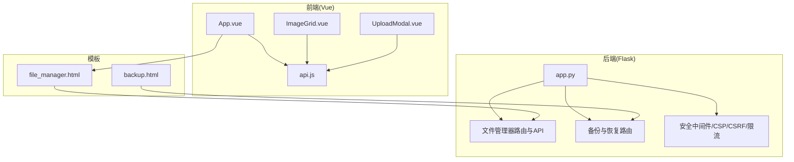
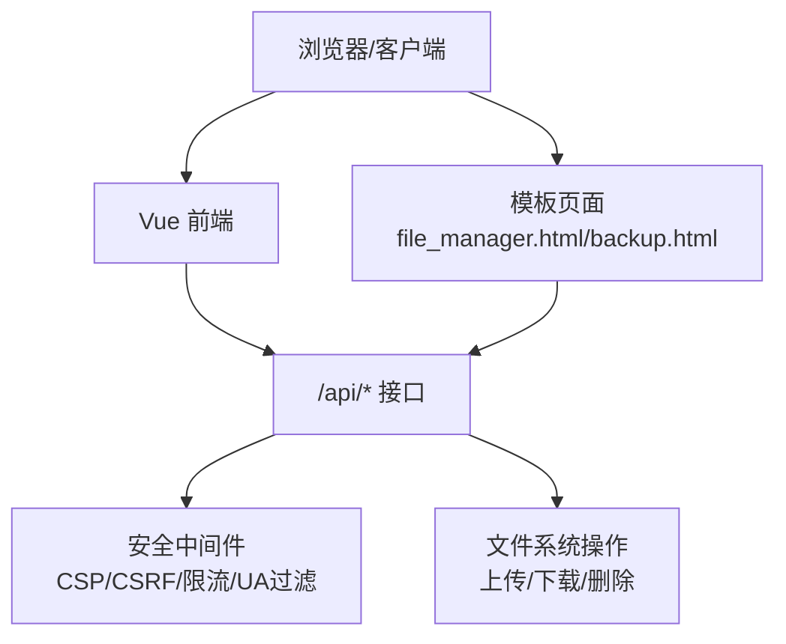
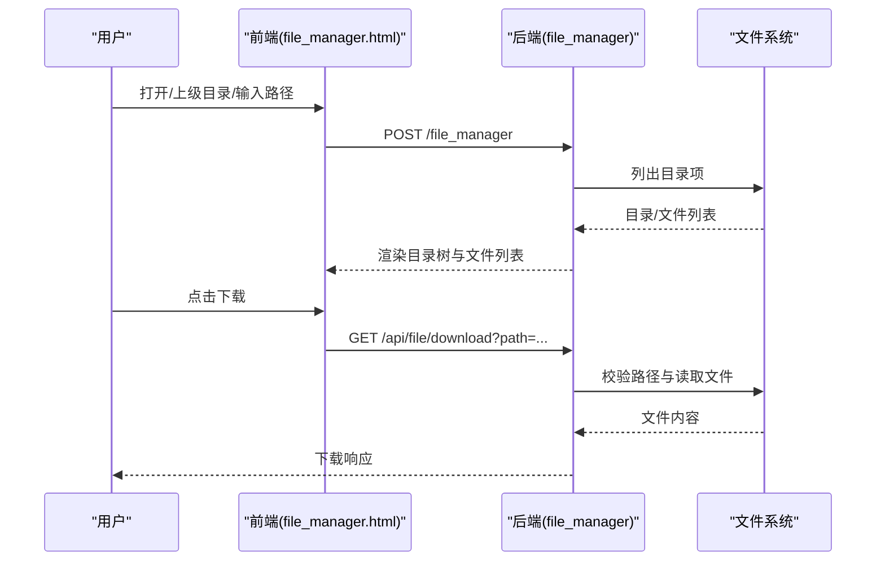
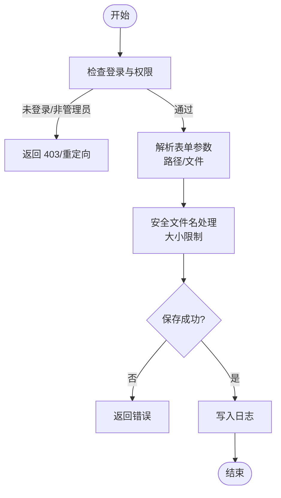
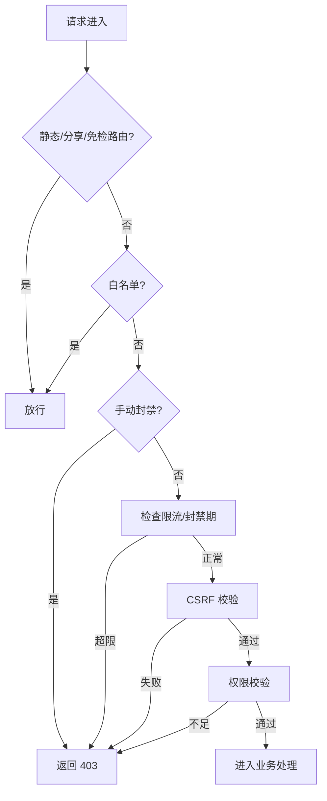
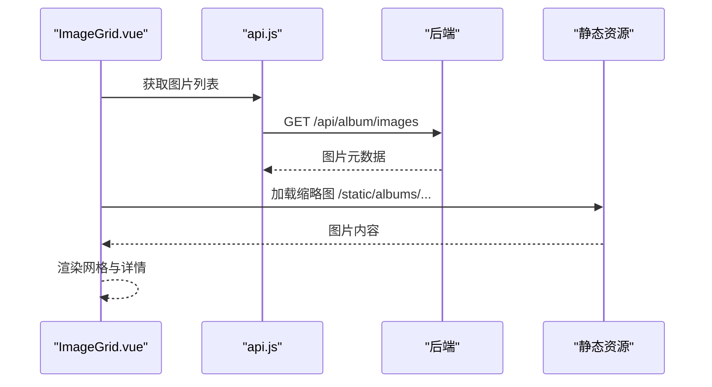
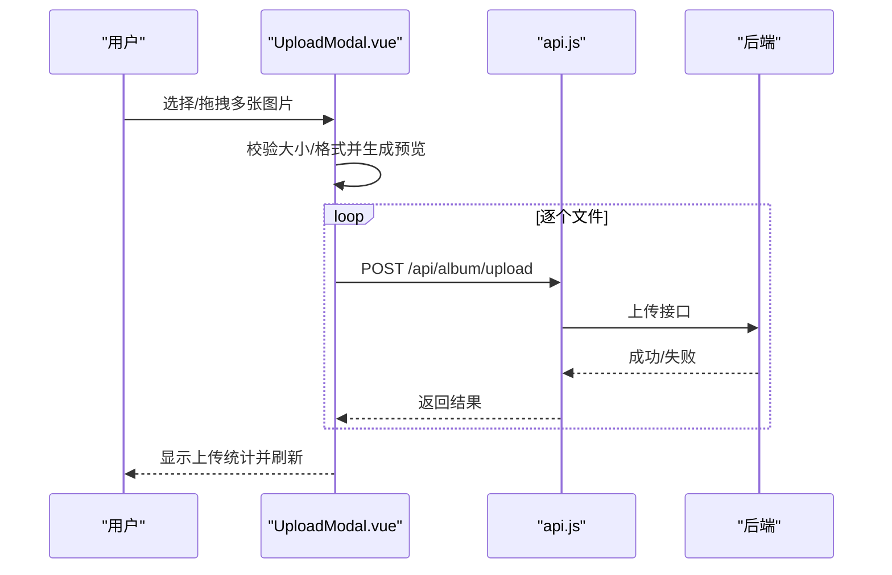
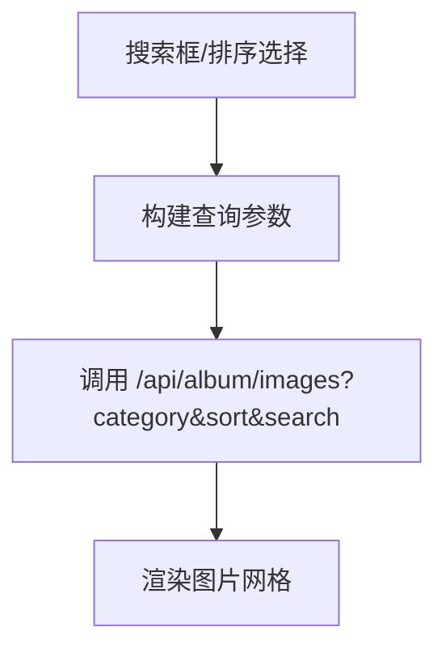
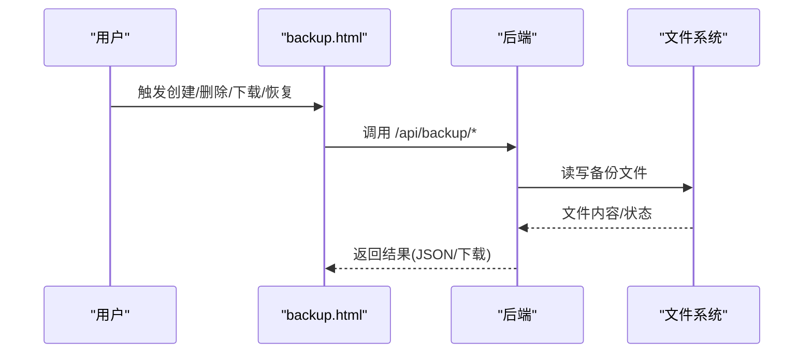
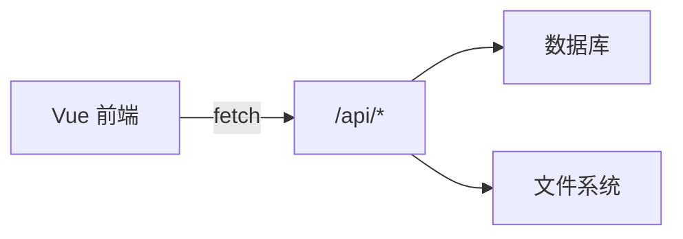

# 文件管理系统

<cite>
**本文引用的文件**
- [app.py](file://app.py)
- [file_manager.html](file://templates/file_manager.html)
- [安全措施清单.md](file://安全措施清单.md)
- [UploadModal.vue](file://frontend/src/components/UploadModal.vue)
- [api.js](file://frontend/src/api.js)
- [App.vue](file://frontend/src/App.vue)
- [ImageGrid.vue](file://frontend/src/components/ImageGrid.vue)
- [backup.html](file://templates/backup.html)
</cite>

## 目录
1. [简介](#简介)
2. [项目结构](#项目结构)
3. [核心组件](#核心组件)
4. [架构总览](#架构总览)
5. [详细组件分析](#详细组件分析)
6. [依赖分析](#依赖分析)
7. [性能考量](#性能考量)
8. [故障排查指南](#故障排查指南)
9. [结论](#结论)
10. [附录](#附录)

## 简介
本文件管理系统基于 Python Flask 后端与 Vue 前端构建，提供目录浏览、文件操作（上传、下载、删除）、权限控制、文件预览、批量操作、搜索与过滤、以及安全与存储优化等能力。系统通过严格的权限模型（访客、VIP、管理员）与多重安全防护（CSP、CSRF、速率限制、路径穿越防护、验证码门禁）保障运行安全。

## 项目结构
- 后端入口与核心逻辑位于 app.py，包含路由、权限装饰器、安全中间件、文件管理 API、备份与恢复等。
- 前端采用 Vue 单页应用，组件化实现上传、网格展示、搜索与排序等功能。
- 模板层提供基础页面与文件管理界面，负责渲染目录树与文件列表。
- 安全措施清单记录了整体安全基线与修复进展。

**图表来源**
- [app.py](file://app.py)
- [file_manager.html](file://templates/file_manager.html)
- [backup.html](file://templates/backup.html)
- [App.vue](file://frontend/src/App.vue)
- [ImageGrid.vue](file://frontend/src/components/ImageGrid.vue)
- [UploadModal.vue](file://frontend/src/components/UploadModal.vue)
- [api.js](file://frontend/src/api.js)

**章节来源**
- [app.py](file://app.py)
- [file_manager.html](file://templates/file_manager.html)
- [backup.html](file://templates/backup.html)
- [App.vue](file://frontend/src/App.vue)
- [ImageGrid.vue](file://frontend/src/components/ImageGrid.vue)
- [UploadModal.vue](file://frontend/src/components/UploadModal.vue)
- [api.js](file://frontend/src/api.js)

## 核心组件
- 目录浏览与导航：后端提供文件管理路由，渲染当前目录下的子目录与文件，并支持“上级目录”跳转。
- 文件操作接口：提供上传、下载、删除（管理员）等 API，均受权限与路径穿越防护约束。
- 权限控制：通过装饰器实现访客、VIP、管理员三级权限，结合会话与 CSRF 防护。
- 文件预览：前端通过静态资源路径直接访问图片，支持缩略图与详情查看。
- 批量操作：前端上传模态框支持多文件选择与批量上传，后端按顺序逐个处理。
- 搜索与过滤：前端提供名称搜索与排序，后端在相册模块实现搜索与排序参数传递。
- 安全与存储：CSP/Nonce、CSRF、速率限制、UA 过滤、验证码门禁、路径穿越防护、HSTS 等。

**章节来源**
- [app.py](file://app.py)
- [file_manager.html](file://templates/file_manager.html)
- [App.vue](file://frontend/src/App.vue)
- [ImageGrid.vue](file://frontend/src/components/ImageGrid.vue)
- [UploadModal.vue](file://frontend/src/components/UploadModal.vue)
- [api.js](file://frontend/src/api.js)

## 架构总览
系统采用前后端分离架构：
- 前端负责用户交互、状态管理、UI 组件与 API 调用。
- 后端提供 REST 风格 API、权限校验、安全中间件与文件系统操作。
- 模板层用于服务端渲染基础页面与文件管理界面。

**图表来源**
- [app.py](file://app.py)
- [file_manager.html](file://templates/file_manager.html)
- [backup.html](file://templates/backup.html)

## 详细组件分析

### 目录浏览与导航
- 后端路由 file_manager 提供目录浏览，支持“打开/上级目录”操作，渲染当前路径下的目录与文件列表。
- 前端模板 file_manager.html 展示目录树与文件列表，文件项包含下载链接。
- 路径穿越防护：后端对输入路径进行规范化与白名单限制，确保只允许在用户主目录范围内访问。

**图表来源**
- [app.py](file://app.py)
- [file_manager.html](file://templates/file_manager.html)

**章节来源**
- [app.py](file://app.py)
- [file_manager.html](file://templates/file_manager.html)

### 文件操作接口（上传/下载/删除）
- 上传：/api/file/upload，接收表单文件与目标路径，进行大小限制与安全文件名处理，保存至目标目录。
- 下载：/api/file/download，要求登录，校验路径合法性后以附件形式返回文件。
- 删除：/api/file/delete，仅管理员可用，校验文件存在性后删除。

**图表来源**
- [app.py](file://app.py)

**章节来源**
- [app.py](file://app.py)

### 权限控制机制
- 权限装饰器：
  - admin_required：仅管理员可访问
  - non_guest_required：禁止访客访问
  - vip_required：VIP 或管理员可用
  - csrf_required：CSRF 校验
- 会话与安全响应头：CSP Nonce、HSTS、X-Frame-Options、X-Content-Type-Options、X-XSS-Protection、Referrer-Policy、Permissions-Policy 等。
- 速率限制与 UA 过滤：全局请求限流、封禁策略、扫描器 UA 拦截。

**图表来源**
- [app.py](file://app.py)

**章节来源**
- [app.py](file://app.py)
- [安全措施清单.md](file://安全措施清单.md)

### 文件预览功能
- 前端通过静态资源路径访问图片，如 /static/albums/{filename}，支持缩略图与详情查看。
- 图片网格组件 ImageGrid 展示图片名称、点赞数、评论数与上传时间，并提供查看、重命名（教师）、删除（教师）等操作入口。

**图表来源**
- [ImageGrid.vue](file://frontend/src/components/ImageGrid.vue)
- [api.js](file://frontend/src/api.js)
- [App.vue](file://frontend/src/App.vue)

**章节来源**
- [ImageGrid.vue](file://frontend/src/components/ImageGrid.vue)
- [api.js](file://frontend/src/api.js)
- [App.vue](file://frontend/src/App.vue)

### 批量操作（上传与批量命名）
- 前端 UploadModal 支持多文件选择与拖拽，限制每张≤5MB、格式为 jpeg/png/gif/webp。
- 逐个上传：循环构造 FormData 并调用 /api/album/upload，支持统一命名（批量命名 + 序号）。
- 上传完成后触发父组件刷新。

**图表来源**
- [UploadModal.vue](file://frontend/src/components/UploadModal.vue)
- [api.js](file://frontend/src/api.js)
- [app.py](file://app.py)

**章节来源**
- [UploadModal.vue](file://frontend/src/components/UploadModal.vue)
- [api.js](file://frontend/src/api.js)
- [app.py](file://app.py)

### 搜索与过滤
- 前端 App.vue 提供搜索框与排序选择，将搜索词与排序参数拼接到 /api/album/images 查询字符串中。
- ImageGrid.vue 根据分类、排序、搜索与标签过滤条件加载图片列表。

**图表来源**
- [App.vue](file://frontend/src/App.vue)
- [ImageGrid.vue](file://frontend/src/components/ImageGrid.vue)
- [api.js](file://frontend/src/api.js)

**章节来源**
- [App.vue](file://frontend/src/App.vue)
- [ImageGrid.vue](file://frontend/src/components/ImageGrid.vue)
- [api.js](file://frontend/src/api.js)

### 备份与恢复（与文件管理相关）
- 备份：后端提供创建备份、下载备份、差异对比、删除备份、清理旧备份等接口。
- 恢复：支持下载备份后在后端进行解压恢复，包含路径穿越与符号链接过滤。

**图表来源**
- [backup.html](file://templates/backup.html)
- [app.py](file://app.py)

**章节来源**
- [backup.html](file://templates/backup.html)
- [app.py](file://app.py)

## 依赖分析
- 前端依赖：Vue 3、组件化开发、fetch API。
- 后端依赖：Flask、PyMySQL、PIL、psutil、requests。
- 前后端通信：统一通过 /api/* 路由，前端通过 api.js 封装请求。

**图表来源**
- [api.js](file://frontend/src/api.js)
- [app.py](file://app.py)

**章节来源**
- [api.js](file://frontend/src/api.js)
- [app.py](file://app.py)
- [requirements.txt](file://requirements.txt)

## 性能考量
- 上传限制：单文件大小上限 50MB，避免过大文件占用带宽与磁盘。
- 限流与封禁：全局请求限流与封禁策略，降低滥用风险。
- 前端懒加载：图片加载使用延迟加载属性，减少首屏压力。
- 静态资源：图片通过静态目录提供，利于浏览器缓存与 CDN 加速。

[本节为通用指导，无需具体文件分析]

## 故障排查指南
- 权限不足：确认会话权限等级，必要时申请 VIP 或联系管理员。
- 路径非法/文件不存在：检查路径穿越防护与文件存在性，确保使用后端提供的下载链接。
- 上传失败：检查文件大小与格式限制、目标目录权限、磁盘空间。
- CSRF/验证码：确保表单包含有效 CSRF Token，验证码正确输入。
- 速率限制：若被封禁，等待封禁期结束或联系管理员解除。

**章节来源**
- [app.py](file://app.py)
- [安全措施清单.md](file://安全措施清单.md)

## 结论
本文件管理系统在功能层面实现了目录浏览、文件操作、权限控制、预览、批量上传与搜索过滤；在安全层面构建了多层防护体系，涵盖 CSP、CSRF、限流、UA 过滤、验证码门禁与路径穿越防护。建议后续在前端逐步移除 CSP 中的 unsafe-inline，完善 GET / 限流策略，并持续优化上传与恢复流程的可观测性与错误提示。

[本节为总结性内容，无需具体文件分析]

## 附录
- 关键路由与权限
  - /file_manager：目录浏览（登录+非访客+文件管理密码）
  - /api/file/upload：上传（登录）
  - /api/file/download：下载（登录）
  - /api/file/delete：删除（管理员）
- 安全基线
  - CSP Nonce、HSTS、X-Frame-Options、X-Content-Type-Options、X-XSS-Protection、Referrer-Policy、Permissions-Policy
  - CSRF Token、验证码门禁、速率限制、UA 过滤

**章节来源**
- [app.py](file://app.py)
- [file_manager.html](file://templates/file_manager.html)
- [安全措施清单.md](file://安全措施清单.md)