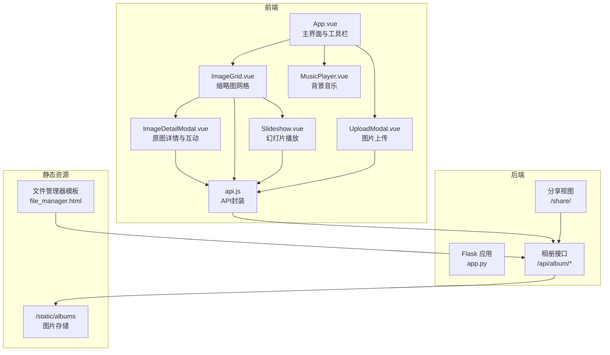
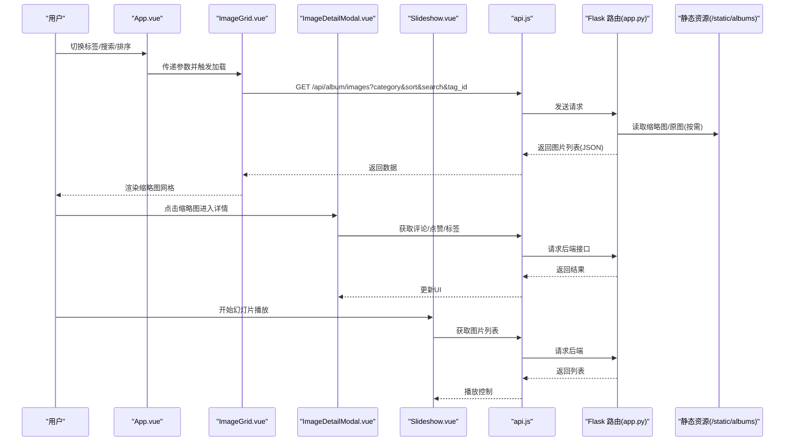
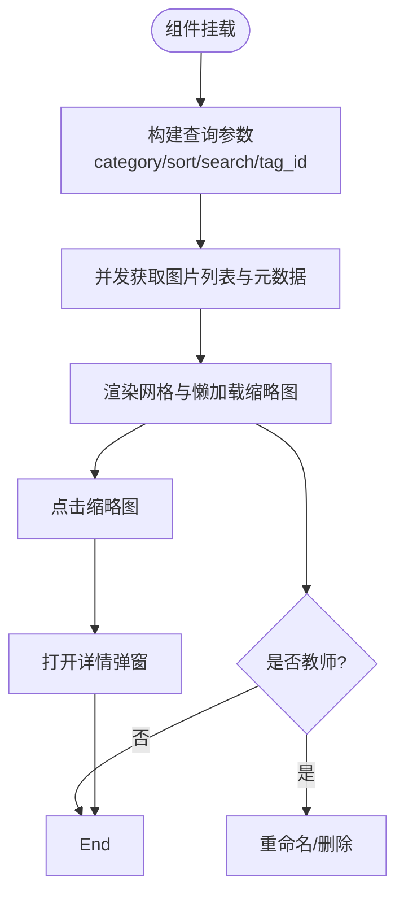
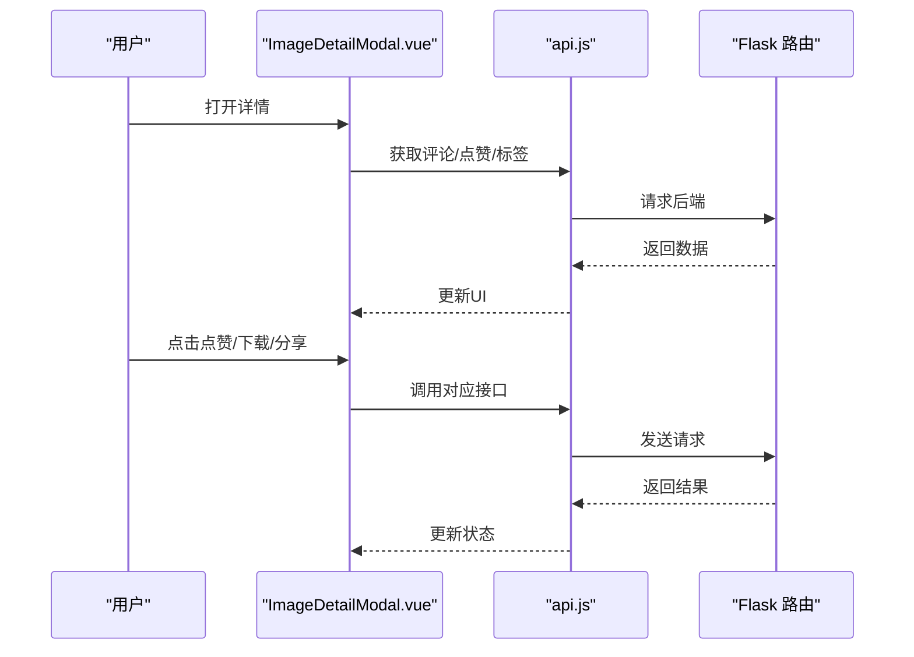
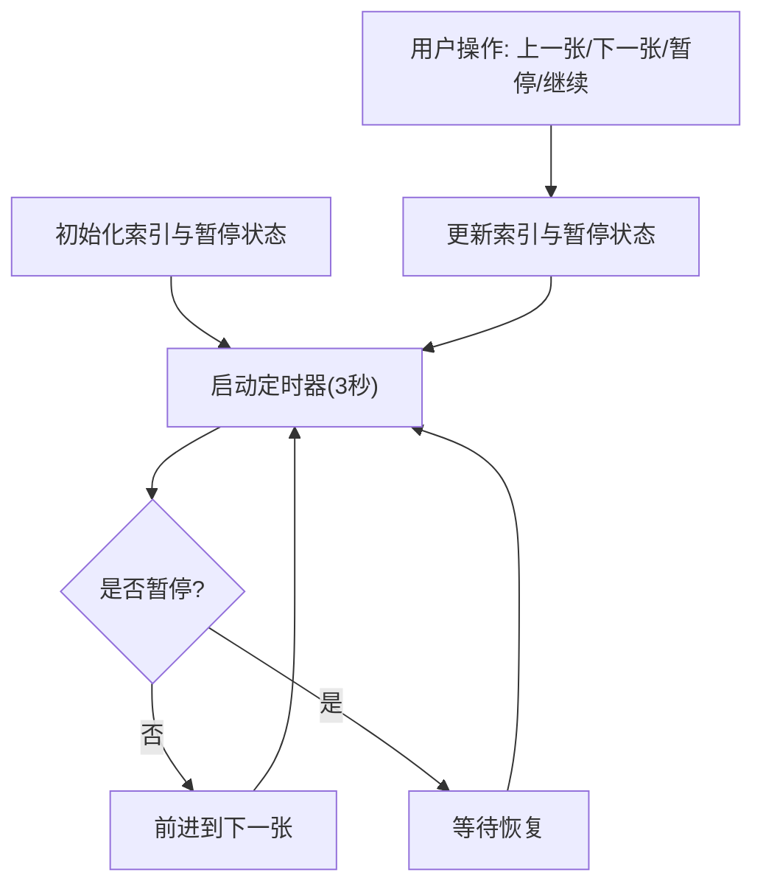
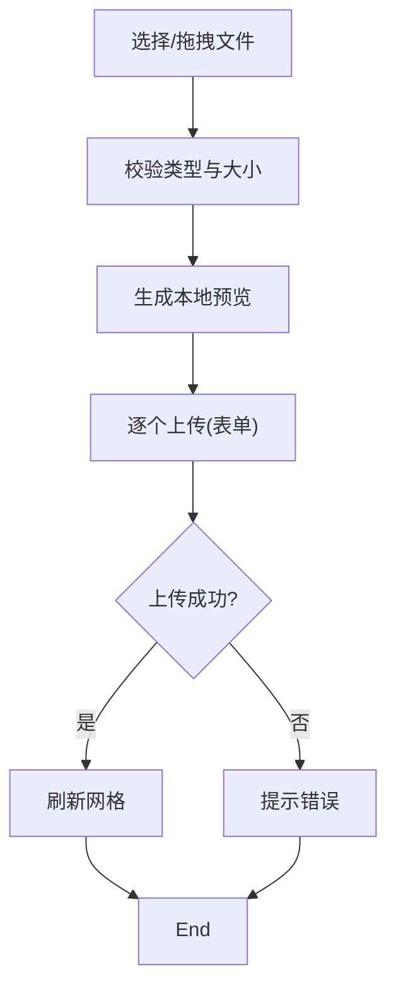
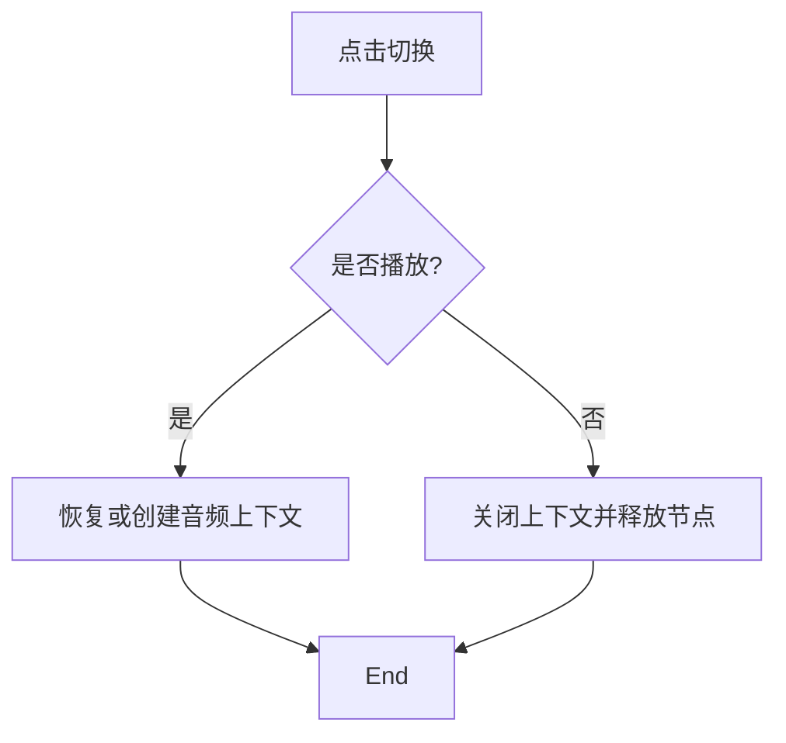
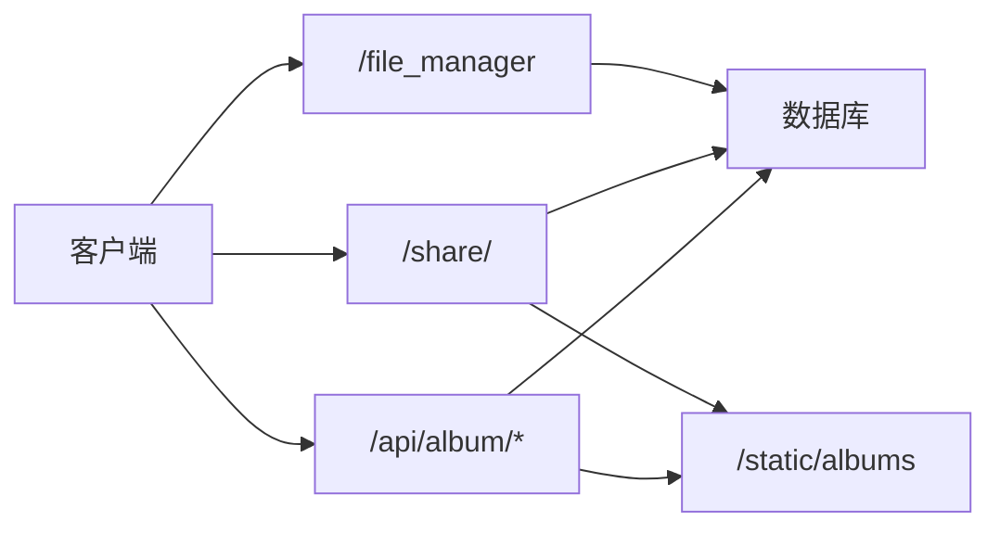
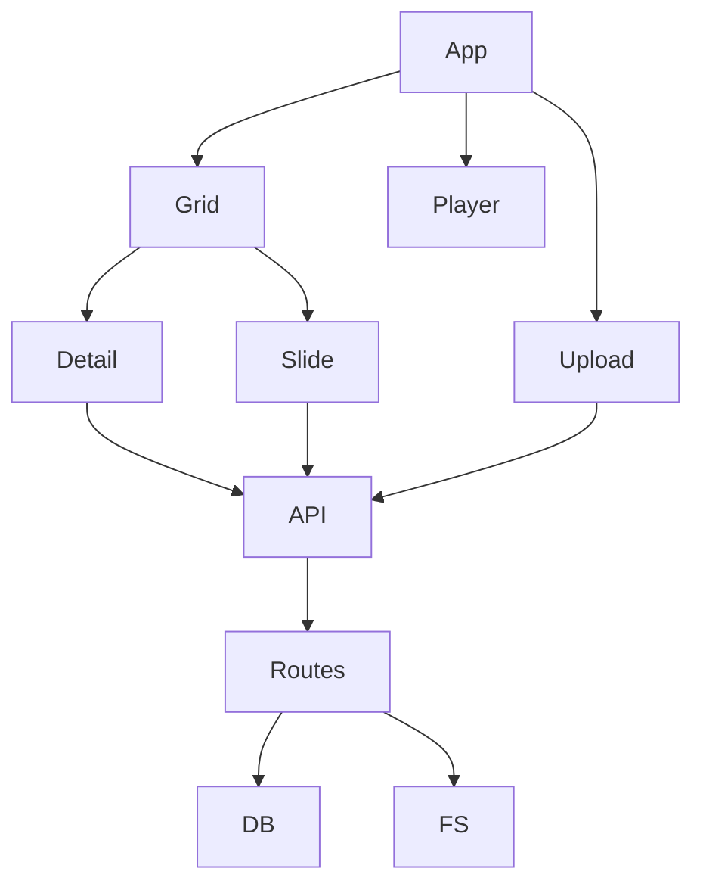

# 文件预览功能

<cite>
**本文引用的文件**
- [frontend/src/components/ImageGrid.vue](file://frontend/src/components/ImageGrid.vue)
- [frontend/src/components/ImageDetailModal.vue](file://frontend/src/components/ImageDetailModal.vue)
- [frontend/src/components/Slideshow.vue](file://frontend/src/components/Slideshow.vue)
- [frontend/src/components/UploadModal.vue](file://frontend/src/components/UploadModal.vue)
- [frontend/src/components/MusicPlayer.vue](file://frontend/src/components/MusicPlayer.vue)
- [frontend/src/api.js](file://frontend/src/api.js)
- [frontend/src/App.vue](file://frontend/src/App.vue)
- [templates/file_manager.html](file://templates/file_manager.html)
- [app.py](file://app.py)
</cite>

## 目录
1. [简介](#简介)
2. [项目结构](#项目结构)
3. [核心组件](#核心组件)
4. [架构总览](#架构总览)
5. [详细组件分析](#详细组件分析)
6. [依赖关系分析](#依赖关系分析)
7. [性能考量](#性能考量)
8. [故障排查指南](#故障排查指南)
9. [结论](#结论)
10. [附录](#附录)

## 简介
本文件预览功能文档聚焦于图片文件的浏览与交互体验，涵盖缩略图展示、原图查看、下载与分享、幻灯片播放、上传与标签管理等能力。当前代码库主要实现了图片相册的前端展示与后端接口，支持图片上传、点赞、评论、分享链接生成与访问、以及简单的统计信息。对于文档类（PDF、Word、Excel）与多媒体（音频、视频）的在线预览，当前仓库未提供直接实现；本文在“概念性概述”部分给出通用实现建议与最佳实践。

## 项目结构
前端采用 Vue 3 单页应用，后端基于 Flask 提供 REST 接口。文件预览相关的核心模块如下：
- 前端组件：图片网格、详情弹窗、幻灯片、上传弹窗、音乐播放器
- API 封装：统一的 /api/album 前缀接口
- 后端路由：图片列表、上传、点赞、评论、下载、分享、统计等
- 模板：文件管理器页面用于通用文件下载入口

**图表来源**
- [frontend/src/App.vue:1-99](file://frontend/src/App.vue#L1-L99)
- [frontend/src/components/ImageGrid.vue:1-129](file://frontend/src/components/ImageGrid.vue#L1-L129)
- [frontend/src/components/ImageDetailModal.vue:1-232](file://frontend/src/components/ImageDetailModal.vue#L1-L232)
- [frontend/src/components/Slideshow.vue:1-66](file://frontend/src/components/Slideshow.vue#L1-L66)
- [frontend/src/components/UploadModal.vue:1-116](file://frontend/src/components/UploadModal.vue#L1-L116)
- [frontend/src/components/MusicPlayer.vue:1-132](file://frontend/src/components/MusicPlayer.vue#L1-L132)
- [frontend/src/api.js:1-45](file://frontend/src/api.js#L1-L45)
- [app.py:2536-2959](file://app.py#L2536-L2959)
- [templates/file_manager.html:1-60](file://templates/file_manager.html#L1-L60)

**章节来源**
- [frontend/src/App.vue:1-99](file://frontend/src/App.vue#L1-L99)
- [frontend/src/components/ImageGrid.vue:1-129](file://frontend/src/components/ImageGrid.vue#L1-L129)
- [frontend/src/components/ImageDetailModal.vue:1-232](file://frontend/src/components/ImageDetailModal.vue#L1-L232)
- [frontend/src/components/Slideshow.vue:1-66](file://frontend/src/components/Slideshow.vue#L1-L66)
- [frontend/src/components/UploadModal.vue:1-116](file://frontend/src/components/UploadModal.vue#L1-L116)
- [frontend/src/components/MusicPlayer.vue:1-132](file://frontend/src/components/MusicPlayer.vue#L1-L132)
- [frontend/src/api.js:1-45](file://frontend/src/api.js#L1-L45)
- [app.py:2536-2959](file://app.py#L2536-L2959)
- [templates/file_manager.html:1-60](file://templates/file_manager.html#L1-L60)

## 核心组件
- 图片网格组件：负责加载与展示缩略图，支持搜索、排序与标签过滤，点击进入详情。
- 详情弹窗组件：展示原图、点赞、评论、下载、分享、标签编辑等。
- 幻灯片组件：在全屏覆盖层中循环播放图片，支持暂停/继续与上一张/下一张。
- 上传弹窗：支持多选图片、拖拽上传、预览与批量命名，提交至后端。
- API 封装：统一封装 /api/album 前缀的请求，便于组件调用。
- 后端接口：提供图片列表、上传、点赞、评论、下载、分享、统计等接口。
- 文件管理器模板：提供通用文件下载入口，适用于非图片文件的下载场景。

**章节来源**
- [frontend/src/components/ImageGrid.vue:1-129](file://frontend/src/components/ImageGrid.vue#L1-L129)
- [frontend/src/components/ImageDetailModal.vue:1-232](file://frontend/src/components/ImageDetailModal.vue#L1-L232)
- [frontend/src/components/Slideshow.vue:1-66](file://frontend/src/components/Slideshow.vue#L1-L66)
- [frontend/src/components/UploadModal.vue:1-116](file://frontend/src/components/UploadModal.vue#L1-L116)
- [frontend/src/api.js:1-45](file://frontend/src/api.js#L1-L45)
- [app.py:2536-2959](file://app.py#L2536-L2959)
- [templates/file_manager.html:1-60](file://templates/file_manager.html#L1-L60)

## 架构总览
前端通过 api.js 统一调用 /api/album 下的各接口，后端 Flask 路由处理请求并访问数据库与静态资源目录。分享链接通过独立的 /share/<token> 视图渲染原图与基本信息。

**图表来源**
- [frontend/src/App.vue:20-45](file://frontend/src/App.vue#L20-L45)
- [frontend/src/components/ImageGrid.vue:55-106](file://frontend/src/components/ImageGrid.vue#L55-L106)
- [frontend/src/components/ImageDetailModal.vue:144-170](file://frontend/src/components/ImageDetailModal.vue#L144-L170)
- [frontend/src/components/Slideshow.vue:34-43](file://frontend/src/components/Slideshow.vue#L34-L43)
- [frontend/src/api.js:8-18](file://frontend/src/api.js#L8-L18)
- [app.py:2536-2576](file://app.py#L2536-L2576)

## 详细组件分析

### 图片网格组件（ImageGrid）
职责与行为
- 加载图片列表：根据分类、排序、搜索关键词与标签过滤条件请求后端。
- 渲染缩略图：懒加载图片，点击缩略图打开详情弹窗。
- 教师权限：支持重命名与删除图片（带二次确认）。
- 预加载元数据：同时并发请求每张图片的评论数与点赞数，提升首屏体验。

**图表来源**
- [frontend/src/components/ImageGrid.vue:55-106](file://frontend/src/components/ImageGrid.vue#L55-L106)

**章节来源**
- [frontend/src/components/ImageGrid.vue:1-129](file://frontend/src/components/ImageGrid.vue#L1-L129)
- [frontend/src/api.js:8-12](file://frontend/src/api.js#L8-L12)
- [app.py:2536-2576](file://app.py#L2536-L2576)

### 图片详情弹窗（ImageDetailModal）
职责与行为
- 展示原图与上传信息。
- 互动功能：点赞、下载、分享、评论区、标签编辑。
- 弹幕组件集成（占位）。
- 自动保存标签变更，刷新父组件。

**图表来源**
- [frontend/src/components/ImageDetailModal.vue:144-170](file://frontend/src/components/ImageDetailModal.vue#L144-L170)
- [frontend/src/api.js:13-31](file://frontend/src/api.js#L13-L31)
- [app.py:2812-2882](file://app.py#L2812-L2882)

**章节来源**
- [frontend/src/components/ImageDetailModal.vue:1-232](file://frontend/src/components/ImageDetailModal.vue#L1-L232)
- [frontend/src/api.js:13-31](file://frontend/src/api.js#L13-L31)
- [app.py:2812-2882](file://app.py#L2812-L2882)

### 幻灯片播放（Slideshow）
职责与行为
- 在覆盖层中以全屏方式展示图片。
- 支持上一张/下一张、暂停/继续、定时轮播。
- 关闭时清理定时器，避免内存泄漏。

**图表来源**
- [frontend/src/components/Slideshow.vue:34-43](file://frontend/src/components/Slideshow.vue#L34-L43)

**章节来源**
- [frontend/src/components/Slideshow.vue:1-66](file://frontend/src/components/Slideshow.vue#L1-L66)

### 图片上传（UploadModal）
职责与行为
- 支持多选与拖拽上传，本地预览缩略图。
- 限制文件类型与大小，批量命名。
- 逐个提交至后端，完成后回调父组件刷新列表。

**图表来源**
- [frontend/src/components/UploadModal.vue:61-99](file://frontend/src/components/UploadModal.vue#L61-L99)
- [frontend/src/api.js](file://frontend/src/api.js#L33)
- [app.py:2733-2810](file://app.py#L2733-L2810)

**章节来源**
- [frontend/src/components/UploadModal.vue:1-116](file://frontend/src/components/UploadModal.vue#L1-L116)
- [frontend/src/api.js](file://frontend/src/api.js#L33)
- [app.py:2733-2810](file://app.py#L2733-L2810)

### 音乐播放器（MusicPlayer）
职责与行为
- 使用 Web Audio API 生成环境音（多层正弦波叠加与缓慢调制）。
- 支持开关与卸载时关闭音频上下文，释放资源。

**图表来源**
- [frontend/src/components/MusicPlayer.vue:99-118](file://frontend/src/components/MusicPlayer.vue#L99-L118)

**章节来源**
- [frontend/src/components/MusicPlayer.vue:1-132](file://frontend/src/components/MusicPlayer.vue#L1-L132)

### 后端接口与静态资源
- 相册接口：图片列表、上传、点赞、评论、下载、分享、统计、审核等。
- 分享视图：通过 token 访问独立页面，展示原图与基本信息。
- 文件管理器：提供通用文件下载入口，适用于非图片文件。

**图表来源**
- [app.py:2536-2959](file://app.py#L2536-L2959)
- [templates/file_manager.html:1-60](file://templates/file_manager.html#L1-L60)

**章节来源**
- [app.py:2536-2959](file://app.py#L2536-L2959)
- [templates/file_manager.html:1-60](file://templates/file_manager.html#L1-L60)

## 依赖关系分析
- 组件耦合
  - App.vue 作为根容器，协调工具栏、网格、上传与音乐播放器。
  - ImageGrid.vue 与 ImageDetailModal.vue 通过 props 与事件进行数据与控制流传递。
  - Slideshow.vue 与 ImageGrid.vue 解耦，通过外部传入图片数组与起始索引。
- 数据流
  - 前端通过 api.js 统一调用后端接口，后端路由处理业务逻辑并访问数据库与静态资源。
- 外部依赖
  - Web Audio API（音乐播放器）
  - Flask（后端框架）
  - MySQL（数据库）

**图表来源**
- [frontend/src/App.vue:47-60](file://frontend/src/App.vue#L47-L60)
- [frontend/src/components/ImageGrid.vue:43-45](file://frontend/src/components/ImageGrid.vue#L43-L45)
- [frontend/src/components/Slideshow.vue:22-23](file://frontend/src/components/Slideshow.vue#L22-L23)
- [frontend/src/api.js:1-5](file://frontend/src/api.js#L1-L5)
- [app.py:2536-2576](file://app.py#L2536-L2576)

**章节来源**
- [frontend/src/App.vue:47-60](file://frontend/src/App.vue#L47-L60)
- [frontend/src/components/ImageGrid.vue:43-45](file://frontend/src/components/ImageGrid.vue#L43-L45)
- [frontend/src/components/Slideshow.vue:22-23](file://frontend/src/components/Slideshow.vue#L22-L23)
- [frontend/src/api.js:1-5](file://frontend/src/api.js#L1-L5)
- [app.py:2536-2576](file://app.py#L2536-L2576)

## 性能考量
- 首屏加载
  - 图片网格使用懒加载属性，减少初始渲染压力。
  - 并发请求图片的评论数与点赞数，缩短等待时间。
- 交互响应
  - 幻灯片播放使用定时器，暂停时清理定时器，避免后台消耗。
  - 音乐播放器在关闭时释放音频上下文与节点，防止资源泄露。
- 上传优化
  - 本地预览与逐个上传，避免阻塞 UI。
  - 限制文件类型与大小，降低后端压力。
- 缓存与离线
  - 当前未实现专用预览缓存；可考虑在浏览器端对缩略图与原图进行缓存策略（如 Cache-Control、Service Worker），并结合后端 ETag/Last-Modified 实现条件请求。
- 大文件处理
  - 当前未提供分页或流式加载；可引入虚拟滚动、分页加载、或基于 Range 的分块传输（需后端配合）。

[本节为通用性能建议，不直接分析具体文件]

## 故障排查指南
- 图片无法显示
  - 检查静态资源路径与权限，确认 /static/albums 目录存在且可读。
  - 确认后端路由返回的图片列表与文件名一致。
- 上传失败
  - 检查文件类型与大小限制，确认前端与后端一致。
  - 查看后端日志与返回的错误信息。
- 点赞/评论异常
  - 确认用户登录状态与会话有效。
  - 检查数据库连接与相关表是否存在。
- 分享链接无效
  - 确认分享 token 是否存在且未过期。
  - 检查分享视图路由与数据库查询结果。

**章节来源**
- [app.py:2733-2810](file://app.py#L2733-L2810)
- [app.py:2812-2882](file://app.py#L2812-L2882)
- [app.py:2884-2959](file://app.py#L2884-L2959)

## 结论
当前代码库提供了完善的图片相册浏览与交互能力：缩略图网格、原图详情、下载与分享、幻灯片播放、上传与标签管理，并通过统一的 API 封装与后端接口支撑。对于文档与多媒体的在线预览，当前仓库未提供直接实现，可在现有架构基础上扩展相应组件与后端接口，遵循本文提供的概念性建议与最佳实践。

## 附录

### 概念性概述：文档与多媒体预览
- 文档预览
  - PDF：可使用浏览器内置 PDF 查看器或第三方库（如 pdf.js）实现在线预览。
  - Word/Excel：可采用 Office Online Viewer 或服务端转换为图片/HTML 后再展示。
- 音频/视频
  - 浏览器兼容性：优先使用 <audio>/<video> 标签，注意不同格式支持差异（如 MP3、AAC、OGG、WebM）。
  - 自适应码率：结合 HLS/DASH（需服务端支持）实现自适应播放。
- 文本文件高亮
  - 使用语法高亮库（如 highlight.js）对代码片段进行着色。
  - 行号显示：通过 CSS 或库自带功能实现。
  - 搜索功能：在 DOM 中进行范围查找与高亮，或在服务端进行全文检索。
- 大文件优化
  - 流式加载：使用 ReadableStream 或服务端分块传输。
  - 分页显示：按页加载与渲染，避免一次性加载全部内容。
- 预览缓存与性能
  - 前端缓存：利用浏览器缓存与 Service Worker。
  - 后端缓存：Redis/Memcached 存储热点数据与中间结果。
  - CDN：静态资源与缩略图通过 CDN 加速。

[本节为概念性内容，不直接分析具体文件]