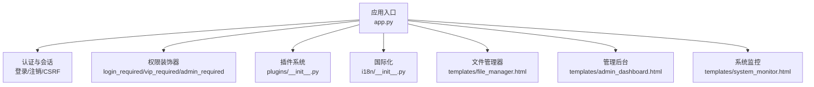
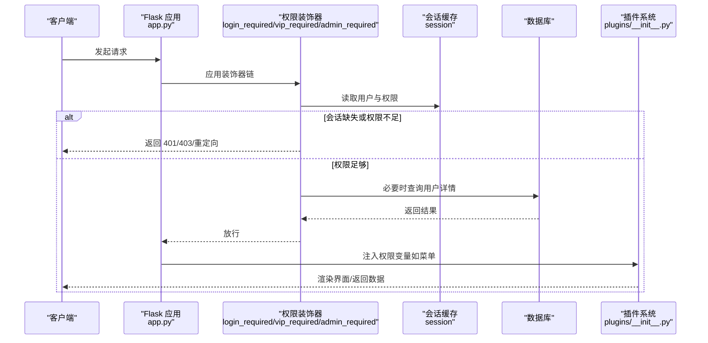
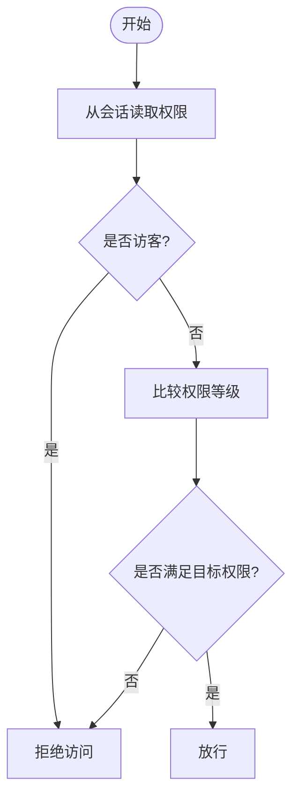
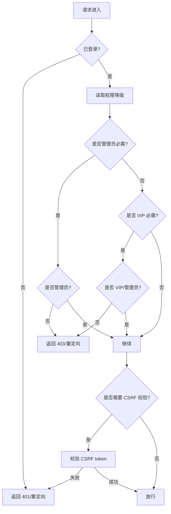
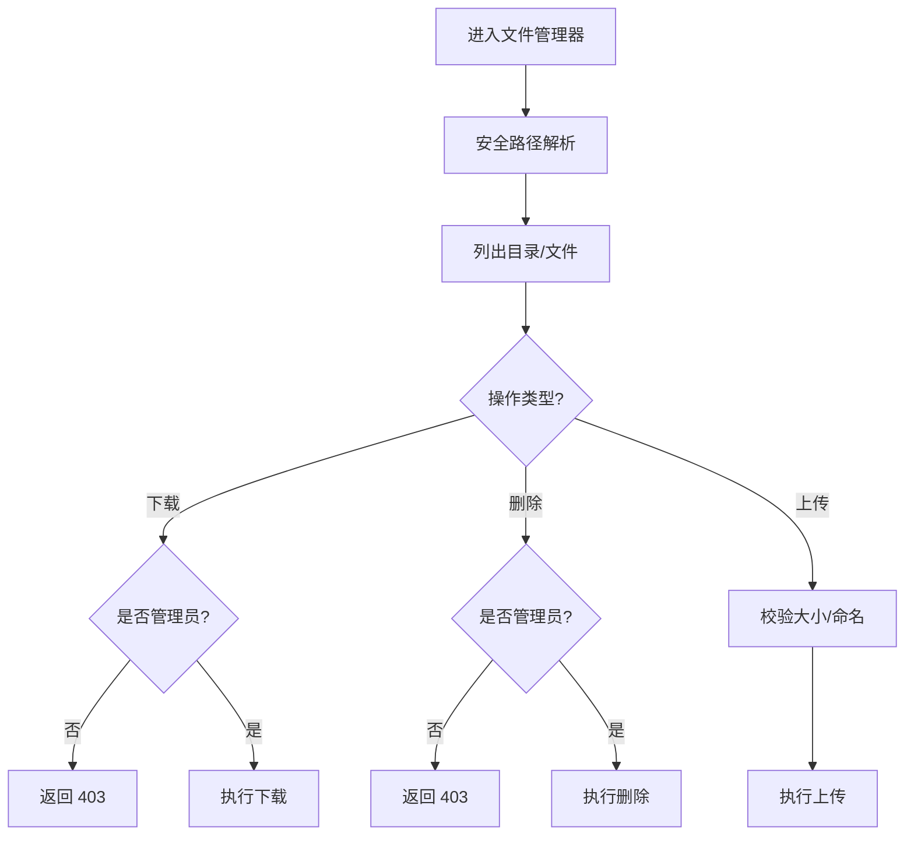
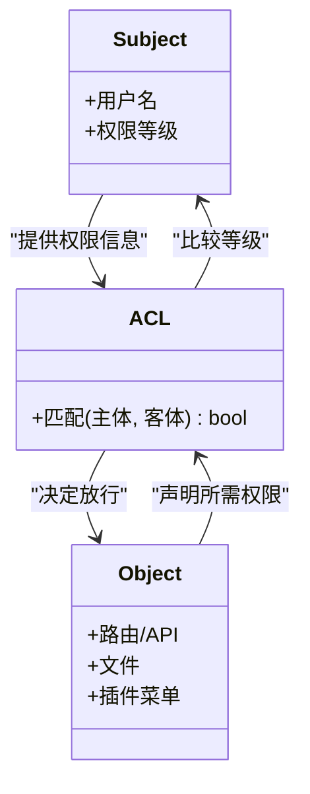
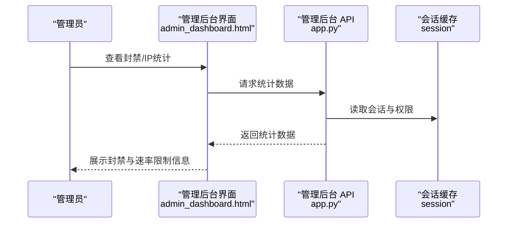
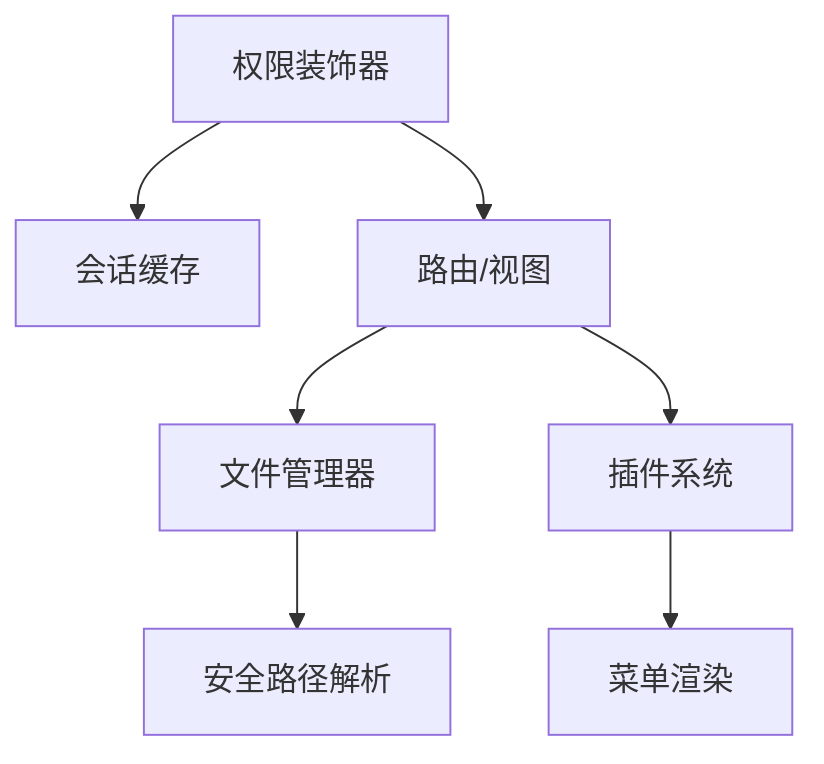

# 权限控制系统

<cite>
**本文引用的文件**
- [app.py](file://app.py)
- [plugins/__init__.py](file://plugins/__init__.py)
- [i18n/__init__.py](file://i18n/__init__.py)
- [templates/file_manager.html](file://templates/file_manager.html)
- [templates/admin_dashboard.html](file://templates/admin_dashboard.html)
- [templates/system_monitor.html](file://templates/system_monitor.html)
</cite>

## 目录
1. [简介](#简介)
2. [项目结构](#项目结构)
3. [核心组件](#核心组件)
4. [架构总览](#架构总览)
5. [详细组件分析](#详细组件分析)
6. [依赖分析](#依赖分析)
7. [性能考虑](#性能考虑)
8. [故障排查指南](#故障排查指南)
9. [结论](#结论)
10. [附录](#附录)

## 简介
本文件面向“权限控制系统”的技术文档，围绕用户权限模型、文件权限机制、访问控制列表（ACL）设计、基于用户与基于组的权限控制、权限缓存与变更通知、以及权限验证的性能优化策略进行系统性阐述。文档结合代码库中的实际实现，提供分层次的说明与可视化图示，帮助读者快速理解并正确使用与扩展权限体系。

## 项目结构
权限控制相关的核心代码集中在后端应用入口文件中，同时插件系统与国际化模块也参与权限判定与界面呈现。前端模板用于展示权限相关的界面元素与交互流程。

图表来源
- [app.py:907-988](file://app.py#L907-L988)
- [plugins/__init__.py:153-193](file://plugins/__init__.py#L153-L193)
- [i18n/__init__.py:50-67](file://i18n/__init__.py#L50-L67)
- [templates/file_manager.html:1-60](file://templates/file_manager.html#L1-L60)
- [templates/admin_dashboard.html:575-841](file://templates/admin_dashboard.html#L575-L841)
- [templates/system_monitor.html:30-53](file://templates/system_monitor.html#L30-L53)

章节来源
- [app.py:907-988](file://app.py#L907-L988)
- [plugins/__init__.py:153-193](file://plugins/__init__.py#L153-L193)
- [i18n/__init__.py:50-67](file://i18n/__init__.py#L50-L67)
- [templates/file_manager.html:1-60](file://templates/file_manager.html#L1-L60)
- [templates/admin_dashboard.html:575-841](file://templates/admin_dashboard.html#L575-L841)
- [templates/system_monitor.html:30-53](file://templates/system_monitor.html#L30-L53)

## 核心组件
- 用户权限模型与角色定义
  - 角色等级：访客（guest）、普通用户（user）、VIP（vip）、管理员（administrator）。权限比较采用数值等级映射，便于统一判断。
  - 权限来源：登录时从数据库读取用户权限并写入会话；后续路由通过装饰器读取会话中的权限进行控制。
- 权限装饰器
  - 登录必需：login_required
  - 管理员必需：admin_required
  - 非访客必需：non_guest_required
  - VIP 或管理员必需：vip_required
  - CSRF 防护：csrf_required
  - 数据库二次验证：db_captcha_required
  - 文件管理器二次密码验证：fm_password_required
- 插件系统与菜单权限
  - 插件菜单项注册时携带所需权限级别，运行时根据当前用户权限进行过滤显示。
- 国际化与权限提示
  - 界面文案通过国际化模块加载，配合权限状态渲染不同提示与徽章。
- 文件权限机制
  - 文件管理器路径解析与访问控制：统一的安全路径解析函数限制在允许范围内；下载与删除等敏感操作受管理员权限保护；上传受大小限制与安全命名规则约束。
- 访问控制列表（ACL）设计
  - 主体（Subject）：当前登录用户及其权限等级
  - 客体（Object）：路由、API、文件、插件菜单等
  - 权限矩阵（Permission Matrix）：以装饰器与插件权限配置构成的隐式 ACL，按需匹配主体与客体的访问许可
- 权限缓存与变更通知
  - 会话缓存：权限写入 session，避免重复查询数据库
  - 管理后台通知：封禁与速率限制相关事件记录，便于管理员查看与处理
- 性能优化策略
  - 会话常驻：权限在会话中缓存，减少数据库访问
  - 装饰器前置判断：在路由前快速拒绝无权限请求
  - 速率限制与白名单：降低恶意请求对系统的影响
  - 日志与审计：记录关键行为，辅助定位性能瓶颈与安全问题

章节来源
- [app.py:907-988](file://app.py#L907-L988)
- [app.py:1063-1075](file://app.py#L1063-L1075)
- [plugins/__init__.py:153-193](file://plugins/__init__.py#L153-L193)
- [templates/file_manager.html:1-60](file://templates/file_manager.html#L1-L60)

## 架构总览
下图展示了权限控制在请求生命周期中的作用点与关键交互：

图表来源
- [app.py:907-988](file://app.py#L907-L988)
- [app.py:1063-1075](file://app.py#L1063-L1075)
- [plugins/__init__.py:153-193](file://plugins/__init__.py#L153-L193)

## 详细组件分析

### 用户权限模型与角色定义
- 角色等级映射
  - guest: 0
  - user: 1
  - vip: 2
  - administrator: 3
- 权限比较逻辑
  - 当前用户权限等级 ≥ 目标权限等级时，允许访问
- 权限来源与写入
  - 登录成功后，从数据库读取用户权限并写入 session 的 permission 字段
- 插件菜单权限
  - 插件注册菜单项时声明所需权限，运行时按等级过滤

图表来源
- [plugins/__init__.py:187-193](file://plugins/__init__.py#L187-L193)
- [app.py:1063-1075](file://app.py#L1063-L1075)

章节来源
- [plugins/__init__.py:187-193](file://plugins/__init__.py#L187-L193)
- [app.py:1063-1075](file://app.py#L1063-L1075)

### 权限装饰器与访问控制
- 登录必需：未登录访问受保护路由时，API 返回 401，页面重定向至登录页
- 管理员必需：非管理员访问管理功能时，返回 403 或重定向至仪表盘
- 非访客必需：访客访问受限功能时，提示申请 VIP
- VIP 或管理员必需：API 返回 403，页面提示需要 VIP 或管理员
- CSRF 防护：对非 GET 请求校验 CSRF token
- 数据库二次验证：针对高风险数据库操作，要求二次验证码
- 文件管理器二次密码验证：针对文件管理器操作，要求二次密码确认

图表来源
- [app.py:907-988](file://app.py#L907-L988)

章节来源
- [app.py:907-988](file://app.py#L907-L988)

### 文件权限机制
- 路径解析与越权防护
  - 统一的安全路径解析函数限制访问范围，防止路径穿越
- 下载与删除
  - 下载：仅管理员可直接下载
  - 删除：仅管理员可删除
- 上传
  - 受大小限制与安全命名规则约束
- 文件管理器界面
  - 展示当前目录内容，提供下载入口与导航

图表来源
- [app.py:3767-3871](file://app.py#L3767-L3871)
- [templates/file_manager.html:1-60](file://templates/file_manager.html#L1-L60)

章节来源
- [app.py:3767-3871](file://app.py#L3767-L3871)
- [templates/file_manager.html:1-60](file://templates/file_manager.html#L1-L60)

### 访问控制列表（ACL）设计
- 主体（Subject）
  - 当前用户：用户名、权限等级
- 客体（Object）
  - 路由与 API、文件、插件菜单项
- 权限矩阵（Permission Matrix）
  - 以装饰器与插件权限配置构成的隐式 ACL
  - 运行时根据当前用户权限与目标客体所需权限进行匹配

图表来源
- [plugins/__init__.py:153-193](file://plugins/__init__.py#L153-L193)
- [app.py:907-988](file://app.py#L907-L988)

章节来源
- [plugins/__init__.py:153-193](file://plugins/__init__.py#L153-L193)
- [app.py:907-988](file://app.py#L907-L988)

### 基于用户与基于组的权限控制
- 基于用户
  - 权限直接来源于用户记录中的权限字段，登录后写入会话
- 基于组
  - 代码库未发现显式的“组”表或组成员关系的持久化结构；权限控制以用户维度直接判定
  - 若需引入组权限，建议扩展用户与组的关联表，并在会话中合并用户与组的权限集合，再进行统一等级比较

章节来源
- [app.py:1063-1075](file://app.py#L1063-L1075)

### 权限缓存机制与权限变更通知
- 权限缓存
  - 登录成功后将权限写入 session，后续请求直接从会话读取，避免重复查询数据库
- 权限变更通知
  - 管理后台提供 IP 统计与封禁记录，便于管理员观察与处理异常流量
  - 系统监控页面展示服务器基础信息与负载情况，辅助评估权限控制对系统的影响

图表来源
- [templates/admin_dashboard.html:575-841](file://templates/admin_dashboard.html#L575-L841)
- [app.py:4077-4101](file://app.py#L4077-L4101)

章节来源
- [templates/admin_dashboard.html:575-841](file://templates/admin_dashboard.html#L575-L841)
- [app.py:4077-4101](file://app.py#L4077-L4101)

### 权限验证的性能优化策略
- 会话缓存优先：权限写入 session，路由前装饰器直接读取，减少数据库访问
- 装饰器前置判断：在进入业务逻辑之前快速拒绝无权限请求，缩短响应链路
- 速率限制与白名单：降低恶意请求对系统的影响，提升整体吞吐
- 日志与审计：记录关键行为，便于定位性能瓶颈与安全问题

章节来源
- [app.py:907-988](file://app.py#L907-L988)
- [app.py:4077-4101](file://app.py#L4077-L4101)

## 依赖分析
- 组件耦合
  - 权限装饰器依赖会话缓存；插件系统依赖装饰器提供的权限变量；文件管理器依赖权限装饰器与安全路径解析
- 外部依赖
  - Flask、Pymysql、Werkzeug 安全工具等
- 循环依赖
  - 代码库未见循环导入；装饰器与插件系统通过会话变量解耦

图表来源
- [app.py:907-988](file://app.py#L907-L988)
- [plugins/__init__.py:153-193](file://plugins/__init__.py#L153-L193)
- [app.py:3767-3871](file://app.py#L3767-L3871)

章节来源
- [app.py:907-988](file://app.py#L907-L988)
- [plugins/__init__.py:153-193](file://plugins/__init__.py#L153-L193)
- [app.py:3767-3871](file://app.py#L3767-L3871)

## 性能考虑
- 会话缓存：权限写入 session，避免重复查询数据库
- 装饰器前置：在进入业务逻辑前快速拒绝无权限请求
- 速率限制与白名单：降低恶意请求对系统的影响
- 日志与审计：记录关键行为，辅助定位性能瓶颈与安全问题

## 故障排查指南
- 登录后仍提示未登录
  - 检查会话中是否存在用户名与权限字段；确认装饰器是否正确应用
- 访问受限功能提示权限不足
  - 确认当前用户权限等级是否满足目标功能需求；检查插件菜单权限配置
- 文件管理器无法下载/删除
  - 确认当前用户是否为管理员；检查安全路径解析是否命中允许范围
- 管理后台封禁记录异常
  - 检查速率限制配置与白名单；查看最近封禁记录与封禁延长逻辑

章节来源
- [app.py:907-988](file://app.py#L907-L988)
- [app.py:3767-3871](file://app.py#L3767-L3871)
- [templates/admin_dashboard.html:575-841](file://templates/admin_dashboard.html#L575-L841)

## 结论
本权限控制系统以“会话缓存 + 装饰器前置判断 + 明确的角色等级”为核心，结合插件系统与文件管理器的权限控制，形成了清晰、可扩展的权限模型。通过速率限制、白名单与日志审计，系统在保证安全性的同时兼顾性能与可观测性。若需进一步增强，可在现有基础上引入“组”维度与集中式权限缓存，以支持更复杂的权限场景。

## 附录
- 相关界面
  - 文件管理器界面：展示目录与文件列表、下载入口
  - 管理后台界面：IP 统计、封禁记录、速率配置
  - 系统监控界面：服务器基础信息与负载情况

章节来源
- [templates/file_manager.html:1-60](file://templates/file_manager.html#L1-L60)
- [templates/admin_dashboard.html:575-841](file://templates/admin_dashboard.html#L575-L841)
- [templates/system_monitor.html:30-53](file://templates/system_monitor.html#L30-L53)