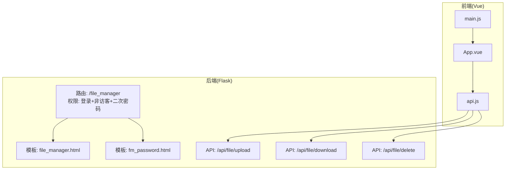
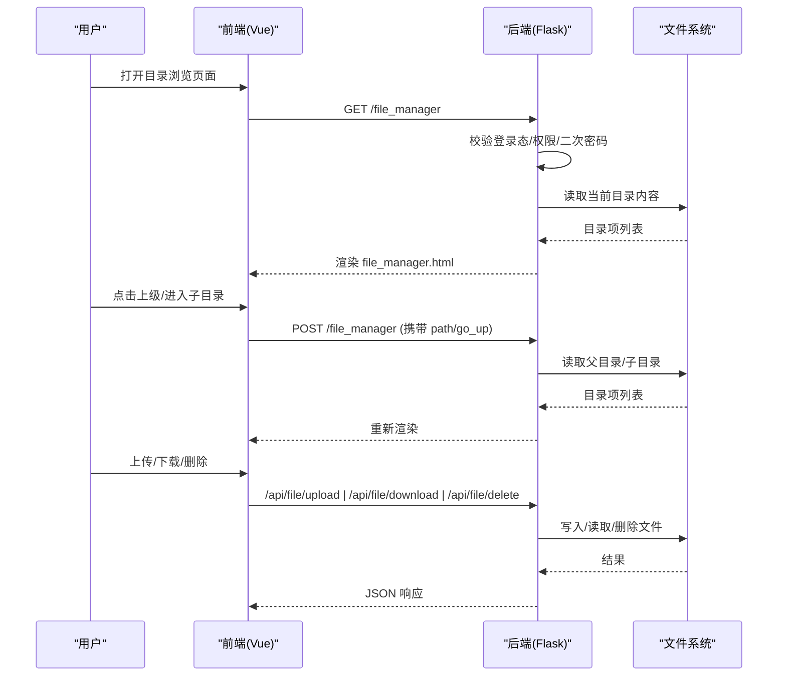
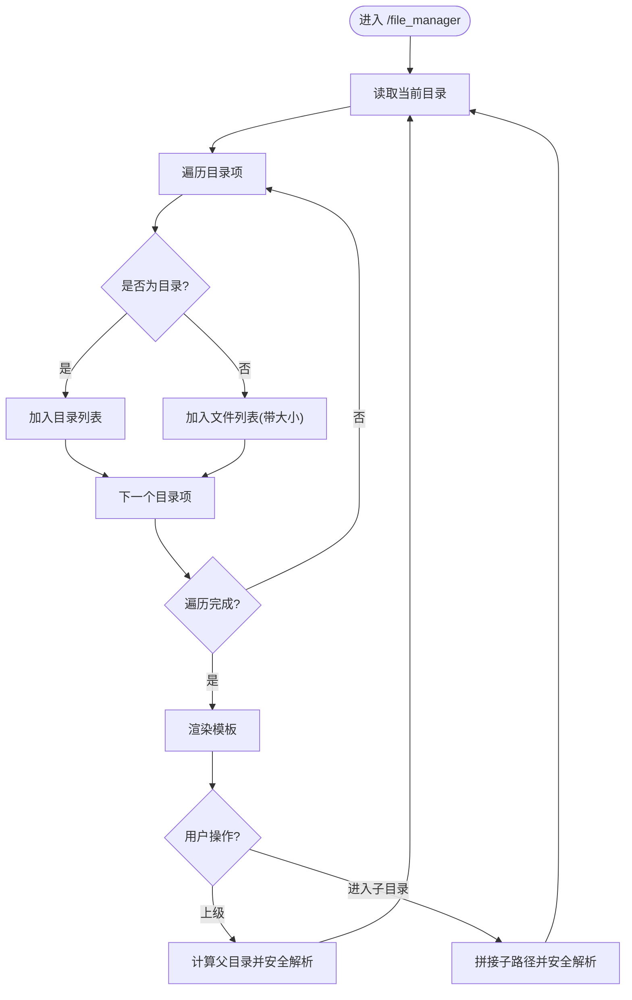
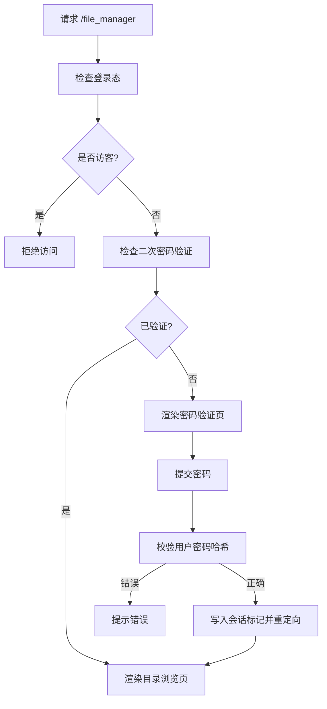
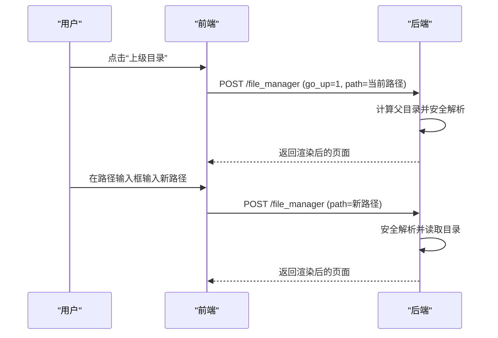
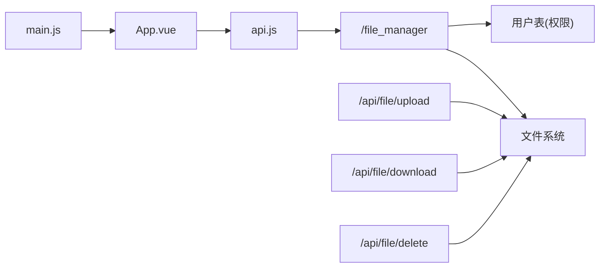

# 目录浏览功能

<cite>
**本文引用的文件**
- [app.py](file://app.py)
- [file_manager.html](file://templates/file_manager.html)
- [fm_password.html](file://templates/fm_password.html)
- [dashboard.html](file://templates/dashboard.html)
- [api.js](file://frontend/src/api.js)
- [App.vue](file://frontend/src/App.vue)
- [main.js](file://frontend/src/main.js)
</cite>

## 目录
1. [简介](#简介)
2. [项目结构](#项目结构)
3. [核心组件](#核心组件)
4. [架构总览](#架构总览)
5. [详细组件分析](#详细组件分析)
6. [依赖分析](#依赖分析)
7. [性能考虑](#性能考虑)
8. [故障排查指南](#故障排查指南)
9. [结论](#结论)

## 简介
本文件面向“目录浏览功能”的技术实现，围绕以下目标进行系统化说明：
- 文件树结构与递归遍历：如何组织目录层级、处理展开/折叠、以及路径跳转。
- 权限检查机制：用户身份验证、角色权限、文件系统访问控制策略。
- 导航控制：面包屑导航、路径跳转、历史记录管理。
- 目录刷新、排序与过滤：刷新策略、排序规则、过滤条件。
- 实时更新：文件系统监控与前端轮询/推送机制。

本项目采用前后端分离模式：后端使用 Python Flask 提供 REST 风格 API 与模板渲染，前端使用 Vue 3 构建交互界面。

## 项目结构
- 后端路由与模板
  - 目录浏览入口：/file_manager（GET/POST）
  - 访问控制：登录态校验、非访客限制、二次密码验证
  - 文件操作：上传、下载、删除（受管理员权限限制）
- 前端界面
  - Vue 应用入口与主组件
  - API 封装与调用
  - 目录浏览页面模板与交互

图表来源
- [app.py:3765-3810](file://app.py#L3765-L3810)
- [file_manager.html:1-60](file://templates/file_manager.html#L1-L60)
- [fm_password.html:1-21](file://templates/fm_password.html#L1-L21)
- [api.js:1-45](file://frontend/src/api.js#L1-L45)
- [main.js:1-6](file://frontend/src/main.js#L1-L6)

章节来源
- [app.py:3765-3810](file://app.py#L3765-L3810)
- [file_manager.html:1-60](file://templates/file_manager.html#L1-L60)
- [fm_password.html:1-21](file://templates/fm_password.html#L1-L21)
- [api.js:1-45](file://frontend/src/api.js#L1-L45)
- [main.js:1-6](file://frontend/src/main.js#L1-L6)

## 核心组件
- 目录浏览路由与模板
  - GET/POST /file_manager：渲染当前目录内容，支持上级目录跳转与路径打开。
  - 模板 file_manager.html：展示目录列表、文件列表、下载入口与空目录提示。
- 二次密码验证
  - fm_password_required：基于用户数据库中的密码哈希进行二次验证，通过后写入会话标记。
- 文件操作 API
  - 上传：/api/file/upload（POST，表单含文件与目标路径）
  - 下载：/api/file/download（GET，参数 path，管理员可见）
  - 删除：/api/file/delete（POST，表单含 path，管理员可见）

章节来源
- [app.py:989-1015](file://app.py#L989-L1015)
- [app.py:3765-3810](file://app.py#L3765-L3810)
- [app.py:3812-3870](file://app.py#L3812-L3870)
- [file_manager.html:1-60](file://templates/file_manager.html#L1-L60)
- [fm_password.html:1-21](file://templates/fm_password.html#L1-L21)

## 架构总览
下图展示了从浏览器到后端再到文件系统的完整流程，包括权限校验、目录遍历与文件操作。

图表来源
- [app.py:3765-3810](file://app.py#L3765-L3810)
- [app.py:3812-3870](file://app.py#L3812-L3870)
- [file_manager.html:1-60](file://templates/file_manager.html#L1-L60)
- [api.js:1-45](file://frontend/src/api.js#L1-L45)

## 详细组件分析

### 目录树结构与递归遍历
- 当前实现方式
  - 后端按需读取当前目录：列出目录项，区分目录与文件，计算文件大小并格式化显示。
  - 前端通过隐藏表单提交路径或点击“上级目录”按钮触发后端重新读取。
  - 未实现前端侧的树形结构缓存与懒加载，每次导航均发起一次后端请求。
- 展开/折叠机制
  - 通过“上级目录”按钮与“进入子目录”按钮实现层级切换，无前端本地展开/折叠状态。
- 路径跳转与安全
  - 使用安全路径解析函数确保路径穿越防护，避免越权访问。
  - 对下载与删除等敏感操作额外进行管理员权限校验。

图表来源
- [app.py:3765-3810](file://app.py#L3765-L3810)

章节来源
- [app.py:3765-3810](file://app.py#L3765-L3810)

### 权限检查机制
- 用户身份与会话
  - 登录成功后写入会话：用户名、权限、CSRF token。
- 角色与访问控制
  - 非访客限制：禁止 guest 访问目录浏览。
  - 二次密码验证：首次访问目录浏览时要求输入用户密码进行二次验证，验证通过后写入会话标记。
  - 文件操作权限：上传/下载/删除接口仅管理员可用。
- 路由装饰器链
  - 登录态校验 → 非访客限制 → 二次密码验证 → 目录浏览视图。

图表来源
- [app.py:989-1015](file://app.py#L989-L1015)
- [app.py:3765-3770](file://app.py#L3765-L3770)
- [fm_password.html:1-21](file://templates/fm_password.html#L1-L21)

章节来源
- [app.py:989-1015](file://app.py#L989-L1015)
- [app.py:3765-3770](file://app.py#L3765-L3770)
- [fm_password.html:1-21](file://templates/fm_password.html#L1-L21)

### 导航控制与历史记录
- 面包屑导航
  - 模板中直接显示当前路径，用户可通过输入框编辑路径并打开，或点击“上级目录”按钮返回上层。
- 路由与历史
  - 前端未实现浏览器历史记录管理（如 pushState/replaceState），每次导航通过表单提交触发页面刷新。
- 与仪表盘集成
  - 仪表盘页面提供“文件管理器”入口，便于统一导航。

图表来源
- [file_manager.html:7-13](file://templates/file_manager.html#L7-L13)
- [app.py:3765-3780](file://app.py#L3765-L3780)

章节来源
- [file_manager.html:7-13](file://templates/file_manager.html#L7-L13)
- [app.py:3765-3780](file://app.py#L3765-L3780)
- [dashboard.html:118-128](file://templates/dashboard.html#L118-L128)

### 目录刷新、排序与过滤
- 刷新
  - 通过点击“上级目录”或提交新的路径实现即时刷新。
- 排序
  - 后端对目录项进行排序后再渲染，前端未提供排序选项。
- 过滤
  - 模板中未提供文件名过滤功能；若需实现，可在前端增加输入框并通过查询参数传递给后端。

章节来源
- [app.py:3780-3798](file://app.py#L3780-L3798)
- [file_manager.html:19-55](file://templates/file_manager.html#L19-L55)

### 文件系统监控与实时更新
- 当前实现
  - 未发现文件系统监控或 WebSocket 实时推送机制。
  - 前端通过定时轮询或手动刷新实现“准实时”效果（本项目未实现）。
- 建议方案
  - 前端定时轮询：每 N 秒请求一次目录内容，比较变更后局部更新。
  - 后端文件系统事件：结合操作系统事件或第三方库监听目录变化，主动推送变更。
  - WebSocket：建立长连接，服务端在文件变更时推送增量更新。

章节来源
- [app.py:3765-3810](file://app.py#L3765-L3810)

## 依赖分析
- 前端依赖
  - Vue 3 应用入口与组件体系，通过 api.js 封装与后端交互。
- 后端依赖
  - Flask 路由与模板渲染，MySQL 数据库用于用户认证与权限存储。
- 关键耦合点
  - 目录浏览与二次密码验证强耦合于用户会话与数据库。
  - 文件操作 API 与管理员权限强耦合。

图表来源
- [main.js:1-6](file://frontend/src/main.js#L1-L6)
- [App.vue:1-99](file://frontend/src/App.vue#L1-L99)
- [api.js:1-45](file://frontend/src/api.js#L1-L45)
- [app.py:3765-3870](file://app.py#L3765-L3870)

章节来源
- [main.js:1-6](file://frontend/src/main.js#L1-L6)
- [App.vue:1-99](file://frontend/src/App.vue#L1-L99)
- [api.js:1-45](file://frontend/src/api.js#L1-L45)
- [app.py:3765-3870](file://app.py#L3765-L3870)

## 性能考虑
- 目录读取
  - 对于大目录，建议后端分页或前端虚拟滚动，避免一次性渲染大量 DOM。
- 文件大小计算
  - 后端已做大小格式化，前端可进一步缓存以减少重复计算。
- 请求频率
  - 为避免频繁请求，可在前端引入防抖与节流策略，减少不必要的刷新。
- 传输优化
  - 下载与上传建议使用分块传输或断点续传（需后端配合）。

## 故障排查指南
- 权限相关
  - 若提示“没有权限访问该目录”，检查当前会话权限与二次密码验证是否通过。
  - 若提示“路径非法”，检查路径穿越防护逻辑与传入路径。
- 文件操作
  - 上传失败：检查文件大小限制、目标路径权限与后端日志。
  - 下载/删除失败：确认管理员权限与文件存在性。
- 前端交互
  - 若页面不刷新或路径不生效，检查表单提交与后端路由映射。

章节来源
- [app.py:3798-3801](file://app.py#L3798-L3801)
- [app.py:3844-3853](file://app.py#L3844-L3853)
- [app.py:3857-3869](file://app.py#L3857-L3869)

## 结论
本项目的目录浏览功能以“按需读取 + 模板渲染”的方式实现，具备基础的权限控制与路径安全防护。当前未内置前端树形结构与实时监控，但通过二次密码验证与管理员权限组合，满足一般场景下的安全需求。后续可引入前端树形缓存、排序/过滤、定时轮询或事件推送等能力，进一步提升用户体验与系统性能。