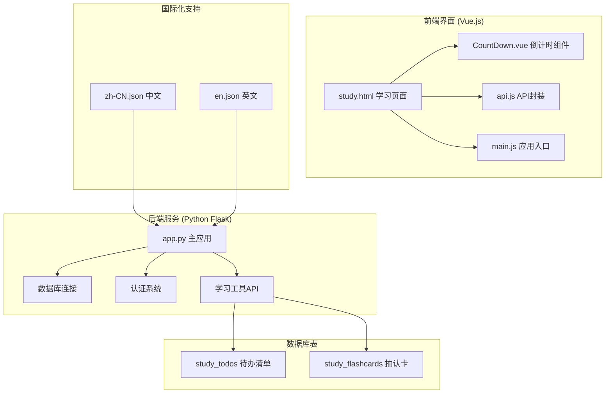
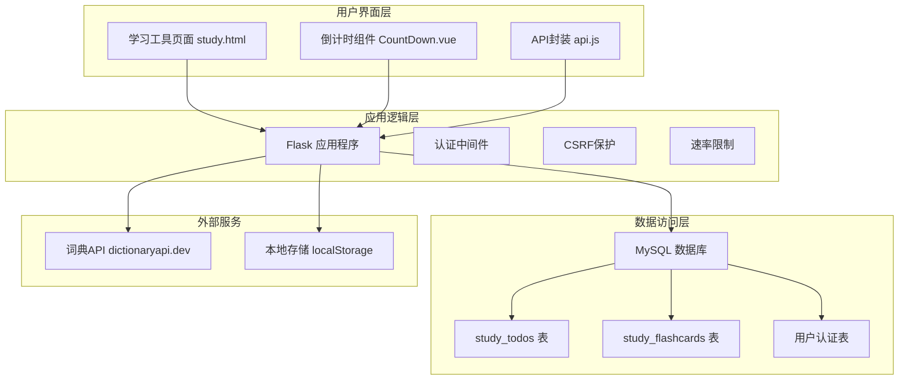
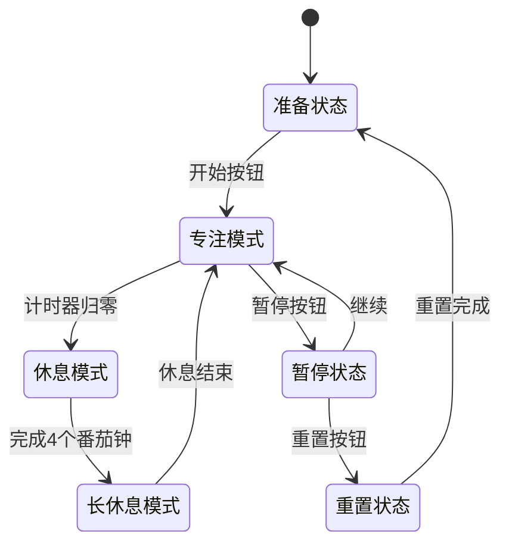
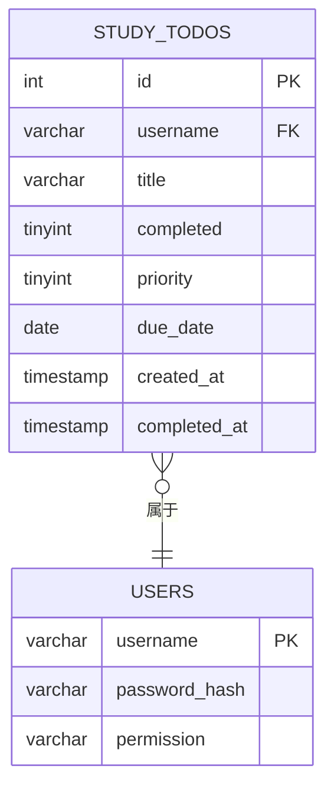
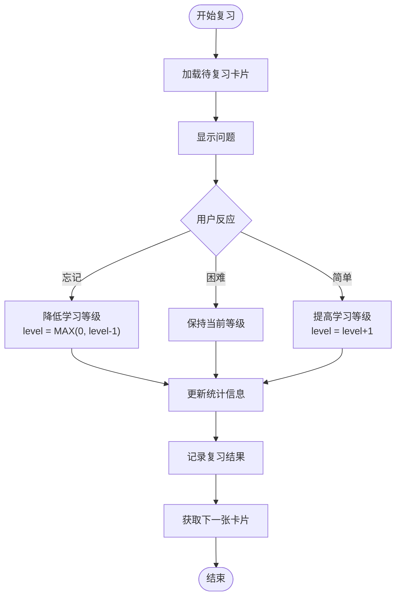
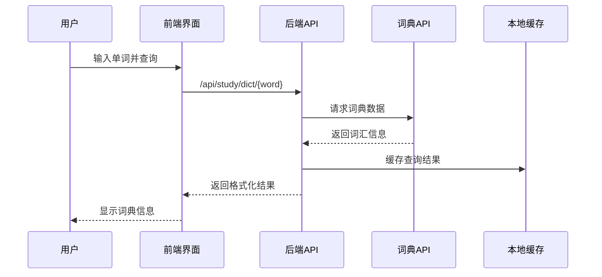
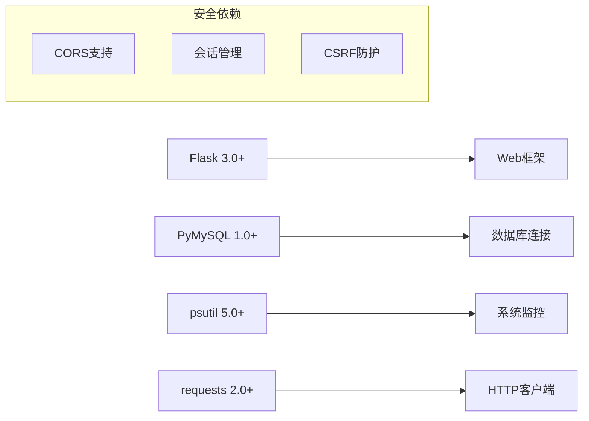
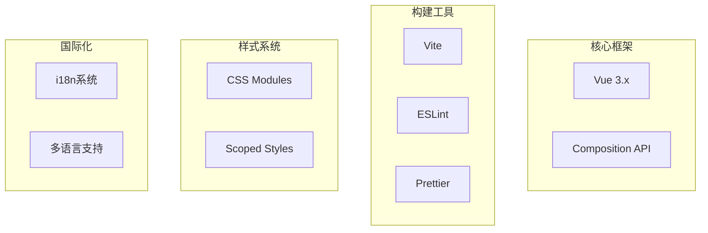

# 学习工具系统

<cite>
**本文档引用的文件**
- [app.py](file://app.py)
- [study.html](file://templates/study.html)
- [zh-CN.json](file://i18n/zh-CN.json)
- [en.json](file://i18n/en.json)
- [CountDown.vue](file://frontend/src/components/CountDown.vue)
- [api.js](file://frontend/src/api.js)
- [main.js](file://frontend/src/main.js)
- [requirements.txt](file://requirements.txt)
</cite>

## 目录
1. [引言](#引言)
2. [项目结构](#项目结构)
3. [核心组件](#核心组件)
4. [架构概览](#架构概览)
5. [详细组件分析](#详细组件分析)
6. [依赖分析](#依赖分析)
7. [性能考虑](#性能考虑)
8. [故障排除指南](#故障排除指南)
9. [结论](#结论)
10. [附录](#附录)

## 引言

学习工具系统是一个集成了多种学习辅助功能的综合性平台，主要包含四个核心模块：番茄工作法计时器、待办清单管理、抽认卡系统和词典查询功能。该系统采用前后端分离架构，后端基于Flask框架，前端使用Vue.js技术栈，数据库采用MySQL。

系统的设计理念是通过科学的时间管理和记忆算法来提升学习效率，同时提供直观的用户界面和个性化的学习体验。通过番茄工作法的专注-休息循环机制，结合间隔重复的记忆算法，帮助用户建立高效的学习习惯。

## 项目结构

学习工具系统采用模块化的项目组织方式，主要分为以下几个部分：



**图表来源**
- [app.py:4981-4988](file://app.py#L4981-L4988)
- [study.html:1-50](file://templates/study.html#L1-L50)
- [CountDown.vue:1-20](file://frontend/src/components/CountDown.vue#L1-L20)

**章节来源**
- [app.py:4981-4988](file://app.py#L4981-L4988)
- [study.html:1-50](file://templates/study.html#L1-L50)
- [requirements.txt:1-5](file://requirements.txt#L1-L5)

## 核心组件

### 番茄工作法计时器

番茄工作法计时器是系统的核心专注工具，基于经典的25分钟专注-5分钟休息模式，支持4个番茄钟后进行15-30分钟长休息的完整流程。

**技术特性：**
- 实时倒计时显示和进度环动画
- 本地状态持久化，支持断电续播
- 自动学习会话记录和统计
- 多种工作时长模式（25/45分钟）

**状态管理：**
- 运行状态：running（布尔值）
- 模式状态：work/break/longbreak
- 剩余时间：pomoSeconds（秒）
- 任务名称：pomoTaskName
- 统计数据：pomoCount（完成次数）、pomoTotalMin（总分钟数）

### 待办清单管理系统

待办清单提供了完整的任务管理功能，支持优先级排序、截止日期管理和完成状态跟踪。

**数据模型：**
- 标题：title（VARCHAR 200字符）
- 完成状态：completed（布尔值，默认false）
- 优先级：priority（TINYINT，默认0，1表示重要）
- 截止日期：due_date（DATE）
- 创建时间：created_at（TIMESTAMP）
- 完成时间：completed_at（TIMESTAMP）

**排序规则：**
1. 未完成任务优先于已完成任务
2. 重要任务优先于普通任务
3. 截止日期早的任务优先
4. 创建时间晚的任务优先

### 抽认卡系统

抽认卡系统实现了基于间隔重复算法的智能记忆系统，通过用户的回忆难度反馈来调整复习频率。

**记忆算法：**
- 学习等级：level（TINYINT，0=新卡，1=学习中，2=已掌握）
- 复习次数：reviewed_count（INT，默认0）
- 最后复习时间：last_reviewed（TIMESTAMP）
- 随机模式：支持随机顺序复习

**复习反馈：**
- 忘记：level减少，reset为0
- 困难：level保持不变
- 简单：level增加1

### 词典查询功能

集成了外部词典API，提供英语单词的发音、词性和释义查询服务。

**功能特性：**
- 实时词典查询（https://api.dictionaryapi.dev）
- 发音标注显示
- 词性分类展示
- 例句示例
- 错误处理和用户提示

**章节来源**
- [study.html:347-460](file://templates/study.html#L347-L460)
- [study.html:462-496](file://templates/study.html#L462-L496)
- [study.html:498-530](file://templates/study.html#L498-L530)
- [study.html:540-571](file://templates/study.html#L540-L571)

## 架构概览

系统采用前后端分离的三层架构设计，确保了良好的可维护性和扩展性。



**图表来源**
- [app.py:4981-4988](file://app.py#L4981-L4988)
- [study.html:1-50](file://templates/study.html#L1-L50)
- [CountDown.vue:1-20](file://frontend/src/components/CountDown.vue#L1-L20)

**章节来源**
- [app.py:907-963](file://app.py#L907-L963)
- [app.py:837-866](file://app.py#L837-L866)

## 详细组件分析

### 番茄工作法计时器实现

#### 状态管理机制



**图表来源**
- [study.html:377-418](file://templates/study.html#L377-L418)

#### 进度环动画实现

计时器使用SVG圆形进度条来直观显示剩余时间，通过CSS变换实现流畅的动画效果：

- 圆形半径：100px
- 周长计算：C = 2πr = 628px
- 进度计算：pct = 1 - (剩余时间/总时间)
- 路径偏移：stroke-dashoffset = C × pct

#### 本地状态持久化

系统使用localStorage实现状态的跨会话持久化：

```javascript
const POMO_KEY = 'pomo_state';
localStorage.setItem(POMO_KEY, JSON.stringify({
    seconds: pomoSeconds,
    running: pomoRunning,
    mode: pomoMode,
    count: pomoCount,
    totalMin: pomoTotalMin,
    task: pomoTaskName,
    workDur: workDuration,
    savedAt: Date.now()
}));
```

**章节来源**
- [study.html:347-460](file://templates/study.html#L347-L460)

### 待办清单管理系统

#### 数据模型设计

待办清单采用标准化的关系型数据模型，支持复杂的状态管理和排序需求：



**图表来源**
- [app.py:837-847](file://app.py#L837-L847)

#### 排序算法实现

系统实现了多维度的智能排序算法：

1. **完成状态优先**：未完成任务始终排在已完成任务之前
2. **优先级排序**：重要任务优先于普通任务
3. **时间敏感性**：截止日期临近的任务优先
4. **新鲜度**：最新的任务优先

排序SQL查询：
```sql
SELECT id, title, completed, priority, due_date, created_at
FROM study_todos 
WHERE username=%s
ORDER BY completed ASC, priority DESC, due_date ASC, created_at DESC
```

#### 完成状态跟踪

系统提供完整的任务生命周期跟踪：

- 创建时间：记录任务创建的具体时刻
- 完成时间：当任务标记为完成时自动记录
- 状态切换：支持在完成和未完成状态间双向切换

**章节来源**
- [app.py:4991-5010](file://app.py#L4991-L5010)
- [app.py:5051-5067](file://app.py#L5051-L5067)

### 抽认卡系统

#### 记忆算法实现

抽认卡系统采用基于间隔重复的智能复习算法，通过用户的回忆表现来动态调整复习计划：



**图表来源**
- [app.py:5134-5153](file://app.py#L5134-L5153)

#### 复习策略

系统提供两种复习模式：

1. **线性复习**：按学习等级和最后复习时间排序
   - 优先复习等级较低的卡片
   - 优先复习长时间未复习的卡片

2. **随机复习**：完全随机选择卡片
   - 适用于巩固记忆
   - 避免复习模式的局限性

#### 学习进度统计

系统提供多维度的学习进度统计：

- 已掌握卡片：level ≥ 2
- 学习中卡片：level = 1  
- 新卡片：level = 0
- 复习次数：reviewed_count
- 最后复习时间：last_reviewed

**章节来源**
- [app.py:5071-5183](file://app.py#L5071-L5183)

### 词典查询功能

#### API集成架构

系统集成了外部词典API，提供实时的词汇查询服务：



**图表来源**
- [study.html:540-571](file://templates/study.html#L540-L571)

#### 结果展示设计

词典查询结果采用层次化的展示结构：

1. **基础信息**：单词标题和音标
2. **词性分类**：按词性分组显示
3. **定义列表**：每个词性下的多个定义
4. **例句示例**：每个定义配有一个例句

#### 错误处理机制

系统实现了完善的错误处理机制：

- 网络请求失败：显示"请求失败"提示
- 词汇不存在：显示"未找到该单词"提示
- 服务器错误：显示具体的错误信息
- 用户友好提示：使用本地化的错误消息

**章节来源**
- [study.html:540-571](file://templates/study.html#L540-L571)

## 依赖分析

### 后端依赖

系统后端依赖采用最小化原则，确保稳定性和安全性：



**图表来源**
- [requirements.txt:1-5](file://requirements.txt#L1-L5)

### 前端依赖

前端采用现代化的Vue.js生态系统：



**图表来源**
- [main.js:1-6](file://frontend/src/main.js#L1-L6)

**章节来源**
- [requirements.txt:1-5](file://requirements.txt#L1-L5)

## 性能考虑

### 前端性能优化

1. **懒加载策略**：学习工具页面按需加载，减少初始加载时间
2. **组件化设计**：将功能拆分为独立组件，提高代码复用性
3. **虚拟DOM优化**：使用Vue的响应式系统，避免不必要的DOM更新
4. **本地存储**：关键状态存储在localStorage，减少服务器请求

### 后端性能优化

1. **数据库索引**：为常用查询字段建立索引
2. **连接池管理**：合理管理数据库连接，避免连接泄漏
3. **缓存策略**：对热点数据进行缓存
4. **异步处理**：耗时操作采用异步处理

### 网络性能优化

1. **CDN加速**：静态资源通过CDN分发
2. **压缩传输**：启用Gzip压缩
3. **请求合并**：减少HTTP请求次数
4. **缓存控制**：合理设置缓存策略

## 故障排除指南

### 常见问题及解决方案

#### 番茄计时器异常

**问题现象**：计时器停止或显示错误时间
**可能原因**：
- 浏览器标签页后台运行
- 系统休眠导致定时器暂停
- localStorage存储损坏

**解决方法**：
1. 确保浏览器标签页保持前台运行
2. 检查系统电源设置
3. 清除localStorage中的计时器数据

#### 待办清单同步问题

**问题现象**：任务状态不同步或显示异常
**可能原因**：
- 网络连接不稳定
- 数据库连接失败
- CSRF令牌验证失败

**解决方法**：
1. 检查网络连接状态
2. 刷新页面重新加载数据
3. 检查浏览器控制台错误信息

#### 抽认卡复习异常

**问题现象**：复习卡片无法加载或复习结果不生效
**可能原因**：
- 数据库查询超时
- 用户权限不足
- 复习算法异常

**解决方法**：
1. 检查数据库连接状态
2. 确认用户登录状态
3. 查看服务器日志

#### 词典查询失败

**问题现象**：无法获取词汇信息或显示错误
**可能原因**：
- 外部API服务不可用
- 网络连接问题
- 词汇拼写错误

**解决方法**：
1. 检查外部API状态
2. 验证网络连接
3. 确认词汇拼写正确

**章节来源**
- [app.py:907-963](file://app.py#L907-L963)

## 结论

学习工具系统通过科学的时间管理和记忆算法，为用户提供了高效的学习辅助工具。系统采用现代化的技术栈和架构设计，确保了良好的用户体验和系统稳定性。

**主要优势：**
1. **科学性**：基于番茄工作法和间隔重复理论
2. **实用性**：功能完整，满足日常学习需求
3. **可扩展性**：模块化设计便于功能扩展
4. **安全性**：完善的认证和授权机制
5. **国际化**：支持多语言界面

**未来改进方向：**
1. 增加更多学习工具和功能
2. 优化移动端用户体验
3. 加强数据分析和统计功能
4. 提升个性化推荐能力

## 附录

### 使用场景和效率提升技巧

#### 番茄工作法使用技巧
1. **选择合适的任务**：将大任务分解为可管理的小任务
2. **消除干扰**：关闭不必要的应用程序和通知
3. **合理安排休息**：利用休息时间放松大脑
4. **记录学习成果**：每天总结学习收获

#### 待办清单管理最佳实践
1. **优先级管理**：使用重要性和紧急性矩阵
2. **SMART原则**：制定具体、可衡量、可实现的目标
3. **定期回顾**：每周评估和调整任务优先级
4. **奖励机制**：完成重要任务后给自己适当奖励

#### 抽认卡学习策略
1. **及时复习**：按照遗忘曲线规律进行复习
2. **主动回忆**：尽量回忆而不看答案
3. **间隔重复**：逐渐延长复习间隔
4. **质量优先**：关注理解深度而非数量

#### 词典学习方法
1. **词汇积累**：每天学习一定数量的新词汇
2. **语境学习**：通过例句理解词汇用法
3. **多感官学习**：结合视觉、听觉和动手记忆
4. **定期复习**：巩固长期记忆