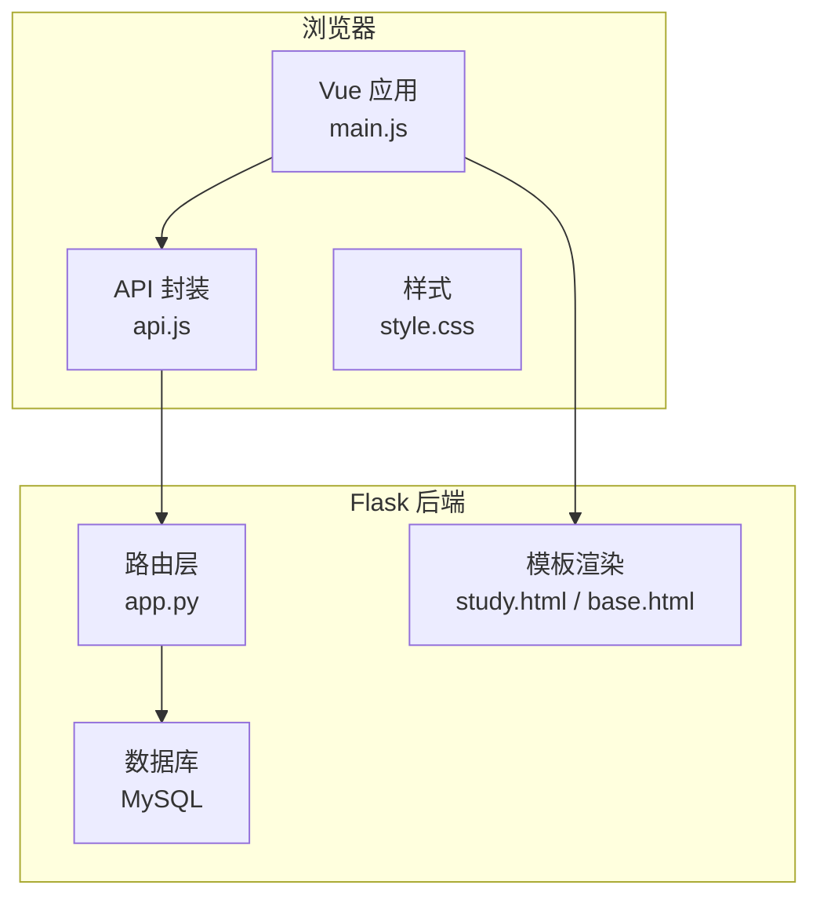
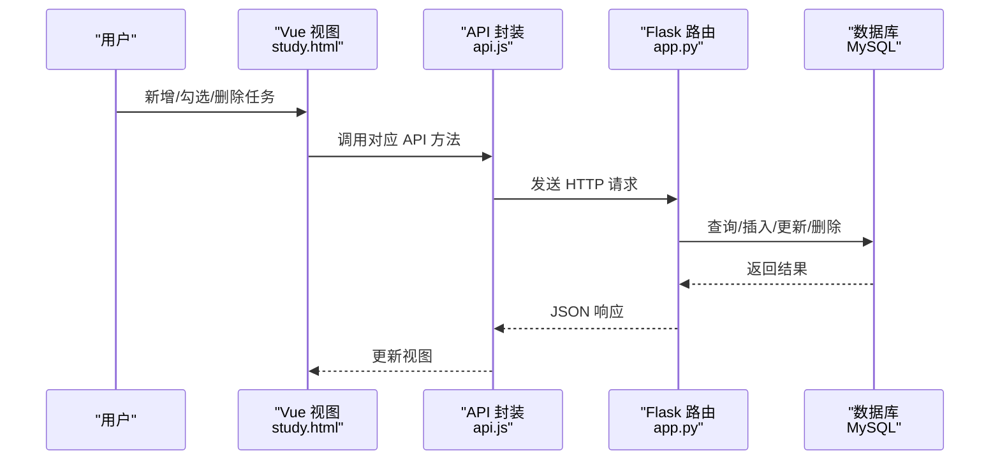
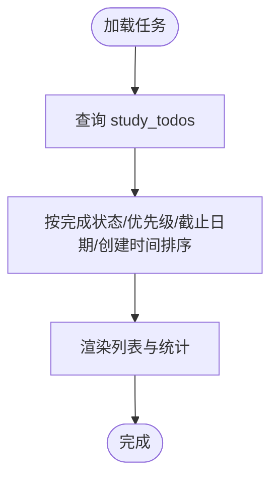
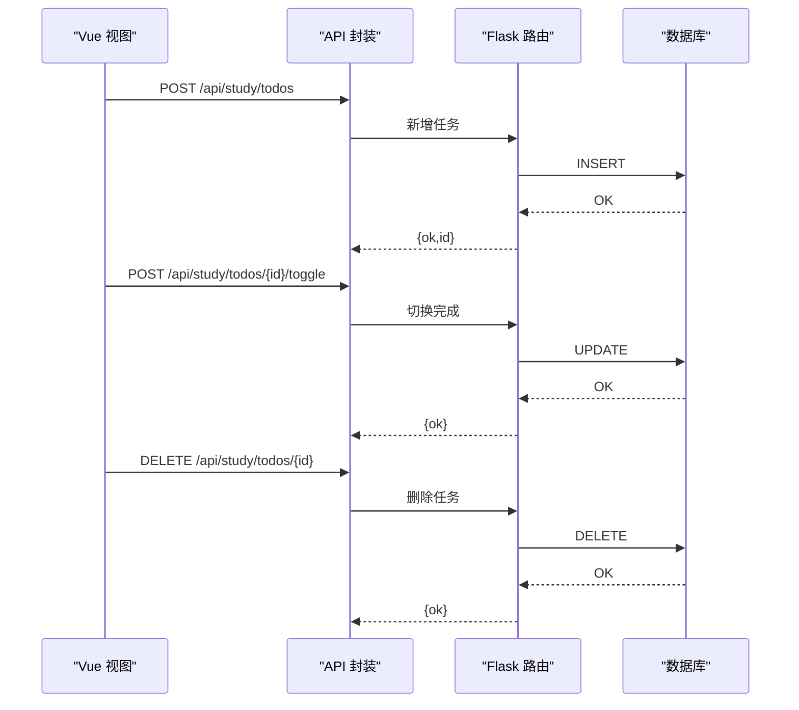
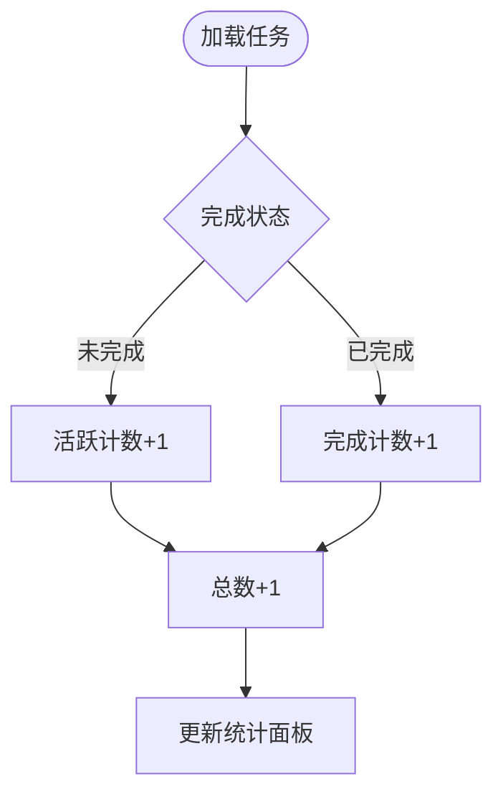
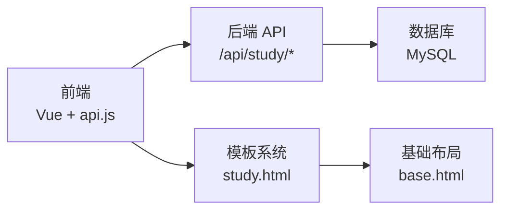

# 待办清单管理系统

<cite>
**本文档引用的文件**
- [app.py](file://app.py)
- [study.html](file://templates/study.html)
- [study.js](file://templates/study.html)
- [base.html](file://templates/base.html)
- [style.css](file://frontend/src/style.css)
- [main.js](file://frontend/src/main.js)
- [api.js](file://frontend/src/api.js)
- [notes.html](file://templates/notes.html)
- [dashboard.html](file://templates/dashboard.html)
</cite>

## 目录
1. [简介](#简介)
2. [项目结构](#项目结构)
3. [核心组件](#核心组件)
4. [架构总览](#架构总览)
5. [详细组件分析](#详细组件分析)
6. [依赖分析](#依赖分析)
7. [性能考虑](#性能考虑)
8. [故障排查指南](#故障排查指南)
9. [结论](#结论)
10. [附录](#附录)

## 简介
本系统是一个基于 Flask + Vue 的学习与生活辅助平台，其中“待办清单”是“学习工具”模块的重要组成部分。系统提供任务的增删改查、优先级排序、完成状态跟踪、统计概览等能力，并预留了导入导出、提醒与重复任务、团队协作等扩展空间。

## 项目结构
- 后端采用 Flask 提供 RESTful API，数据库使用 MySQL，通过 PyMySQL 连接。
- 前端使用 Vue 3 + Vite 构建，静态资源通过 Flask 模板渲染与静态目录提供。
- “学习工具”页面集成待办清单与抽认卡两大功能模块，待办清单位于 study.html 的 tab-todo 区域。

**图表来源**
- [main.js:1-6](file://frontend/src/main.js#L1-L6)
- [api.js:1-45](file://frontend/src/api.js#L1-L45)
- [app.py:5000-5093](file://app.py#L5000-L5093)
- [study.html:97-134](file://templates/study.html#L97-L134)
- [base.html:1-337](file://templates/base.html#L1-L337)

**章节来源**
- [main.js:1-6](file://frontend/src/main.js#L1-L6)
- [api.js:1-45](file://frontend/src/api.js#L1-L45)
- [app.py:830-866](file://app.py#L830-L866)
- [study.html:97-134](file://templates/study.html#L97-L134)
- [base.html:1-337](file://templates/base.html#L1-L337)

## 核心组件
- 数据模型：study_todos 表存储任务实体，包含用户名、标题、完成状态、优先级、截止日期、创建与完成时间戳。
- 前端界面：study.html 的“待办清单”区域提供新增、勾选完成、删除、统计展示。
- 后端 API：提供任务列表查询、新增、删除、切换完成状态等接口。
- 排序策略：按完成状态、优先级、截止日期、创建时间进行排序。
- 完成跟踪：统计活动/完成/全部数量，支持完成时间记录。

**章节来源**
- [app.py:837-847](file://app.py#L837-L847)
- [app.py:5000-5067](file://app.py#L5000-L5067)
- [study.html:97-134](file://templates/study.html#L97-L134)
- [study.js:462-496](file://templates/study.html#L462-L496)

## 架构总览
系统采用前后端分离模式：
- 前端负责用户交互与视图渲染，通过 api.js 封装的 fetch 接口调用后端 /api/study/* 路由。
- 后端负责业务逻辑与数据持久化，study_todos 表承载任务数据。
- 模板系统提供基础布局与国际化支持，study.html 作为学习工具的子页面集成待办清单。

**图表来源**
- [study.js:462-496](file://templates/study.html#L462-L496)
- [api.js:1-45](file://frontend/src/api.js#L1-L45)
- [app.py:5000-5067](file://app.py#L5000-L5067)

## 详细组件分析

### 数据模型与排序策略
- 表结构要点
  - 字段：id、username、title、completed、priority、due_date、created_at、completed_at
  - 关键索引：username、due_date 等（由创建语句推断）
- 排序规则
  - ORDER BY completed ASC, priority DESC, due_date ASC, created_at DESC
  - 优先级：未完成优先于已完成；高优先级靠前；按截止日期早到晚；最后按创建时间倒序
- 用途
  - 保证界面显示符合“重要且紧急”的优先级与时间敏感性

**图表来源**
- [app.py:5000-5008](file://app.py#L5000-L5008)

**章节来源**
- [app.py:837-847](file://app.py#L837-L847)
- [app.py:5000-5008](file://app.py#L5000-L5008)

### 增删改查流程
- 新增任务
  - 前端：收集标题、优先级、截止日期，调用 POST /api/study/todos
  - 后端：参数校验、写入 study_todos，记录活动日志
- 删除任务
  - 前端：确认后调用 DELETE /api/study/todos/{id}
  - 后端：按 id 与 username 删除
- 切换完成状态
  - 前端：点击复选框调用 POST /api/study/todos/{id}/toggle
  - 后端：取反 completed，并在完成时写入 completed_at
- 获取列表
  - 前端：GET /api/study/todos
  - 后端：按排序规则返回任务数组

**图表来源**
- [study.js:489-496](file://templates/study.html#L489-L496)
- [api.js:1-45](file://frontend/src/api.js#L1-L45)
- [app.py:5013-5067](file://app.py#L5013-L5067)

**章节来源**
- [study.js:489-496](file://templates/study.html#L489-L496)
- [api.js:1-45](file://frontend/src/api.js#L1-L45)
- [app.py:5013-5067](file://app.py#L5013-L5067)

### 完成状态跟踪与统计
- 完成状态
  - completed 字段布尔化，completed_at 记录完成时刻
- 统计指标
  - 活跃任务、已完成任务、全部任务数量，前端实时更新
- 历史记录
  - 通过 created_at/completed_at 字段可追溯任务生命周期

**图表来源**
- [study.js:462-486](file://templates/study.html#L462-L486)
- [app.py:5000-5008](file://app.py#L5000-L5008)

**章节来源**
- [study.js:462-486](file://templates/study.html#L462-L486)
- [app.py:5000-5008](file://app.py#L5000-L5008)

### 优先级与时间敏感性
- 优先级字段：priority 为 TINYINT，默认 0；1 表示重要
- 时间敏感性：due_date 为空表示无截止；排序中优先按 due_date ASC
- 用户自定义排序：当前排序固定，如需更灵活排序，可在前端增加排序选项并传递到后端

**章节来源**
- [app.py:837-847](file://app.py#L837-L847)
- [app.py:5000-5008](file://app.py#L5000-L5008)
- [study.html:107-115](file://templates/study.html#L107-L115)

### 任务分类与标签系统（设计思路）
- 当前实现
  - 待办清单未内置分类字段；可通过扩展 username 维度实现“个人分类”
- 设计建议
  - 新增分类表与任务-分类关联表，支持多维分类与快速筛选
  - 标签系统可参考现有 study_flashcards 的 tags 字段设计，便于跨任务复用
- 快速筛选
  - 前端增加分类/标签过滤器，后端按条件查询或在前端二次过滤

[本节为概念性设计说明，不直接分析具体文件，故不附“章节来源”]

### 导入导出与批量操作（设计思路）
- 导入
  - 支持 CSV/JSON 格式，解析后批量插入 study_todos
  - 建议加入去重与校验（如截止日期格式、优先级范围）
- 导出
  - 导出当前筛选结果为 CSV/JSON，包含标题、优先级、截止日期、完成状态等
- 批量操作
  - 勾选多个任务执行批量完成/删除/移动分类

[本节为概念性设计说明，不直接分析具体文件，故不附“章节来源”]

### 任务提醒机制、重复任务与团队协作（设计思路）
- 提醒机制
  - 前端定时轮询或使用浏览器通知 API，在截止时间附近提示
- 重复任务
  - 新增 repeat_rule 字段（如每日/每周/每月），完成后根据规则生成新任务
- 团队协作
  - 新增共享任务表与成员表，支持分配、评论与状态同步

[本节为概念性设计说明，不直接分析具体文件，故不附“章节来源”]

## 依赖分析
- 前端依赖
  - Vue 3、Bootstrap、本地样式与图标字体
- 后端依赖
  - Flask、PyMySQL、psutil、requests 等
- 模块耦合
  - 前端通过 api.js 与后端 /api/study/* 路由解耦
  - 后端 study_todos 表独立于其他模块，便于扩展

**图表来源**
- [api.js:1-45](file://frontend/src/api.js#L1-L45)
- [app.py:5000-5067](file://app.py#L5000-L5067)
- [study.html:97-134](file://templates/study.html#L97-L134)
- [base.html:1-337](file://templates/base.html#L1-L337)

**章节来源**
- [requirements.txt:1-5](file://requirements.txt#L1-L5)
- [api.js:1-45](file://frontend/src/api.js#L1-L45)
- [app.py:5000-5067](file://app.py#L5000-L5067)

## 性能考虑
- 数据库
  - 为 username、due_date 建立索引，提升查询与排序效率
- 排序
  - 前端可做轻量缓存，避免重复请求；后端排序字段尽量命中索引
- 前端
  - 使用虚拟滚动处理大量任务；减少不必要的重渲染
- 安全
  - 已有 CSRF、速率限制、会话超时等保护，建议结合白名单与封禁策略

[本节提供通用指导，不直接分析具体文件，故不附“章节来源”]

## 故障排查指南
- 登录态问题
  - 未登录访问 /api/* 将返回 401；检查前端是否携带 Cookie
- 参数校验
  - 新增任务标题为空将返回 400；检查前端输入与后端 sanitize_input
- 权限不足
  - 非管理员访问管理相关接口将被拒绝；确认会话权限
- 数据库异常
  - DB 错误统一返回 500；检查数据库连接与表结构

**章节来源**
- [app.py:907-916](file://app.py#L907-L916)
- [app.py:5017-5019](file://app.py#L5017-L5019)
- [app.py:5020-5033](file://app.py#L5020-L5033)

## 结论
本待办清单系统以 study_todos 为核心数据模型，结合 Flask 的简洁路由与 Vue 的交互体验，实现了任务的完整生命周期管理。当前版本聚焦于优先级与时间敏感性的排序、完成状态跟踪与统计展示；未来可在分类标签、导入导出、提醒与重复任务、团队协作等方面进一步扩展，以满足更复杂的使用场景。

## 附录
- 相关页面与功能入口
  - 学习工具页面：study.html
  - 仪表盘：dashboard.html
  - 备忘录：notes.html

**章节来源**
- [study.html:97-134](file://templates/study.html#L97-L134)
- [dashboard.html:1-350](file://templates/dashboard.html#L1-L350)
- [notes.html:1-19](file://templates/notes.html#L1-L19)