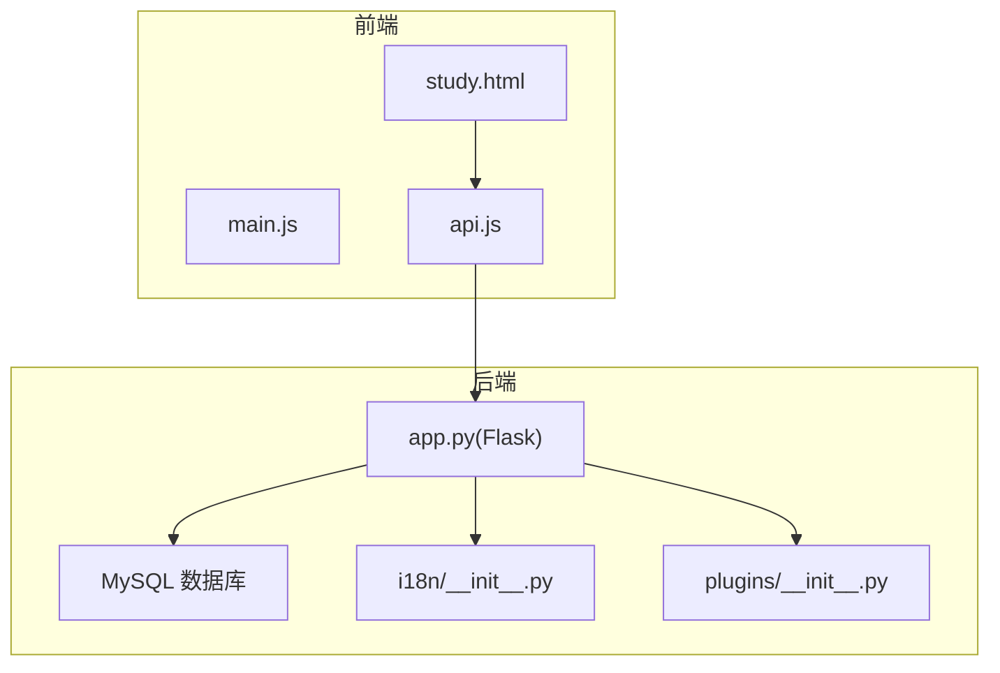
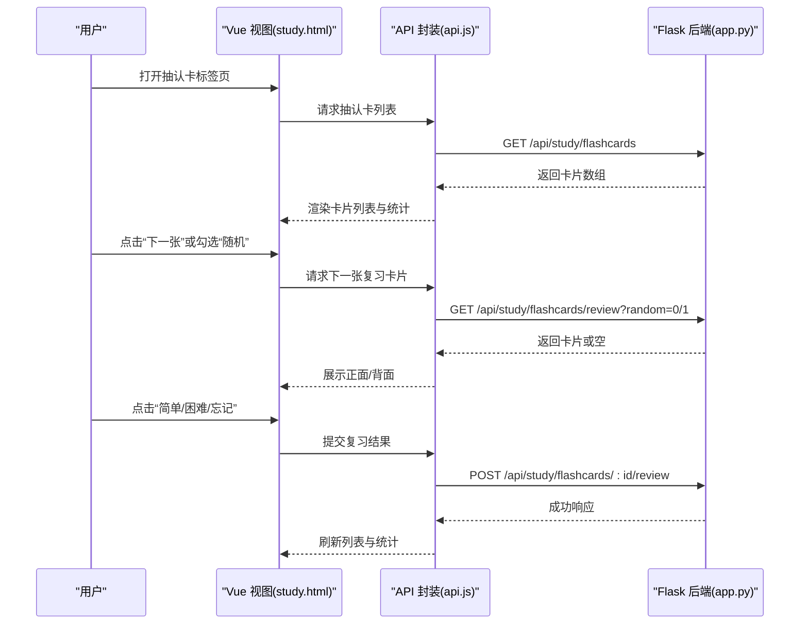
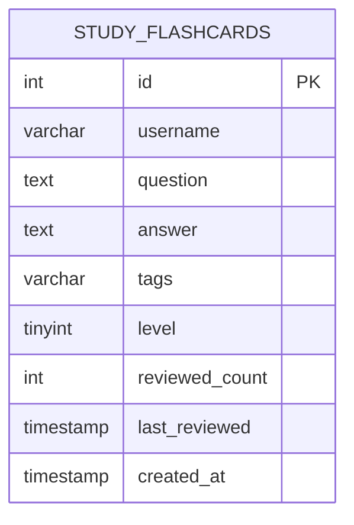
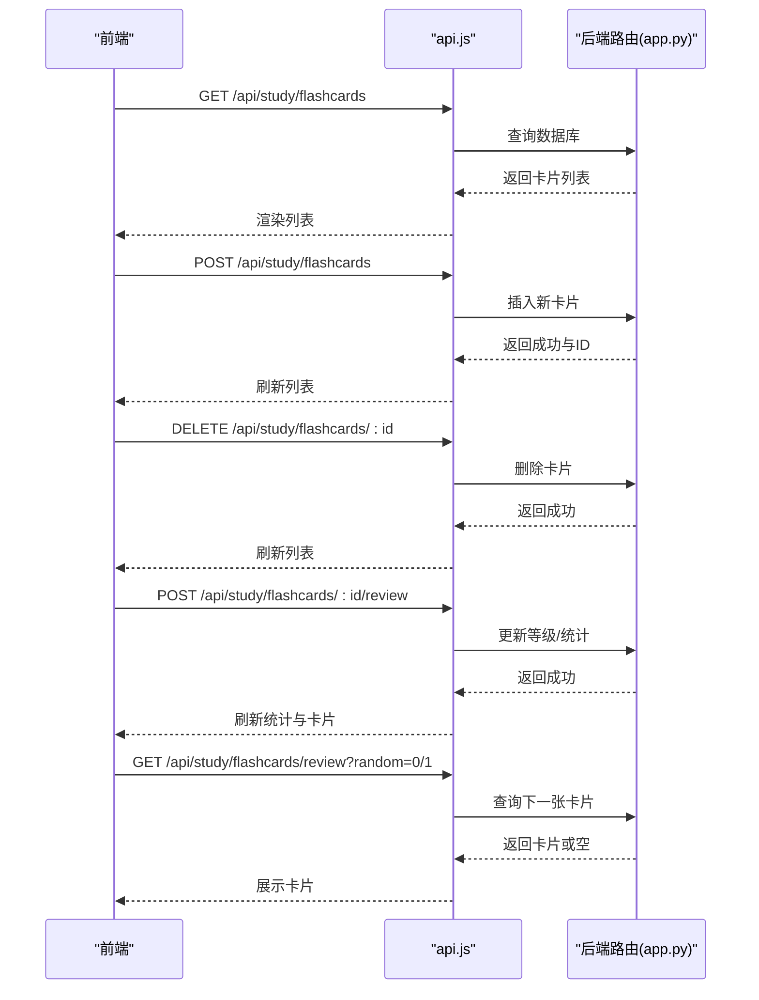
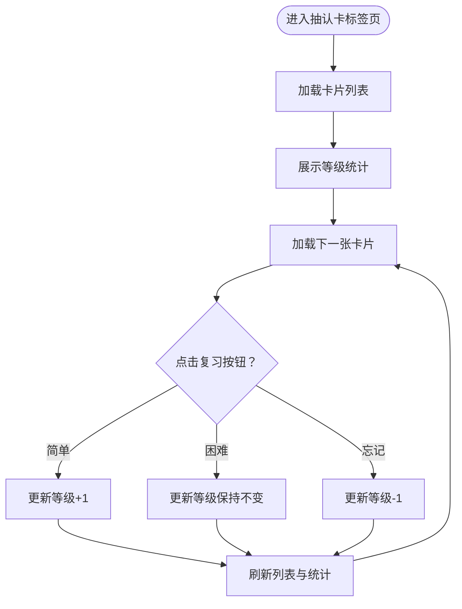
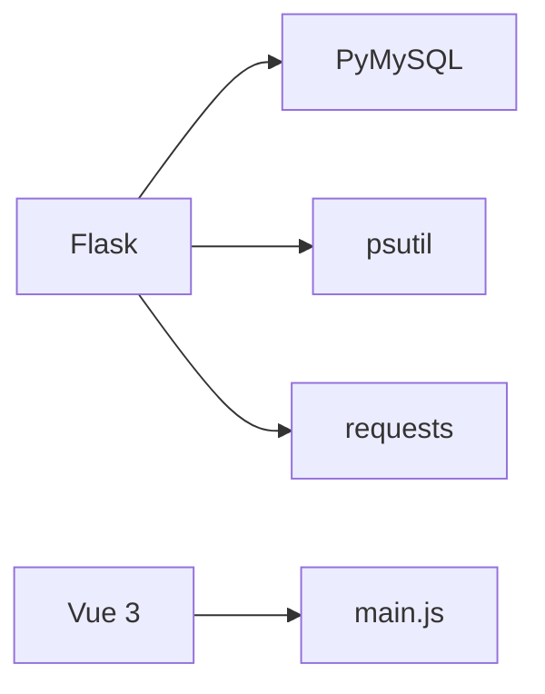

# 抽认卡记忆系统

<cite>
**本文档引用的文件**
- [app.py](file://app.py)
- [study.html](file://templates/study.html)
- [api.js](file://frontend/src/api.js)
- [main.js](file://frontend/src/main.js)
- [i18n/__init__.py](file://i18n/__init__.py)
- [plugins/__init__.py](file://plugins/__init__.py)
- [requirements.txt](file://requirements.txt)
</cite>

## 目录
1. [简介](#简介)
2. [项目结构](#项目结构)
3. [核心组件](#核心组件)
4. [架构总览](#架构总览)
5. [详细组件分析](#详细组件分析)
6. [依赖分析](#依赖分析)
7. [性能考虑](#性能考虑)
8. [故障排查指南](#故障排查指南)
9. [结论](#结论)
10. [附录](#附录)

## 简介
本项目为一个基于 Web 的学习工具平台，其中包含“抽认卡记忆系统”。系统通过前端 Vue 应用与后端 Flask API 协作，提供抽认卡的创建、复习、统计与调度功能，并结合多语言支持、插件系统与安全防护等特性，形成完整的个人知识管理与记忆强化方案。

## 项目结构
- 后端：Flask 应用，提供 RESTful API、数据库初始化与安全策略
- 前端：Vue 3 应用，Study 页面集成番茄钟、待办清单、抽认卡、词典、单位换算等功能
- 国际化：i18n 模块支持多语言
- 插件系统：动态加载与管理插件，支持菜单与模板注入

图表来源
- [main.js:1-6](file://frontend/src/main.js#L1-L6)
- [api.js:1-45](file://frontend/src/api.js#L1-L45)
- [study.html:1-669](file://templates/study.html#L1-L669)
- [app.py:119-139](file://app.py#L119-L139)
- [i18n/__init__.py:1-113](file://i18n/__init__.py#L1-L113)
- [plugins/__init__.py:1-249](file://plugins/__init__.py#L1-L249)

章节来源
- [main.js:1-6](file://frontend/src/main.js#L1-L6)
- [api.js:1-45](file://frontend/src/api.js#L1-L45)
- [study.html:1-669](file://templates/study.html#L1-L669)
- [app.py:119-139](file://app.py#L119-L139)
- [i18n/__init__.py:1-113](file://i18n/__init__.py#L1-L113)
- [plugins/__init__.py:1-249](file://plugins/__init__.py#L1-L249)

## 核心组件
- 抽认卡数据库表：study_flashcards，包含字段如 id、username、question、answer、tags、level、reviewed_count、last_reviewed、created_at
- 抽认卡 API：列表查询、新增、删除、复习评分、下一张卡片
- 前端交互：Study 页面中的抽认卡面板，支持新建、查看、复习、随机模式与统计展示
- 多语言支持：i18n 模块按请求语言渲染界面文案
- 插件系统：动态加载/卸载插件，支持菜单与模板注入

章节来源
- [app.py:832-867](file://app.py#L832-L867)
- [app.py:5071-5183](file://app.py#L5071-L5183)
- [study.html:136-201](file://templates/study.html#L136-L201)
- [i18n/__init__.py:50-113](file://i18n/__init__.py#L50-L113)
- [plugins/__init__.py:60-136](file://plugins/__init__.py#L60-L136)

## 架构总览
系统采用前后端分离架构：
- 前端 Vue 应用通过 fetch 调用后端 /api/study/* 接口
- 后端 Flask 提供认证、速率限制、CSP、安全头等保护
- 数据持久化使用 MySQL，study_flashcards 表承载抽认卡数据

图表来源
- [study.html:498-530](file://templates/study.html#L498-L530)
- [api.js:1-45](file://frontend/src/api.js#L1-L45)
- [app.py:5156-5183](file://app.py#L5156-L5183)
- [app.py:5134-5153](file://app.py#L5134-L5153)

## 详细组件分析

### 抽认卡数据模型
- 表结构要点：用户名、问题、答案、标签、等级、复习次数、最近复习时间、创建时间
- 字段设计支撑：等级用于调度优先级；复习次数与最近复习时间用于统计与排序

图表来源
- [app.py:849-861](file://app.py#L849-L861)

章节来源
- [app.py:849-861](file://app.py#L849-L861)

### 抽认卡 API 流程
- 列表查询：支持按标签过滤，按创建时间倒序
- 新增卡片：输入校验与插入
- 删除卡片：按主键与用户名删除
- 复习评分：根据结果更新等级与统计
- 下一张卡片：顺序或随机模式

图表来源
- [app.py:5071-5183](file://app.py#L5071-L5183)
- [api.js:1-45](file://frontend/src/api.js#L1-L45)

章节来源
- [app.py:5071-5183](file://app.py#L5071-L5183)
- [api.js:1-45](file://frontend/src/api.js#L1-L45)

### 前端交互与复习流程
- 抽认卡面板：支持新建、删除、查看、翻面、随机模式开关
- 统计展示：按等级分类统计百分比
- 复习按钮：简单/困难/忘记三种反馈

图表来源
- [study.html:498-530](file://templates/study.html#L498-L530)
- [app.py:5134-5153](file://app.py#L5134-L5153)

章节来源
- [study.html:136-201](file://templates/study.html#L136-L201)
- [study.html:498-530](file://templates/study.html#L498-L530)
- [app.py:5134-5153](file://app.py#L5134-L5153)

### 复习调度与学习进度统计
- 调度策略：按等级升序、最近复习时间升序优先，确保低掌握度与长时间未复习的卡片优先出现
- 随机模式：按需开启，适合打乱顺序进行巩固
- 统计维度：已掌握、学习中、新卡片数量与占比

章节来源
- [app.py:5156-5183](file://app.py#L5156-L5183)
- [study.html:154-167](file://templates/study.html#L154-L167)
- [study.html:500-514](file://templates/study.html#L500-L514)

### 多语言与国际化
- 语言检测：优先查询参数、会话、Cookie，再回退到 Accept-Language
- 文案注入：模板上下文注入翻译函数与语言信息
- 支持语言：简中、英、日、韩

章节来源
- [i18n/__init__.py:50-113](file://i18n/__init__.py#L50-L113)
- [app.py:165-194](file://app.py#L165-L194)

### 插件系统
- 动态加载：扫描插件目录，读取 plugin.json 与 __init__.py
- 菜单与模板注入：注册菜单项与模板块
- 管理接口：管理员可加载/卸载/重载插件

章节来源
- [plugins/__init__.py:25-136](file://plugins/__init__.py#L25-L136)
- [plugins/__init__.py:5186-5254](file://plugins/__init__.py#L5186-L5254)

## 依赖分析
- 后端依赖：Flask、PyMySQL、psutil、requests
- 前端依赖：Vue 3（由 main.js 创建应用）

图表来源
- [requirements.txt:1-5](file://requirements.txt#L1-L5)
- [main.js:1-6](file://frontend/src/main.js#L1-L6)

章节来源
- [requirements.txt:1-5](file://requirements.txt#L1-L5)
- [main.js:1-6](file://frontend/src/main.js#L1-L6)

## 性能考虑
- 数据库索引：建议在 study_flashcards.username、study_flashcards.level、study_flashcards.last_reviewed 上建立合适索引以优化调度查询
- 查询优化：复习调度使用 ORDER BY level ASC, last_reviewed ASC LIMIT 1，避免全表扫描
- 前端缓存：本地存储复习状态与番茄钟状态，减少重复请求
- 并发控制：后端已实现速率限制与会话超时，避免滥用

## 故障排查指南
- 无法加载抽认卡列表
  - 检查网络请求是否被拦截（CORS、CSP）
  - 查看后端数据库连接状态与表是否存在
- 复习评分无效
  - 确认已登录且请求携带凭据
  - 检查后端返回的状态码与错误信息
- 语言显示异常
  - 检查会话语言设置与 Cookie
  - 确认 i18n 文件存在且格式正确

章节来源
- [app.py:131-139](file://app.py#L131-L139)
- [app.py:832-867](file://app.py#L832-L867)
- [i18n/__init__.py:50-113](file://i18n/__init__.py#L50-L113)

## 结论
本抽认卡记忆系统以清晰的数据模型与简洁的 API 设计为核心，结合前端交互与后端安全策略，实现了从卡片创建到复习调度、统计分析的完整闭环。系统具备良好的扩展性（插件系统）与国际化能力，适合进一步引入更复杂的记忆算法（如 SM-2、Anki 算法）与多媒体支持。

## 附录
- 术语说明
  - 等级(level)：卡片掌握程度，数值越小越需要复习
  - 复习次数(reviewed_count)：累计复习次数
  - 最近复习时间(last_reviewed)：上次复习时间
- 后续改进建议
  - 引入 SM-2/Anki 算法，实现科学的复习间隔计算
  - 增加反应时间与正确率统计，构建记忆强度评估
  - 支持文本、图片、音频等多媒体内容
  - 导入/导出功能（CSV/JSON）
  - 个性化学习路径与智能内容推荐