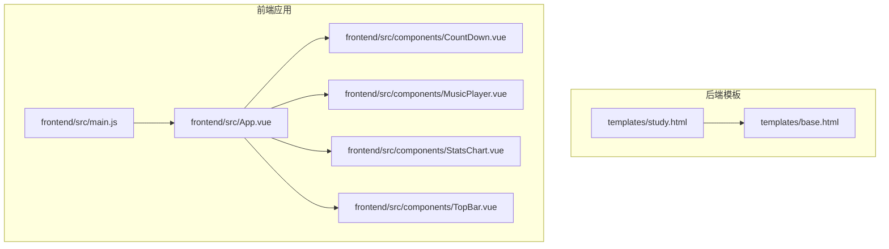
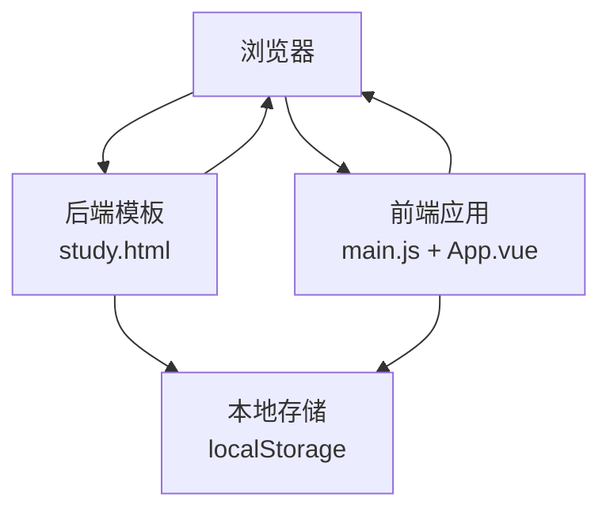
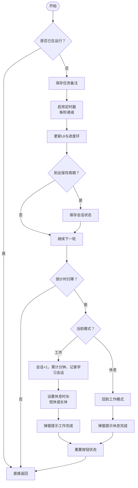
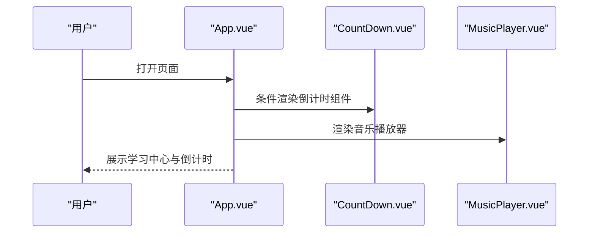
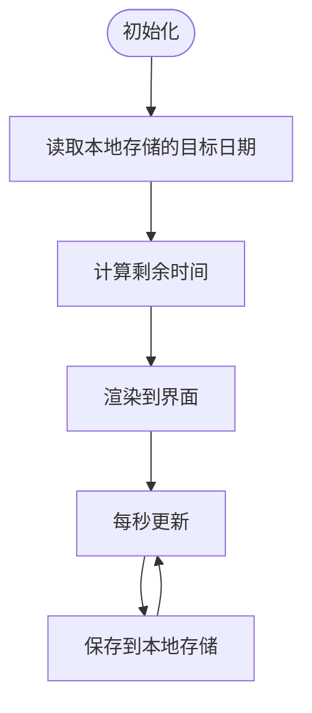
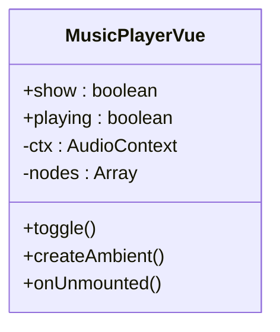
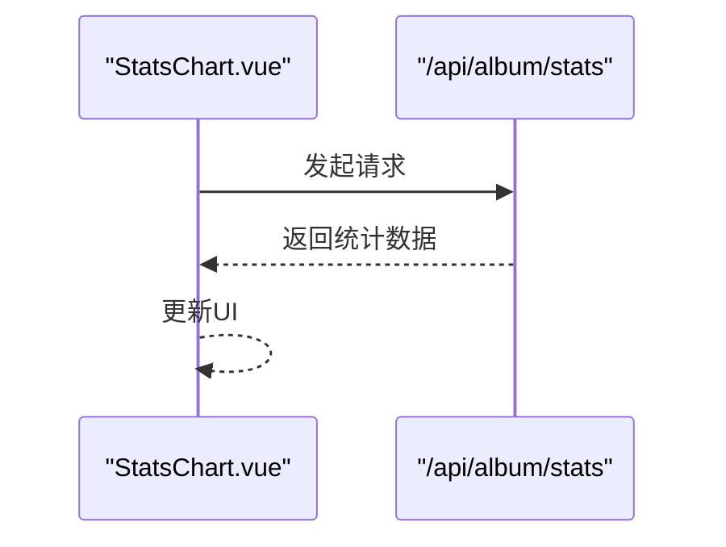
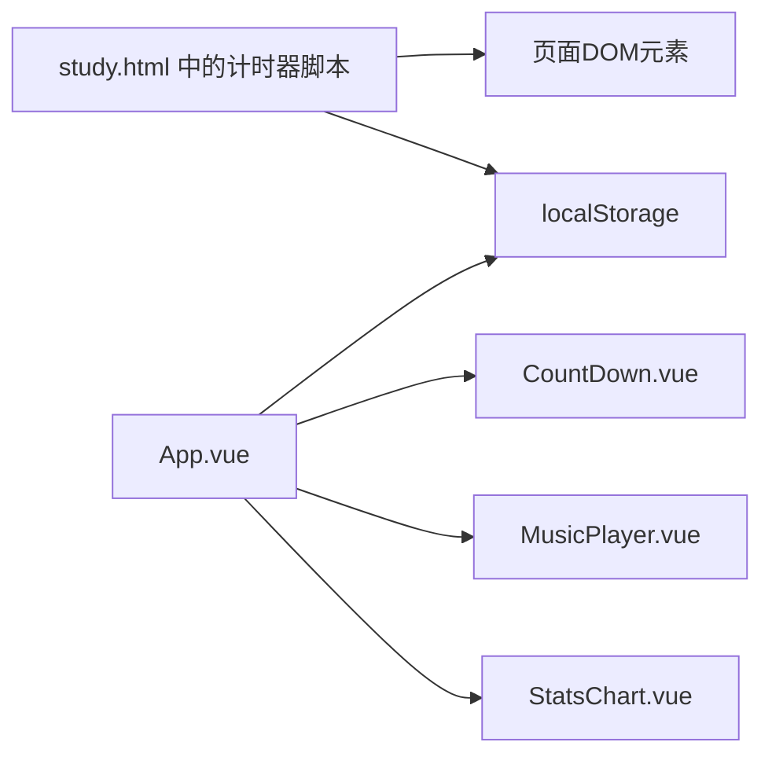

# 番茄工作法计时器

<cite>
**本文引用的文件**
- [study.html](file://templates/study.html)
- [App.vue](file://frontend/src/App.vue)
- [CountDown.vue](file://frontend/src/components/CountDown.vue)
- [MusicPlayer.vue](file://frontend/src/components/MusicPlayer.vue)
- [StatsChart.vue](file://frontend/src/components/StatsChart.vue)
- [main.js](file://frontend/src/main.js)
- [TopBar.vue](file://frontend/src/components/TopBar.vue)
- [base.html](file://templates/base.html)
</cite>

## 目录
1. [简介](#简介)
2. [项目结构](#项目结构)
3. [核心组件](#核心组件)
4. [架构总览](#架构总览)
5. [详细组件分析](#详细组件分析)
6. [依赖关系分析](#依赖关系分析)
7. [性能考量](#性能考量)
8. [故障排除指南](#故障排除指南)
9. [结论](#结论)
10. [附录](#附录)

## 简介
本文件系统性阐述“番茄工作法计时器”的实现与使用，覆盖以下主题：
- 计时器核心机制：专注/休息状态管理、启动/暂停/重置流程
- 专注模式设计理念：视觉反馈、声音提醒与用户体验优化
- 休息提醒机制：自动切换、用户交互与可定制设置
- 状态持久化：会话存储与本地存储策略
- 与其他学习功能的集成：学习统计与进度跟踪
- 配置选项、个性化设置与常见问题排查

## 项目结构
该功能由后端模板与前端组件共同构成：
- 后端模板负责渲染“学习中心”页面，内置原生 JavaScript 实现的计时器
- 前端 Vue 应用负责应用级布局、导航与部分交互组件（如倒计时、音乐播放器等）
- 学习统计图表组件用于展示整体学习数据

**图示来源**
- [study.html](file://templates/study.html)
- [base.html](file://templates/base.html)
- [main.js](file://frontend/src/main.js)
- [App.vue](file://frontend/src/App.vue)
- [CountDown.vue](file://frontend/src/components/CountDown.vue)
- [MusicPlayer.vue](file://frontend/src/components/MusicPlayer.vue)
- [StatsChart.vue](file://frontend/src/components/StatsChart.vue)
- [TopBar.vue](file://frontend/src/components/TopBar.vue)

**章节来源**
- [study.html](file://templates/study.html)
- [main.js](file://frontend/src/main.js)
- [App.vue](file://frontend/src/App.vue)

## 核心组件
- 计时器核心（study.html 中的原生 JS）：负责专注/休息循环、UI 进度环更新、本地存储与每日统计
- 前端 Vue 计时器入口（App.vue）：通过条件渲染挂载计时器组件，并与顶部栏、音乐播放器等协同
- 倒计时组件（CountDown.vue）：展示毕业倒计时，演示本地存储与定时器使用
- 音乐播放器（MusicPlayer.vue）：提供背景环境音，增强专注氛围
- 统计图表（StatsChart.vue）：展示相册类学习数据，体现学习成果可视化

**章节来源**
- [study.html](file://templates/study.html)
- [App.vue](file://frontend/src/App.vue)
- [CountDown.vue](file://frontend/src/components/CountDown.vue)
- [MusicPlayer.vue](file://frontend/src/components/MusicPlayer.vue)
- [StatsChart.vue](file://frontend/src/components/StatsChart.vue)

## 架构总览
计时器采用“后端模板 + 前端应用”的混合架构：
- 页面由后端模板渲染，内含计时器脚本与 SVG 进度环
- 前端 Vue 负责应用级布局、导航与交互组件
- 两者通过 DOM 共享计时器 UI 元素，实现统一的视觉与交互体验

**图示来源**
- [study.html](file://templates/study.html)
- [main.js](file://frontend/src/main.js)
- [App.vue](file://frontend/src/App.vue)

## 详细组件分析

### 计时器核心（study.html 中的原生 JS）
- 状态模型
  - pomoSeconds：当前剩余秒数
  - pomoMode：工作/休息/长休息
  - pomoRunning：是否运行中
  - pomoCount/pomoTotalMin：当日会话次数与累计分钟数
  - workDuration：工作模式时长（分钟），决定进度环总时长
  - pomoTaskName：任务备注
- 关键流程
  - 启动：校验运行状态，保存任务备注，启用定时器，逐秒递减并更新 UI；周期性保存状态；倒计时结束自动切换模式并弹窗提示
  - 暂停：停止定时器，恢复按钮状态，保存状态
  - 重置：停止定时器，回到工作模式初始状态，清空任务显示，清空本地状态
  - 模式切换：支持工作 25/45 分钟与短休息 5 分钟，切换时清空定时器并更新 UI
  - 初始化：从本地存储恢复“会话状态”与“当日统计”，若会话处于运行中则继续倒计时
- 可视化与反馈
  - SVG 圆环进度条根据总时长计算偏移，颜色随模式变化
  - 文字标签显示“就绪/专注中/休息中/长休息”
  - 按钮状态随运行状态动态启用/禁用
- 本地存储策略
  - 会话状态键：固定键名，保存剩余秒数、运行状态、模式、会话数、累计分钟、任务、工作时长与保存时间戳
  - 当日统计键：按日期聚合，保存当日会话次数与累计分钟
  - 恢复逻辑：根据保存时间戳推算剩余秒数，避免跨会话误差
- 与学习统计的集成
  - 工作阶段结束时记录一次学习会话，更新当日统计并在 UI 中同步

**图示来源**
- [study.html](file://templates/study.html)

**章节来源**
- [study.html](file://templates/study.html)

### 前端 Vue 计时器入口（App.vue）
- 角色定位：作为应用根组件，承载顶部栏、倒计时组件与各功能模块
- 与计时器的协作：通过条件渲染挂载计时器组件，确保页面加载后可见
- 用户态与权限：通过顶部栏组件获取当前用户信息，为后续扩展（如用户维度的学习统计）提供基础

**图示来源**
- [App.vue](file://frontend/src/App.vue)
- [CountDown.vue](file://frontend/src/components/CountDown.vue)
- [MusicPlayer.vue](file://frontend/src/components/MusicPlayer.vue)

**章节来源**
- [App.vue](file://frontend/src/App.vue)
- [TopBar.vue](file://frontend/src/components/TopBar.vue)

### 倒计时组件（CountDown.vue）
- 功能：展示距离目标日期的剩余天时分秒，支持手动修改目标日期并持久化
- 机制：每秒计算差值并更新显示，卸载时清理定时器
- 与本地存储：读取并写入目标日期键值

**图示来源**
- [CountDown.vue](file://frontend/src/components/CountDown.vue)

**章节来源**
- [CountDown.vue](file://frontend/src/components/CountDown.vue)

### 音乐播放器（MusicPlayer.vue）
- 功能：提供背景环境音，使用 Web Audio API 生成多层正弦波叠加的环境音
- 交互：点击切换静音/播放，组件卸载时关闭音频上下文
- 与专注模式的结合：为专注时段提供沉浸式听觉环境

**图示来源**
- [MusicPlayer.vue](file://frontend/src/components/MusicPlayer.vue)

**章节来源**
- [MusicPlayer.vue](file://frontend/src/components/MusicPlayer.vue)

### 统计图表（StatsChart.vue）
- 功能：展示相册类学习数据（如照片总数、评论数、点赞数、上传达人排行等）
- 与计时器的关系：虽然不直接统计番茄钟，但同属“学习中心”，可作为学习成果的补充展示

**图示来源**
- [StatsChart.vue](file://frontend/src/components/StatsChart.vue)

**章节来源**
- [StatsChart.vue](file://frontend/src/components/StatsChart.vue)

## 依赖关系分析
- 计时器脚本依赖于 study.html 的 DOM 结构（SVG 进度环、按钮、文本标签）
- 前端 Vue 应用依赖 main.js 的应用入口与 App.vue 的布局
- 本地存储为计时器提供跨会话状态恢复能力
- 顶部栏组件提供用户态信息，为后续个性化扩展提供基础

**图示来源**
- [study.html](file://templates/study.html)
- [App.vue](file://frontend/src/App.vue)
- [CountDown.vue](file://frontend/src/components/CountDown.vue)
- [MusicPlayer.vue](file://frontend/src/components/MusicPlayer.vue)
- [StatsChart.vue](file://frontend/src/components/StatsChart.vue)

**章节来源**
- [study.html](file://templates/study.html)
- [App.vue](file://frontend/src/App.vue)

## 性能考量
- 定时器频率：计时器以 1 秒为粒度更新，对 CPU 开销极小
- UI 更新：仅更新必要节点（时间、进度环、按钮状态、标签文本），避免全量重绘
- 本地存储：定期保存（例如每 5 秒）平衡恢复精度与 I/O 成本
- 音频资源：Web Audio API 在组件卸载时释放上下文，避免内存泄漏

## 故障排除指南
- 计时器不显示或不更新
  - 检查 study.html 中的 DOM 元素是否存在且 ID 与脚本一致
  - 确认浏览器未阻止脚本执行
- 暂停/重置无效
  - 确认按钮状态逻辑未被外部样式覆盖
  - 查看控制台是否有异常
- 无法恢复会话
  - 检查本地存储中是否存在会话状态键
  - 确认保存时间戳与当前时间差值合理
- 音频无法播放
  - 确认首次交互后音频上下文已恢复
  - 检查浏览器是否允许自动播放媒体
- 统计数据不显示
  - 确认接口 /api/album/stats 可访问
  - 检查网络面板与响应内容

**章节来源**
- [study.html](file://templates/study.html)
- [MusicPlayer.vue](file://frontend/src/components/MusicPlayer.vue)
- [StatsChart.vue](file://frontend/src/components/StatsChart.vue)

## 结论
该计时器以简洁高效的原生脚本实现核心逻辑，配合本地存储实现跨会话恢复；前端 Vue 应用提供统一的布局与交互组件，形成“后端模板 + 前端应用”的互补架构。通过进度环与按钮状态的直观反馈、环境音与每日统计的集成，有效提升专注效率与学习体验。

## 附录

### 配置选项与个性化建议
- 模式选择
  - 工作时长：25 分钟或 45 分钟
  - 休息时长：5 分钟或长休息 15 分钟（每完成 4 个会话后触发）
- 任务备注
  - 支持在开始计时前输入任务名称，完成后在界面上展示
- 视觉反馈
  - 进度环颜色随模式变化，标签文字提示当前状态
- 本地存储
  - 会话状态键：固定键名，保存运行状态与元数据
  - 当日统计键：按日期聚合，便于统计与展示
- 音频环境
  - 提供背景环境音开关，适合需要集中注意力的场景

### 与其他学习功能的集成
- 学习统计
  - 工作阶段结束时记录一次学习会话，更新当日统计
- 通知与提醒
  - 可参考通知铃铛组件的实现思路，扩展计时器完成后的通知
- 个性化设置
  - 可在现有基础上增加用户偏好（如默认工作时长、是否启用环境音等）

**章节来源**
- [study.html](file://templates/study.html)
- [base.html](file://templates/base.html)