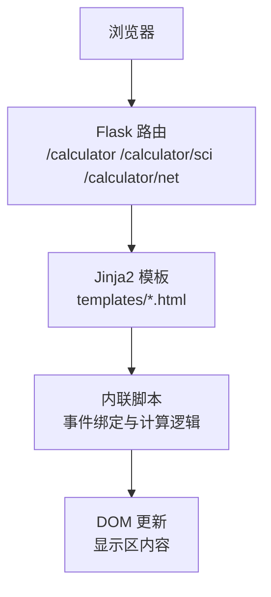
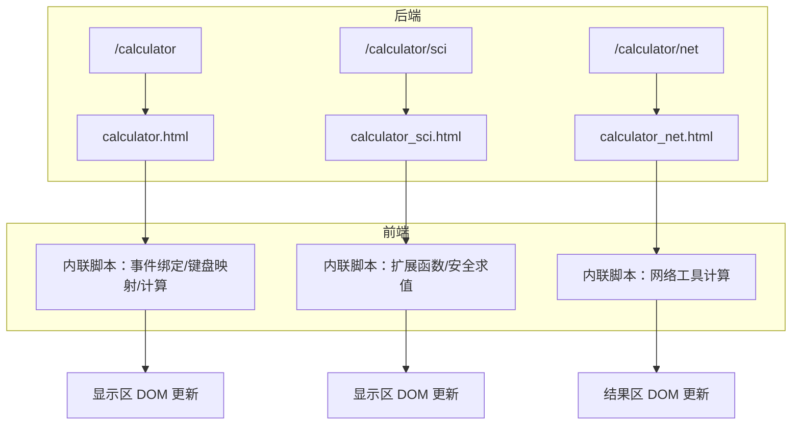
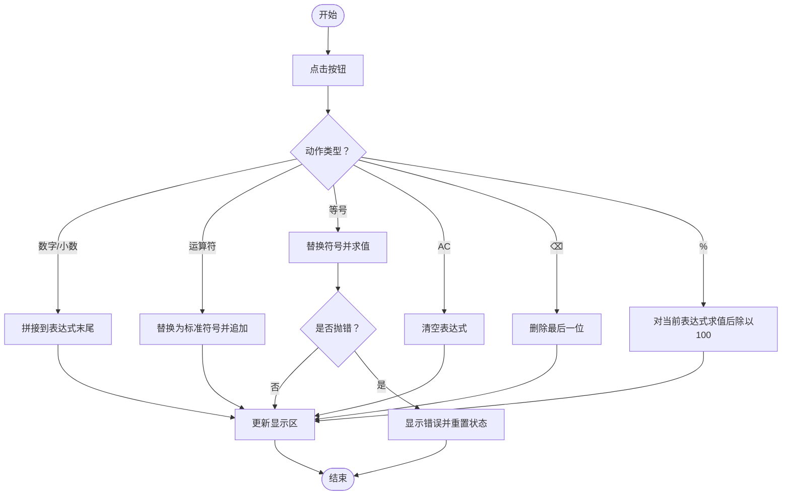
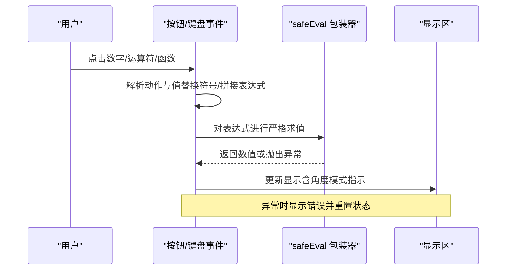
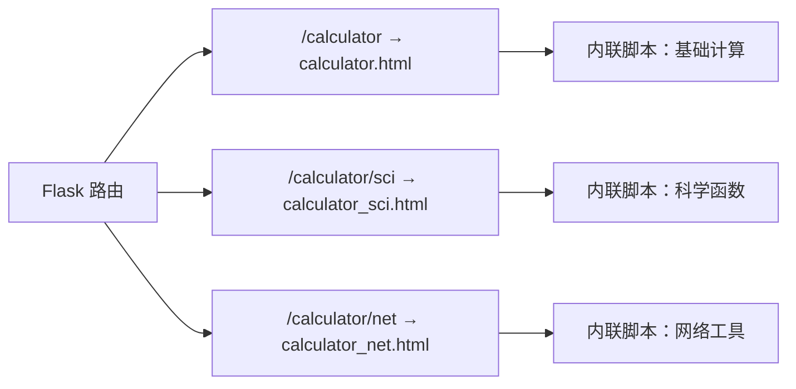

# 基础计算器

<cite>
**本文引用的文件**
- [templates/calculator.html](file://templates/calculator.html)
- [templates/calculator_sci.html](file://templates/calculator_sci.html)
- [templates/calculator_net.html](file://templates/calculator_net.html)
- [templates/base.html](file://templates/base.html)
- [app.py](file://app.py)
- [frontend/src/main.js](file://frontend/src/main.js)
- [frontend/src/App.vue](file://frontend/src/App.vue)
- [frontend/src/style.css](file://frontend/src/style.css)
</cite>

## 目录
1. [简介](#简介)
2. [项目结构](#项目结构)
3. [核心组件](#核心组件)
4. [架构总览](#架构总览)
5. [详细组件分析](#详细组件分析)
6. [依赖关系分析](#依赖关系分析)
7. [性能考量](#性能考量)
8. [故障排查指南](#故障排查指南)
9. [结论](#结论)
10. [附录](#附录)

## 简介
本文件面向“基础计算器”功能，基于现有模板与前端脚本，系统性梳理其表达式解析、UI交互、错误处理与扩展能力，并给出可操作的优化建议。当前仓库中包含三类计算器模板：
- 普通计算器：支持基本四则运算、取模、百分比等。
- 科学计算器：在普通基础上增加三角函数、对数、幂方、阶乘、括号与角度模式等。
- 网络计算器：提供子网掩码、CIDR、IP范围与进制转换等网络工具。

本文重点围绕普通与科学计算器的前端实现进行深入分析，同时说明网络计算器的独立功能定位。

## 项目结构
- 后端框架：基于 Flask 的模板渲染与路由控制，提供三个计算器页面的访问入口。
- 前端模板：使用 Jinja2 模板引擎渲染 HTML，内置内联回调脚本处理按钮点击与键盘事件。
- 样式与主题：Bootstrap 与自定义样式，支持明暗主题切换与响应式布局。

图表来源
- [app.py:3998-4018](file://app.py#L3998-L4018)
- [templates/calculator.html:1-111](file://templates/calculator.html#L1-L111)
- [templates/calculator_sci.html:1-210](file://templates/calculator_sci.html#L1-L210)
- [templates/calculator_net.html:1-188](file://templates/calculator_net.html#L1-L188)
- [templates/base.html:1-337](file://templates/base.html#L1-L337)

章节来源
- [app.py:3998-4018](file://app.py#L3998-L4018)
- [templates/base.html:1-337](file://templates/base.html#L1-L337)

## 核心组件
- 普通计算器（基础四则与百分比）
  - 支持数字输入、运算符（+、−、×、÷）、小数点、清除（AC）、删除（⌫）、等号（=）与百分比（%）。
  - 使用 eval 安全包装器进行表达式求值，支持键盘映射。
- 科学计算器（扩展运算与函数）
  - 在普通基础上新增三角函数、对数、平方根、平方、幂、阶乘、倒数、EXP、正负号切换、括号等。
  - 角度模式（DEG/RAD）与更严格的数值域校验（如阶乘仅接受非负整数）。
- 网络计算器（独立工具）
  - 提供子网计算、IP范围计算与IP进制转换，不涉及表达式解析。

章节来源
- [templates/calculator.html:11-111](file://templates/calculator.html#L11-L111)
- [templates/calculator_sci.html:11-210](file://templates/calculator_sci.html#L11-L210)
- [templates/calculator_net.html:11-188](file://templates/calculator_net.html#L11-L188)

## 架构总览
普通与科学计算器采用“模板 + 内联脚本”的轻量实现：模板负责结构与样式，脚本负责事件监听、表达式拼接与计算执行。网络计算器为纯前端工具，无需后端参与。

图表来源
- [app.py:3998-4018](file://app.py#L3998-L4018)
- [templates/calculator.html:46-111](file://templates/calculator.html#L46-L111)
- [templates/calculator_sci.html:73-210](file://templates/calculator_sci.html#L73-L210)
- [templates/calculator_net.html:70-188](file://templates/calculator_net.html#L70-L188)

## 详细组件分析

### 普通计算器（基础四则与百分比）
- 表达式构建与更新
  - 数字与小数点直接拼接到当前表达式；运算符替换为标准 ASCII 符号以便安全求值。
  - 等号触发表达式替换与求值，异常时显示错误提示。
- 键盘支持
  - 键盘按键映射到对应按钮，支持 Enter、Backspace、Escape 等快捷键。
- 错误处理
  - eval 包装器捕获异常并标记为错误状态，避免页面崩溃。
- 性能与复杂度
  - 字符串拼接与一次 eval 求值，时间复杂度 O(n)，n 为表达式长度；空间复杂度 O(n)。

图表来源
- [templates/calculator.html:54-108](file://templates/calculator.html#L54-L108)

章节来源
- [templates/calculator.html:11-111](file://templates/calculator.html#L11-L111)

### 科学计算器（扩展函数与安全求值）
- 表达式与函数
  - 支持括号、幂（^）、EXP、正负号切换、倒数、百分比等。
  - 角度模式（DEG/RAD）影响三角函数输入单位。
- 安全求值
  - 使用严格模式的 Function 包装器替代直接 eval，降低风险。
- 数值域校验
  - 阶乘仅接受非负整数；除法与倒数在异常时返回错误。
- 键盘支持
  - 新增括号、幂运算、EXP、正负号等按键映射。

图表来源
- [templates/calculator_sci.html:83-182](file://templates/calculator_sci.html#L83-L182)

章节来源
- [templates/calculator_sci.html:11-210](file://templates/calculator_sci.html#L11-L210)

### 网络计算器（独立工具）
- 功能模块
  - 子网掩码计算：支持输入 IP 与掩码/CIDR，输出网络地址、广播地址、可用主机数等。
  - IP 范围计算：给定起止 IP，计算数量与最小 CIDR 覆盖。
  - IP 进制转换：十进制、十六进制、八进制、二进制与标准 IP 互转。
- 实现要点
  - IP 与整数互转、CIDR 与掩码互转、二进制格式化等纯前端计算逻辑。
  - 结果表格化展示，便于阅读与复制。

章节来源
- [templates/calculator_net.html:11-188](file://templates/calculator_net.html#L11-L188)

### 用户界面设计与交互
- 按钮布局
  - 普通：4 列网格，AC、⌫、%、÷ 为警示色；0 占两列；等号为主色。
  - 科学：函数行 + 主键盘，括号、正负号、倒数、EXP 等增强按钮。
- 数字输入与显示更新
  - 显示区实时反映表达式或结果；错误时高亮提示。
- 键盘与触摸优化
  - 键盘映射覆盖常用按键；按钮尺寸适中，适合移动端点击。
- 主题与样式
  - Bootstrap 卡片与按钮风格；自定义样式保证对比度与可读性；支持明暗主题切换。

章节来源
- [templates/calculator.html:14-44](file://templates/calculator.html#L14-L44)
- [templates/calculator_sci.html:13-71](file://templates/calculator_sci.html#L13-L71)
- [templates/base.html:37-154](file://templates/base.html#L37-L154)
- [frontend/src/style.css:1-59](file://frontend/src/style.css#L1-L59)

### 错误处理与边界情况
- 除零与非法运算
  - 普通：eval 包装器捕获异常并显示错误；倒数与除法同理。
  - 科学：对倒数与除法进行异常捕获；阶乘对非整数与负数直接报错。
- 输入合法性
  - 小数点仅允许每段一次；连续运算符自动替换；括号成对使用。
- 状态重置
  - 等号与百分比后进入重置状态，避免后续输入拼接错误。

章节来源
- [templates/calculator.html:66-82](file://templates/calculator.html#L66-L82)
- [templates/calculator_sci.html:119-136](file://templates/calculator_sci.html#L119-L136)

### 计算历史与快速重现
- 当前实现
  - 模板未内置历史记录存储与回放逻辑。
- 建议方案
  - 前端本地存储（localStorage）保存最近 N 条表达式与结果；
  - 历史面板支持点击重现，或通过键盘快捷键（如上/下箭头）循环浏览；
  - 历史记录支持清空与导出（JSON/CSV）。

章节来源
- [templates/calculator.html:46-111](file://templates/calculator.html#L46-L111)
- [templates/calculator_sci.html:73-210](file://templates/calculator_sci.html#L73-L210)

### 键盘支持与触摸优化
- 键盘映射
  - 普通：0–9、+、−、*、/、.、%、Enter、Backspace、Escape。
  - 科学：新增 ( )、^、EXP、正负号等映射。
- 触摸体验
  - 按钮尺寸与间距适配移动端；颜色对比度满足无障碍要求；主题切换提升夜间使用体验。

章节来源
- [templates/calculator.html:87-105](file://templates/calculator.html#L87-L105)
- [templates/calculator_sci.html:184-205](file://templates/calculator_sci.html#L184-L205)
- [templates/base.html:234-267](file://templates/base.html#L234-L267)

### 扩展功能建议（基于现有模板能力）
- 百分比计算：普通与科学均支持，内部将表达式结果除以 100。
- 倒数运算：科学计算器支持 1/x，异常时显示错误。
- 平方根与平方：科学计算器支持 √ 与 x²。
- 阶乘：仅接受非负整数，否则报错。
- 角度模式：DEG/RAD 影响三角函数输入单位。

章节来源
- [templates/calculator.html:76-82](file://templates/calculator.html#L76-L82)
- [templates/calculator_sci.html:127-136](file://templates/calculator_sci.html#L127-L136)

## 依赖关系分析
- 路由与模板
  - /calculator → calculator.html
  - /calculator/sci → calculator_sci.html
  - /calculator/net → calculator_net.html
- 前端资源
  - base.html 提供主题、导航与通用脚本；各计算器模板内联脚本实现具体交互。
- 依赖图

图表来源
- [app.py:3998-4018](file://app.py#L3998-L4018)
- [templates/calculator.html:46-111](file://templates/calculator.html#L46-L111)
- [templates/calculator_sci.html:73-210](file://templates/calculator_sci.html#L73-L210)
- [templates/calculator_net.html:70-188](file://templates/calculator_net.html#L70-L188)

章节来源
- [app.py:3998-4018](file://app.py#L3998-L4018)

## 性能考量
- 表达式求值
  - 普通：eval 包装器一次性求值，简单高效；建议在安全可控场景使用。
  - 科学：严格模式 Function 包装器，安全性更高，性能略降但可接受。
- DOM 更新
  - 仅更新显示区文本，开销极低；建议避免频繁重排。
- 键盘事件
  - 事件委托与按键映射减少重复绑定，提升交互流畅度。

## 故障排查指南
- 显示“错误”
  - 可能原因：除零、非法表达式、阶乘参数非法。
  - 处理建议：检查输入顺序与数值范围；使用 AC 清空后重试。
- 键盘无响应
  - 可能原因：焦点不在页面或事件被阻止。
  - 处理建议：确保页面处于激活状态；尝试点击任意按钮恢复焦点。
- 角度模式导致三角函数结果异常
  - 可能原因：输入角度与当前模式不一致。
  - 处理建议：切换 DEG/RAD 或显式使用弧度输入。

章节来源
- [templates/calculator.html:66-82](file://templates/calculator.html#L66-L82)
- [templates/calculator_sci.html:95-136](file://templates/calculator_sci.html#L95-L136)

## 结论
- 普通与科学计算器采用内联脚本实现，具备良好的交互体验与可扩展性。
- 网络计算器作为独立工具，满足网络工程场景需求。
- 建议在保持现有安全策略的基础上，引入历史记录与更完善的错误提示，进一步提升可用性与可维护性。

## 附录
- 前端运行入口（Vue 应用）
  - 项目包含 Vue 应用入口与样式文件，但与计算器功能无直接耦合。
  
章节来源
- [frontend/src/main.js:1-6](file://frontend/src/main.js#L1-L6)
- [frontend/src/App.vue:1-99](file://frontend/src/App.vue#L1-L99)
- [frontend/src/style.css:1-59](file://frontend/src/style.css#L1-L59)