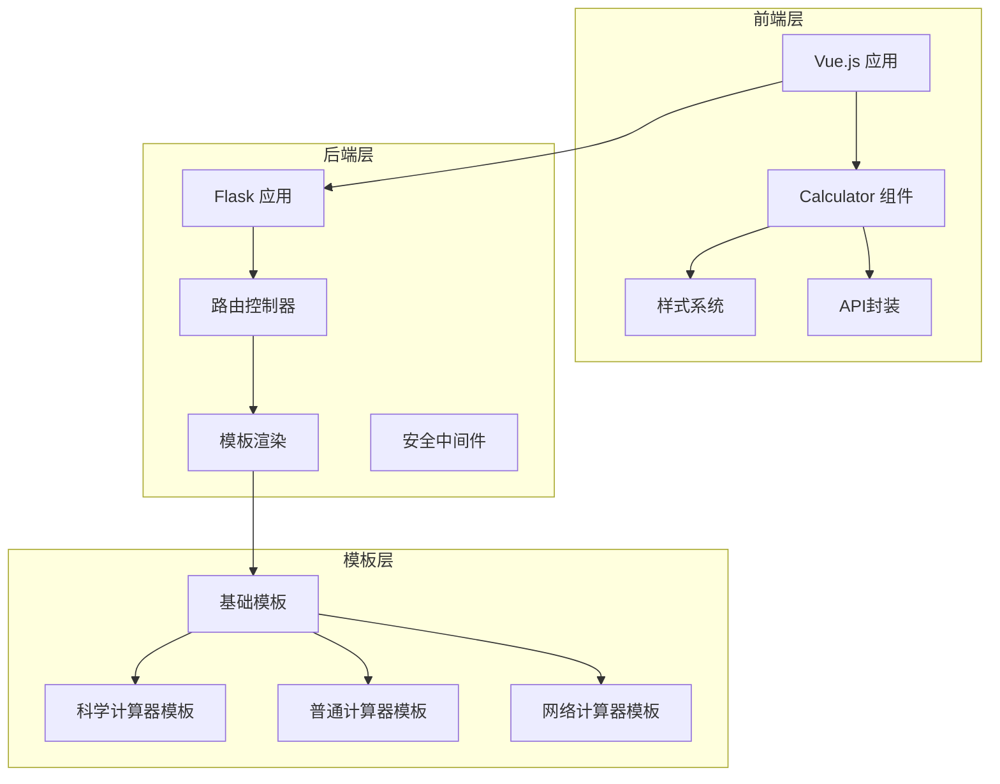
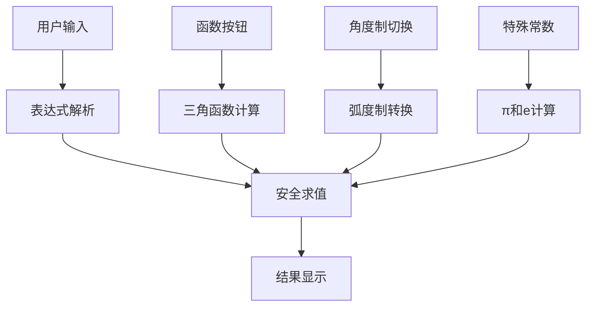
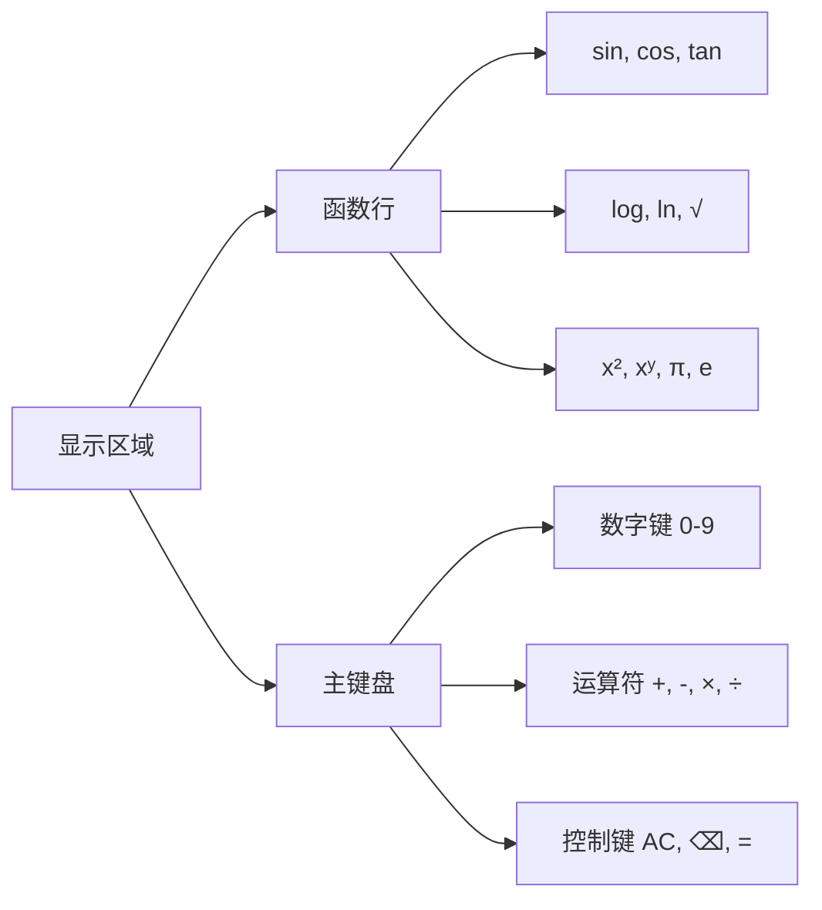
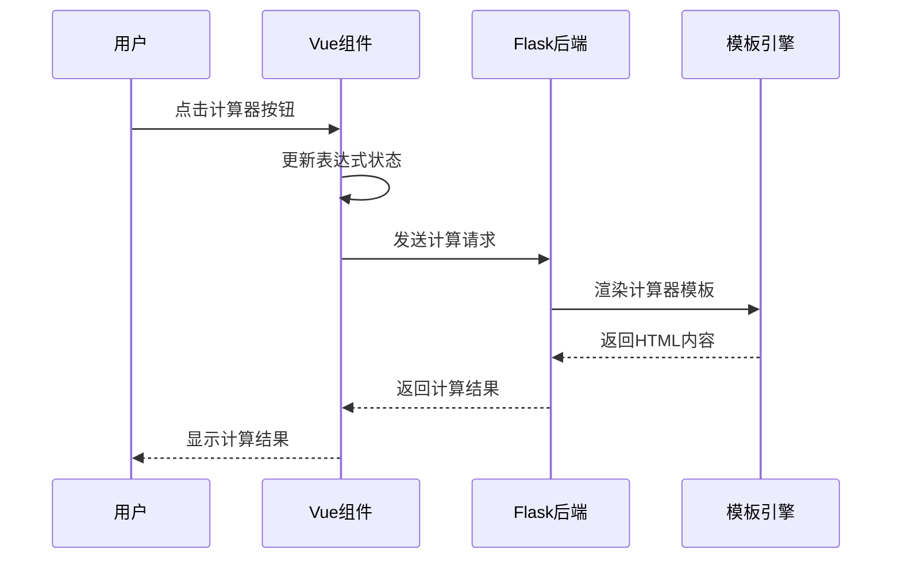
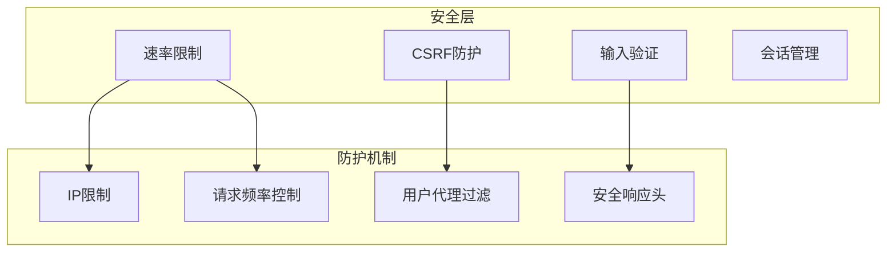
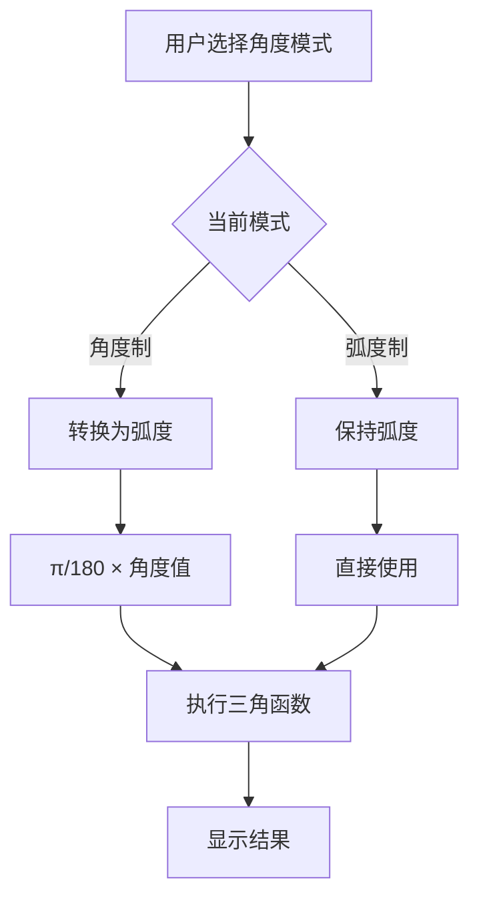
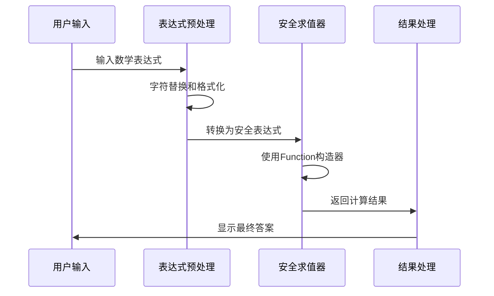
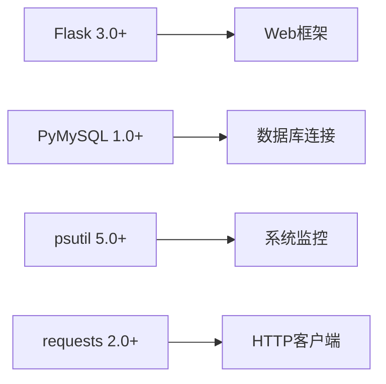
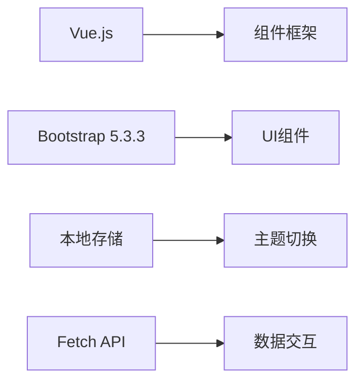
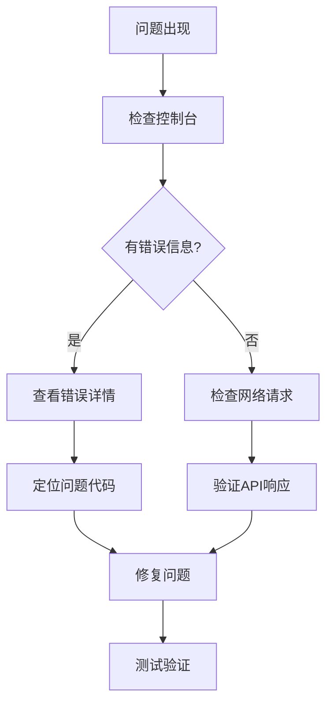

# 科学计算器

<cite>
**本文档引用的文件**
- [templates/calculator_sci.html](file://templates/calculator_sci.html)
- [templates/calculator.html](file://templates/calculator.html)
- [templates/calculator_net.html](file://templates/calculator_net.html)
- [templates/base.html](file://templates/base.html)
- [frontend/src/style.css](file://frontend/src/style.css)
- [frontend/src/api.js](file://frontend/src/api.js)
- [frontend/src/main.js](file://frontend/src/main.js)
- [app.py](file://app.py)
- [requirements.txt](file://requirements.txt)
</cite>

## 目录
1. [简介](#简介)
2. [项目结构](#项目结构)
3. [核心组件](#核心组件)
4. [架构概览](#架构概览)
5. [详细组件分析](#详细组件分析)
6. [依赖分析](#依赖分析)
7. [性能考虑](#性能考虑)
8. [故障排除指南](#故障排除指南)
9. [结论](#结论)

## 简介

科学计算器是多合一工具箱Web版中的一个重要功能模块，提供了高级数学计算能力。该项目采用Flask作为后端框架，Vue.js作为前端框架，实现了完整的科学计算功能。

科学计算器的主要特点包括：
- 支持三角函数、对数函数、指数函数等高级数学运算
- 角度制和弧度制自动转换机制
- 实时结果显示和键盘快捷键支持
- 响应式设计，适配多种设备
- 完善的安全防护机制

## 项目结构

项目采用典型的前后端分离架构，主要分为以下层次：

**图表来源**
- [templates/base.html:1-337](file://templates/base.html#L1-L337)
- [templates/calculator_sci.html:1-210](file://templates/calculator_sci.html#L1-L210)
- [app.py:3998-4018](file://app.py#L3998-L4018)

**章节来源**
- [templates/base.html:1-337](file://templates/base.html#L1-L337)
- [templates/calculator_sci.html:1-210](file://templates/calculator_sci.html#L1-L210)
- [frontend/src/style.css:1-59](file://frontend/src/style.css#L1-L59)

## 核心组件

### 计算器核心逻辑

科学计算器的核心功能集中在JavaScript代码中，实现了完整的表达式解析和计算功能：

**图表来源**
- [templates/calculator_sci.html:74-208](file://templates/calculator_sci.html#L74-L208)

### 计算器界面布局

计算器采用网格布局设计，包含功能按钮和数字键盘：

**图表来源**
- [templates/calculator_sci.html:15-69](file://templates/calculator_sci.html#L15-L69)

**章节来源**
- [templates/calculator_sci.html:15-210](file://templates/calculator_sci.html#L15-L210)

## 架构概览

科学计算器采用MVC架构模式，结合现代Web技术栈：

**图表来源**
- [app.py:3998-4018](file://app.py#L3998-L4018)
- [templates/calculator_sci.html:74-208](file://templates/calculator_sci.html#L74-L208)

### 安全架构

系统实现了多层次的安全防护机制：

**图表来源**
- [app.py:348-593](file://app.py#L348-L593)

**章节来源**
- [app.py:348-593](file://app.py#L348-L593)

## 详细组件分析

### 科学函数实现

科学计算器支持多种高级数学函数：

#### 三角函数计算
- **正弦函数 (sin)**: 支持角度制和弧度制自动转换
- **余弦函数 (cos)**: 实现精确的角度换算
- **正切函数 (tan)**: 处理特殊角度的边界情况

#### 对数和指数函数
- **常用对数 (log)**: 计算以10为底的对数
- **自然对数 (ln)**: 计算自然对数
- **平方根 (√)**: 实现非负数开平方
- **平方 (x²)**: 快速平方计算

#### 特殊数学常数
- **圆周率 (π)**: 高精度π值计算
- **自然常数 (e)**: 欧拉数计算
- **阶乘 (n!)**: 整数阶乘计算

**章节来源**
- [templates/calculator_sci.html:89-136](file://templates/calculator_sci.html#L89-L136)

### 角度制和弧度制转换

系统实现了智能的角度单位转换机制：

**图表来源**
- [templates/calculator_sci.html:95-96](file://templates/calculator_sci.html#L95-L96)
- [templates/calculator_sci.html:110-118](file://templates/calculator_sci.html#L110-L118)

### 表达式解析和安全计算

系统采用安全的表达式求值机制：

**图表来源**
- [templates/calculator_sci.html:84-87](file://templates/calculator_sci.html#L84-L87)
- [templates/calculator_sci.html:158-162](file://templates/calculator_sci.html#L158-L162)

**章节来源**
- [templates/calculator_sci.html:84-182](file://templates/calculator_sci.html#L84-L182)

### 键盘快捷键支持

系统支持完整的键盘操作：

| 键位 | 功能 | 对应按钮 |
|------|------|----------|
| 数字键 0-9 | 数字输入 | 对应数字按钮 |
| +, -, *, / | 运算符 | 对应运算按钮 |
| Enter | 等号 | 等号按钮 |
| Backspace | 退格 | 退格按钮 |
| Escape | 清空 | 清空按钮 |
| . | 小数点 | 小数点按钮 |
| ^ | 幂运算 | xʸ按钮 |

**章节来源**
- [templates/calculator_sci.html:184-205](file://templates/calculator_sci.html#L184-L205)

### 网络计算器功能

网络计算器提供专门的网络计算功能：

#### 子网掩码计算
- **CIDR到子网掩码转换**
- **子网大小计算**
- **网络地址和广播地址计算**

#### IP地址转换
- **十进制整数转换**
- **二进制表示**
- **十六进制表示**
- **反向DNS查询**

**章节来源**
- [templates/calculator_net.html:103-185](file://templates/calculator_net.html#L103-L185)

## 依赖分析

### 后端依赖

项目使用Flask框架构建Web服务：

**图表来源**
- [requirements.txt:1-5](file://requirements.txt#L1-L5)

### 前端依赖

前端使用Vue.js和Bootstrap构建用户界面：

**图表来源**
- [frontend/src/main.js:1-6](file://frontend/src/main.js#L1-L6)
- [frontend/src/api.js:1-45](file://frontend/src/api.js#L1-L45)

**章节来源**
- [requirements.txt:1-5](file://requirements.txt#L1-L5)
- [frontend/src/main.js:1-6](file://frontend/src/main.js#L1-L6)
- [frontend/src/api.js:1-45](file://frontend/src/api.js#L1-L45)

## 性能考虑

### 计算性能优化

1. **表达式缓存**: 计算结果进行四舍五入避免浮点数精度问题
2. **DOM操作优化**: 批量更新显示区域减少重绘
3. **事件委托**: 使用事件委托减少监听器数量

### 内存管理

- **定时器清理**: 及时清理超时检查定时器
- **缓存策略**: 合理使用localStorage存储主题偏好
- **资源释放**: 正确清理事件监听器和定时器

### 网络性能

- **CDN加速**: 使用BootCDN提供静态资源
- **按需加载**: 模块化加载减少初始包体积
- **缓存策略**: 合理设置HTTP缓存头

## 故障排除指南

### 常见问题及解决方案

#### 计算器无响应
1. 检查浏览器控制台是否有JavaScript错误
2. 确认网络连接正常
3. 清除浏览器缓存后重试

#### 计算结果异常
1. 验证输入的数学表达式格式
2. 检查是否使用了正确的角度单位
3. 确认没有超出计算范围的数值

#### 界面显示问题
1. 检查CSS文件是否正确加载
2. 验证Bootstrap样式是否生效
3. 确认响应式断点设置正确

### 调试技巧

**章节来源**
- [app.py:514-562](file://app.py#L514-L562)

## 结论

科学计算器项目展现了现代Web应用开发的最佳实践，具有以下优势：

1. **功能完整性**: 提供了全面的科学计算功能，包括高级数学函数和单位转换
2. **用户体验**: 优秀的界面设计和交互体验，支持键盘快捷键
3. **安全性**: 实现了多层次的安全防护机制
4. **可维护性**: 清晰的代码结构和模块化设计
5. **性能优化**: 考虑了计算性能和网络性能的优化

该项目为学习Web开发和科学计算应用提供了良好的参考案例，其架构设计和实现细节对于理解现代Web应用开发具有重要价值。