# 网络计算器

<cite>
**本文档引用的文件**
- [app.py](file://app.py)
- [calculator_net.html](file://templates/calculator_net.html)
- [network_tools.html](file://templates/network_tools.html)
- [base.html](file://templates/base.html)
- [zh-CN.json](file://i18n/zh-CN.json)
</cite>

## 目录
1. [简介](#简介)
2. [项目结构](#项目结构)
3. [核心组件](#核心组件)
4. [架构概览](#架构概览)
5. [详细组件分析](#详细组件分析)
6. [依赖关系分析](#依赖关系分析)
7. [性能考虑](#性能考虑)
8. [故障排除指南](#故障排除指南)
9. [结论](#结论)

## 简介

网络计算器是SchoolWeb项目中的一个重要功能模块，提供了全面的网络地址计算和网络工具功能。该模块包含IPv4地址解析、子网划分计算、IP范围生成、进制转换等核心功能，同时集成了多种网络诊断工具。

主要功能特性包括：
- IPv4地址解析和验证
- 子网掩码转换（CIDR ↔ 二进制 ↔ 十进制）
- 网络参数计算（网络地址、广播地址、可用主机数）
- IP范围计算和最小CIDR覆盖
- IP地址进制转换（十进制、十六进制、八进制、二进制）
- 网络工具集成（Ping、Traceroute、DNS查询、SSL检查等）

## 项目结构

网络计算器功能分布在多个文件中，采用前后端分离的架构设计：

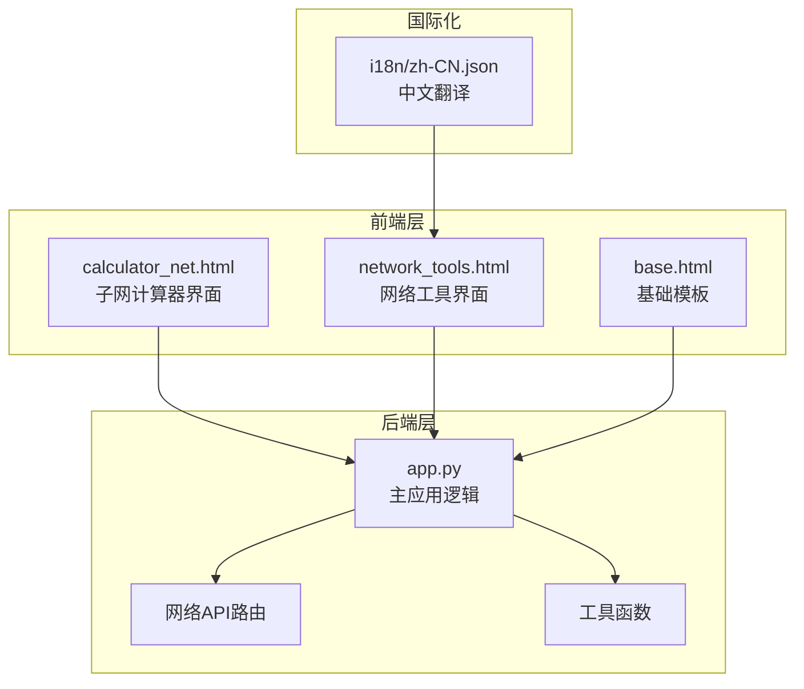

**图表来源**
- [calculator_net.html:1-188](file://templates/calculator_net.html#L1-L188)
- [network_tools.html:1-328](file://templates/network_tools.html#L1-L328)
- [app.py:1958-2316](file://app.py#L1958-L2316)

**章节来源**
- [app.py:1958-2316](file://app.py#L1958-L2316)
- [calculator_net.html:1-188](file://templates/calculator_net.html#L1-L188)
- [network_tools.html:1-328](file://templates/network_tools.html#L1-L328)

## 核心组件

### 子网计算器组件

子网计算器是网络计算器的核心组件，提供完整的IPv4地址计算功能：

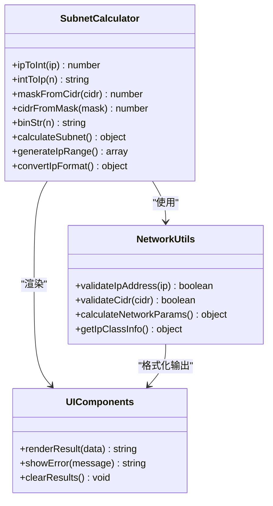

**图表来源**
- [calculator_net.html:72-185](file://templates/calculator_net.html#L72-L185)

### 网络工具组件

网络工具组件提供多种网络诊断和分析功能：

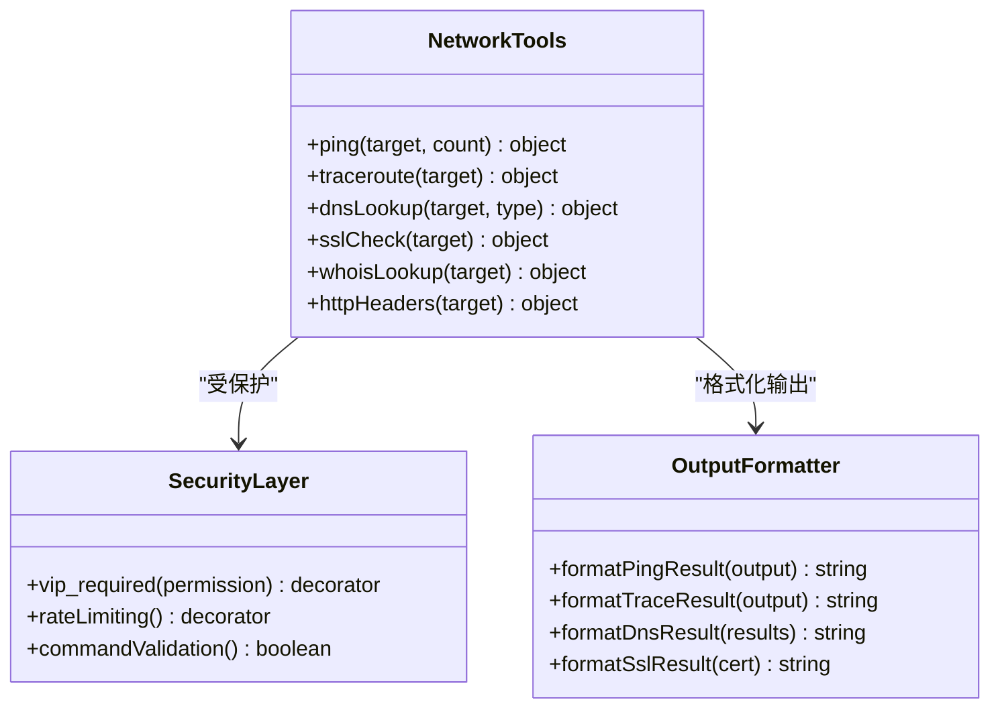

**图表来源**
- [app.py:2075-2316](file://app.py#L2075-L2316)

**章节来源**
- [calculator_net.html:103-185](file://templates/calculator_net.html#L103-L185)
- [app.py:2075-2316](file://app.py#L2075-L2316)

## 架构概览

网络计算器采用三层架构设计，确保功能的完整性和安全性：

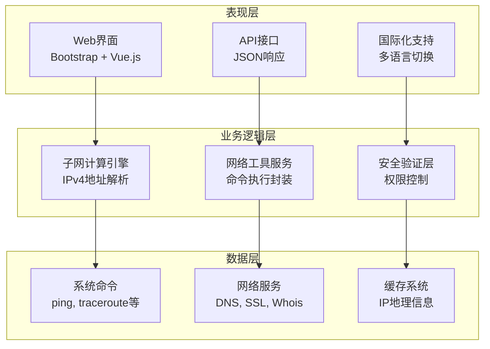

**图表来源**
- [app.py:1958-2316](file://app.py#L1958-L2316)
- [calculator_net.html:1-188](file://templates/calculator_net.html#L1-L188)

### 数据流图

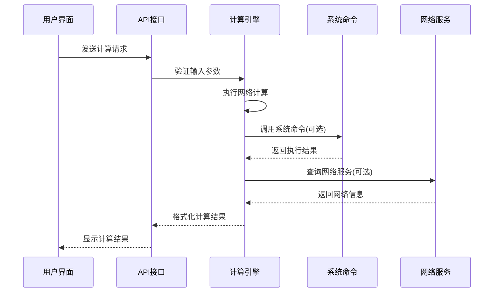

**图表来源**
- [app.py:2075-2316](file://app.py#L2075-L2316)
- [calculator_net.html:103-185](file://templates/calculator_net.html#L103-L185)

## 详细组件分析

### IPv4地址解析组件

IPv4地址解析是网络计算器的基础功能，负责将用户输入的IP地址转换为内部表示形式：

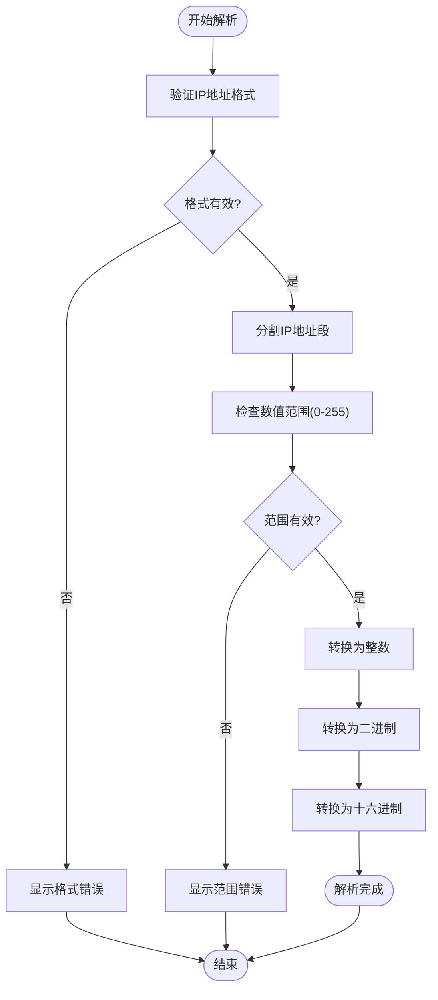

**图表来源**
- [calculator_net.html:72-94](file://templates/calculator_net.html#L72-L94)

#### 功能特性

1. **地址验证**：检查IP地址格式是否符合IPv4标准
2. **范围检查**：确保每个字节都在0-255范围内
3. **格式转换**：支持十进制、二进制、十六进制等多种格式
4. **错误处理**：提供详细的错误信息和用户指导

**章节来源**
- [calculator_net.html:72-94](file://templates/calculator_net.html#L72-L94)

### 子网掩码转换组件

子网掩码转换功能支持多种表示法之间的互换：

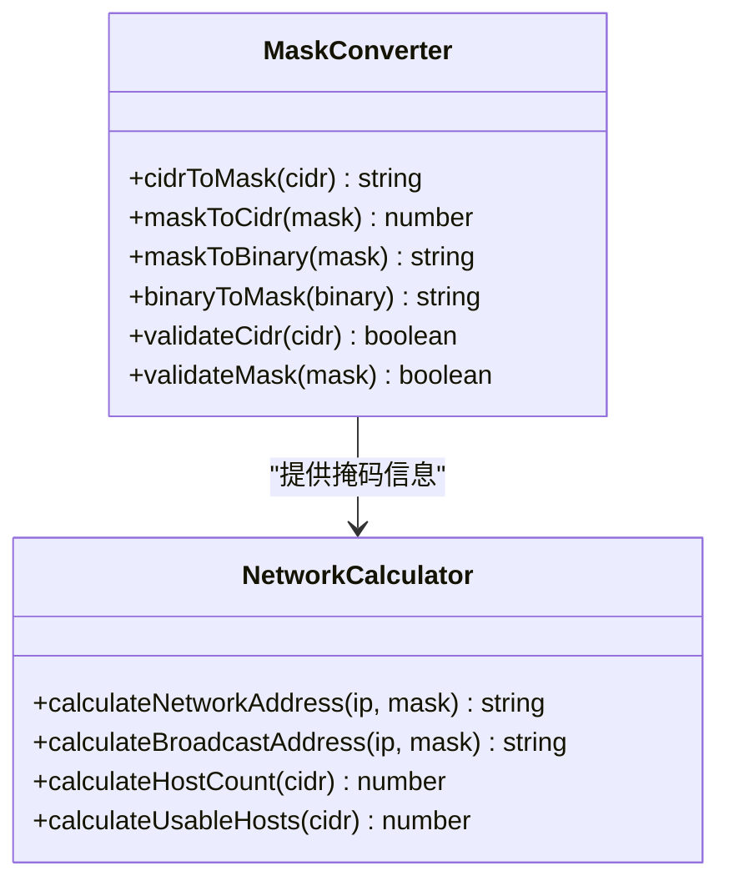

**图表来源**
- [calculator_net.html:80-90](file://templates/calculator_net.html#L80-L90)

#### 转换机制

1. **CIDR到掩码**：`/24` → `255.255.255.0`
2. **掩码到CIDR**：`255.255.255.0` → `/24`
3. **掩码到二进制**：`255.255.255.0` → `11111111.11111111.11111111.00000000`

**章节来源**
- [calculator_net.html:80-90](file://templates/calculator_net.html#L80-L90)

### 网络参数计算组件

网络参数计算组件负责生成完整的网络信息：

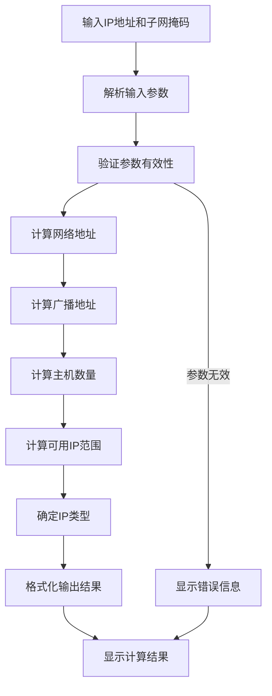

**图表来源**
- [calculator_net.html:103-140](file://templates/calculator_net.html#L103-L140)

#### 计算参数

1. **网络地址**：IP地址与子网掩码的按位与运算
2. **广播地址**：网络地址与反掩码的按位或运算
3. **可用主机数**：`(2^(32-CIDR)) - 2`
4. **IP类型判断**：根据地址范围确定类型

**章节来源**
- [calculator_net.html:103-140](file://templates/calculator_net.html#L103-L140)

### IP范围计算组件

IP范围计算功能支持计算IP地址范围和最小CIDR覆盖：

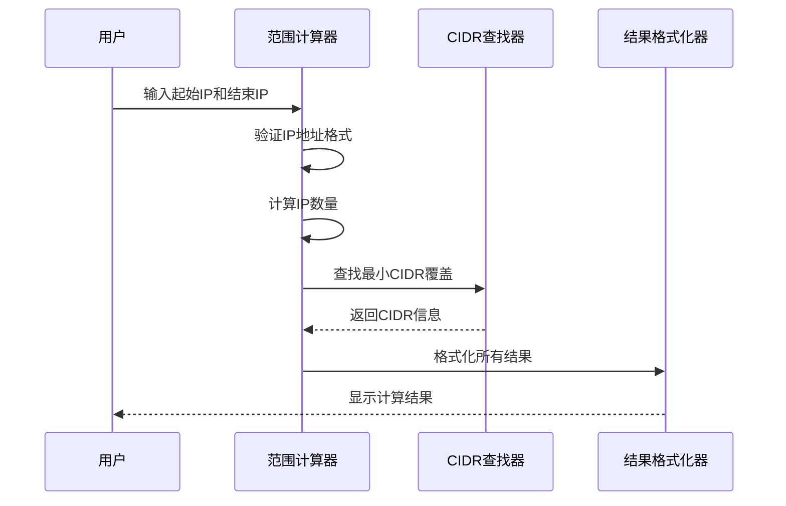

**图表来源**
- [calculator_net.html:142-167](file://templates/calculator_net.html#L142-L167)

#### 功能特性

1. **范围验证**：确保起始IP不大于结束IP
2. **CIDR查找**：自动计算最小覆盖CIDR
3. **二进制显示**：提供二进制格式的IP地址
4. **统计信息**：显示IP数量和范围详情

**章节来源**
- [calculator_net.html:142-167](file://templates/calculator_net.html#L142-L167)

### 网络工具组件

网络工具组件提供多种网络诊断功能，均需VIP权限访问：

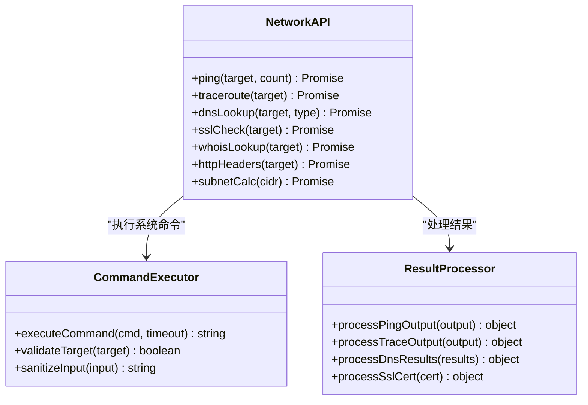

**图表来源**
- [app.py:2075-2316](file://app.py#L2075-L2316)

#### 工具功能

1. **Ping检测**：网络连通性测试
2. **路由追踪**：网络路径分析
3. **DNS查询**：域名解析服务
4. **SSL检查**：证书验证和信息提取
5. **Whois查询**：域名注册信息
6. **HTTP头检查**：网站响应头分析

**章节来源**
- [app.py:2075-2316](file://app.py#L2075-L2316)

## 依赖关系分析

网络计算器功能的依赖关系体现了清晰的分层架构：

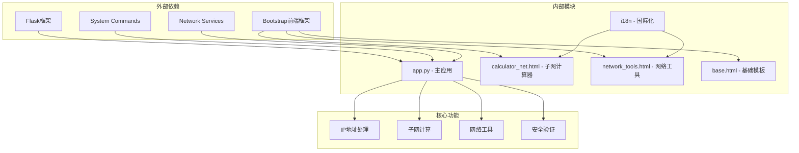

**图表来源**
- [app.py:1958-2316](file://app.py#L1958-L2316)
- [calculator_net.html:1-188](file://templates/calculator_net.html#L1-188)
- [network_tools.html:1-328](file://templates/network_tools.html#L1-328)

### 权限控制机制

网络工具组件采用严格的权限控制：

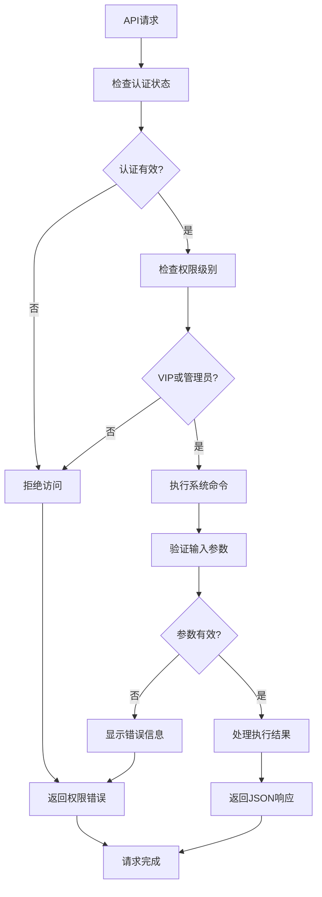

**图表来源**
- [app.py:952-963](file://app.py#L952-L963)

**章节来源**
- [app.py:952-963](file://app.py#L952-L963)
- [app.py:1958-2316](file://app.py#L1958-L2316)

## 性能考虑

网络计算器在设计时充分考虑了性能优化：

### 内存优化策略

1. **即时计算**：所有计算在客户端进行，减少服务器负载
2. **缓存机制**：IP地理信息缓存，避免重复查询
3. **资源清理**：及时释放网络连接和系统资源

### 网络优化

1. **异步处理**：网络工具使用异步请求，避免阻塞UI
2. **超时控制**：所有网络操作设置合理超时时间
3. **错误重试**：关键操作具备基本的错误处理机制

### 安全优化

1. **输入验证**：严格验证所有用户输入
2. **命令过滤**：限制可执行的系统命令
3. **权限隔离**：不同权限级别的功能访问控制

## 故障排除指南

### 常见问题及解决方案

#### 子网计算器问题

| 问题类型 | 症状 | 解决方案 |
|---------|------|----------|
| IP格式错误 | 显示"无效的IP地址" | 确保输入格式为xxx.xxx.xxx.xxx，每个部分0-255 |
| 子网掩码无效 | 显示"无效的子网掩码/CIDR" | 检查掩码格式或CIDR值范围(0-32) |
| 计算结果异常 | 网络地址或广播地址错误 | 验证输入的IP地址和子网掩码 |

#### 网络工具问题

| 问题类型 | 症状 | 解决方案 |
|---------|------|----------|
| 权限不足 | 显示"需要VIP或管理员权限" | 联系管理员提升权限 |
| 命令不可用 | 显示"command not available" | 确保系统安装了相应的网络工具 |
| 超时错误 | 显示"timeout" | 检查网络连接和目标可达性 |
| 参数错误 | 显示"Invalid target" | 确保目标地址格式正确 |

#### 界面显示问题

| 问题类型 | 症状 | 解决方案 |
|---------|------|----------|
| 界面空白 | 页面无法加载 | 检查浏览器控制台错误信息 |
| 按钮无响应 | 计算或查询无反应 | 刷新页面后重试 |
| 结果格式异常 | 显示原始数据而非格式化结果 | 清除浏览器缓存后重试 |

**章节来源**
- [calculator_net.html:103-185](file://templates/calculator_net.html#L103-L185)
- [app.py:2075-2316](file://app.py#L2075-L2316)

## 结论

网络计算器功能展现了现代Web应用的优秀设计实践，具有以下特点：

### 技术优势

1. **功能完整性**：涵盖IPv4地址计算、子网分析、网络诊断等核心功能
2. **用户体验**：直观的界面设计和实时反馈机制
3. **安全性**：完善的权限控制和输入验证机制
4. **可扩展性**：模块化的架构设计便于功能扩展

### 应用价值

1. **教育用途**：帮助学生理解网络概念和计算方法
2. **实用工具**：为网络管理员提供便捷的计算工具
3. **学习资源**：支持网络技术的学习和实践

### 改进建议

1. **移动端优化**：增强移动设备的适配能力
2. **功能扩展**：增加IPv6支持和更多网络工具
3. **性能优化**：进一步优化计算效率和响应速度
4. **用户体验**：提供更多的帮助文档和示例

网络计算器作为SchoolWeb项目的重要组成部分，为用户提供了强大而易用的网络计算和分析工具，体现了现代Web应用的技术水平和用户体验设计理念。