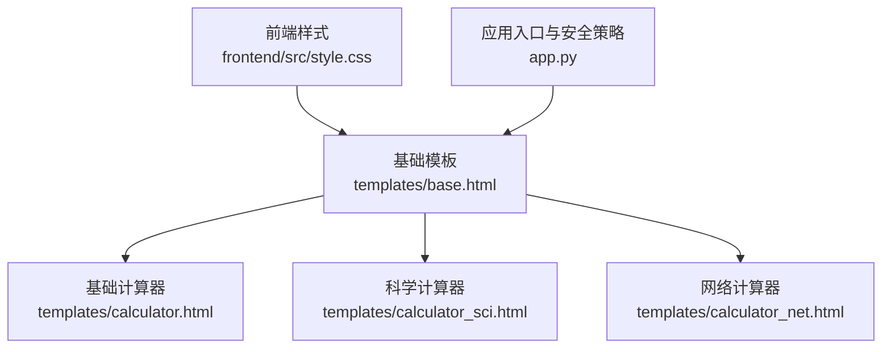
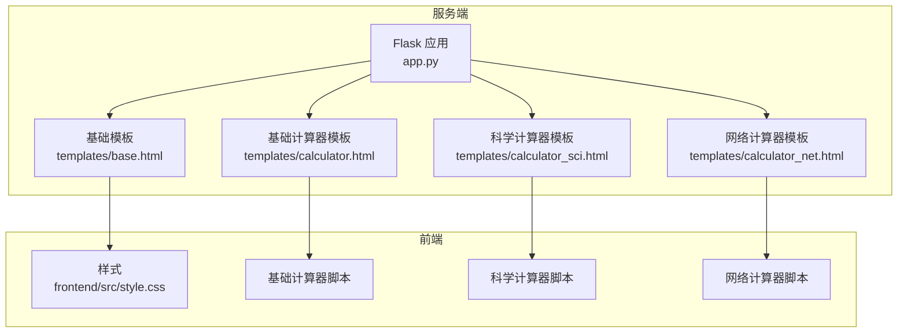
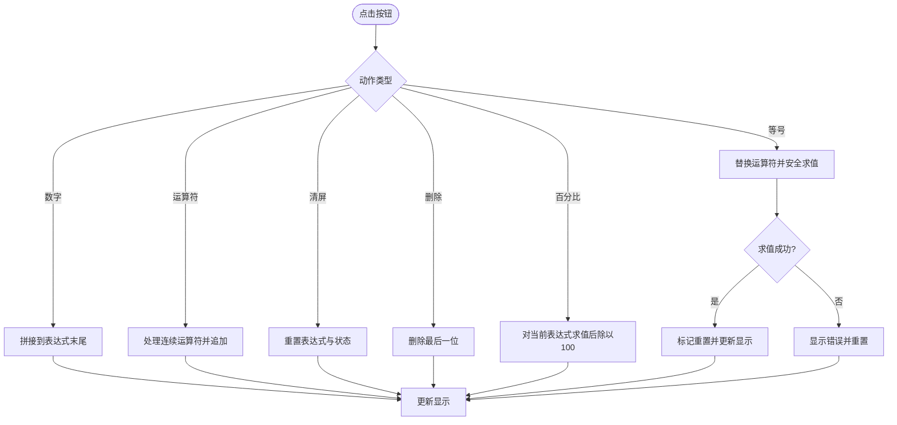
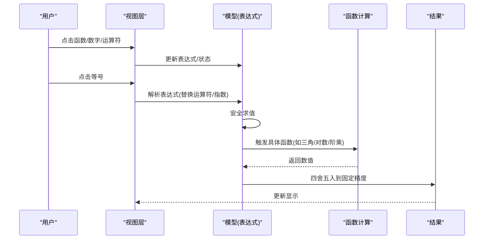
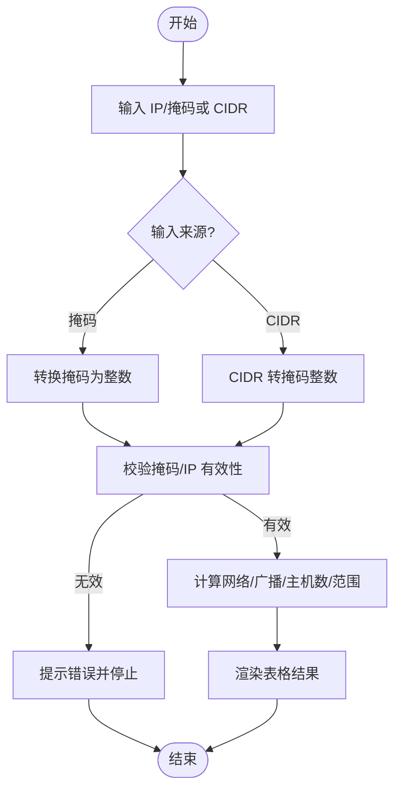
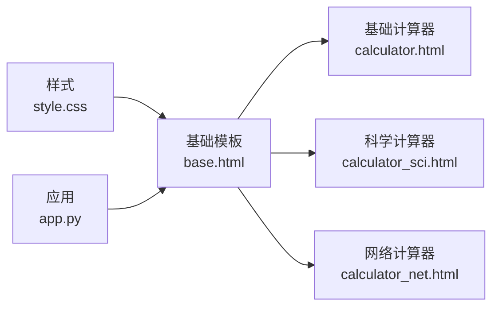

# 计算器工具集

<cite>
**本文引用的文件**
- [templates/calculator.html](file://templates/calculator.html)
- [templates/calculator_sci.html](file://templates/calculator_sci.html)
- [templates/calculator_net.html](file://templates/calculator_net.html)
- [templates/base.html](file://templates/base.html)
- [frontend/src/style.css](file://frontend/src/style.css)
- [app.py](file://app.py)
</cite>

## 目录
1. [简介](#简介)
2. [项目结构](#项目结构)
3. [核心组件](#核心组件)
4. [架构总览](#架构总览)
5. [详细组件分析](#详细组件分析)
6. [依赖分析](#依赖分析)
7. [性能考虑](#性能考虑)
8. [故障排查指南](#故障排查指南)
9. [结论](#结论)
10. [附录](#附录)

## 简介
本文件系统性梳理“计算器工具集”的实现与使用说明，覆盖三类计算器：基础计算器、科学计算器与网络计算器。内容包括表达式解析与运算符优先级、错误处理机制、界面布局与键盘快捷键、响应式适配、历史记录能力现状、精度控制与数值范围限制、扩展功能（单位换算、编程模式、高级数学函数）等。文档旨在帮助开发者快速理解代码结构与交互流程，并为后续增强提供参考。

## 项目结构
计算器工具集由服务端模板渲染与前端样式共同组成：
- 服务端模板负责页面结构与交互逻辑（基础/科学/网络计算器）
- 基础模板提供通用导航、主题切换与全局样式
- 前端样式提供统一视觉风格与响应式布局

图表来源
- [templates/base.html:1-337](file://templates/base.html#L1-L337)
- [templates/calculator.html:1-111](file://templates/calculator.html#L1-L111)
- [templates/calculator_sci.html:1-210](file://templates/calculator_sci.html#L1-L210)
- [templates/calculator_net.html:1-188](file://templates/calculator_net.html#L1-L188)
- [frontend/src/style.css:1-59](file://frontend/src/style.css#L1-L59)
- [app.py:119-139](file://app.py#L119-L139)

章节来源
- [templates/base.html:1-337](file://templates/base.html#L1-L337)
- [templates/calculator.html:1-111](file://templates/calculator.html#L1-L111)
- [templates/calculator_sci.html:1-210](file://templates/calculator_sci.html#L1-L210)
- [templates/calculator_net.html:1-188](file://templates/calculator_net.html#L1-L188)
- [frontend/src/style.css:1-59](file://frontend/src/style.css#L1-L59)
- [app.py:119-139](file://app.py#L119-L139)

## 核心组件
- 基础计算器
  - 支持数字输入、四则运算、百分比、退格与清屏
  - 使用安全替换规则进行表达式转换，再通过安全求值执行
  - 键盘快捷键映射到按钮行为
- 科学计算器
  - 在基础功能上增加三角函数、对数、幂方、阶乘、角度模式（度/弧度）、常数（π、e）
  - 表达式解析采用更严格的替换与安全求值，结果保留固定小数位
  - 支持括号、指数符号、倒数、科学计数法标记
- 网络计算器
  - 提供子网掩码计算、IP范围计算、IP进制转换（十进制/十六进制/八进制/二进制/标准IP/反向DNS）
  - 输入校验与边界条件处理，输出表格化结果
- 界面与交互
  - Bootstrap 布局与卡片式设计，网格按钮布局
  - 主题切换（明/暗）与语言切换
  - 响应式适配（移动端优化）

章节来源
- [templates/calculator.html:47-110](file://templates/calculator.html#L47-L110)
- [templates/calculator_sci.html:74-209](file://templates/calculator_sci.html#L74-L209)
- [templates/calculator_net.html:71-187](file://templates/calculator_net.html#L71-L187)
- [templates/base.html:158-203](file://templates/base.html#L158-L203)
- [frontend/src/style.css:1-59](file://frontend/src/style.css#L1-L59)

## 架构总览
整体采用“服务端模板渲染 + 前端样式”的轻量架构：
- 路由由服务端负责（Flask），模板渲染页面并注入 CSP nonce
- 前端通过内联脚本实现计算器交互，网络工具通过独立脚本模块化处理
- 安全策略在服务端集中配置（CSP、Session Cookie、速率限制等）

图表来源
- [app.py:119-139](file://app.py#L119-L139)
- [templates/base.html:1-337](file://templates/base.html#L1-L337)
- [templates/calculator.html:47-110](file://templates/calculator.html#L47-L110)
- [templates/calculator_sci.html:74-209](file://templates/calculator_sci.html#L74-L209)
- [templates/calculator_net.html:71-187](file://templates/calculator_net.html#L71-L187)
- [frontend/src/style.css:1-59](file://frontend/src/style.css#L1-L59)

## 详细组件分析

### 基础计算器
- 表达式解析与运算符优先级
  - 通过替换运算符（×、÷、−）为标准符号，再进行安全求值
  - 对连续运算符进行替换处理，避免非法拼接
- 错误处理机制
  - 语法错误捕获并显示错误提示，同时重置状态
- 键盘快捷键
  - 数字、运算符、退格、清屏、回车等按键映射到对应按钮点击
- 界面与交互
  - 4列网格按钮布局，显示区右对齐，字体等宽

图表来源
- [templates/calculator.html:54-85](file://templates/calculator.html#L54-L85)

章节来源
- [templates/calculator.html:47-110](file://templates/calculator.html#L47-L110)

### 科学计算器
- 功能特性
  - 三角函数（含角度/弧度模式）、对数（常用/自然）、平方根、平方、幂运算、阶乘、常数（π、e）、括号、正负号切换、倒数、科学计数法标记
- 表达式解析与精度控制
  - 使用安全求值函数，替换运算符与指数符号，结果按固定精度截断
  - 角度模式切换影响三角函数计算
- 错误处理与边界
  - 阶乘仅接受非负整数；非法输入显示错误并重置
- 键盘快捷键
  - 支持括号、指数符号、常用运算符与回车等

图表来源
- [templates/calculator_sci.html:84-182](file://templates/calculator_sci.html#L84-L182)

章节来源
- [templates/calculator_sci.html:74-209](file://templates/calculator_sci.html#L74-L209)

### 网络计算器
- 子网掩码计算
  - 支持输入 IP 与子网掩码或 CIDR，计算网络地址、广播地址、可用主机数、主机范围、总地址数、IP 类型、二进制表示
- IP 范围计算
  - 输入起始与结束 IP，计算数量、最小 CIDR 覆盖、起止整数与二进制
- IP 进制转换
  - 输入标准 IP，输出十进制整数、十六进制、八进制、二进制、标准 IP、反向 DNS
- 输入校验与错误提示
  - 非法格式显示警告，边界条件（如 CIDR 范围、起止顺序）进行保护

图表来源
- [templates/calculator_net.html:104-140](file://templates/calculator_net.html#L104-L140)
- [templates/calculator_net.html:143-167](file://templates/calculator_net.html#L143-L167)
- [templates/calculator_net.html:170-185](file://templates/calculator_net.html#L170-L185)

章节来源
- [templates/calculator_net.html:71-187](file://templates/calculator_net.html#L71-L187)

### 界面设计与响应式适配
- 按钮布局
  - 基础/科学计算器采用网格布局，网络计算器采用卡片分栏
- 键盘快捷键
  - 基础/科学计算器均绑定常用键位映射
- 响应式适配
  - 使用 Bootstrap 网格系统，配合媒体查询优化移动端显示
- 主题与语言
  - 支持明/暗主题切换与多语言切换（由基础模板提供）

章节来源
- [templates/calculator.html:16-44](file://templates/calculator.html#L16-L44)
- [templates/calculator_sci.html:17-71](file://templates/calculator_sci.html#L17-L71)
- [templates/calculator_net.html:11-68](file://templates/calculator_net.html#L11-L68)
- [templates/base.html:158-203](file://templates/base.html#L158-L203)
- [frontend/src/style.css:1-59](file://frontend/src/style.css#L1-L59)

### 计算历史记录
- 当前实现
  - 三个计算器模板未内置本地历史存储或导出功能
- 建议方案
  - 使用浏览器本地存储（localStorage）记录最近计算历史
  - 提供“查看历史”“清空历史”“导出为文本/JSON”等操作
  - 历史项包含时间戳、表达式、结果与类型（基础/科学/网络）

[本节为概念性建议，不直接分析具体文件]

### 精度控制与数值范围限制
- 精度控制
  - 科学计算器对结果进行固定精度截断（约小数位）
  - 基础计算器直接显示求值结果
- 数值范围限制
  - JavaScript 浮点数范围与精度限制需注意
  - 网络计算器对 CIDR 范围进行校验（0–32）
- 建议
  - 对超界或异常结果给出明确提示
  - 在科学计算器中统一精度策略，避免不同函数表现差异

章节来源
- [templates/calculator_sci.html:159-162](file://templates/calculator_sci.html#L159-L162)
- [templates/calculator_net.html:82-89](file://templates/calculator_net.html#L82-L89)

### 扩展功能
- 单位换算（来自学习工具）
  - 支持长度、重量、温度、面积、体积、速度等类别
  - 提供实时换算与表格化展示
- 编程模式与高级数学函数
  - 可在现有科学计算器基础上扩展（如复数、阶乘、组合/排列、统计函数）
  - 注意输入合法性与数值范围校验

章节来源
- [templates/study.html:574-630](file://templates/study.html#L574-L630)

## 依赖分析
- 模板依赖
  - 三个计算器模板均继承基础模板，共享导航、主题切换与全局样式
- 前端样式依赖
  - 统一使用 Bootstrap 与自定义样式，保证视觉一致性
- 安全与会话
  - Flask 应用集中配置 CSP、Session Cookie、速率限制与安全响应头

图表来源
- [templates/base.html:1-337](file://templates/base.html#L1-L337)
- [templates/calculator.html:1-111](file://templates/calculator.html#L1-L111)
- [templates/calculator_sci.html:1-210](file://templates/calculator_sci.html#L1-L210)
- [templates/calculator_net.html:1-188](file://templates/calculator_net.html#L1-L188)
- [frontend/src/style.css:1-59](file://frontend/src/style.css#L1-L59)
- [app.py:642-676](file://app.py#L642-L676)

章节来源
- [templates/base.html:1-337](file://templates/base.html#L1-L337)
- [app.py:642-676](file://app.py#L642-L676)

## 性能考虑
- 计算器脚本均为轻量内联脚本，复杂度主要取决于表达式长度与函数调用次数
- 科学计算器的安全求值与精度截断开销可控
- 网络计算器的整数与二进制转换为 O(1) 操作
- 建议
  - 避免在长表达式中频繁触发重算
  - 对高频输入（如连续数字）可增加去抖处理

[本节为一般性指导，不直接分析具体文件]

## 故障排查指南
- 常见问题
  - 表达式语法错误：检查运算符拼接与括号匹配
  - 非法输入（如负阶乘、除零）：查看错误提示并修正
  - 网络计算器输入非法：确认 IP 与 CIDR/掩码格式
- 定位方法
  - 查看控制台是否有异常
  - 检查模板中的脚本绑定与事件监听
- 安全与稳定性
  - 服务端已启用 CSP 与安全响应头，避免脚本注入风险
  - 速率限制与会话超时保障系统稳定

章节来源
- [templates/calculator.html:67-82](file://templates/calculator.html#L67-L82)
- [templates/calculator_sci.html:160-177](file://templates/calculator_sci.html#L160-L177)
- [templates/calculator_net.html:115-118](file://templates/calculator_net.html#L115-L118)
- [app.py:642-676](file://app.py#L642-L676)

## 结论
计算器工具集以简洁的模板与脚本实现了基础、科学与网络三大类计算器，具备良好的交互体验与安全性。建议后续增强方向包括：计算历史记录与导出、统一精度策略、扩展高级数学与单位换算功能、以及进一步优化移动端体验。

[本节为总结性内容，不直接分析具体文件]

## 附录
- 快捷键速查
  - 基础/科学计算器：数字、运算符、退格、清屏、回车
  - 网络计算器：输入框与按钮交互为主，无专用快捷键
- 主题与语言
  - 通过基础模板提供的主题切换与语言切换完成

[本节为概览性内容，不直接分析具体文件]