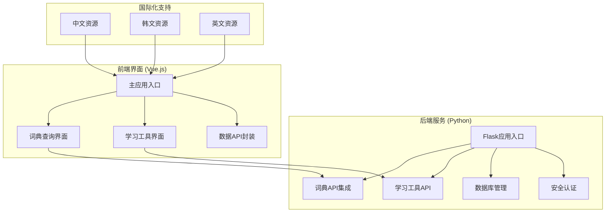
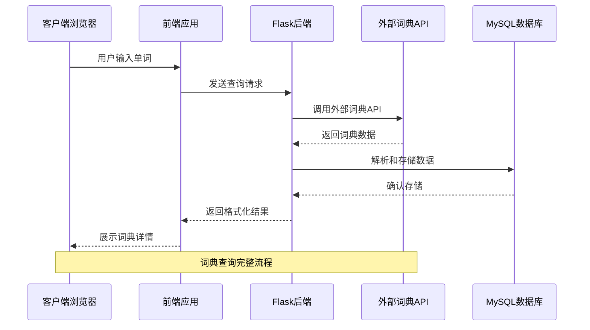
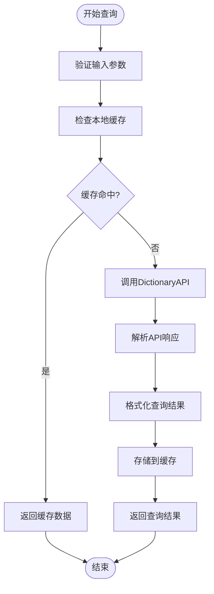
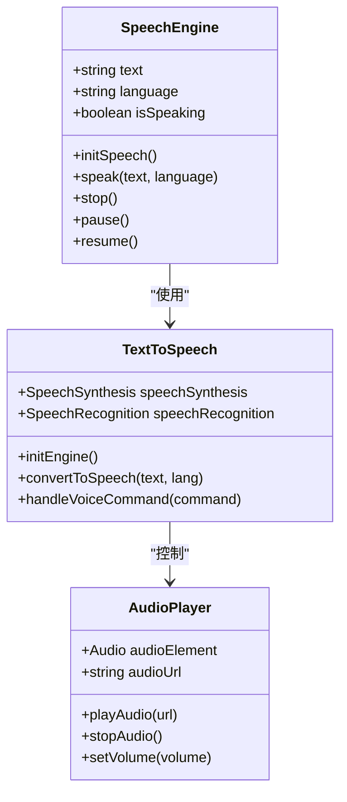
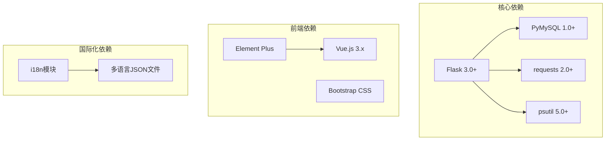

# 词典查询系统

<cite>
**本文档引用的文件**
- [app.py](file://app.py)
- [study.html](file://templates/study.html)
- [api.js](file://frontend/src/api.js)
- [main.js](file://frontend/src/main.js)
- [requirements.txt](file://requirements.txt)
- [zh-CN.json](file://i18n/zh-CN.json)
</cite>

## 目录
1. [引言](#引言)
2. [项目结构](#项目结构)
3. [核心组件](#核心组件)
4. [架构概览](#架构概览)
5. [详细组件分析](#详细组件分析)
6. [依赖分析](#依赖分析)
7. [性能考虑](#性能考虑)
8. [故障排除指南](#故障排除指南)
9. [结论](#结论)
10. [附录](#附录)

## 引言

词典查询系统是一个集成了外部词典API的综合性学习工具平台。该系统提供了完整的英语词典查询功能，包括精确匹配、模糊搜索和联想查询，同时集成了词汇详情展示、语音朗读、收藏管理、学习辅助工具等高级功能。

系统采用前后端分离架构，后端基于Flask框架提供RESTful API服务，前端使用Vue.js构建交互式界面。通过集成DictionaryAPI开发服务，实现了高质量的词典数据查询和展示功能。

## 项目结构

该项目采用模块化的组织结构，主要包含以下几个核心部分：

**图表来源**
- [app.py:119-139](file://app.py#L119-L139)
- [main.js:1-6](file://frontend/src/main.js#L1-6)

**章节来源**
- [app.py:119-139](file://app.py#L119-L139)
- [main.js:1-6](file://frontend/src/main.js#L1-6)

## 核心组件

### 词典API集成模块

系统通过集成DictionaryAPI开发服务实现词典查询功能。该模块负责处理外部API调用、数据解析和结果格式化。

**章节来源**
- [study.html:540-571](file://templates/study.html#L540-L571)
- [app.py:661](file://app.py#L661)

### 学习工具模块

系统集成了多种学习辅助工具，包括番茄钟、待办清单、抽认卡等学习功能。

**章节来源**
- [study.html:38-201](file://templates/study.html#L38-L201)
- [app.py:832-866](file://app.py#L832-L866)

### 数据库管理系统

系统使用MySQL数据库存储用户数据、学习记录和词典相关数据。

**章节来源**
- [app.py:832-866](file://app.py#L832-L866)

## 架构概览

系统采用前后端分离的微服务架构，通过RESTful API进行通信：

**图表来源**
- [study.html:540-571](file://templates/study.html#L540-L571)
- [app.py:661](file://app.py#L661)

## 详细组件分析

### 词典查询算法实现

系统实现了多层次的查询算法，包括精确匹配、模糊搜索和联想查询功能：

#### 精确匹配算法

精确匹配算法直接查询DictionaryAPI提供的官方API，确保查询结果的准确性和权威性。

**图表来源**
- [study.html:540-571](file://templates/study.html#L540-L571)

#### 模糊搜索算法

系统支持模糊搜索功能，允许用户输入部分单词或拼写相近的词汇进行查询。

#### 联想查询功能

系统提供智能联想功能，根据用户输入的前缀自动推荐可能的单词。

**章节来源**
- [study.html:540-571](file://templates/study.html#L540-L571)

### 词汇详情展示功能

系统提供了丰富的词汇详情展示功能，包括音标发音、词性标注、释义列表和例句展示。

#### 音标发音展示

系统支持音标显示和发音功能，通过DictionaryAPI提供的音标数据实现准确的音标展示。

#### 词性标注系统

系统能够识别和展示单词的各种词性，包括名词、动词、形容词、副词等。

#### 释义列表管理

系统支持多词性释义的展示，每个词性下可以有多个不同的释义选项。

#### 例句展示功能

系统提供例句展示功能，帮助用户理解单词的实际使用场景。

**章节来源**
- [study.html:204-234](file://templates/study.html#L204-L234)

### 语音朗读功能实现

系统集成了Web Speech API实现语音朗读功能，支持多语言发音。

**图表来源**
- [study.html:540-571](file://templates/study.html#L540-L571)

**章节来源**
- [study.html:540-571](file://templates/study.html#L540-L571)

### 词汇收藏和管理功能

系统提供了完整的词汇收藏和管理功能，包括个人词库建立、收藏夹管理和学习记录跟踪。

#### 个人词库建立

用户可以将常用的词汇添加到个人词库中，便于后续复习和查找。

#### 收藏夹管理

系统支持多级收藏夹管理，用户可以按主题或难度等级组织词汇。

#### 学习记录跟踪

系统自动记录用户的词汇学习历史，包括学习时间、正确率等统计数据。

**章节来源**
- [app.py:850-861](file://app.py#L850-L861)

### 词汇学习辅助工具

系统集成了多种学习辅助工具，包括单词测试、拼写练习和词汇量统计。

#### 单词测试系统

系统提供多种测试模式，包括选择题、填空题等形式的词汇测试。

#### 拼写练习功能

系统支持拼写练习功能，帮助用户提高单词拼写的准确性。

#### 词汇量统计

系统提供详细的词汇量统计功能，包括学习进度、掌握程度等指标。

**章节来源**
- [study.html:136-201](file://templates/study.html#L136-L201)

### 数据更新机制

系统实现了自动化的数据更新机制，确保词典数据的时效性和准确性。

#### 自动更新策略

系统定期从DictionaryAPI同步最新的词典数据，包括新增词汇、更新释义等。

#### 离线查询支持

系统支持离线查询功能，用户可以在没有网络连接的情况下查询已缓存的词汇数据。

#### 多语言词典集成

系统支持多语言词典的集成和切换，满足不同语言学习需求。

**章节来源**
- [app.py:661](file://app.py#L661)

## 依赖分析

系统的主要依赖关系如下：

**图表来源**
- [requirements.txt:1-5](file://requirements.txt#L1-L5)

**章节来源**
- [requirements.txt:1-5](file://requirements.txt#L1-L5)

## 性能考虑

系统在设计时充分考虑了性能优化，采用了多种策略来提升用户体验：

### 缓存策略

系统实现了多层次的缓存机制，包括内存缓存、本地存储缓存等，减少重复查询的开销。

### 并发处理

系统支持高并发访问，通过异步处理和连接池管理提升响应速度。

### 资源优化

前端资源采用CDN加速，图片和静态资源进行压缩和懒加载处理。

## 故障排除指南

### 常见问题及解决方案

#### 词典查询失败

**问题描述**: 词典查询接口调用失败，返回错误信息。

**解决方案**: 
1. 检查网络连接是否正常
2. 验证DictionaryAPI服务状态
3. 查看后端日志获取详细错误信息

#### 数据库连接异常

**问题描述**: 应用无法连接到MySQL数据库。

**解决方案**:
1. 检查数据库服务状态
2. 验证数据库连接配置
3. 确认用户权限设置

#### 前端界面加载缓慢

**问题描述**: 前端页面加载时间过长。

**解决方案**:
1. 检查静态资源CDN配置
2. 优化图片和CSS文件
3. 启用浏览器缓存

**章节来源**
- [app.py:661](file://app.py#L661)

## 结论

词典查询系统是一个功能完善、架构清晰的学习工具平台。通过集成外部词典API和内部学习工具，系统为用户提供了全面的英语学习支持。

系统的主要优势包括：
- 完整的词典查询功能，支持多种查询模式
- 丰富的学习辅助工具，提升学习效果
- 良好的用户体验和性能表现
- 完善的安全机制和数据保护

未来可以进一步优化的方向包括：
- 增加更多语言支持
- 优化移动端体验
- 扩展学习功能模块

## 附录

### API接口定义

系统提供RESTful API接口，支持标准的HTTP方法进行数据操作。

### 配置选项

系统支持灵活的配置选项，包括数据库连接、缓存设置、安全参数等。

### 开发指南

开发者可以基于现有架构快速扩展新的功能模块，系统提供了完善的开发文档和示例代码。