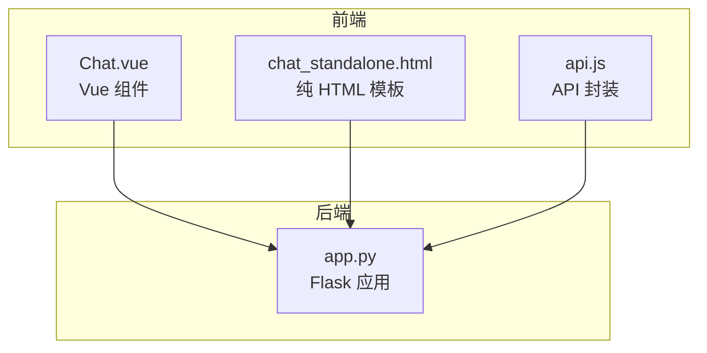
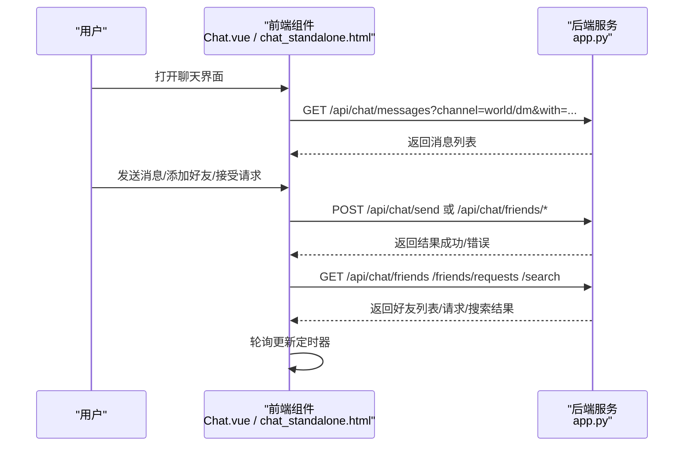
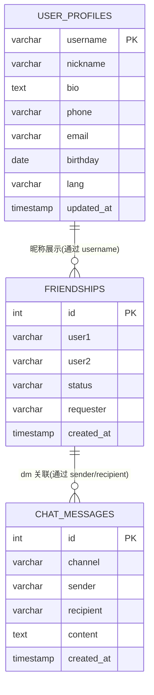
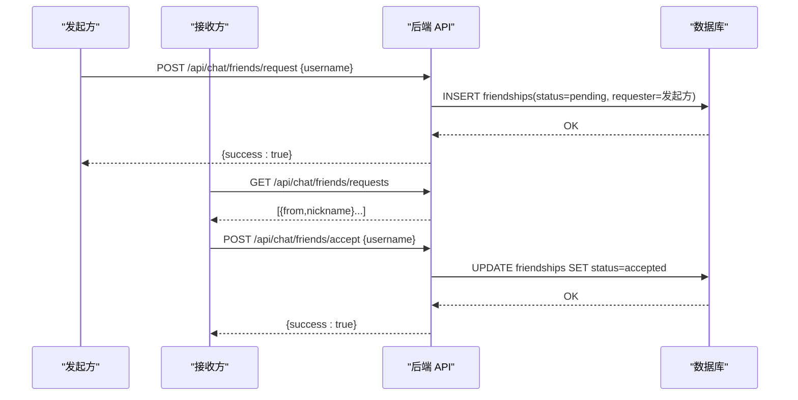
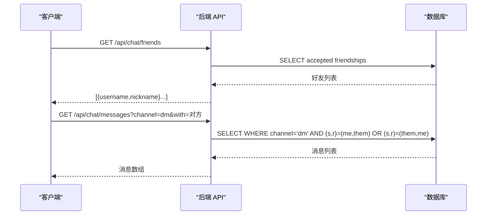
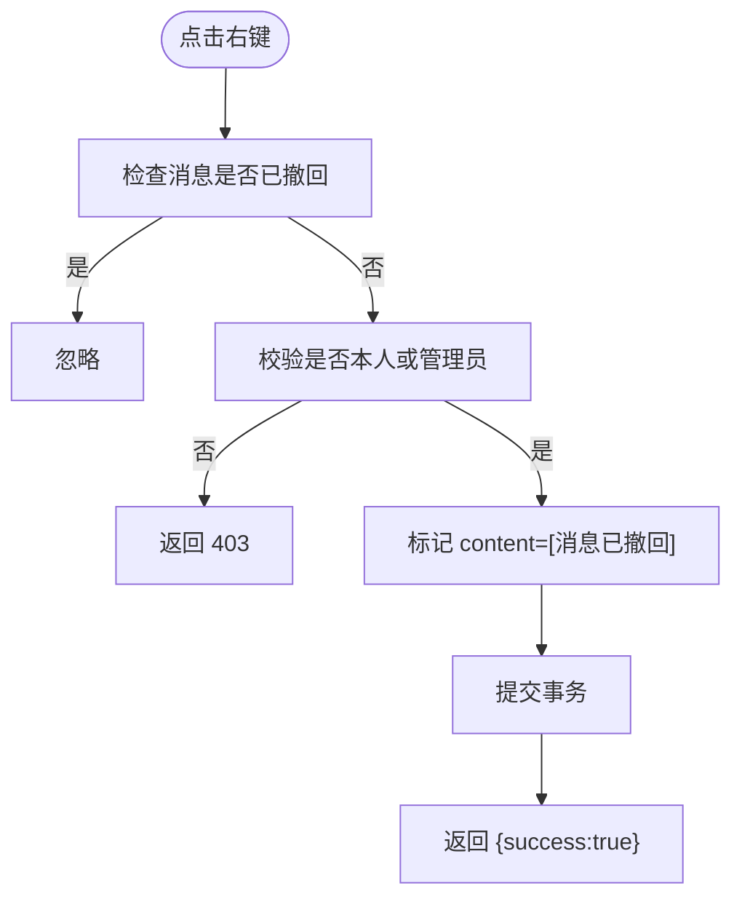
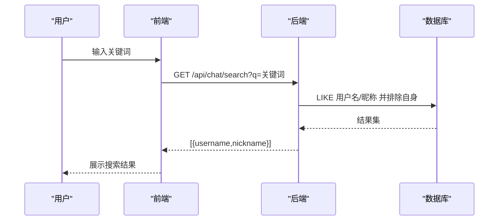
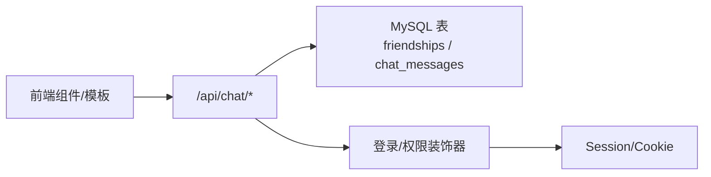

# 好友系统

<cite>
**本文引用的文件**
- [app.py](file://app.py)
- [Chat.vue](file://frontend/src/components/Chat.vue)
- [chat_standalone.html](file://templates/chat_standalone.html)
- [api.js](file://frontend/src/api.js)
- [.gitignore](file://.gitignore)
</cite>

## 目录
1. [简介](#简介)
2. [项目结构](#项目结构)
3. [核心组件](#核心组件)
4. [架构总览](#架构总览)
5. [详细组件分析](#详细组件分析)
6. [依赖分析](#依赖分析)
7. [性能考量](#性能考量)
8. [故障排查指南](#故障排查指南)
9. [结论](#结论)
10. [附录](#附录)

## 简介
本文件面向“好友系统”的完整技术文档，基于仓库中的现有实现进行说明。内容涵盖：
- 好友关系模型与状态管理
- 好友添加流程与权限控制
- 好友列表管理与私信实现
- 搜索与推荐思路
- 安全与隐私策略
- 扩展开发指南

注意：当前仓库中好友系统主要通过“聊天模块”实现，包含好友关系表、私信房间、消息隔离与历史记录等能力。部分高级特性（如在线状态、分组管理、批量操作、复杂推荐算法）在现有代码中未直接体现，将在相应章节给出实现建议与最佳实践。

## 项目结构
好友系统相关的核心位置如下：
- 后端 Flask 应用：app.py
- 前端 Vue 组件：frontend/src/components/Chat.vue
- 前端 HTML 模板：templates/chat_standalone.html
- 前端 API 封装：frontend/src/api.js
- 配置与忽略文件：.gitignore

图表来源
- [app.py:3545-3744](file://app.py#L3545-L3744)
- [Chat.vue:1-214](file://frontend/src/components/Chat.vue#L1-L214)
- [chat_standalone.html:1-174](file://templates/chat_standalone.html#L1-L174)
- [api.js:1-45](file://frontend/src/api.js#L1-L45)

章节来源
- [app.py:3545-3744](file://app.py#L3545-L3744)
- [Chat.vue:1-214](file://frontend/src/components/Chat.vue#L1-L214)
- [chat_standalone.html:1-174](file://templates/chat_standalone.html#L1-L174)
- [api.js:1-45](file://frontend/src/api.js#L1-L45)

## 核心组件
- 数据模型
  - 好友关系表：存储好友对、状态、发起人等
  - 聊天消息表：按频道/私信隔离消息
- API 端点
  - 好友相关：查询好友、查询请求、发送请求、接受请求、删除好友
  - 消息相关：拉取消息、发送消息、撤回消息
  - 搜索：按用户名或昵称模糊搜索
- 前端交互
  - Vue 组件与 HTML 模板分别提供聊天界面、好友列表、请求处理与消息收发

章节来源
- [app.py:818-828](file://app.py#L818-L828)
- [app.py:803-816](file://app.py#L803-L816)
- [app.py:3606-3630](file://app.py#L3606-L3630)
- [app.py:3631-3733](file://app.py#L3631-L3733)
- [app.py:3545-3604](file://app.py#L3545-L3604)
- [Chat.vue:78-164](file://frontend/src/components/Chat.vue#L78-L164)
- [chat_standalone.html:60-172](file://templates/chat_standalone.html#L60-L172)

## 架构总览
好友系统采用前后端分离模式：
- 前端负责 UI、交互与轮询更新
- 后端提供 REST 风格 API，执行业务逻辑与数据库操作
- 数据库层面通过“频道/私信”字段实现消息隔离

图表来源
- [app.py:3545-3604](file://app.py#L3545-L3604)
- [app.py:3606-3630](file://app.py#L3606-L3630)
- [app.py:3631-3733](file://app.py#L3631-L3733)
- [Chat.vue:80-105](file://frontend/src/components/Chat.vue#L80-L105)
- [chat_standalone.html:73-112](file://templates/chat_standalone.html#L73-L112)

## 详细组件分析

### 数据模型与状态管理
- 好友关系表
  - 字段要点：user1、user2、status、requester、created_at
  - 约束：唯一索引保证 user1,user2 唯一
  - 状态：pending/accepted 等
- 聊天消息表
  - 字段要点：channel（world/dm）、sender、recipient、content、created_at
  - 索引：按频道、发送者、接收者、时间建立索引
- 用户资料表
  - 用于昵称等展示信息

图表来源
- [app.py:818-828](file://app.py#L818-L828)
- [app.py:803-816](file://app.py#L803-L816)
- [app.py:258-267](file://app.py#L258-L267)

章节来源
- [app.py:803-828](file://app.py#L803-L828)
- [app.py:258-267](file://app.py#L258-L267)

### 好友添加流程与权限控制
- 流程
  - 搜索目标用户 → 发送好友请求 → 接收方收到请求 → 接受或拒绝 → 成为好友
- 权限与安全
  - 登录态校验：所有好友 API 均需登录
  - 防重复请求：数据库唯一约束 + 异常捕获
  - 自己不能添加自己
  - 接受请求仅限被请求方，且状态必须为 pending

图表来源
- [app.py:3674-3695](file://app.py#L3674-L3695)
- [app.py:3657-3672](file://app.py#L3657-L3672)
- [app.py:3697-3714](file://app.py#L3697-L3714)

章节来源
- [app.py:3674-3714](file://app.py#L3674-L3714)

### 好友列表管理与私信实现
- 好友列表
  - 查询已接受的好友，同时补充昵称
- 私信房间
  - 通过 sender+recipient 双向组合过滤，形成一对一房间
  - 支持分页参数 before 与 limit
- 消息隔离与历史
  - world 频道公开可见
  - dm 频道仅双方可见
  - 历史消息按 id 倒序返回，再反转顺序展示

图表来源
- [app.py:3631-3655](file://app.py#L3631-L3655)
- [app.py:3545-3579](file://app.py#L3545-L3579)

章节来源
- [app.py:3545-3579](file://app.py#L3545-L3579)
- [app.py:3631-3655](file://app.py#L3631-L3655)

### 撤回消息与权限控制
- 仅消息发送者或管理员可撤回
- 实施方式：标记 content 为特定文案，不物理删除
- 前端右键菜单触发，确认后调用 DELETE /api/chat/messages/:mid

图表来源
- [app.py:3735-3754](file://app.py#L3735-L3754)
- [Chat.vue:137-153](file://frontend/src/components/Chat.vue#L137-L153)

章节来源
- [app.py:3735-3754](file://app.py#L3735-L3754)
- [Chat.vue:137-153](file://frontend/src/components/Chat.vue#L137-L153)

### 搜索与推荐
- 搜索
  - 支持用户名与昵称模糊匹配，排除自身
  - 返回前 N 条候选
- 推荐
  - 当前未实现复杂推荐算法
  - 建议：结合活跃度、共同群组、最近互动等维度构建简单推荐

图表来源
- [app.py:3606-3629](file://app.py#L3606-L3629)
- [Chat.vue:107-110](file://frontend/src/components/Chat.vue#L107-L110)
- [chat_standalone.html:136-146](file://templates/chat_standalone.html#L136-L146)

章节来源
- [app.py:3606-3629](file://app.py#L3606-L3629)
- [Chat.vue:107-110](file://frontend/src/components/Chat.vue#L107-L110)
- [chat_standalone.html:136-146](file://templates/chat_standalone.html#L136-L146)

### 在线状态、分组管理与批量操作
- 在线状态
  - 当前未实现在线状态显示
  - 建议：引入 WebSocket 或心跳机制维护在线集合
- 分组管理
  - 当前未实现分组
  - 建议：新增分组表与好友-分组关联表
- 批量操作
  - 当前未实现批量添加/删除
  - 建议：提供批量接口与前端多选交互

（本节为概念性说明，不直接分析具体文件）

## 依赖分析
- 前端依赖
  - Vue 组件与模板通过 /api/chat 下的端点与后端通信
  - 使用 fetch 并携带 Cookie（credentials: include）
- 后端依赖
  - Flask 路由装饰器实现登录态与权限校验
  - MySQL 连接池与事务控制
  - 速率限制与安全中间件

图表来源
- [app.py:907-963](file://app.py#L907-L963)
- [Chat.vue:78-164](file://frontend/src/components/Chat.vue#L78-L164)
- [chat_standalone.html:60-172](file://templates/chat_standalone.html#L60-L172)

章节来源
- [app.py:907-963](file://app.py#L907-L963)
- [Chat.vue:78-164](file://frontend/src/components/Chat.vue#L78-L164)
- [chat_standalone.html:60-172](file://templates/chat_standalone.html#L60-L172)

## 性能考量
- 数据库索引
  - 聊天消息表已建立多列索引，建议根据查询模式进一步评估
- 分页与翻页
  - 消息接口支持 before 与 limit，避免一次性拉取过多
- 轮询频率
  - 前端定时器每 3 秒轮询一次，建议根据场景调整或改用 WebSocket
- 速率限制
  - 后端具备全局速率限制与白名单机制，建议结合业务场景优化阈值

（本节提供通用建议，不直接分析具体文件）

## 故障排查指南
- 登录态问题
  - 确认前端请求携带 Cookie（credentials: include）
  - 检查后端登录装饰器与会话有效期
- 数据库连接
  - 确认数据库配置与连接池可用
  - 检查唯一约束冲突导致的重复请求错误
- 速率限制
  - 若出现 429/封禁提示，检查速率配置与白名单
- 消息撤回
  - 仅本人或管理员可撤回；若失败，检查权限与消息是否存在

章节来源
- [app.py:907-963](file://app.py#L907-L963)
- [app.py:3735-3754](file://app.py#L3735-L3754)
- [app.py:3674-3695](file://app.py#L3674-L3695)
- [.gitignore:1-3](file://.gitignore#L1-L3)

## 结论
- 现有实现提供了完整的好友关系与私信能力，具备良好的扩展基础
- 建议后续完善在线状态、分组与批量操作，并引入更高效的实时通信方案
- 安全方面已具备登录态、CSRF、CSP、速率限制等多重保障

（本节为总结性内容，不直接分析具体文件）

## 附录

### API 规范概览
- 获取消息列表
  - 方法：GET
  - 路径：/api/chat/messages
  - 参数：channel（world/dm）、with（dm 时必填）、before（翻页）、limit（默认 50，上限 100）
- 发送消息
  - 方法：POST
  - 路径：/api/chat/send
  - 参数：channel、content、recipient（dm 时必填）
- 撤回消息
  - 方法：DELETE
  - 路径：/api/chat/messages/:mid
- 好友相关
  - GET /api/chat/friends
  - GET /api/chat/friends/requests
  - POST /api/chat/friends/request
  - POST /api/chat/friends/accept
  - POST /api/chat/friends/remove
- 搜索
  - GET /api/chat/search?q=关键词

章节来源
- [app.py:3545-3604](file://app.py#L3545-L3604)
- [app.py:3606-3630](file://app.py#L3606-L3630)
- [app.py:3631-3733](file://app.py#L3631-L3733)