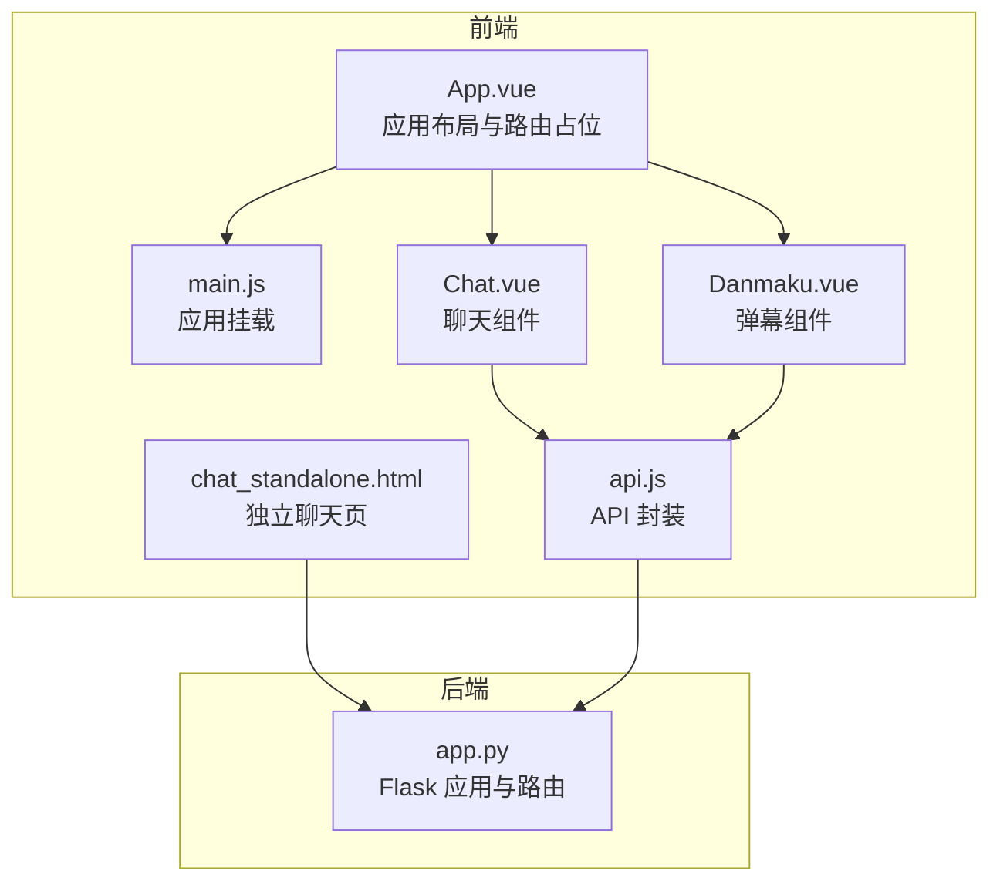
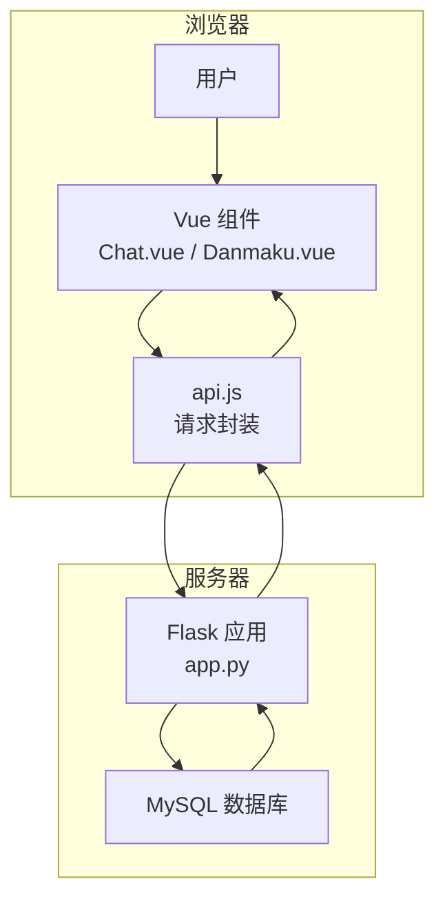
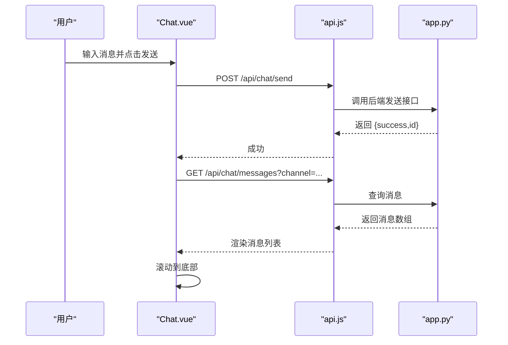
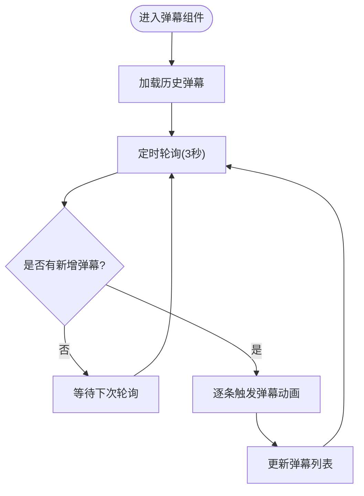
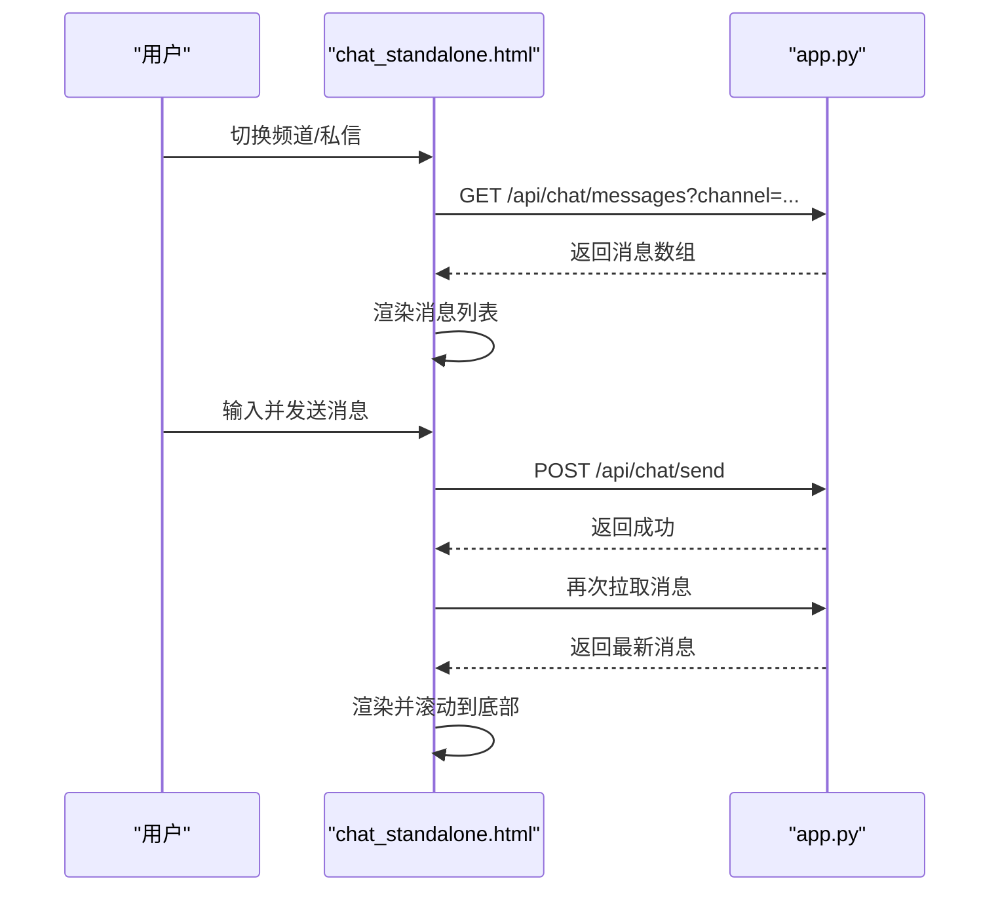
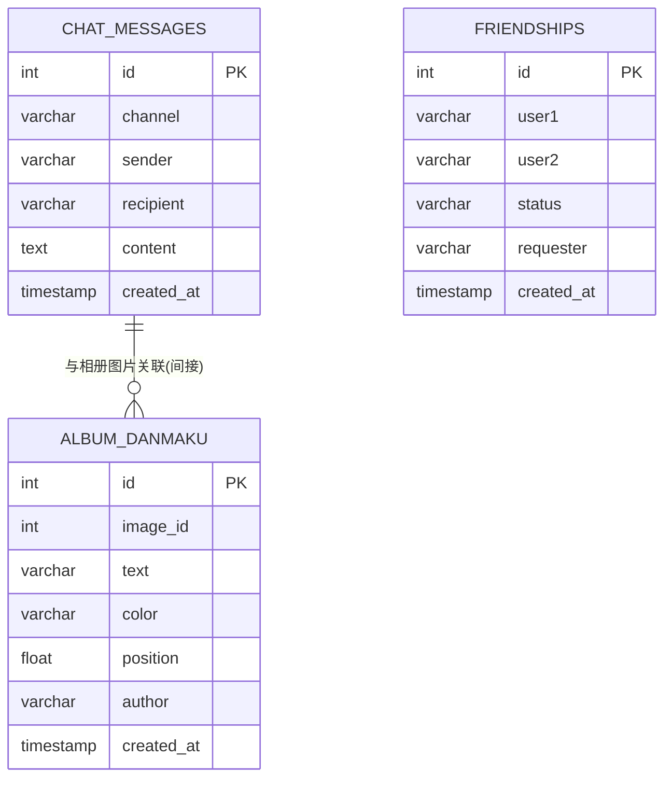
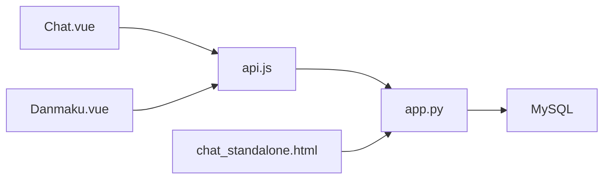

# 实时聊天系统

<cite>
**本文引用的文件**
- [App.vue](file://frontend/src/App.vue)
- [main.js](file://frontend/src/main.js)
- [api.js](file://frontend/src/api.js)
- [Chat.vue](file://frontend/src/components/Chat.vue)
- [Danmaku.vue](file://frontend/src/components/Danmaku.vue)
- [chat_standalone.html](file://templates/chat_standalone.html)
- [app.py](file://app.py)
</cite>

## 目录
1. [简介](#简介)
2. [项目结构](#项目结构)
3. [核心组件](#核心组件)
4. [架构总览](#架构总览)
5. [详细组件分析](#详细组件分析)
6. [依赖分析](#依赖分析)
7. [性能考虑](#性能考虑)
8. [故障排查指南](#故障排查指南)
9. [结论](#结论)
10. [附录](#附录)

## 简介
本文件面向“实时聊天系统”的技术文档，围绕前端组件与后端服务的协作，系统性阐述以下主题：
- WebSocket 连接建立与消息传输协议（基于轮询的实时机制）
- 聊天室架构设计：频道管理、在线用户列表、消息历史记录
- 消息格式、事件类型与状态管理
- 好友系统、私信功能与群组聊天的实现思路
- 弹幕功能的技术实现：渲染、颜色选择与位置控制
- 聊天界面组件设计、用户交互与性能优化策略
- 使用场景与扩展开发指南

说明：当前仓库采用轮询拉取的方式实现“准实时”聊天体验，未发现 WebSocket 服务端或客户端代码。本文将据此进行架构解读与最佳实践建议。

## 项目结构
前端采用 Vue 3 单页应用，后端基于 Flask 提供 REST API。聊天相关的核心文件如下：
- 前端入口与布局：App.vue、main.js
- 聊天组件：Chat.vue（Vue 组件）、chat_standalone.html（纯 JS 页面）
- 弹幕组件：Danmaku.vue
- API 封装：api.js
- 后端路由与数据库：app.py（含聊天、好友、弹幕等表）

图表来源
- [App.vue:1-99](file://frontend/src/App.vue#L1-L99)
- [main.js:1-6](file://frontend/src/main.js#L1-L6)
- [Chat.vue:1-214](file://frontend/src/components/Chat.vue#L1-L214)
- [Danmaku.vue:1-89](file://frontend/src/components/Danmaku.vue#L1-L89)
- [api.js:1-45](file://frontend/src/api.js#L1-L45)
- [chat_standalone.html:1-174](file://templates/chat_standalone.html#L1-L174)
- [app.py:3545-3754](file://app.py#L3545-L3754)

章节来源
- [App.vue:1-99](file://frontend/src/App.vue#L1-L99)
- [main.js:1-6](file://frontend/src/main.js#L1-L6)
- [Chat.vue:1-214](file://frontend/src/components/Chat.vue#L1-L214)
- [Danmaku.vue:1-89](file://frontend/src/components/Danmaku.vue#L1-L89)
- [api.js:1-45](file://frontend/src/api.js#L1-L45)
- [chat_standalone.html:1-174](file://templates/chat_standalone.html#L1-L174)
- [app.py:3545-3754](file://app.py#L3545-L3754)

## 核心组件
- 聊天组件 Chat.vue：负责频道切换、消息列表渲染、发送消息、好友管理、右键撤回等交互。
- 弹幕组件 Danmaku.vue：负责弹幕输入、颜色选择、随机垂直位置与滚动动画、定时拉取。
- API 封装 api.js：统一处理认证与请求体，封装相册与聊天相关 API。
- 独立聊天页 chat_standalone.html：纯前端页面，演示频道与好友管理、消息拉取与撤回。
- 后端路由 app.py：提供聊天消息、好友、弹幕等 API，维护数据库表结构。

章节来源
- [Chat.vue:1-214](file://frontend/src/components/Chat.vue#L1-L214)
- [Danmaku.vue:1-89](file://frontend/src/components/Danmaku.vue#L1-L89)
- [api.js:1-45](file://frontend/src/api.js#L1-L45)
- [chat_standalone.html:1-174](file://templates/chat_standalone.html#L1-L174)
- [app.py:3545-3754](file://app.py#L3545-L3754)

## 架构总览
系统采用前后端分离的 REST 架构：
- 前端通过 fetch 发起 API 请求，后端返回 JSON 数据。
- 聊天消息与好友状态存储于 MySQL 数据库。
- 聊天组件与弹幕组件分别通过定时轮询更新 UI。

图表来源
- [Chat.vue:1-214](file://frontend/src/components/Chat.vue#L1-L214)
- [Danmaku.vue:1-89](file://frontend/src/components/Danmaku.vue#L1-L89)
- [api.js:1-45](file://frontend/src/api.js#L1-L45)
- [app.py:3545-3754](file://app.py#L3545-L3754)

## 详细组件分析

### 聊天组件 Chat.vue
- 功能要点
  - 频道管理：世界频道与私信频道切换。
  - 好友系统：搜索用户、发送/接受/删除好友请求、列出好友。
  - 消息交互：发送消息、右键菜单撤回、自动滚动到底部。
  - 定时轮询：每 3 秒刷新消息与好友列表。
- 数据流
  - 用户输入 -> 发送 API -> 成功后立即拉取最新消息 -> 渲染列表。
  - 右键菜单 -> 撤回 API -> 刷新消息列表。
- 状态管理
  - 使用响应式 ref 管理频道、消息列表、好友、搜索结果等。
  - 通过 nextTick 控制滚动条位置，保证最新消息可见。

图表来源
- [Chat.vue:80-97](file://frontend/src/components/Chat.vue#L80-L97)
- [Chat.vue:148-153](file://frontend/src/components/Chat.vue#L148-L153)
- [api.js:1-45](file://frontend/src/api.js#L1-L45)
- [app.py:3545-3604](file://app.py#L3545-L3604)

章节来源
- [Chat.vue:1-214](file://frontend/src/components/Chat.vue#L1-L214)
- [app.py:3545-3604](file://app.py#L3545-L3604)

### 弹幕组件 Danmaku.vue
- 功能要点
  - 弹幕输入：文本与颜色选择，提交后本地即时渲染。
  - 自动轮询：每 3 秒拉取新增弹幕并增量渲染。
  - 动画控制：随机垂直位置与滚动时长，动画结束后移除节点。
- 数据流
  - 提交弹幕后，立即向后端写入并触发本地动画；随后定时轮询拉取，对比差异后追加新弹幕。

图表来源
- [Danmaku.vue:28-73](file://frontend/src/components/Danmaku.vue#L28-L73)

章节来源
- [Danmaku.vue:1-89](file://frontend/src/components/Danmaku.vue#L1-L89)

### 独立聊天页 chat_standalone.html
- 功能要点
  - 展示世界频道与私信频道的消息列表。
  - 好友搜索、请求、接受与删除。
  - 右键菜单撤回消息。
- 交互流程
  - 切换频道 -> 拉取消息 -> 渲染列表。
  - 发送消息 -> 清空输入 -> 重新拉取。
  - 定时刷新消息与好友列表。

图表来源
- [chat_standalone.html:73-112](file://templates/chat_standalone.html#L73-L112)
- [app.py:3545-3604](file://app.py#L3545-L3604)

章节来源
- [chat_standalone.html:1-174](file://templates/chat_standalone.html#L1-L174)
- [app.py:3545-3604](file://app.py#L3545-L3604)

### 后端路由与数据模型
- 路由概览
  - 获取消息：GET /api/chat/messages
  - 发送消息：POST /api/chat/send
  - 撤回消息：DELETE /api/chat/messages/{mid}
  - 好友相关：GET /api/chat/friends、GET /api/chat/friends/requests、POST /api/chat/friends/request、POST /api/chat/friends/accept、POST /api/chat/friends/remove
  - 搜索用户：GET /api/chat/search
- 数据模型
  - 聊天消息表：包含频道、发送者、接收者、内容与时间戳。
  - 好友关系表：记录双方用户、状态与请求者。
  - 弹幕表：与相册图片关联，包含弹幕文本、颜色与位置。

图表来源
- [app.py:804-828](file://app.py#L804-L828)
- [app.py:3545-3754](file://app.py#L3545-L3754)

章节来源
- [app.py:804-828](file://app.py#L804-L828)
- [app.py:3545-3754](file://app.py#L3545-L3754)

## 依赖分析
- 前端依赖
  - Vue 3：组件化与响应式状态管理。
  - fetch：统一 API 调用。
- 后端依赖
  - Flask：路由与视图函数。
  - PyMySQL：数据库访问。
  - CORS：跨域支持。
- 组件间耦合
  - Chat.vue 与 Danmaku.vue 分别依赖 api.js 与 app.py。
  - chat_standalone.html 直接调用 app.py 的 /api/chat/* 接口。

图表来源
- [Chat.vue:1-214](file://frontend/src/components/Chat.vue#L1-L214)
- [Danmaku.vue:1-89](file://frontend/src/components/Danmaku.vue#L1-L89)
- [api.js:1-45](file://frontend/src/api.js#L1-L45)
- [chat_standalone.html:1-174](file://templates/chat_standalone.html#L1-L174)
- [app.py:3545-3754](file://app.py#L3545-L3754)

章节来源
- [Chat.vue:1-214](file://frontend/src/components/Chat.vue#L1-L214)
- [Danmaku.vue:1-89](file://frontend/src/components/Danmaku.vue#L1-L89)
- [api.js:1-45](file://frontend/src/api.js#L1-L45)
- [chat_standalone.html:1-174](file://templates/chat_standalone.html#L1-L174)
- [app.py:3545-3754](file://app.py#L3545-L3754)

## 性能考虑
- 轮询频率与节流
  - 当前轮询间隔为 3 秒，适合低并发场景；高并发时可考虑降低频率或引入服务端推送（WebSocket）。
- 消息分页与上限
  - 后端按 id 倒序查询并限制数量，避免一次性拉取过多数据。
- DOM 更新优化
  - 使用虚拟滚动或列表 diff 减少重排；仅在新增消息时滚动到底部。
- 弹幕渲染
  - 限制弹幕数量与动画时长，避免大量元素同时渲染导致掉帧。
- 网络与安全
  - 使用 credentials: include 保持会话；后端对输入进行清洗与长度限制。
  - 对敏感路由增加登录与权限校验。

[本节为通用指导，无需特定文件引用]

## 故障排查指南
- 无法登录或会话丢失
  - 检查 Cookie 与 CORS 设置；确认 /api/chat/* 路由是否携带凭据。
- 消息无法发送
  - 确认 /api/chat/send 的请求体格式与字段；检查后端输入清洗逻辑。
- 撤回失败
  - 确认消息归属或管理员权限；检查后端返回的错误信息。
- 弹幕不显示
  - 检查 /api/album/images/{id}/danmaku 接口返回；确认轮询间隔与增量比较逻辑。

章节来源
- [app.py:3581-3604](file://app.py#L3581-L3604)
- [app.py:3735-3754](file://app.py#L3735-L3754)
- [Danmaku.vue:28-73](file://frontend/src/components/Danmaku.vue#L28-L73)

## 结论
本系统通过前后端分离与 REST API 实现了基础的聊天与弹幕功能。当前采用轮询机制满足基本实时性需求，若需进一步提升性能与用户体验，建议引入 WebSocket 服务端与客户端，结合服务端推送与更精细的状态管理，实现真正的双向实时通信。

[本节为总结，无需特定文件引用]

## 附录

### 消息格式与事件类型
- 消息对象字段
  - id：消息唯一标识
  - channel：频道类型（world/dm）
  - sender：发送者用户名
  - recipient：私信接收者（私信时存在）
  - content：消息内容
  - created_at：时间戳字符串
- 事件类型
  - 发送消息：POST /api/chat/send
  - 拉取消息：GET /api/chat/messages
  - 撤回消息：DELETE /api/chat/messages/{mid}
  - 好友请求：POST /api/chat/friends/request
  - 接受/删除好友：POST /api/chat/friends/accept、POST /api/chat/friends/remove
  - 搜索用户：GET /api/chat/search

章节来源
- [app.py:3545-3754](file://app.py#L3545-L3754)

### 状态管理与 UI 交互
- 频道状态：world / dm
- 好友状态：pending / accepted
- 弹幕状态：本地动画队列与后端持久化
- 交互行为：输入框、按钮、右键菜单、定时轮询

章节来源
- [Chat.vue:1-214](file://frontend/src/components/Chat.vue#L1-L214)
- [Danmaku.vue:1-89](file://frontend/src/components/Danmaku.vue#L1-L89)
- [chat_standalone.html:1-174](file://templates/chat_standalone.html#L1-L174)

### 扩展开发指南
- 引入 WebSocket
  - 前端：使用 Socket.IO 或原生 WebSocket，订阅频道与好友事件。
  - 后端：在 app.py 中添加 WebSocket 路由与事件广播。
- 群组聊天
  - 新增群组表与成员表，扩展频道类型为 group。
- 在线用户列表
  - 维护用户在线状态字典，定时清理离线用户。
- 消息历史与分页
  - 基于 created_at 或 id 的分页查询，支持“加载更多”。

[本节为概念性扩展建议，无需特定文件引用]