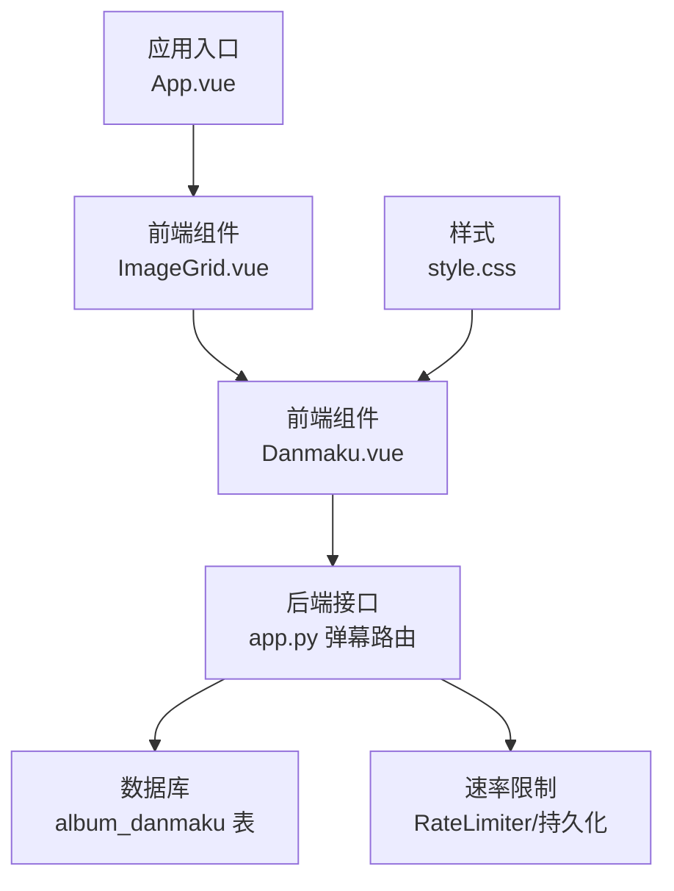
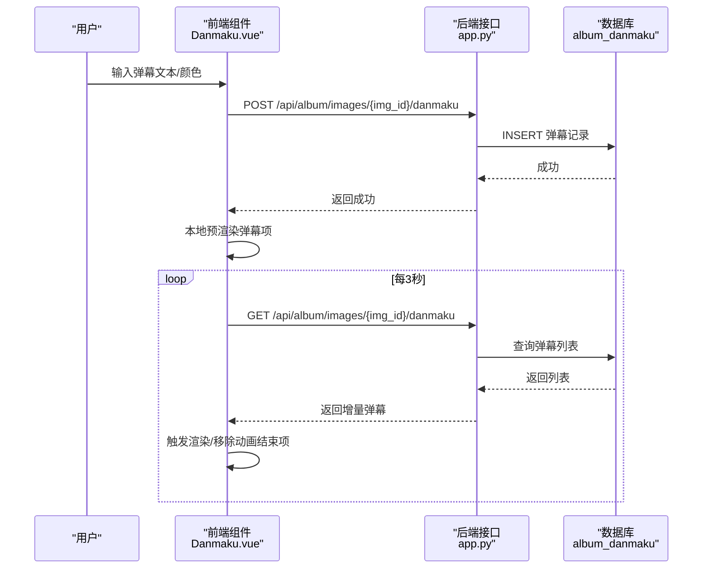
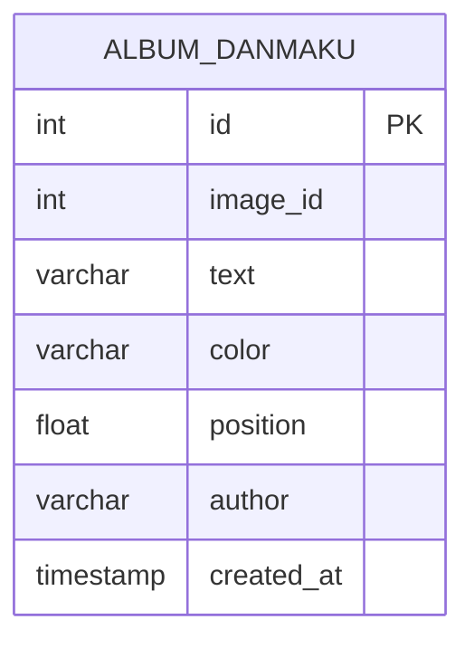
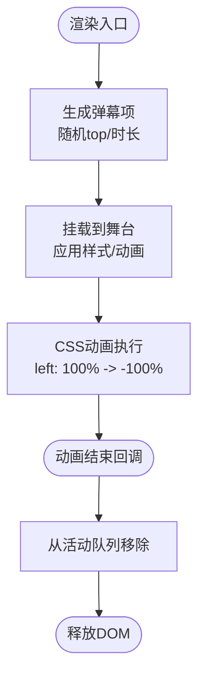
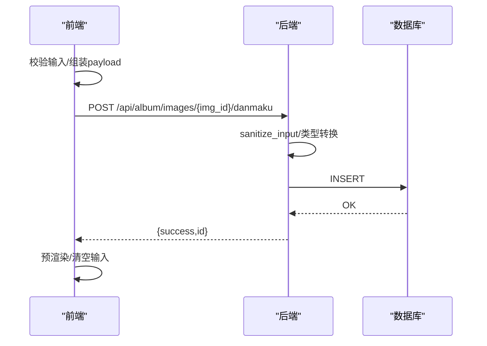
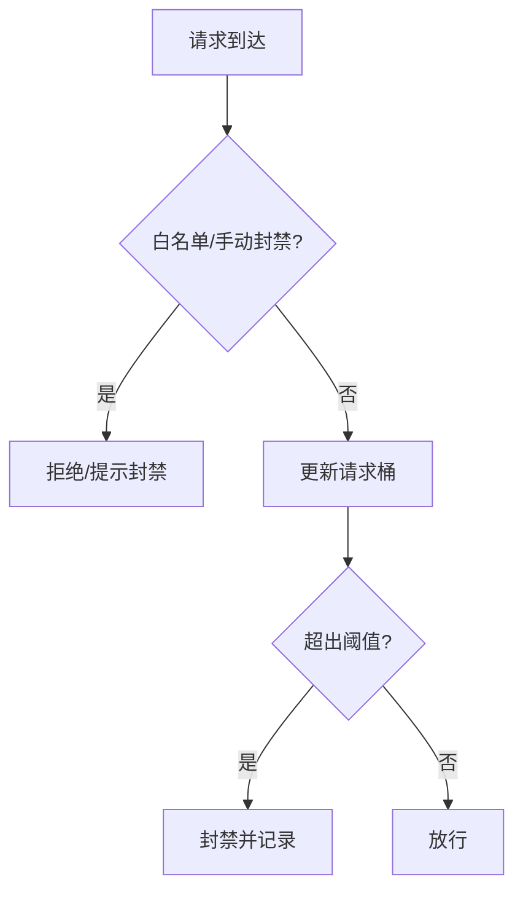
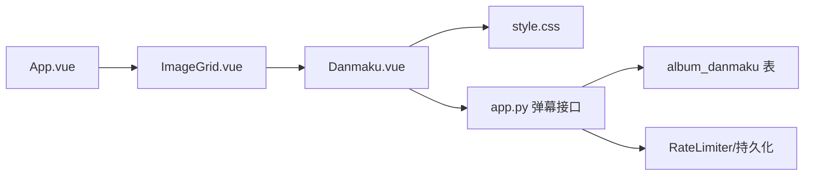

# 弹幕功能

<cite>
**本文引用的文件**
- [Danmaku.vue](file://frontend/src/components/Danmaku.vue)
- [app.py](file://app.py)
- [api.js](file://frontend/src/api.js)
- [ImageGrid.vue](file://frontend/src/components/ImageGrid.vue)
- [App.vue](file://frontend/src/App.vue)
- [style.css](file://frontend/src/style.css)
- [rate_limiter.json](file://rate_limiter.json)
</cite>

## 目录
1. [简介](#简介)
2. [项目结构](#项目结构)
3. [核心组件](#核心组件)
4. [架构总览](#架构总览)
5. [详细组件分析](#详细组件分析)
6. [依赖分析](#依赖分析)
7. [性能考虑](#性能考虑)
8. [故障排查指南](#故障排查指南)
9. [结论](#结论)
10. [附录](#附录)

## 简介
本文件系统性梳理弹幕功能的前端与后端实现，涵盖数据模型、渲染引擎、发送机制、样式系统、过滤与限制策略、统计能力以及用户体验优化（移动端与无障碍）。弹幕系统围绕“相册图片”场景展开，用户可在图片详情页发送弹幕，弹幕以横向滚动方式实时呈现，并通过轮询拉取新弹幕。

## 项目结构
弹幕功能主要涉及以下模块：
- 前端组件：弹幕容器与输入控件、图片网格展示、应用入口与样式
- 后端接口：弹幕列表查询与新增、输入清洗、速率限制
- 资源与配置：样式、静态资源、速率限制持久化文件

图表来源
- [Danmaku.vue:1-89](file://frontend/src/components/Danmaku.vue#L1-L89)
- [app.py:3503-3541](file://app.py#L3503-L3541)
- [ImageGrid.vue:1-129](file://frontend/src/components/ImageGrid.vue#L1-L129)
- [App.vue:1-99](file://frontend/src/App.vue#L1-L99)
- [style.css:1-59](file://frontend/src/style.css#L1-L59)

章节来源
- [Danmaku.vue:1-89](file://frontend/src/components/Danmaku.vue#L1-L89)
- [app.py:3503-3541](file://app.py#L3503-L3541)
- [ImageGrid.vue:1-129](file://frontend/src/components/ImageGrid.vue#L1-L129)
- [App.vue:1-99](file://frontend/src/App.vue#L1-L99)
- [style.css:1-59](file://frontend/src/style.css#L1-L59)

## 核心组件
- 弹幕容器与输入控件：负责弹幕输入、颜色选择、发送、渲染与自动轮询刷新
- 图片网格：承载图片列表与详情，为弹幕提供挂载目标
- 应用入口：组织页面标签与子组件
- 后端弹幕接口：提供弹幕读取与写入、输入清洗与活动记录
- 样式系统：统一视觉风格与动画表现

章节来源
- [Danmaku.vue:18-74](file://frontend/src/components/Danmaku.vue#L18-L74)
- [ImageGrid.vue:43-106](file://frontend/src/components/ImageGrid.vue#L43-L106)
- [App.vue:47-84](file://frontend/src/App.vue#L47-L84)
- [app.py:3503-3541](file://app.py#L3503-L3541)
- [style.css:76-88](file://frontend/src/style.css#L76-L88)

## 架构总览
弹幕系统采用前后端分离模式：
- 前端通过轮询拉取弹幕列表，增量对比后逐条触发渲染
- 发送弹幕时，前端直接调用后端接口，同时本地预渲染以提升即时反馈
- 后端提供弹幕读取与新增接口，使用输入清洗函数防止注入风险
- 速率限制与持久化保障系统稳定性

图表来源
- [Danmaku.vue:50-73](file://frontend/src/components/Danmaku.vue#L50-L73)
- [app.py:3503-3541](file://app.py#L3503-L3541)

## 详细组件分析

### 弹幕数据模型
- 存储字段
  - image_id：所属图片标识
  - text：弹幕文本（最大长度约束）
  - color：弹幕颜色
  - position：弹幕垂直位置（百分比）
  - author：作者（登录用户）
  - created_at：创建时间
- 前端渲染字段
  - key：唯一键
  - top：随机垂直位置（百分比）
  - duration：动画时长（秒）

图表来源
- [app.py:781-792](file://app.py#L781-L792)

章节来源
- [app.py:781-792](file://app.py#L781-L792)
- [Danmaku.vue:36-49](file://frontend/src/components/Danmaku.vue#L36-L49)

### 渲染引擎与动画
- 渲染策略
  - 使用绝对定位与CSS动画实现横向滚动
  - 每条弹幕独立计算随机垂直位置与动画时长
  - 动画结束后自动移除DOM节点，避免内存累积
- 样式要点
  - 字体加粗、阴影增强可读性
  - 输入区与舞台区的视觉分层
  - 深色半透明背景提升对比度

图表来源
- [Danmaku.vue:36-49](file://frontend/src/components/Danmaku.vue#L36-L49)
- [style.css:76-88](file://frontend/src/style.css#L76-L88)

章节来源
- [Danmaku.vue:36-49](file://frontend/src/components/Danmaku.vue#L36-L49)
- [style.css:76-88](file://frontend/src/style.css#L76-L88)

### 发送机制与输入验证
- 输入验证
  - 文本长度限制（后端清洗函数）
  - 颜色与位置参数接收与类型转换
  - 登录态校验（装饰器）
- 发送流程
  - 前端发送请求并本地预渲染
  - 后端插入数据库并记录用户活动
  - 前端轮询拉取新弹幕，保持实时同步

图表来源
- [Danmaku.vue:50-59](file://frontend/src/components/Danmaku.vue#L50-L59)
- [app.py:3519-3541](file://app.py#L3519-L3541)
- [app.py:873-880](file://app.py#L873-L880)

章节来源
- [Danmaku.vue:50-59](file://frontend/src/components/Danmaku.vue#L50-L59)
- [app.py:3519-3541](file://app.py#L3519-L3541)
- [app.py:873-880](file://app.py#L873-L880)

### 样式系统与交互设计
- 字体与颜色
  - 弹幕文本使用较大字号与加粗，配合阴影提升可读性
  - 颜色由用户选择，支持任意合法颜色值
- 位置控制
  - 前端随机分配垂直位置，后端存储位置字段便于扩展
- 动画效果
  - 固定速度线性动画，时长随随机因素变化，避免整齐划一
- 用户体验
  - 输入框支持回车发送，颜色选择器直观
  - 舞台区域具备圆角与半透明背景，减少视觉压力

章节来源
- [Danmaku.vue:76-88](file://frontend/src/components/Danmaku.vue#L76-L88)
- [style.css:76-88](file://frontend/src/style.css#L76-L88)

### 过滤机制与频率限制
- 输入过滤
  - 后端使用清洗函数去除HTML/脚本标签，限制最大长度
- 频率限制
  - 通用IP速率限制：基于内存桶与持久化文件，支持动态配置
  - 登录接口与验证码接口有独立速率限制策略
- 用户屏蔽
  - 当前实现未见专门的“用户屏蔽”功能，建议后续扩展

图表来源
- [app.py:514-562](file://app.py#L514-L562)
- [rate_limiter.json:1-1](file://rate_limiter.json#L1-L1)

章节来源
- [app.py:514-562](file://app.py#L514-L562)
- [app.py:873-880](file://app.py#L873-L880)
- [rate_limiter.json:1-1](file://rate_limiter.json#L1-L1)

### 统计功能
- 弹幕数量统计
  - 后端按图片聚合弹幕条目，前端轮询获取列表
- 热门弹幕排行
  - 当前未实现热门排行逻辑，建议基于文本出现频次或时间权重进行统计
- 用户贡献度
  - 后端记录用户活动（弹幕计数），前端可结合用户信息展示贡献排行

章节来源
- [app.py:3503-3517](file://app.py#L3503-L3517)
- [app.py:3539-3541](file://app.py#L3539-L3541)

### 用户体验优化
- 移动端适配
  - 输入框与按钮尺寸适中，颜色对比度满足可读性要求
  - 舞台高度固定，避免在小屏上过度拥挤
- 无障碍访问
  - 当前未发现专门的无障碍属性（如aria-label），建议为输入控件与按钮补充描述性属性
  - 动画时长与速度应兼顾低敏感用户需求

章节来源
- [Danmaku.vue:76-88](file://frontend/src/components/Danmaku.vue#L76-L88)
- [style.css:76-88](file://frontend/src/style.css#L76-L88)

## 依赖分析
- 前端
  - Danmaku.vue 依赖 Vue 响应式与生命周期钩子，依赖样式模块
  - ImageGrid.vue 提供图片列表与详情入口，承载弹幕组件
  - App.vue 组织页面标签与子组件
- 后端
  - 弹幕接口依赖数据库连接、输入清洗、活动记录与速率限制
  - 速率限制器支持持久化，避免进程重启导致状态丢失

图表来源
- [Danmaku.vue:1-89](file://frontend/src/components/Danmaku.vue#L1-L89)
- [ImageGrid.vue:1-129](file://frontend/src/components/ImageGrid.vue#L1-L129)
- [App.vue:1-99](file://frontend/src/App.vue#L1-L99)
- [app.py:3503-3541](file://app.py#L3503-L3541)

章节来源
- [Danmaku.vue:1-89](file://frontend/src/components/Danmaku.vue#L1-L89)
- [ImageGrid.vue:1-129](file://frontend/src/components/ImageGrid.vue#L1-L129)
- [App.vue:1-99](file://frontend/src/App.vue#L1-L99)
- [app.py:3503-3541](file://app.py#L3503-L3541)

## 性能考虑
- 渲染性能
  - 单帧动画时长与数量成正比，建议限制同时在场弹幕数量或采用虚拟滚动
  - 动画结束后及时移除DOM，避免内存泄漏
- 网络与数据库
  - 轮询间隔3秒较为合理，可根据并发量调整
  - 数据库查询按图片ID与时间排序，索引可考虑增加复合索引以优化
- 速率限制
  - 持久化文件降低重启影响，建议在高并发场景引入Redis等共享缓存

## 故障排查指南
- 发送失败
  - 检查登录态与CSRF校验
  - 查看后端清洗函数是否截断文本
- 弹幕不显示
  - 确认图片ID有效且轮询正常
  - 检查CSS动画是否被覆盖
- 速率受限
  - 查看IP封禁状态与请求桶记录
  - 检查持久化文件是否存在异常

章节来源
- [app.py:3519-3541](file://app.py#L3519-L3541)
- [app.py:514-562](file://app.py#L514-L562)
- [rate_limiter.json:1-1](file://rate_limiter.json#L1-L1)

## 结论
弹幕系统实现了基本的发送、渲染与轮询同步，具备基础的输入清洗与速率限制。建议后续增强：
- 弹幕过滤（敏感词）、用户屏蔽、热门排行与贡献度统计
- 无障碍属性与移动端交互细节优化
- 渲染性能与数据库查询优化

## 附录
- API一览
  - GET /api/album/images/{img_id}/danmaku：获取弹幕列表
  - POST /api/album/images/{img_id}/danmaku：新增弹幕

章节来源
- [app.py:3503-3541](file://app.py#L3503-L3541)