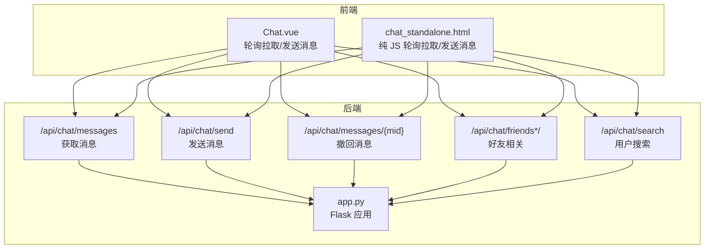
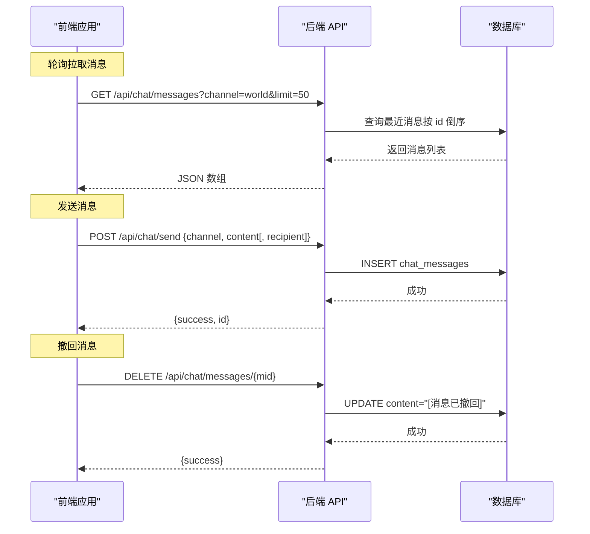
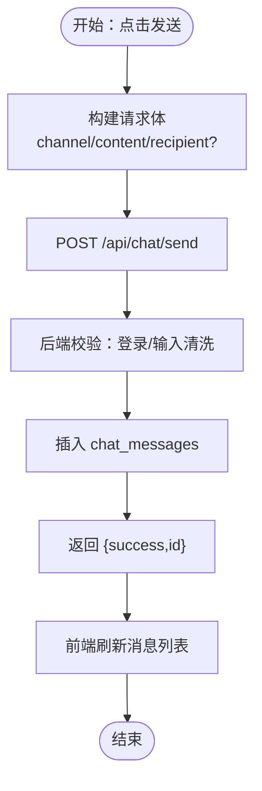
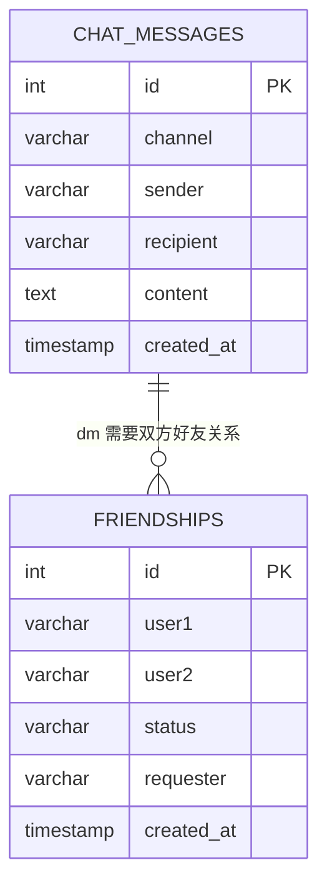
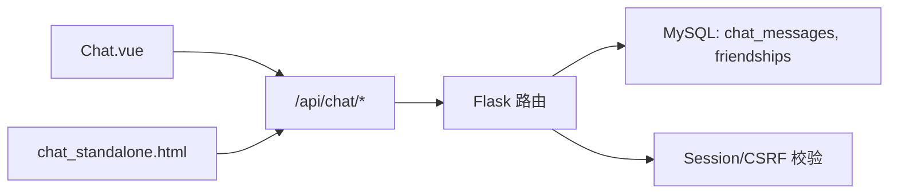

# 消息传输协议

<cite>
**本文引用的文件**
- [app.py](file://app.py)
- [Chat.vue](file://frontend/src/components/Chat.vue)
- [chat_standalone.html](file://templates/chat_standalone.html)
</cite>

## 目录
1. [简介](#简介)
2. [项目结构](#项目结构)
3. [核心组件](#核心组件)
4. [架构总览](#架构总览)
5. [详细组件分析](#详细组件分析)
6. [依赖分析](#依赖分析)
7. [性能考量](#性能考量)
8. [故障排查指南](#故障排查指南)
9. [结论](#结论)
10. [附录](#附录)

## 简介
本文件面向“消息传输协议”的设计与实现，聚焦聊天系统中的消息格式、序列化、发送流程、存储机制、历史记录管理、错误处理与重连策略，以及协议版本与向后兼容性建议。文档基于仓库中实际实现进行说明，帮助开发者与运维人员快速理解与维护消息传输能力。

## 项目结构
消息传输协议相关的关键位置如下：
- 后端服务入口与路由：app.py
- 前端 Vue 组件：frontend/src/components/Chat.vue
- 前端独立页面：templates/chat_standalone.html

图表来源
- [app.py:3546-3754](file://app.py#L3546-L3754)
- [Chat.vue:80-164](file://frontend/src/components/Chat.vue#L80-L164)
- [chat_standalone.html:73-166](file://templates/chat_standalone.html#L73-L166)

章节来源
- [app.py:3546-3754](file://app.py#L3546-L3754)
- [Chat.vue:80-164](file://frontend/src/components/Chat.vue#L80-L164)
- [chat_standalone.html:73-166](file://templates/chat_standalone.html#L73-L166)

## 核心组件
- 消息实体与存储
  - 表结构：chat_messages（主键 id、通道 channel、发送者 sender、接收者 recipient、内容 content、时间 created_at）
  - 索引：channel、sender、recipient、created_at
- 好友关系
  - 表结构：friendships（主键 id、用户1 user1、用户2 user2、状态 status、发起人 requester）
- API 能力
  - 获取消息：/api/chat/messages
  - 发送消息：/api/chat/send
  - 撤回消息：/api/chat/messages/{mid}
  - 好友相关：/api/chat/friends、/api/chat/friends/requests、/api/chat/friends/request、/api/chat/friends/accept、/api/chat/friends/remove
  - 用户搜索：/api/chat/search

章节来源
- [app.py:803-828](file://app.py#L803-L828)
- [app.py:3546-3754](file://app.py#L3546-L3754)

## 架构总览
消息传输采用“前后端分离 + 轮询拉取”的模式：
- 前端定时轮询获取最新消息，保证低延迟展示
- 发送消息时，前端构造 JSON 请求体，后端执行插入或更新
- 撤回消息采用“标记删除”策略，避免物理删除带来的复杂一致性问题

图表来源
- [app.py:3546-3604](file://app.py#L3546-L3604)
- [app.py:3735-3754](file://app.py#L3735-L3754)
- [Chat.vue:80-97](file://frontend/src/components/Chat.vue#L80-L97)
- [chat_standalone.html:106-112](file://templates/chat_standalone.html#L106-L112)

## 详细组件分析

### 消息格式与序列化
- 请求体字段
  - 通用字段：channel（枚举："world"|"dm"）、content（字符串，最大长度 1000）
  - 私信特有：recipient（字符串，最大长度 50）
- 响应体字段
  - 发送成功：{success: true, id: number}
  - 拉取消息：数组元素包含 id、channel、sender、content、created_at（字符串）
  - 撤回成功：{success: true}
- 序列化机制
  - 前端统一使用 application/json
  - 后端对 content 进行长度与 HTML/JS 标签清洗（sanitize_input）

章节来源
- [Chat.vue:87-96](file://frontend/src/components/Chat.vue#L87-L96)
- [chat_standalone.html:106-112](file://templates/chat_standalone.html#L106-L112)
- [app.py:3581-3604](file://app.py#L3581-L3604)
- [app.py:873-880](file://app.py#L873-L880)

### 消息发送流程
- 客户端构建
  - channel 与 content 必填；当 channel 为 "dm" 时附加 recipient
  - 使用 fetch 发送 POST 请求，携带 JSON 负载
- 服务器接收与处理
  - 校验登录态（login_required）
  - 清洗与校验输入（sanitize_input）
  - 插入 chat_messages 表，返回新消息 id
- 前端反馈
  - 清空输入框并触发一次拉取，确保界面即时更新

图表来源
- [Chat.vue:87-97](file://frontend/src/components/Chat.vue#L87-L97)
- [app.py:3581-3604](file://app.py#L3581-L3604)

章节来源
- [Chat.vue:87-97](file://frontend/src/components/Chat.vue#L87-L97)
- [app.py:3581-3604](file://app.py#L3581-L3604)

### 服务器接收与处理
- 登录态校验：所有 /api/chat* 路由均受 login_required 保护
- 输入清洗：content 与 recipient 使用 sanitize_input 进行长度限制与 HTML/JS 标签剔除
- 数据库写入：插入 chat_messages，记录发送行为（活动积分）

章节来源
- [app.py:3581-3604](file://app.py#L3581-L3604)
- [app.py:873-880](file://app.py#L873-L880)
- [app.py](file://app.py#L3603)

### 消息转发与可见性
- 世界频道（channel="world"）
  - 拉取条件：channel='world'
  - 无需双方互为好友
- 私信（channel="dm"）
  - 拉取条件：sender 与 recipient 必须包含当前用户与目标用户
  - 需要双方互为好友（好友关系由 friendships 表维护）

章节来源
- [app.py:3546-3579](file://app.py#L3546-L3579)
- [app.py:818-828](file://app.py#L818-L828)

### 消息存储机制
- 表结构与索引
  - chat_messages：主键 id、channel、sender、recipient、content、created_at；复合索引覆盖 channel、sender、recipient、created_at
  - friendships：唯一约束 user1,user2，避免重复关系
- 写入路径
  - 发送消息时插入一条记录
  - 撤回消息时更新 content 字段为固定占位符，不删除整行
- 读取路径
  - 拉取消息时按 id 倒序取前 N 条，支持 before 参数实现翻页

图表来源
- [app.py:803-828](file://app.py#L803-L828)

章节来源
- [app.py:803-828](file://app.py#L803-L828)
- [app.py:3546-3579](file://app.py#L3546-L3579)

### 消息历史记录管理
- 分页与翻页
  - 支持 limit 参数（最大 100），默认 50
  - 支持 before 参数（基于 id）实现“加载更早”
- 搜索功能
  - 搜索用户：/api/chat/search?q=...
  - 搜索结果同时包含用户名与昵称（来自 user_profiles）
- 清理策略
  - 当前实现未见自动清理逻辑；如需清理，可在业务侧增加定期任务（例如基于 created_at 的归档/删除）

章节来源
- [app.py:3546-3579](file://app.py#L3546-L3579)
- [app.py:3607-3629](file://app.py#L3607-L3629)

### 错误处理机制
- 登录态缺失
  - API 返回 JSON 错误与 401/403 状态码
- 输入校验失败
  - 空 content 返回 400
- 权限不足
  - 非管理员尝试撤回他人消息返回 403
- 数据库异常
  - 返回 500 并提示 DB 错误
- 前端交互
  - 发送失败弹窗提示；撤回前确认对话框；拉取失败保持现状并等待重试

章节来源
- [app.py:3581-3604](file://app.py#L3581-L3604)
- [app.py:3735-3754](file://app.py#L3735-L3754)
- [Chat.vue:148-153](file://frontend/src/components/Chat.vue#L148-L153)

### 重连策略与轮询
- 轮询周期
  - 前端每 3 秒轮询一次消息与好友列表
- 重连与退避
  - 未实现指数退避；建议在前端增加失败计数与指数退避，避免雪崩
- 会话超时
  - IP 会话超时（默认 150 秒无动作自动登出），影响消息轮询连续性

章节来源
- [Chat.vue:158-164](file://frontend/src/components/Chat.vue#L158-L164)
- [chat_standalone.html](file://templates/chat_standalone.html#L165)
- [app.py:508-593](file://app.py#L508-L593)

### 协议版本与向后兼容
- 当前版本
  - 采用 JSON 请求体，字段明确，版本号未在协议中显式声明
- 建议
  - 在请求头中引入 X-Protocol-Version 或在 URL 中加入版本段，便于未来演进
  - 新增字段采用可选策略，避免破坏既有客户端
  - 对于破坏性变更，保留旧接口一段时间并标注 deprecation

[本节为概念性建议，不直接分析具体文件]

## 依赖分析
- 前端依赖
  - Chat.vue：使用 fetch 与轮询，依赖 /api/chat/* 接口
  - chat_standalone.html：纯 JS 实现相同功能
- 后端依赖
  - Flask 路由与装饰器（login_required、admin_required 等）
  - MySQL（pymysql）连接与事务
  - 会话（session）与 CSRF 校验

图表来源
- [app.py:3546-3754](file://app.py#L3546-L3754)
- [Chat.vue:80-164](file://frontend/src/components/Chat.vue#L80-L164)
- [chat_standalone.html:73-166](file://templates/chat_standalone.html#L73-L166)

章节来源
- [app.py:3546-3754](file://app.py#L3546-L3754)
- [Chat.vue:80-164](file://frontend/src/components/Chat.vue#L80-L164)
- [chat_standalone.html:73-166](file://templates/chat_standalone.html#L73-L166)

## 性能考量
- 查询优化
  - 拉取消息按 id 倒序 + LIMIT，适合高频写入场景
  - 建议在 created_at 上建立索引以支持按时间范围查询（如需）
- 写入优化
  - 单条插入，无批量写入；若消息量巨大，可考虑批量写入或异步队列
- 轮询频率
  - 3 秒轮询对小规模聊天足够，大规模场景建议 WebSocket 或服务端推送
- 清理与归档
  - 建议定期归档历史消息至冷存储，降低热表压力

[本节提供一般性指导，不直接分析具体文件]

## 故障排查指南
- 发送失败
  - 检查登录态与 CSRF；确认 content 非空且长度未超限
- 拉取为空
  - 确认 channel 与参数（before/limit）正确；检查好友关系（dm）
- 撤回失败
  - 确认消息属于当前用户或具备管理员权限；检查消息是否存在
- 轮询中断
  - 检查会话超时与网络状况；必要时调整轮询间隔

章节来源
- [app.py:3581-3604](file://app.py#L3581-L3604)
- [app.py:3735-3754](file://app.py#L3735-L3754)
- [Chat.vue:158-164](file://frontend/src/components/Chat.vue#L158-L164)

## 结论
本消息传输协议以简洁的 JSON 协议与轮询机制实现消息的发送、拉取与撤回，配合数据库索引与输入清洗保障基本性能与安全。建议在未来引入版本控制、WebSocket 推送与更完善的清理策略，以支撑更大规模与更高并发的场景。

## 附录
- 示例请求与响应（路径参考）
  - 发送消息：[发送接口:3581-3604](file://app.py#L3581-L3604)
  - 拉取消息：[拉取接口:3546-3579](file://app.py#L3546-L3579)
  - 撤回消息：[撤回接口:3735-3754](file://app.py#L3735-L3754)
  - 好友相关：[好友接口:3632-3733](file://app.py#L3632-L3733)
  - 用户搜索：[搜索接口:3607-3629](file://app.py#L3607-L3629)
- 前端调用示例（路径参考）
  - Vue 调用：[消息拉取与发送:80-97](file://frontend/src/components/Chat.vue#L80-L97)
  - HTML 调用：[消息拉取与发送:73-112](file://templates/chat_standalone.html#L73-L112)