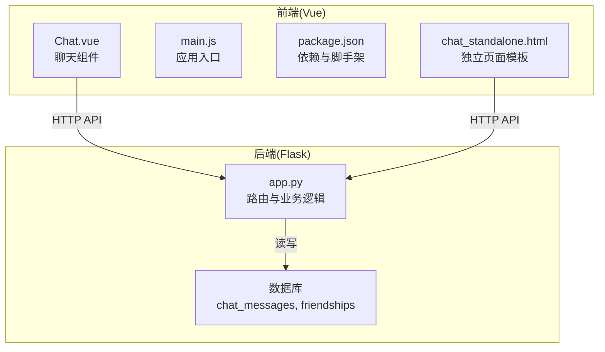
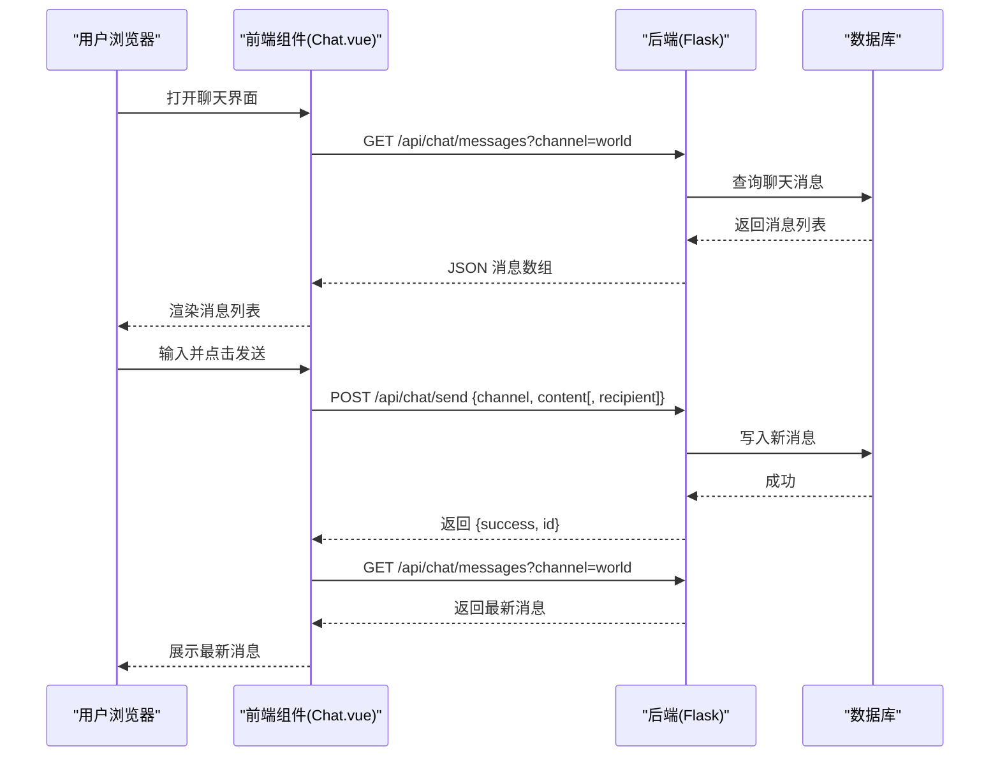
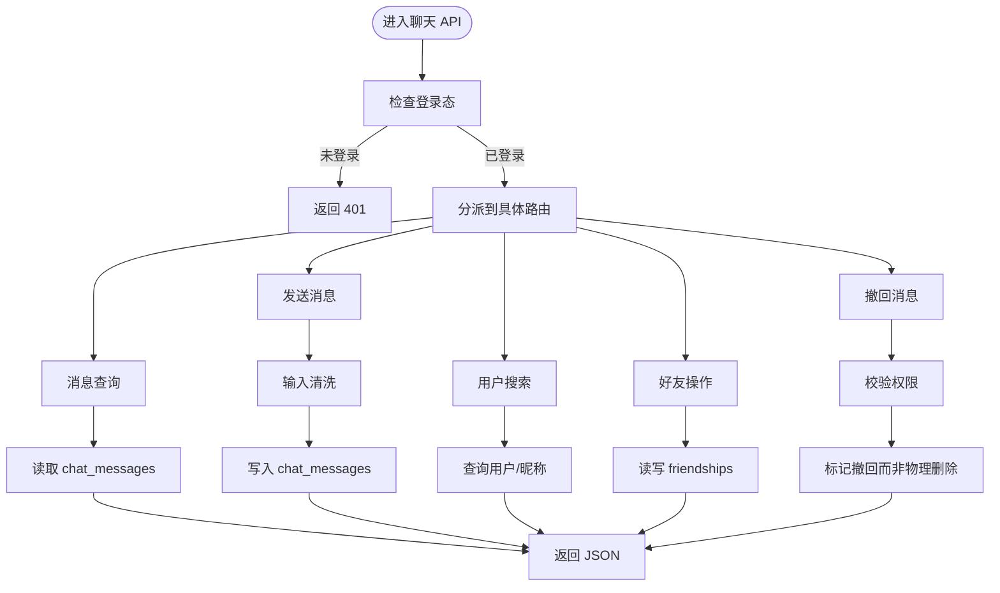
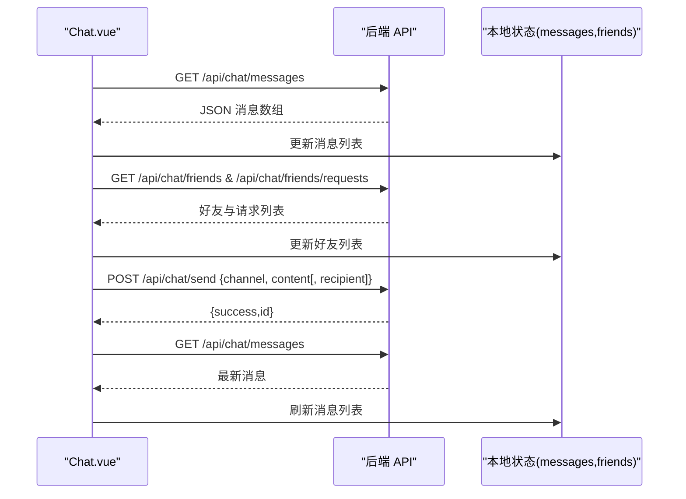
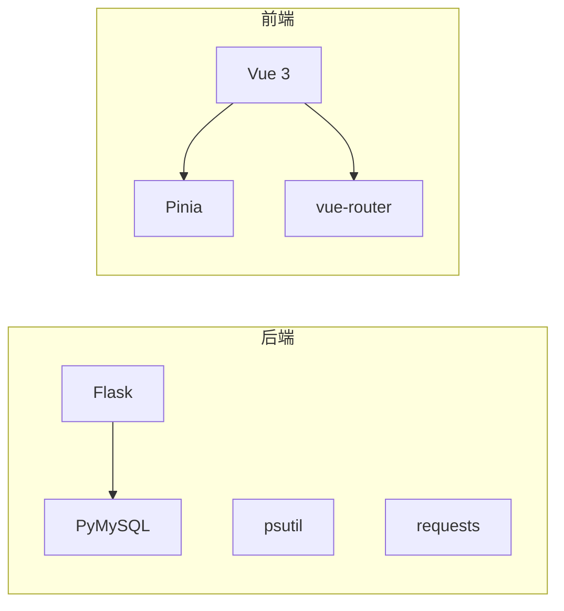
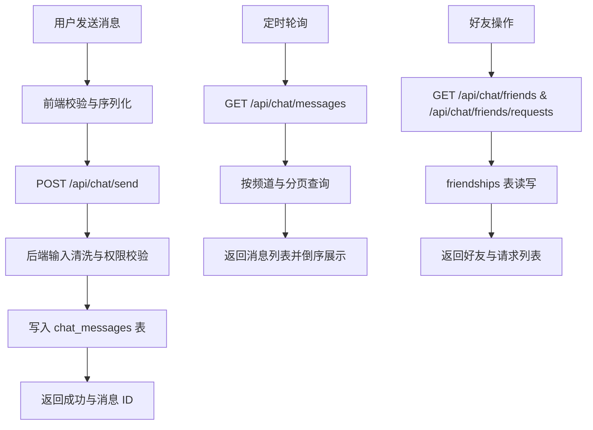

# 聊天室架构设计

<cite>
**本文引用的文件**
- [app.py](file://app.py)
- [Chat.vue](file://frontend/src/components/Chat.vue)
- [chat_standalone.html](file://templates/chat_standalone.html)
- [package.json](file://frontend/package.json)
- [main.js](file://frontend/src/main.js)
- [requirements.txt](file://requirements.txt)
</cite>

## 目录
1. [引言](#引言)
2. [项目结构](#项目结构)
3. [核心组件](#核心组件)
4. [架构总览](#架构总览)
5. [详细组件分析](#详细组件分析)
6. [依赖分析](#依赖分析)
7. [性能考量](#性能考量)
8. [故障排查指南](#故障排查指南)
9. [结论](#结论)
10. [附录](#附录)

## 引言
本文件面向“聊天室”子系统，系统性梳理其架构设计与实现细节，重点覆盖以下方面：
- WebSocket 连接建立过程与服务器端 SocketIO 集成（现状与替代方案说明）
- 客户端连接管理机制（轮询与会话）
- 聊天室数据流架构（消息队列、用户状态同步、房间权限控制）
- 频道管理（公共频道、私有频道、动态频道创建）
- 在线用户列表与离线检测
- 配置选项、性能优化策略与扩展性建议
- 架构图表与组件交互流程图

说明：当前仓库中未发现 WebSocket 与 Socket.IO 的直接实现。聊天室采用“基于会话的轮询式实时通信”模式，通过定时拉取消息与好友列表实现近实时体验。本文在“架构总览”与“详细组件分析”中明确指出这一现状，并给出替代 WebSocket 的实现建议与迁移路径。

## 项目结构
聊天室相关代码分布于后端 Flask 应用与前端 Vue 单页应用两部分：
- 后端：在主应用中集中定义聊天室 API 与数据库表结构初始化逻辑
- 前端：Vue 组件负责渲染聊天界面、处理用户交互、调用后端 API

**图表来源**
- [app.py](file://app.py)
- [Chat.vue](file://frontend/src/components/Chat.vue)
- [chat_standalone.html](file://templates/chat_standalone.html)
- [main.js](file://frontend/src/main.js)
- [package.json](file://frontend/package.json)

**章节来源**
- [app.py](file://app.py)
- [Chat.vue](file://frontend/src/components/Chat.vue)
- [chat_standalone.html](file://templates/chat_standalone.html)
- [main.js](file://frontend/src/main.js)
- [package.json](file://frontend/package.json)

## 核心组件
- 后端路由与业务层
  - 聊天消息查询与发送
  - 用户搜索与好友关系管理
  - 输入清洗与权限控制
- 前端组件
  - 聊天组件：频道切换、消息展示、发送与撤回、右键菜单
  - 独立页面模板：提供无需嵌入主应用的聊天界面
- 数据模型
  - 聊天消息表与好友关系表

**章节来源**
- [app.py](file://app.py)
- [Chat.vue](file://frontend/src/components/Chat.vue)
- [chat_standalone.html](file://templates/chat_standalone.html)

## 架构总览
当前聊天室采用“轮询式实时通信”，即前端定时向后端拉取最新消息与好友状态，后端通过会话维持用户身份。WebSocket 与 Socket.IO 并未在仓库中实现。

**图表来源**
- [app.py](file://app.py)
- [Chat.vue](file://frontend/src/components/Chat.vue)

## 详细组件分析

### 后端：聊天室 API 与数据模型
- 路由与职责
  - 消息查询：按频道与分页参数查询消息
  - 发送消息：校验输入、写入数据库
  - 用户搜索：按用户名或昵称检索
  - 好友管理：请求、接受、删除好友
  - 撤回消息：仅发送者或管理员可执行
- 数据模型
  - 聊天消息表：包含频道标识、发送者、接收者、内容与时间戳
  - 好友关系表：记录双向好友关系与状态
- 安全与权限
  - 登录保护：所有聊天 API 均需登录
  - 权限控制：管理员可撤回他人消息
  - 输入清洗：移除脚本与 HTML 标签，限制长度
- 会话与超时
  - 使用 Flask session 维持登录态
  - IP 级会话空闲超时，强制重新登录

**图表来源**
- [app.py](file://app.py)

**章节来源**
- [app.py](file://app.py)

### 前端：聊天组件与交互
- 组件职责
  - 频道切换：世界频道与私信频道
  - 消息展示：按时间倒序显示，支持滚动到底部
  - 发送消息：支持世界频道与私信
  - 撤回消息：右键菜单仅对本人消息生效
  - 好友管理：搜索、请求、接受、删除
- 交互流程
  - 挂载时加载当前用户信息、消息与好友列表
  - 定时轮询刷新消息与好友状态
  - 发送成功后立即刷新消息列表

**图表来源**
- [Chat.vue](file://frontend/src/components/Chat.vue)

**章节来源**
- [Chat.vue](file://frontend/src/components/Chat.vue)

### 独立页面模板与集成方式
- 独立页面模板提供无需嵌入主应用的聊天界面，便于快速访问
- 前端组件与模板共享同一套 API，保持行为一致

**章节来源**
- [chat_standalone.html](file://templates/chat_standalone.html)
- [Chat.vue](file://frontend/src/components/Chat.vue)

### WebSocket 与 Socket.IO 集成（现状与替代方案）
- 现状
  - 仓库中未发现 WebSocket 或 Socket.IO 的实现
  - 聊天室采用“轮询式实时通信”
- 替代方案建议
  - 引入 Flask-SocketIO 或 Django Channels（如迁移至 Python 后端）
  - 前端使用 Socket.IO 客户端，后端维护 Socket 连接池与房间映射
  - 采用 Redis Pub/Sub 实现跨进程广播
- 迁移要点
  - 保持现有 API 行为不变，仅替换底层传输层
  - 保留会话与权限校验逻辑
  - 设计房间与频道的映射关系，确保频道隔离

[本节为概念性说明，不直接分析具体文件，故不附“章节来源”]

## 依赖分析
- 后端依赖
  - Flask：Web 框架与路由
  - PyMySQL：数据库连接
  - psutil、requests：系统监控与网络请求
- 前端依赖
  - Vue 3：组件化与响应式
  - pinia：状态管理
  - vue-router：路由（在聊天组件中未直接使用）

**图表来源**
- [requirements.txt](file://requirements.txt)
- [package.json](file://frontend/package.json)

**章节来源**
- [requirements.txt](file://requirements.txt)
- [package.json](file://frontend/package.json)

## 性能考量
- 轮询频率与分页
  - 前端定时轮询（固定间隔）可能带来不必要的请求压力
  - 建议：根据消息密度动态调整轮询间隔；后端提供“增量拉取”接口（基于时间戳或游标）
- 数据库索引与查询
  - 聊天消息表已建立多列索引，有助于按频道、发送者、时间等条件查询
  - 建议：为高频查询字段增加复合索引；限制单次拉取数量与时间范围
- 输入清洗与安全
  - 已实现输入清洗与长度限制，降低 XSS 与注入风险
  - 建议：结合 CSP 与 CSRF 保护，避免跨站脚本与跨站请求伪造
- 会话与超时
  - IP 级会话空闲超时，减少长期挂起的无效会话
  - 建议：结合前端心跳上报，动态延长会话有效期

[本节提供通用指导，不直接分析具体文件，故不附“章节来源”]

## 故障排查指南
- 常见问题与定位
  - 无法发送消息：检查登录态、CSRF 校验与后端权限装饰器
  - 消息不刷新：确认前端轮询定时器是否运行、后端 API 是否返回正确数据
  - 好友请求异常：核对好友关系表状态与唯一约束
- 日志与审计
  - 后端提供日志写入函数，可用于记录关键事件
  - 建议：在关键路由添加请求追踪 ID，便于问题定位
- 安全加固
  - 速率限制与封禁策略：检查 IP 黑名单与封禁时长配置
  - 验证码与二次验证：确保敏感操作的二次验证流程正常

**章节来源**
- [app.py](file://app.py)

## 结论
- 当前聊天室采用“轮询式实时通信”，通过定时拉取与会话维持实现近实时体验
- 后端提供完善的聊天 API、输入清洗与权限控制，前端组件具备良好的交互体验
- 若需进一步提升实时性与扩展性，建议引入 WebSocket/Socket.IO，并配合 Redis 实现跨进程广播
- 在迁移过程中，应保持现有 API 行为与权限体系不变，优先保证数据一致性与安全性

[本节为总结性内容，不直接分析具体文件，故不附“章节来源”]

## 附录

### 聊天室数据流架构（消息队列、用户状态同步、房间权限）

**图表来源**
- [app.py](file://app.py)
- [Chat.vue](file://frontend/src/components/Chat.vue)

### 频道管理（公共频道、私有频道、动态频道创建）
- 公共频道：世界频道，所有成员可见
- 私有频道：一对一私信，仅双方可见
- 动态频道创建：当前实现未提供动态频道创建能力，可通过扩展后端路由与数据库表结构实现

**章节来源**
- [app.py](file://app.py)

### 在线用户列表与离线检测
- 在线用户列表：当前实现通过好友列表与轮询刷新模拟在线状态
- 离线检测：结合会话空闲超时与心跳上报（建议）实现更精确的在线状态管理

**章节来源**
- [app.py](file://app.py)
- [Chat.vue](file://frontend/src/components/Chat.vue)

### 配置选项与扩展性
- 配置项
  - 速率限制：最大请求数、时间窗口、封禁时长等
  - 白名单：IP 白名单持久化
  - 会话超时：IP 级会话空闲超时
- 扩展性建议
  - 引入消息队列（如 Redis Streams）承载高并发消息
  - 使用 Redis 缓存热门频道与好友列表，降低数据库压力
  - 采用 WebSocket/Socket.IO 提升实时性与资源利用率

**章节来源**
- [app.py](file://app.py)
- [requirements.txt](file://requirements.txt)
- [package.json](file://frontend/package.json)