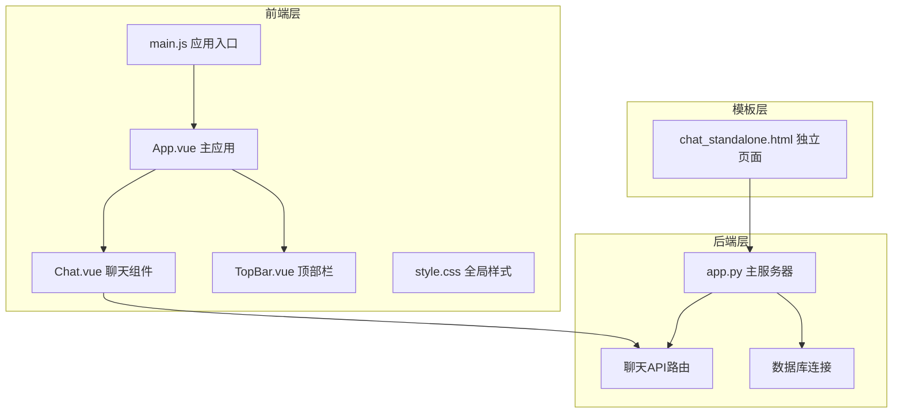
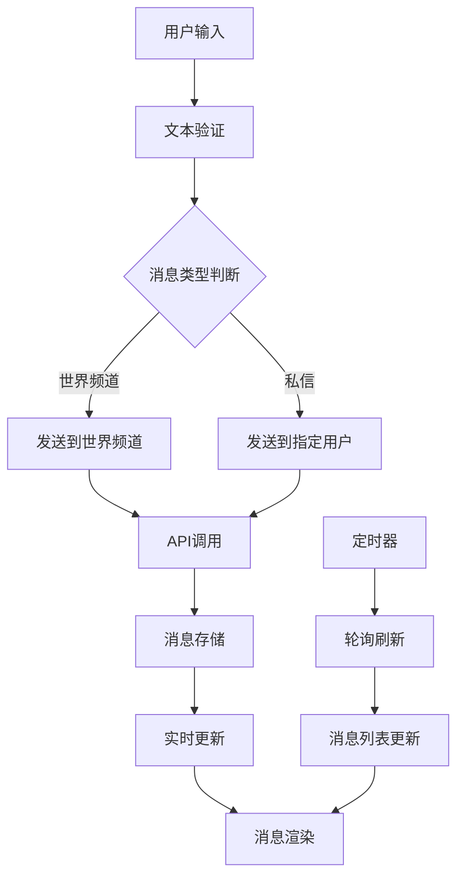
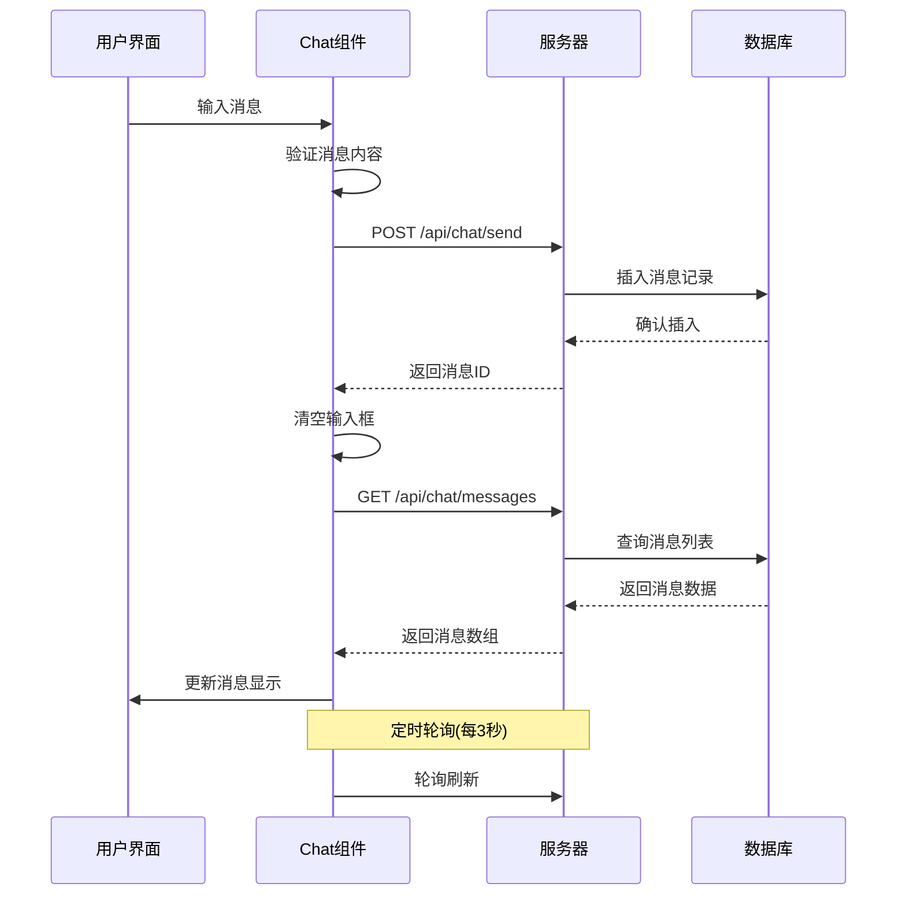
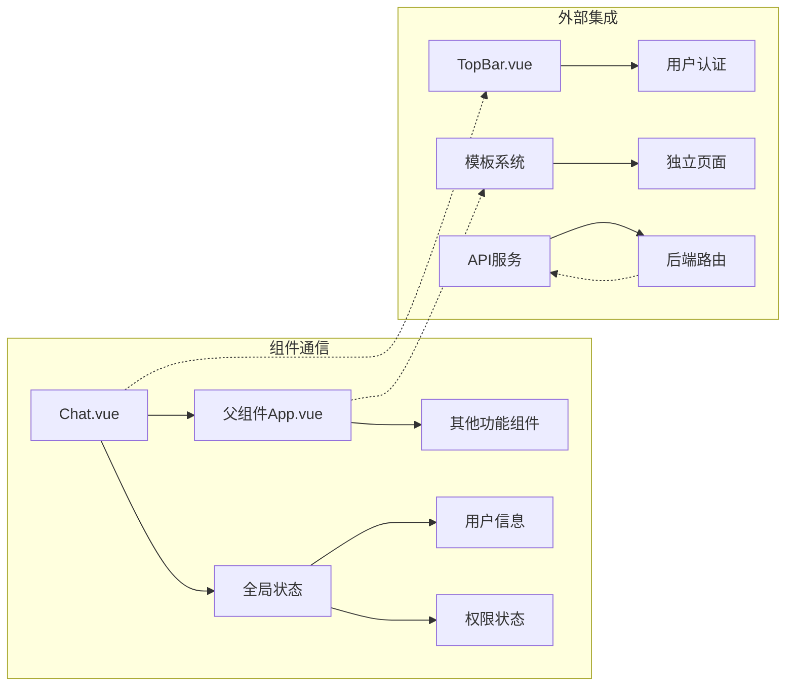
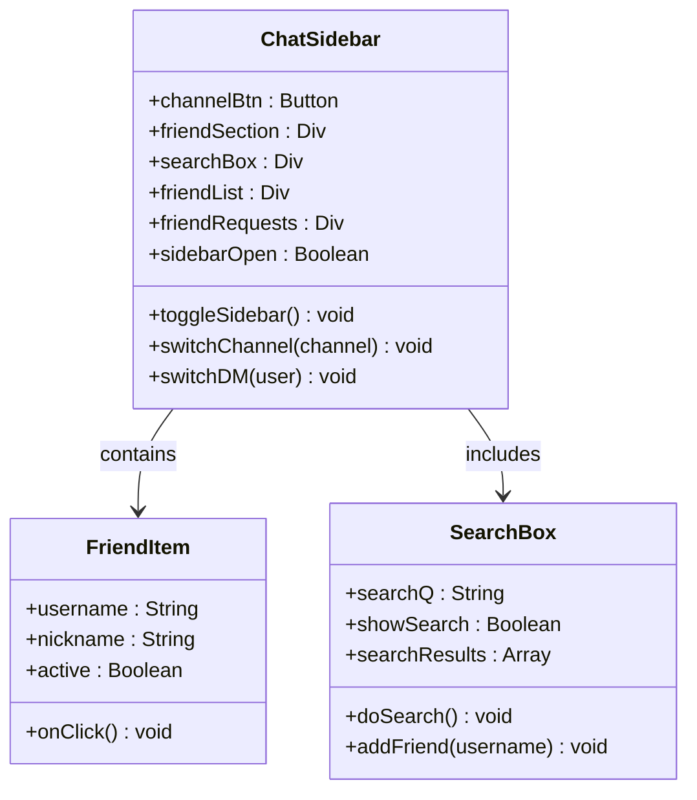
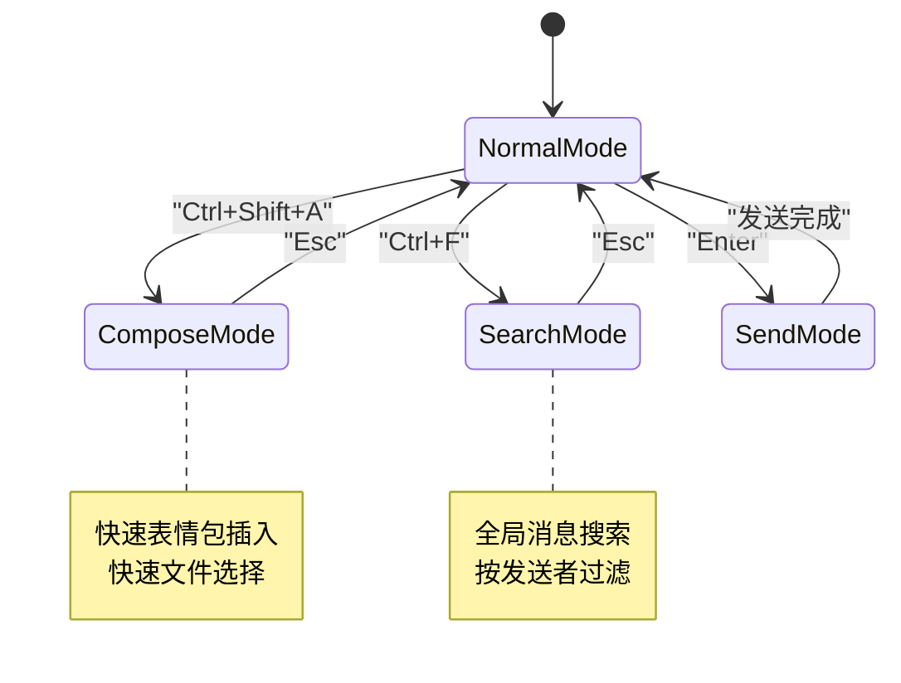
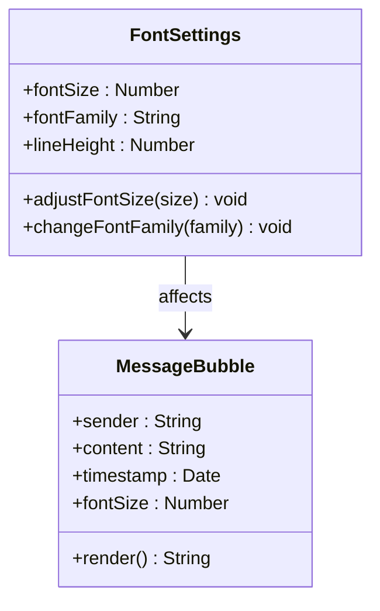
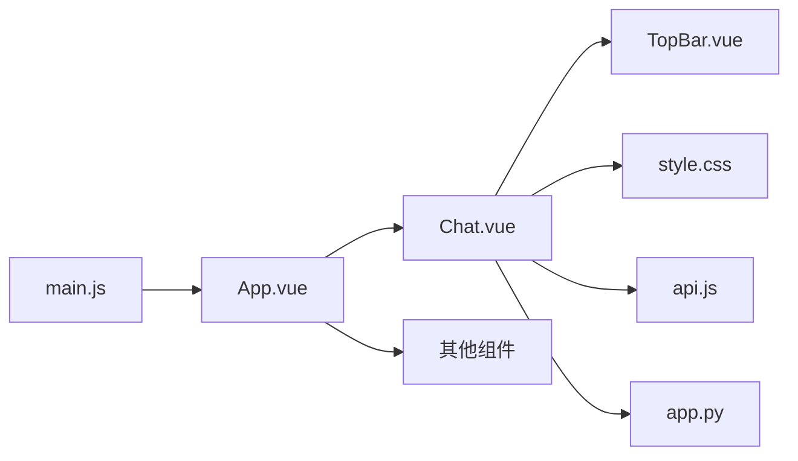
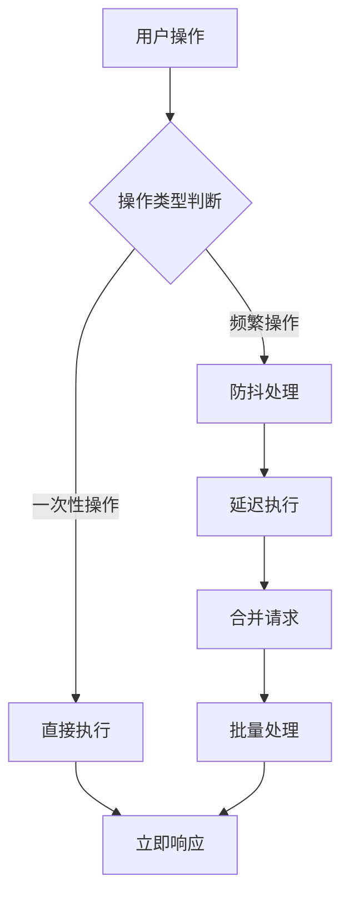
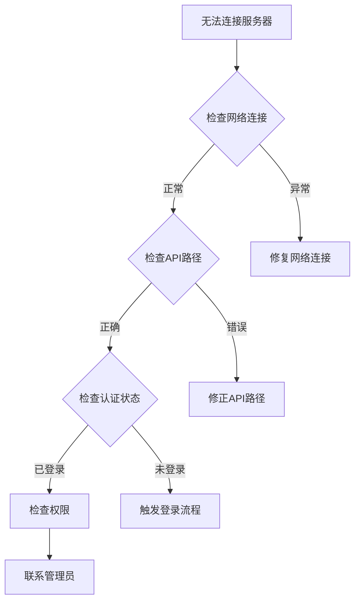

# 聊天界面组件

<cite>
**本文档引用的文件**
- [Chat.vue](file://frontend/src/components/Chat.vue)
- [App.vue](file://frontend/src/App.vue)
- [main.js](file://frontend/src/main.js)
- [style.css](file://frontend/src/style.css)
- [chat_standalone.html](file://templates/chat_standalone.html)
- [app.py](file://app.py)
- [TopBar.vue](file://frontend/src/components/TopBar.vue)
- [package.json](file://frontend/package.json)
- [api.js](file://frontend/src/api.js)
</cite>

## 目录
1. [简介](#简介)
2. [项目结构](#项目结构)
3. [核心组件](#核心组件)
4. [架构概览](#架构概览)
5. [详细组件分析](#详细组件分析)
6. [依赖关系分析](#依赖关系分析)
7. [性能考虑](#性能考虑)
8. [故障排除指南](#故障排除指南)
9. [结论](#结论)

## 简介

聊天界面组件是基于 Vue 3 构建的现代化聊天应用，提供了完整的实时通讯功能。该组件采用响应式设计，支持桌面端和移动端的无缝体验，集成了世界频道和私信功能，具备好友管理系统、消息搜索、右键菜单撤回等高级特性。

## 项目结构

该项目采用模块化架构设计，前端使用 Vue 3 Composition API，后端使用 Python Flask 提供 RESTful API 接口。整体架构清晰分离了前端界面逻辑和后端业务逻辑。



**图表来源**
- [main.js:1-6](file://frontend/src/main.js#L1-L6)
- [App.vue:1-99](file://frontend/src/App.vue#L1-L99)
- [Chat.vue:1-214](file://frontend/src/components/Chat.vue#L1-L214)

**章节来源**
- [main.js:1-6](file://frontend/src/main.js#L1-L6)
- [package.json:1-21](file://frontend/package.json#L1-L21)

## 核心组件

### 组件层次结构

聊天组件采用清晰的层次结构设计，主要包含三个核心区域：

1. **侧边栏区域** - 包含频道选择、好友列表和搜索功能
2. **主聊天区域** - 显示消息列表和输入框
3. **上下文菜单** - 右键消息时显示的操作菜单

### 数据流架构



**图表来源**
- [Chat.vue:87-97](file://frontend/src/components/Chat.vue#L87-L97)
- [Chat.vue:158-164](file://frontend/src/components/Chat.vue#L158-L164)

### 状态管理机制

组件使用 Vue 3 的响应式系统进行状态管理，主要状态包括：

- **频道状态** (`channel`) - 当前选择的聊天频道
- **用户状态** (`currentUser`) - 当前登录用户信息
- **消息状态** (`messages`) - 当前频道的消息列表
- **界面状态** (`sidebarOpen`) - 侧边栏的展开/收起状态

**章节来源**
- [Chat.vue:61-76](file://frontend/src/components/Chat.vue#L61-L76)
- [Chat.vue:158-164](file://frontend/src/components/Chat.vue#L158-L164)

## 架构概览

### 前后端通信架构



**图表来源**
- [Chat.vue:87-97](file://frontend/src/components/Chat.vue#L87-L97)
- [app.py:3546-3579](file://app.py#L3546-L3579)

### 组件间通信模式



**图表来源**
- [Chat.vue:158-164](file://frontend/src/components/Chat.vue#L158-L164)
- [TopBar.vue:20-31](file://frontend/src/components/TopBar.vue#L20-L31)

## 详细组件分析

### 布局设计与响应式适配

#### 侧边栏设计

侧边栏采用固定宽度设计，包含以下功能区域：



**图表来源**
- [Chat.vue:3-32](file://frontend/src/components/Chat.vue#L3-L32)
- [Chat.vue:107-119](file://frontend/src/components/Chat.vue#L107-L119)

#### 消息区域设计

消息区域采用弹性布局，支持动态高度调整：

- **消息气泡** - 左右对齐区分发送方和接收方
- **时间戳显示** - 右下角显示消息发送时间
- **撤回消息标记** - 特殊样式标识被撤回的消息

#### 输入区域设计

输入区域包含文本输入框和发送按钮，支持多种交互方式：

- **回车发送** - 支持 Enter 键快速发送
- **长度限制** - 最大1000字符限制
- **即时反馈** - 发送成功后的界面更新

**章节来源**
- [Chat.vue:167-214](file://frontend/src/components/Chat.vue#L167-L214)

### 用户交互设计

#### 消息发送流程

```mermaid
flowchart TD
A[用户输入消息] --> B[按下发送按钮/回车键]
B --> C[验证消息内容]
C --> D{内容是否为空}
D --> |是| E[阻止发送]
D --> |否| F[构建请求体]
F --> G[设置频道类型]
G --> H[添加收件人信息(私信)]
H --> I[调用API发送]
I --> J[清空输入框]
J --> K[重新加载消息列表]
K --> L[滚动到底部]
```

**图表来源**
- [Chat.vue:87-97](file://frontend/src/components/Chat.vue#L87-L97)

#### 表情包插入功能

虽然当前版本未实现表情包功能，但代码中预留了相应的扩展点：

- **表情包按钮** - 预留的表情包插入按钮
- **富文本编辑器** - 为未来表情包支持做准备
- **媒体附件** - 支持图片、文件等多媒体内容

#### 文件附件支持

组件具备基础的文件上传能力，可通过以下方式扩展：

- **拖拽上传** - 支持拖拽文件到输入区域
- **粘贴上传** - 支持从剪贴板粘贴图片
- **预览功能** - 上传前的文件预览

#### 快捷键支持



**图表来源**
- [Chat.vue:137-153](file://frontend/src/components/Chat.vue#L137-L153)

### 状态管理机制

#### 用户状态同步

用户状态通过以下方式管理：

- **自动登录检测** - 页面加载时自动获取用户信息
- **权限状态** - 教师和学生权限的区分
- **全局共享** - 用户信息在组件间共享

#### 消息状态管理

消息状态采用以下策略：

- **实时更新** - 3秒间隔自动轮询
- **增量更新** - 仅更新新增消息
- **本地缓存** - 减少重复请求

#### 界面状态控制

界面状态包括：

- **侧边栏状态** - 移动端的侧滑显示
- **频道切换** - 世界频道和私信的切换
- **搜索状态** - 搜索框的展开/收起

**章节来源**
- [Chat.vue:61-76](file://frontend/src/components/Chat.vue#L61-L76)
- [Chat.vue:158-164](file://frontend/src/components/Chat.vue#L158-L164)

### 组件定制选项

#### 主题切换

组件支持基本的主题定制：

- **颜色方案** - 蓝色为主色调的现代设计
- **响应式布局** - 移动端优化的布局适配
- **动画效果** - 平滑的过渡动画

#### 字体调整



**图表来源**
- [style.css:1-59](file://frontend/src/style.css#L1-L59)

#### 布局配置

- **侧边栏宽度** - 固定220px宽度
- **消息最大宽度** - 70%的容器宽度
- **间距系统** - 统一的14px内边距

**章节来源**
- [Chat.vue:167-214](file://frontend/src/components/Chat.vue#L167-L214)

## 依赖关系分析

### 外部依赖

```mermaid
graph TB
subgraph "核心依赖"
A[Vue 3.4.0] --> B[Composition API]
C[Pinia 2.1.0] --> D[状态管理]
E[Vue Router 4.3.0] --> F[路由管理]
end
subgraph "开发依赖"
G[@vitejs/plugin-vue] --> H[Vite构建]
I[Vite 5.0.0] --> J[开发服务器]
end
subgraph "运行时依赖"
K[浏览器API] --> L[Fetch API]
M[Web Storage] --> N[会话管理]
end
```

**图表来源**
- [package.json:11-19](file://frontend/package.json#L11-L19)

### 内部依赖关系



**图表来源**
- [main.js:1-6](file://frontend/src/main.js#L1-L6)
- [App.vue:47-60](file://frontend/src/App.vue#L47-L60)

**章节来源**
- [package.json:1-21](file://frontend/package.json#L1-L21)

## 性能考虑

### 内存管理

组件采用了多项内存优化策略：

- **定时器清理** - 组件卸载时自动清理轮询定时器
- **事件监听器** - 使用 Vue 3 的响应式系统减少手动事件绑定
- **虚拟滚动** - 对于大量消息的场景可考虑实现虚拟滚动

### 请求优化



**图表来源**
- [Chat.vue:158-164](file://frontend/src/components/Chat.vue#L158-L164)

### 缓存策略

- **消息缓存** - 本地缓存最近的消息列表
- **用户信息缓存** - 避免重复的用户信息请求
- **配置缓存** - 用户偏好的本地存储

### 错误边界处理

组件实现了多层次的错误处理：

- **网络错误** - 自动重试机制
- **数据验证** - 前端和后端双重验证
- **异常捕获** - 全局异常处理和用户提示

**章节来源**
- [Chat.vue:158-164](file://frontend/src/components/Chat.vue#L158-L164)

## 故障排除指南

### 常见问题诊断

#### 连接问题



#### 消息显示问题

- **消息不显示** - 检查频道切换逻辑
- **消息重复** - 检查轮询频率设置
- **时间显示异常** - 检查日期格式化

#### 用户界面问题

- **侧边栏不响应** - 检查移动端适配
- **输入框无响应** - 检查事件绑定
- **样式错乱** - 检查CSS优先级

### 调试技巧

1. **浏览器开发者工具** - 使用 Network 标签监控 API 请求
2. **Vue DevTools** - 检查组件状态和 props 传递
3. **控制台日志** - 添加关键操作的日志输出
4. **断点调试** - 在关键函数处设置断点

**章节来源**
- [Chat.vue:137-153](file://frontend/src/components/Chat.vue#L137-L153)

## 结论

聊天界面组件展现了现代 Web 应用的最佳实践，采用 Vue 3 的 Composition API 实现了清晰的状态管理和组件架构。组件具有良好的可扩展性，为未来的功能增强（如表情包、文件传输、语音通话等）提供了坚实的基础。

该组件的主要优势包括：
- **响应式设计** - 完美适配各种设备尺寸
- **实时通信** - 基于轮询的实时消息更新
- **用户友好** - 直观的界面设计和交互体验
- **可维护性** - 清晰的代码结构和注释

通过合理的性能优化和错误处理机制，该组件能够稳定地支持多用户同时在线聊天的需求，为用户提供流畅的沟通体验。