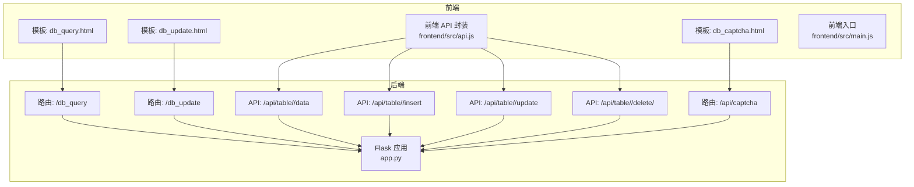
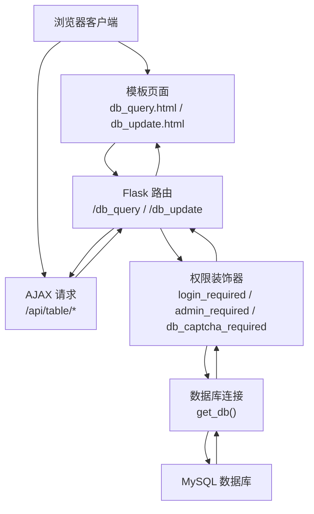
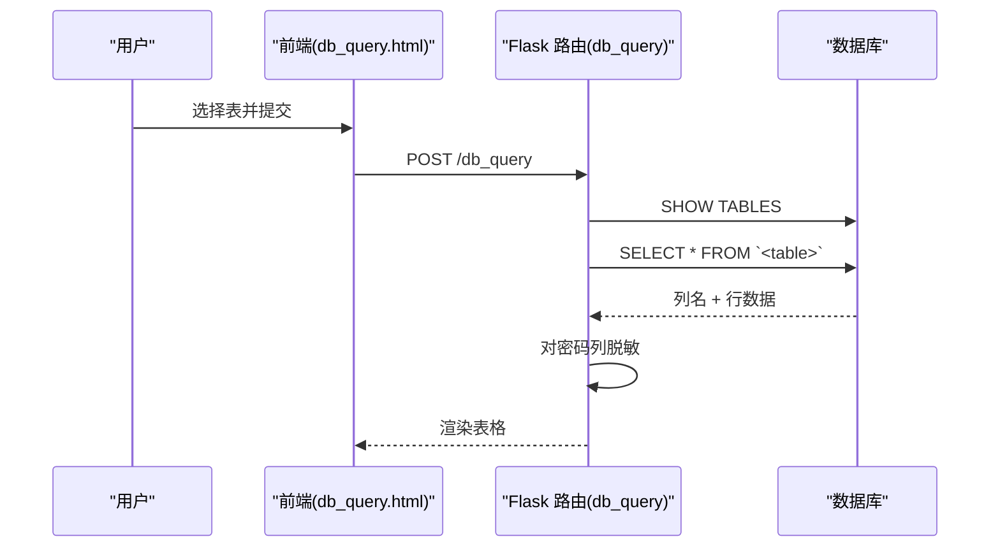
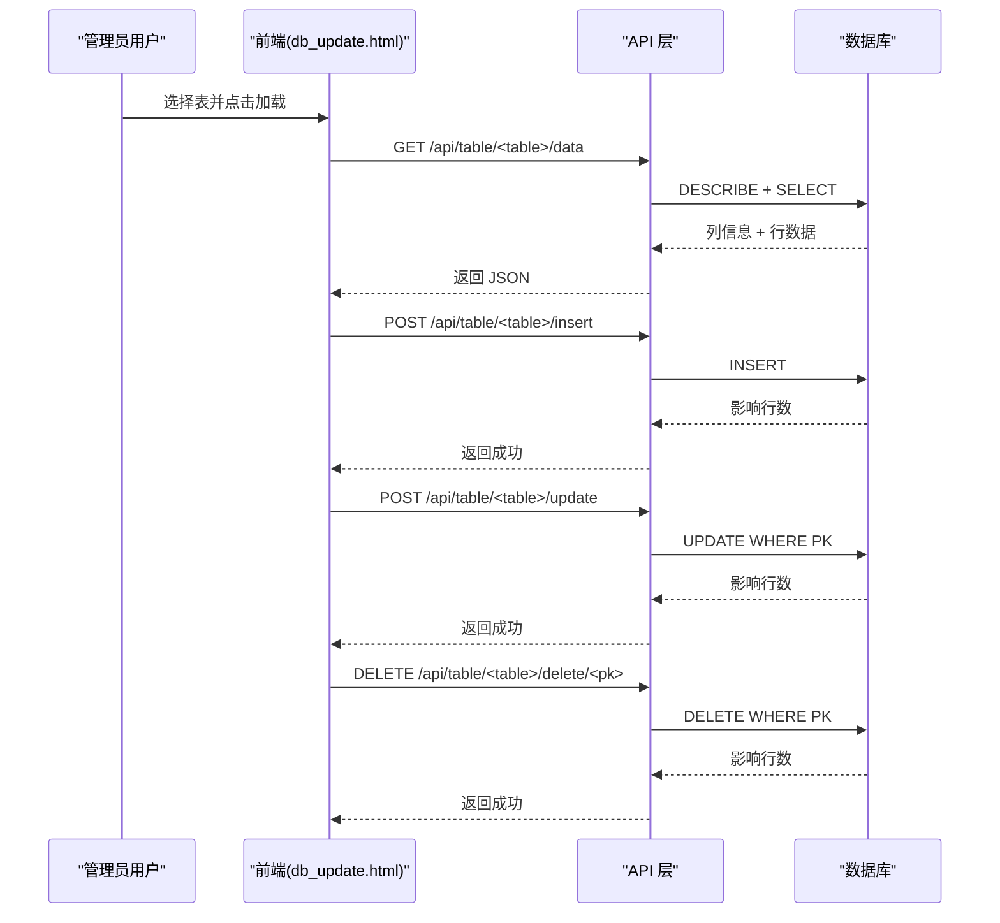
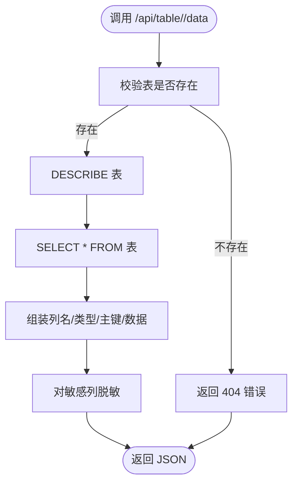
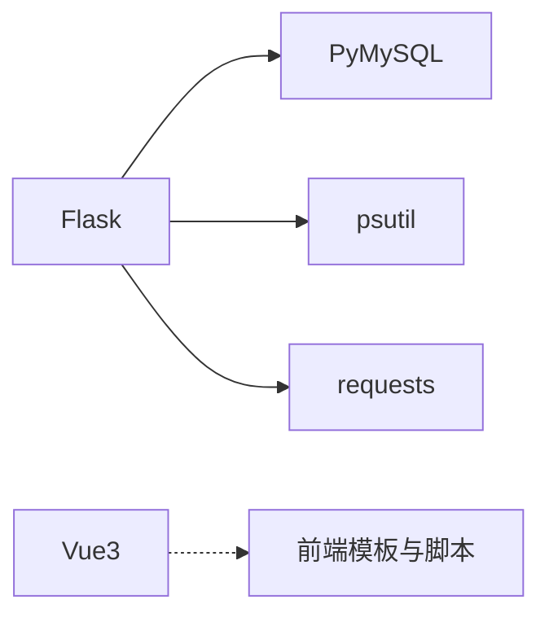

# 数据库管理系统

<cite>
**本文档引用的文件**
- [app.py](file://app.py)
- [db_query.html](file://templates/db_query.html)
- [db_update.html](file://templates/db_update.html)
- [db_captcha.html](file://templates/db_captcha.html)
- [api.js](file://frontend/src/api.js)
- [main.js](file://frontend/src/main.js)
- [requirements.txt](file://requirements.txt)
</cite>

## 目录
1. [简介](#简介)
2. [项目结构](#项目结构)
3. [核心组件](#核心组件)
4. [架构总览](#架构总览)
5. [详细组件分析](#详细组件分析)
6. [依赖分析](#依赖分析)
7. [性能考虑](#性能考虑)
8. [故障排查指南](#故障排查指南)
9. [结论](#结论)
10. [附录](#附录)

## 简介
本项目是一个基于 Flask 的数据库管理系统，提供以下核心能力：
- SQL 查询接口：支持用户选择表并执行查询，返回结构化结果并在前端表格中展示。
- 数据可视化编辑：管理员可通过可视化界面进行增删改查操作，具备主键识别、数据脱敏与日志记录。
- 表结构浏览：通过 API 获取表的列定义、类型与主键信息，辅助理解元数据与索引布局。
- 安全机制：包含登录保护、验证码门禁、速率限制、CSP、会话超时与输入清理等多层防护。
- 管理界面：提供查询历史、执行计划与性能监控入口，便于运维与审计。

## 项目结构
系统采用前后端分离的组织方式：
- 后端：Flask 应用，负责路由、数据库连接、安全策略与 API 实现。
- 前端：模板渲染与少量交互逻辑，主要通过 AJAX 调用后端 API。
- 静态资源：模板文件位于 templates 目录，前端 Vue 应用位于 frontend 目录（用于其他模块，此处聚焦数据库功能）。

**图表来源**
- [app.py:2318-2517](file://app.py#L2318-L2517)
- [db_query.html:1-52](file://templates/db_query.html#L1-L52)
- [db_update.html:1-248](file://templates/db_update.html#L1-L248)
- [db_captcha.html:1-24](file://templates/db_captcha.html#L1-L24)
- [api.js:1-45](file://frontend/src/api.js#L1-L45)
- [main.js:1-6](file://frontend/src/main.js#L1-L6)

**章节来源**
- [app.py:2318-2517](file://app.py#L2318-L2517)
- [requirements.txt:1-5](file://requirements.txt#L1-L5)

## 核心组件
- 数据库连接管理：统一通过 get_db() 获取连接，异常时返回空，避免崩溃传播。
- 查询执行引擎：在路由层直接拼接表名（使用反引号包裹）并执行 SELECT，同时进行密码列脱敏。
- 结果集处理：提取列名与数据，进行脱敏与序列化返回。
- 可视化编辑：提供 /api/table/<table>/data 获取表结构与数据；支持插入、更新、删除，并记录日志。
- 安全机制：登录保护、管理员权限、数据库操作验证码、速率限制、CSP、会话超时与输入清理。

**章节来源**
- [app.py:2318-2517](file://app.py#L2318-L2517)

## 架构总览
系统采用“模板渲染 + RESTful API”的混合架构：
- 模板层：db_query.html 展示查询表单与结果；db_update.html 提供可视化编辑界面。
- API 层：/api/table/* 提供 CRUD 操作，返回 JSON。
- 安全层：装饰器组合实现登录、管理员、验证码与速率限制。
- 数据层：通过 PyMySQL 连接 MySQL，执行 DDL/DML 并返回结果。

**图表来源**
- [app.py:2318-2517](file://app.py#L2318-L2517)
- [db_query.html:1-52](file://templates/db_query.html#L1-L52)
- [db_update.html:1-248](file://templates/db_update.html#L1-L248)

## 详细组件分析

### SQL 查询接口
- 功能概述：用户选择表后执行查询，后端返回列名与数据，前端以表格形式展示。
- 关键流程：
  - GET /db_query：列出所有表，渲染 db_query.html。
  - POST /db_query：接收选中表名，查询数据并脱敏显示。
- 安全要点：
  - 表名使用反引号包裹，配合白名单校验，降低注入风险。
  - 密码列进行脱敏处理，避免敏感信息泄露。
- 性能与可用性：
  - 当前实现为一次性 SELECT *，适合小规模数据浏览；大规模数据建议分页或限制列。

**图表来源**
- [app.py:2318-2367](file://app.py#L2318-L2367)
- [db_query.html:1-52](file://templates/db_query.html#L1-L52)

**章节来源**
- [app.py:2318-2367](file://app.py#L2318-L2367)
- [db_query.html:1-52](file://templates/db_query.html#L1-L52)

### 数据可视化编辑（管理员）
- 功能概述：管理员通过 db_update.html 可视化浏览与编辑任意表的数据。
- 关键流程：
  - GET /db_update：列出所有表，渲染 db_update.html。
  - /api/table/<table>/data：返回列名、类型、主键与数据。
  - /api/table/<table>/insert：插入新行。
  - /api/table/<table>/update：按主键更新字段。
  - /api/table/<table>/delete/<pk>：按主键删除行。
- 权限与安全：
  - 严格要求管理员权限与数据库操作验证码。
  - 所有写操作均记录日志，便于审计。
- 错误处理：
  - 数据库异常统一返回 JSON 错误信息，前端弹窗提示。

**图表来源**
- [app.py:2370-2485](file://app.py#L2370-L2485)
- [db_update.html:1-248](file://templates/db_update.html#L1-L248)

**章节来源**
- [app.py:2370-2485](file://app.py#L2370-L2485)
- [db_update.html:1-248](file://templates/db_update.html#L1-L248)

### 表结构浏览与元数据查询
- 功能概述：通过 /api/table/<table>/data 获取列名、类型与主键，辅助理解表结构与索引布局。
- 实现细节：
  - DESCRIBE 用于获取列定义与键属性（PRI 为主键）。
  - SELECT * 获取数据，结合脱敏策略输出。
- 性能建议：
  - 对大表建议分页查询数据，仅在需要时加载列定义。
  - 主键识别优先查找 PRI，若无则回退到第一列。

**图表来源**
- [app.py:2370-2405](file://app.py#L2370-L2405)

**章节来源**
- [app.py:2370-2405](file://app.py#L2370-L2405)

### 数据编辑功能（增删改查、事务与冲突）
- 增删改查：
  - 插入：/api/table/<table>/insert，参数为键值对，使用占位符执行。
  - 更新：/api/table/<table>/update，需提供主键列名与值及待更新字段。
  - 删除：/api/table/<table>/delete/<pk>，需提供主键列名（查询参数）。
- 事务处理：
  - 当前实现每条语句独立提交，未显式开启事务块；如需强一致，建议在业务层封装事务。
- 冲突解决：
  - 主键冲突：由数据库约束保证唯一性；应用层返回错误并提示用户。
  - 并发更新：建议引入乐观锁（版本号）或悲观锁策略，当前实现未见此类机制。

**章节来源**
- [app.py:2408-2485](file://app.py#L2408-L2485)

### 数据库连接管理与查询执行引擎
- 连接管理：
  - get_db() 统一创建连接，异常捕获并返回 None，避免全局异常。
  - 相关表初始化在首次访问时完成，确保基础表存在。
- 查询执行：
  - 路由层直接拼接 SQL（使用反引号包裹表名），随后执行并提取结果。
  - 结果集处理包含列名提取与数据脱敏。
- 错误处理：
  - 所有数据库异常转换为 JSON 错误响应，前端友好提示。

**章节来源**
- [app.py:680-693](file://app.py#L680-L693)
- [app.py:2318-2367](file://app.py#L2318-L2367)

### 安全机制（输入验证、查询计划分析、执行权限控制）
- 输入验证：
  - 表名校验：先查询 SHOW TABLES，仅在白名单内执行查询。
  - 字段名与值：插入/更新使用占位符绑定，避免直接拼接。
  - 脱敏策略：对密码列进行脱敏处理，减少敏感信息暴露。
- 查询计划分析：
  - 当前未提供 EXPLAIN 或执行计划展示；建议在管理界面增加“执行计划”按钮，调用 EXPLAIN 语句并返回可视化结果。
- 执行权限控制：
  - 登录保护：login_required 装饰器。
  - 管理员权限：admin_required 装饰器。
  - 数据库操作验证码：db_captcha_required 装饰器。
  - 会话超时：IP 级别的空闲超时自动登出。
  - 速率限制：全局请求频率限制与封禁策略。
  - CSP 与安全响应头：严格的 CSP 策略与安全头设置。

**章节来源**
- [app.py:2370-2485](file://app.py#L2370-L2485)
- [app.py:513-593](file://app.py#L513-L593)
- [app.py:641-676](file://app.py#L641-L676)

### 数据库管理界面使用指南
- 查询历史：当前未提供专用查询历史页面；建议在前端维护本地历史列表，并在后端存储最近 N 条查询记录以便审计。
- 执行计划：建议新增“执行计划”按钮，调用 EXPLAIN 并以可视化表格展示。
- 性能监控：建议集成慢查询日志与执行耗时统计，前端展示平均耗时与热点表。
- 使用步骤：
  - 访问 /db_query 选择表并查询。
  - 访问 /db_update 选择表，使用“添加行”、“编辑”、“删除”进行可视化操作。
  - 所有写操作均需管理员权限与数据库操作验证码。

**章节来源**
- [app.py:2318-2517](file://app.py#L2318-L2517)
- [db_query.html:1-52](file://templates/db_query.html#L1-L52)
- [db_update.html:1-248](file://templates/db_update.html#L1-L248)

## 依赖分析
- 后端框架：Flask（Werkzeug、Jinja2）。
- 数据库驱动：PyMySQL。
- 系统监控：psutil。
- 网络请求：requests。
- 前端：Vue3（用于其他模块，数据库功能主要依赖模板与少量脚本）。

**图表来源**
- [requirements.txt:1-5](file://requirements.txt#L1-L5)

**章节来源**
- [requirements.txt:1-5](file://requirements.txt#L1-L5)

## 性能考虑
- 查询性能：
  - 大表查询建议分页与索引优化，避免一次性 SELECT *。
  - 对敏感列脱敏会增加一次遍历成本，建议在必要时才进行。
- 连接管理：
  - 当前每次请求新建连接，建议引入连接池以减少开销。
- 前端渲染：
  - 大数据量表格建议虚拟滚动或分页展示，提升交互体验。
- 安全与性能平衡：
  - 速率限制与验证码会增加额外开销，但能有效抵御暴力破解与爬虫。

## 故障排查指南
- 数据库连接失败：
  - 检查 get_db() 返回值与异常日志；确认 MySQL 服务状态与凭据。
- 权限不足：
  - 确认用户角色为管理员；检查 db_captcha_required 是否通过。
- 速率限制触发：
  - 查看 IP 是否被封禁；调整 rate_config.json 中的阈值与封禁时长。
- 查询报错：
  - 检查表名白名单与 SQL 拼接逻辑；确认列名与数据类型匹配。
- 前端无法加载数据：
  - 检查 /api/table/<table>/data 返回的 JSON；确认网络与跨域配置。

**章节来源**
- [app.py:513-593](file://app.py#L513-L593)
- [app.py:2370-2485](file://app.py#L2370-L2485)

## 结论
本数据库管理系统提供了完整的查询与可视化编辑能力，结合多层安全机制保障运行安全。建议后续增强：
- 引入连接池与执行计划可视化；
- 增加查询历史与性能监控；
- 在写操作层面引入事务与并发控制策略；
- 为大表提供分页与索引优化建议。

## 附录
- 安全最佳实践：启用 HTTPS、定期轮换密钥、最小权限原则、定期审计日志。
- 备份恢复策略：制定定时备份计划，验证恢复流程，确保数据一致性。
- 性能优化技巧：索引优化、查询重写、连接池、缓存热点数据、异步任务处理。