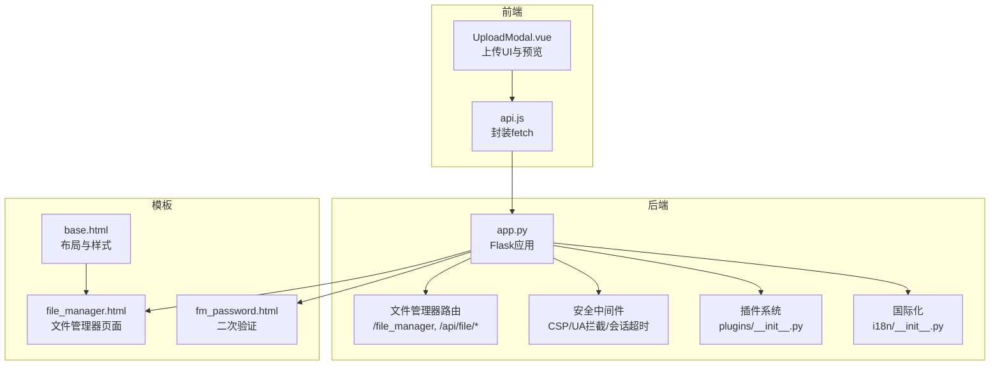
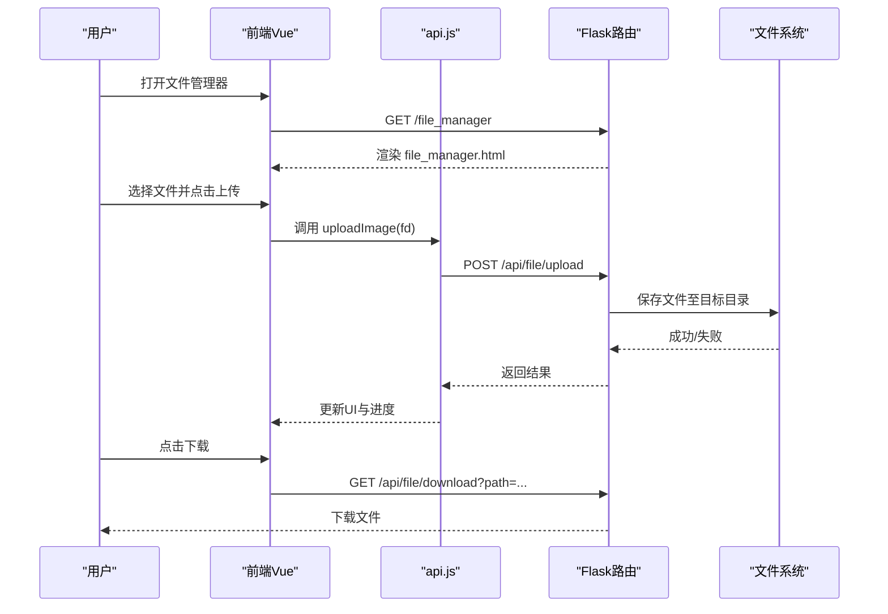
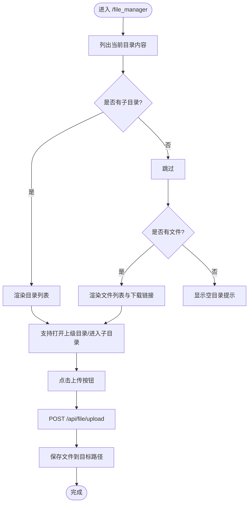
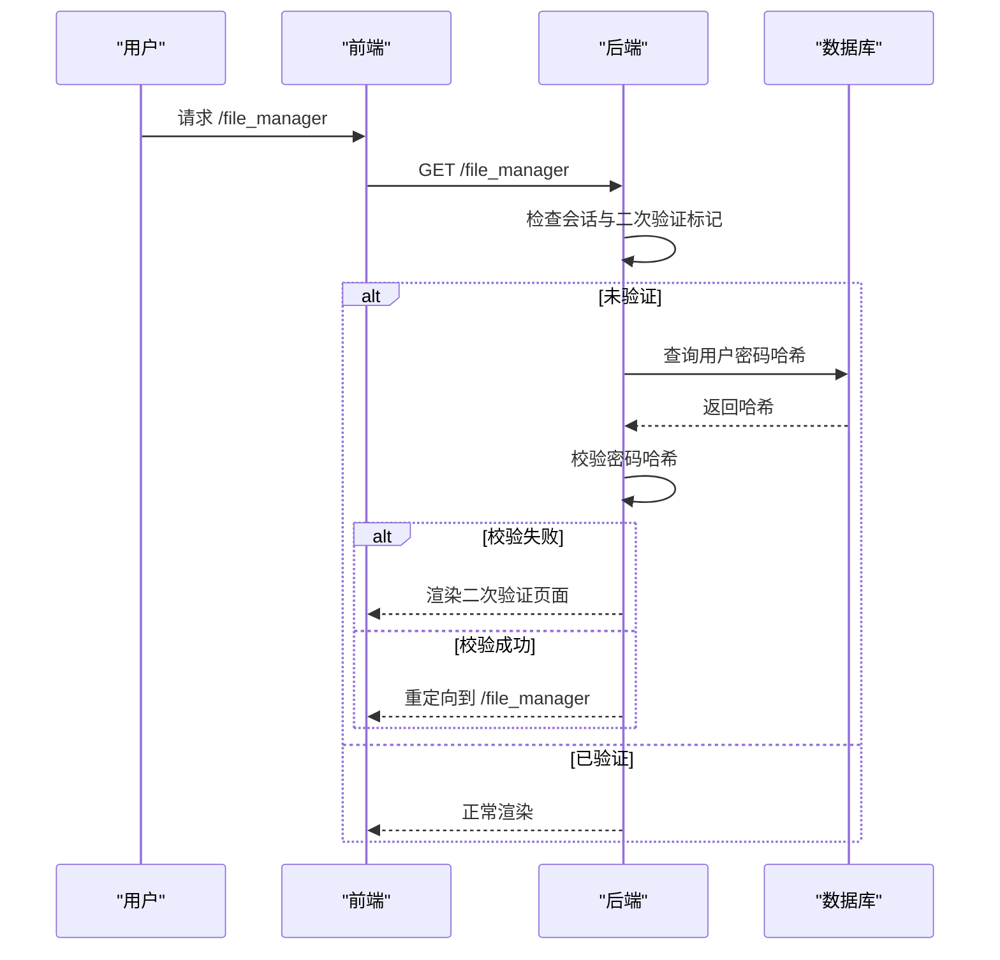
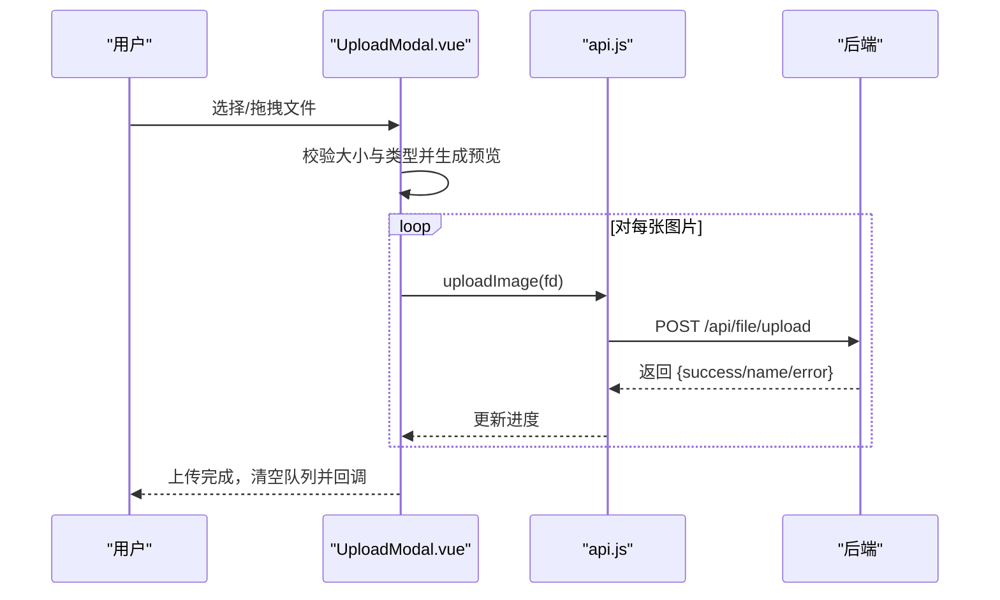
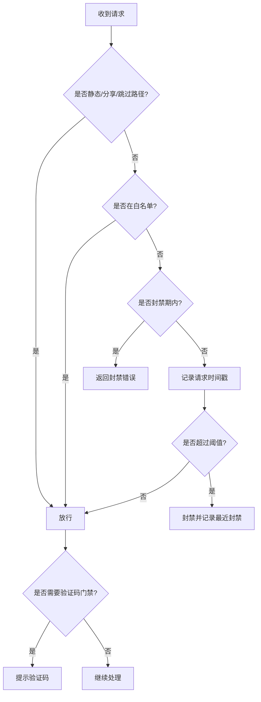
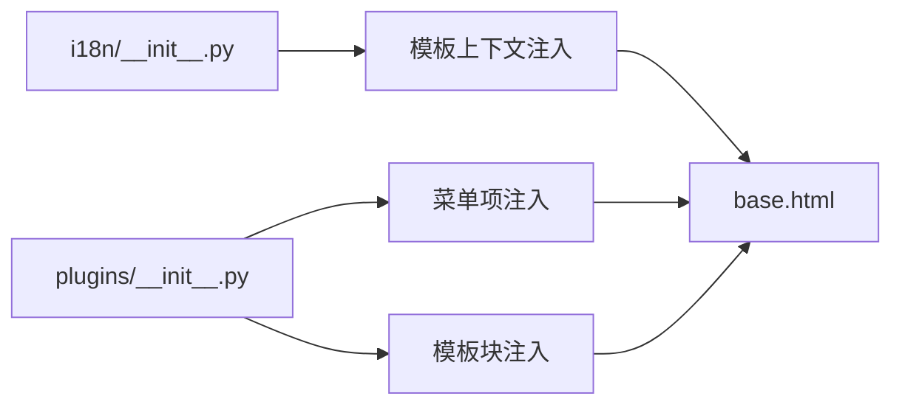
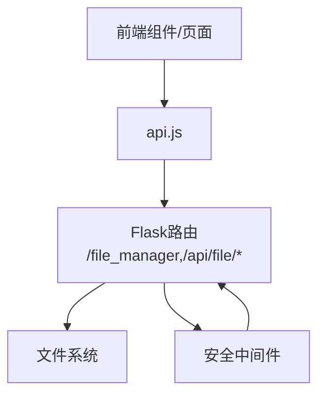

# 文件管理系统

<cite>
**本文引用的文件**
- [app.py](file://app.py)
- [file_manager.html](file://templates/file_manager.html)
- [fm_password.html](file://templates/fm_password.html)
- [UploadModal.vue](file://frontend/src/components/UploadModal.vue)
- [api.js](file://frontend/src/api.js)
- [plugins/__init__.py](file://plugins/__init__.py)
- [i18n/__init__.py](file://i18n/__init__.py)
- [base.html](file://templates/base.html)
- [dashboard.html](file://templates/dashboard.html)
- [rate_limiter.json](file://rate_limiter.json)
- [rate_config.json](file://rate_config.json)
- [ip_whitelist.json](file://ip_whitelist.json)
</cite>

## 目录
1. [简介](#简介)
2. [项目结构](#项目结构)
3. [核心组件](#核心组件)
4. [架构总览](#架构总览)
5. [详细组件分析](#详细组件分析)
6. [依赖分析](#依赖分析)
7. [性能考虑](#性能考虑)
8. [故障排查指南](#故障排查指南)
9. [结论](#结论)
10. [附录](#附录)

## 简介
本文件管理系统围绕“文件管理器”功能展开，提供目录浏览、文件上传下载、基础删除能力与二次验证入口，并结合前端 Vue 组件与后端 Flask 路由形成完整的前后端交互闭环。系统同时内置安全机制（速率限制、白名单、CSP、会话超时等）、国际化与插件扩展能力，便于后续按需增强如复制/移动/重命名、权限控制、搜索与批量操作、压缩解压等功能。

## 项目结构
- 后端核心：Flask 应用位于根目录，集中于 app.py，负责路由、安全策略、数据库与文件系统交互。
- 前端：Vue3 单页应用位于 frontend/src，通过 api.js 封装与后端 /api/* 接口通信。
- 模板：Jinja2 模板位于 templates/，包含文件管理器页面与基础布局等。
- 配置与持久化：速率限制与白名单等配置以 JSON 文件形式存储，便于运行时读取与热更新。
- 扩展：插件系统位于 plugins/，支持菜单项与模板块注入，便于功能扩展。

**图表来源**
- [app.py](file://app.py)
- [file_manager.html](file://templates/file_manager.html)
- [fm_password.html](file://templates/fm_password.html)
- [UploadModal.vue](file://frontend/src/components/UploadModal.vue)
- [api.js](file://frontend/src/api.js)
- [plugins/__init__.py](file://plugins/__init__.py)
- [i18n/__init__.py](file://i18n/__init__.py)
- [base.html](file://templates/base.html)

**章节来源**
- [app.py](file://app.py)
- [file_manager.html](file://templates/file_manager.html)
- [fm_password.html](file://templates/fm_password.html)
- [UploadModal.vue](file://frontend/src/components/UploadModal.vue)
- [api.js](file://frontend/src/api.js)
- [plugins/__init__.py](file://plugins/__init__.py)
- [i18n/__init__.py](file://i18n/__init__.py)
- [base.html](file://templates/base.html)

## 核心组件
- 文件管理器页面与路由
  - 后端路由：/file_manager 提供目录浏览与导航；/api/file/upload、/api/file/download、/api/file/delete 提供上传、下载与删除接口。
  - 前端页面：file_manager.html 展示当前目录下的子目录与文件列表，支持打开上级目录与下载。
- 二次验证
  - 访问文件管理器前需进行二次密码验证，防止未授权访问。
- 前端上传组件
  - UploadModal.vue 支持多图选择、拖拽、预览、批量命名与逐张上传。
- 安全与配置
  - 速率限制（内存+持久化）、白名单、CSP、UA拦截、会话超时、全局验证码门禁等。
- 国际化与插件
  - i18n 模块提供多语言支持；plugins 提供菜单与模板块注入能力。

**章节来源**
- [app.py](file://app.py)
- [file_manager.html](file://templates/file_manager.html)
- [fm_password.html](file://templates/fm_password.html)
- [UploadModal.vue](file://frontend/src/components/UploadModal.vue)
- [api.js](file://frontend/src/api.js)
- [i18n/__init__.py](file://i18n/__init__.py)
- [plugins/__init__.py](file://plugins/__init__.py)

## 架构总览
系统采用“前端 Vue + 后端 Flask”的分层架构：
- 前端负责用户交互与状态管理，通过 api.js 统一调用后端 /api/* 接口。
- 后端负责业务逻辑、安全策略与文件系统操作，模板渲染与静态资源服务由 Flask 提供。
- 安全策略贯穿请求生命周期，包括速率限制、CSP、UA过滤、会话超时与二次验证。

**图表来源**
- [app.py](file://app.py)
- [file_manager.html](file://templates/file_manager.html)
- [UploadModal.vue](file://frontend/src/components/UploadModal.vue)
- [api.js](file://frontend/src/api.js)

## 详细组件分析

### 文件管理器页面与路由
- 目录浏览
  - 后端路由 /file_manager 支持 POST 上级目录与 GET 当前目录浏览；使用安全路径解析函数限制在用户主目录范围内。
  - 模板 file_manager.html 展示目录与文件列表，文件项包含名称与大小，支持直接下载。
- 上传接口
  - /api/file/upload 接收 multipart/form-data，限制文件大小与文件名合法性，保存到目标路径并记录日志。
- 下载接口
  - /api/file/download 仅允许已登录用户，执行路径穿越校验后返回文件。
- 删除接口
  - /api/file/delete 仅管理员可用，执行路径校验后删除文件并记录日志。

**图表来源**
- [app.py](file://app.py)
- [file_manager.html](file://templates/file_manager.html)

**章节来源**
- [app.py](file://app.py)
- [file_manager.html](file://templates/file_manager.html)

### 二次验证与访问控制
- 文件管理器二次验证
  - 通过装饰器对 /file_manager 与相关路由进行二次密码校验，使用用户密码哈希比对成功后写入会话标记。
- 权限控制现状
  - 删除接口标注为“仅管理员”，但当前未在路由层强制校验；建议补充 admin_required 装饰器以统一权限策略。
- 会话与超时
  - 会话空闲超时检测，长时间无操作将强制登出，提升安全性。

**图表来源**
- [app.py](file://app.py)
- [fm_password.html](file://templates/fm_password.html)

**章节来源**
- [app.py](file://app.py)
- [fm_password.html](file://templates/fm_password.html)

### 前端上传组件与进度
- 多图选择与拖拽
  - 支持多文件选择与拖拽，限制每张图片不超过 5MB，类型限定为 jpeg/png/gif/webp。
- 预览与命名
  - 使用 FileReader 生成预览缩略图；支持统一命名，批量命名时自动追加序号。
- 逐张上传与进度
  - 逐张构造 FormData 并调用 /api/file/upload，维护上传进度与已上传数量，完成后触发父组件回调。

**图表来源**
- [UploadModal.vue](file://frontend/src/components/UploadModal.vue)
- [api.js](file://frontend/src/api.js)
- [app.py](file://app.py)

**章节来源**
- [UploadModal.vue](file://frontend/src/components/UploadModal.vue)
- [api.js](file://frontend/src/api.js)
- [app.py](file://app.py)

### 安全机制与配置
- 速率限制
  - 内存队列记录请求时间戳，超限时封禁；支持持久化到 JSON 文件，重启不丢失。
- 白名单
  - IP 白名单持久化，支持动态增删。
- CSP 与响应头
  - 自动注入 CSP nonce，设置严格安全响应头，隐藏服务器版本信息。
- UA 拦截
  - 拦截常见安全扫描工具的 User-Agent。
- 全局验证码门禁
  - 已登录用户在非跳过路径进行敏感操作时需二次验证码验证。
- 会话超时
  - IP 级空闲超时，超时强制登出。

**图表来源**
- [app.py](file://app.py)
- [rate_limiter.json](file://rate_limiter.json)
- [rate_config.json](file://rate_config.json)
- [ip_whitelist.json](file://ip_whitelist.json)

**章节来源**
- [app.py](file://app.py)
- [rate_limiter.json](file://rate_limiter.json)
- [rate_config.json](file://rate_config.json)
- [ip_whitelist.json](file://ip_whitelist.json)

### 国际化与插件扩展
- 国际化
  - i18n 模块提供多语言加载与语言检测，支持 zh-CN/en/ja/ko，模板中通过注入的上下文使用翻译函数。
- 插件系统
  - plugins 支持动态发现、加载与卸载插件，注册菜单项与模板块，具备权限过滤与排序能力，便于扩展新功能。

**图表来源**
- [i18n/__init__.py](file://i18n/__init__.py)
- [plugins/__init__.py](file://plugins/__init__.py)
- [base.html](file://templates/base.html)

**章节来源**
- [i18n/__init__.py](file://i18n/__init__.py)
- [plugins/__init__.py](file://plugins/__init__.py)
- [base.html](file://templates/base.html)

## 依赖分析
- 前端到后端
  - UploadModal.vue 通过 api.js 调用 /api/file/upload；file_manager.html 通过链接触发 /api/file/download。
- 后端到文件系统
  - 文件管理器路由与上传接口直接操作本地文件系统，受安全路径解析与大小限制约束。
- 安全中间件
  - 速率限制、UA 拦截、CSP、会话超时等在请求进入业务路由前统一执行。

**图表来源**
- [app.py](file://app.py)
- [file_manager.html](file://templates/file_manager.html)
- [UploadModal.vue](file://frontend/src/components/UploadModal.vue)
- [api.js](file://frontend/src/api.js)

**章节来源**
- [app.py](file://app.py)
- [file_manager.html](file://templates/file_manager.html)
- [UploadModal.vue](file://frontend/src/components/UploadModal.vue)
- [api.js](file://frontend/src/api.js)

## 性能考虑
- 上传性能
  - 建议引入断点续传与分片上传，避免大文件一次性传输导致的网络波动风险。
  - 前端可增加上传进度条与暂停/恢复能力，提升用户体验。
- 下载性能
  - 对大文件建议使用流式下载与 Range 支持，减少内存占用。
- 速率限制
  - 结合内存队列与持久化配置，合理设置窗口与阈值，避免误伤正常用户。
- 模板与静态资源
  - 使用 CDN 与缓存策略，减少静态资源请求压力。

## 故障排查指南
- 无法访问文件管理器
  - 检查二次验证是否通过；确认会话有效与未被空闲超时踢出。
- 上传失败
  - 检查文件大小与类型限制；确认目标目录可写；查看后端日志与返回错误。
- 下载失败
  - 确认路径参数正确且未越权访问；检查路径穿越校验与文件是否存在。
- 速率受限
  - 查看速率限制配置与封禁状态；必要时加入白名单或调整阈值。
- 会话超时
  - 确认 IP 未超过空闲超时；重新登录后刷新页面。

**章节来源**
- [app.py](file://app.py)
- [file_manager.html](file://templates/file_manager.html)
- [UploadModal.vue](file://frontend/src/components/UploadModal.vue)

## 结论
本文件管理系统以简洁的前后端分离架构实现了目录浏览、上传下载与基础删除能力，并内置完善的前端安全策略与国际化、插件扩展能力。建议后续增强权限控制（如统一管理员装饰器）、文件操作接口（复制/移动/重命名/搜索/批量/压缩解压）与上传体验（断点续传/进度/完整性校验），以满足更复杂的业务场景。

## 附录
- 快速入口
  - 文件管理器页面：/file_manager
  - 上传接口：/api/file/upload
  - 下载接口：/api/file/download
  - 删除接口：/api/file/delete
- 安全配置文件
  - 速率限制持久化：rate_limiter.json
  - 速率配置：rate_config.json
  - IP 白名单：ip_whitelist.json
- 前端组件
  - UploadModal.vue：上传弹窗与预览
  - api.js：统一 API 封装

**章节来源**
- [app.py](file://app.py)
- [file_manager.html](file://templates/file_manager.html)
- [UploadModal.vue](file://frontend/src/components/UploadModal.vue)
- [api.js](file://frontend/src/api.js)
- [rate_limiter.json](file://rate_limiter.json)
- [rate_config.json](file://rate_config.json)
- [ip_whitelist.json](file://ip_whitelist.json)